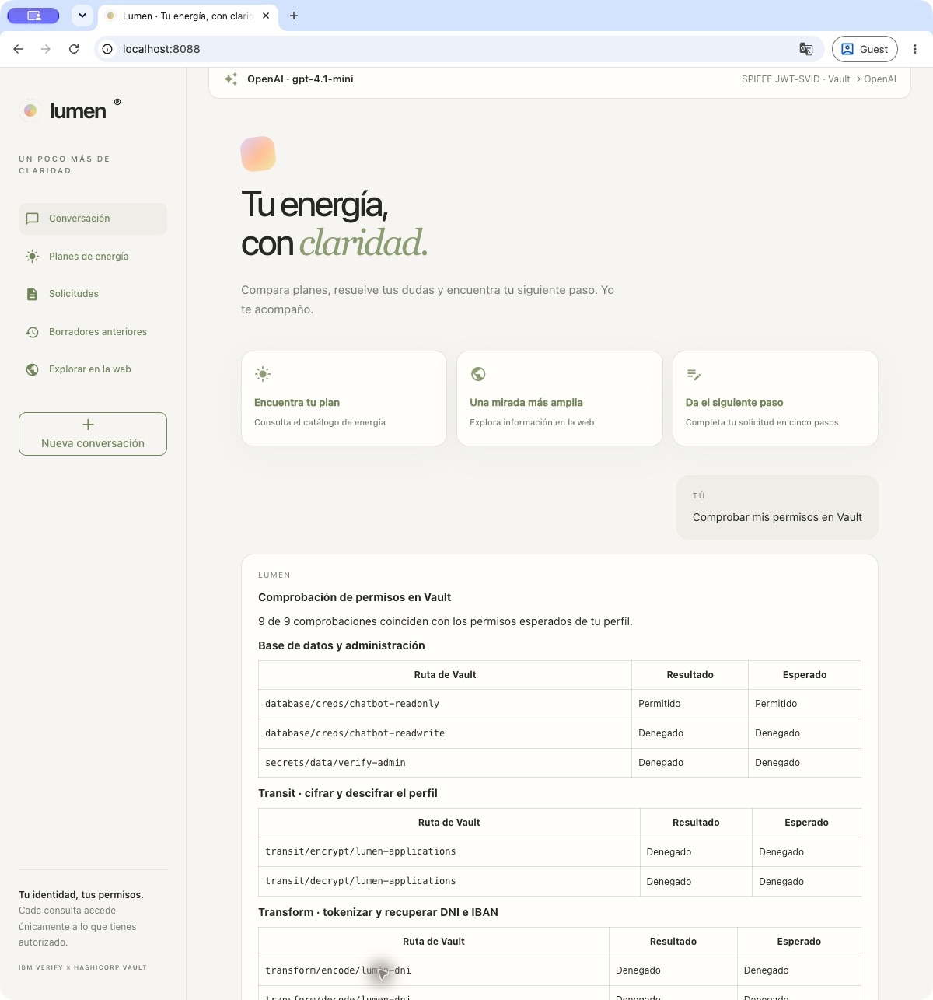

# Lumen · Vault Agentic IAM

La ampliación [Espacios personales](docs/manual/16-espacios-personales.md) añade **Mi espacio de secretos** a la interfaz: KV por identidad humana, lectura/escritura según el techo del agente y pruebas reales de acceso cruzado con trazas.

Demo con **NiceGUI, LangChain Deep Agents y selección xAI/OpenAI/Claude**, login OIDC en IBM Verify, **OBO**, MySQL Enterprise con **KMIP**, protección **Transit/Transform** y trazas en **Grafana, Loki y Tempo**. xAI utiliza un Secret Engine dinámico; OpenAI y Claude utilizan **SPIFFE JWT-SVID emitidos por Vault** y tokens de corta duración. [Configuración manual de Claude](docs/manual/08-claude-spiffe.md).

Lumen admite **español e inglés**: toma el idioma inicial del navegador y ofrece **EN / ES** arriba a la derecha. La elección se recuerda y se aplica a la interfaz, los formularios, las trazas y las siguientes respuestas del asistente. [Funcionamiento y mantenimiento](chatbot/README.md#idioma-español-e-inglés) · [Comprobación paso a paso](docs/manual/10-aplicacion.md#idioma-y-comprobaciones-bilingües).

## Prerrequisitos

Para una instalación desde cero, prepara las herramientas, cuentas y credenciales de esta sección. El lanzador crea Minikube, Vault, MySQL y los recursos de Lumen en Verify; las cuentas de los proveedores y sus credenciales administrativas se obtienen antes del primer arranque.

### Herramientas y recursos locales

- **macOS**: los procesos locales se mantienen con `launchd`.
- Bash, curl, jq, OpenSSL, Vault CLI, kubectl, **Helm 4**, Minikube, uv, rsync, lsof y ripgrep (`rg`; `brew install ripgrep` — no el binario embebido de Cursor), además de `plutil` y `launchctl`, incluidos en macOS.
- **Podman o Docker instalado y arrancado**. La plantilla usa Podman; para Docker, cambia tanto `CONTAINER_ENGINE` como `MINIKUBE_DRIVER` a `docker` en `.env`.
- Recursos disponibles para Minikube: la configuración predeterminada asigna **4 CPU y 8 GiB de memoria**. La VM del motor de contenedores debe disponer de esa capacidad.
- Conectividad con los proveedores y los registros de imágenes. Vault utiliza [`josemerchan/vault-xai:2.1.2-ent`](https://hub.docker.com/r/josemerchan/vault-xai), que incluye el plugin xAI para AMD64 y ARM64; Kubernetes descarga la imagen al desplegarlo.

También están publicadas las [imágenes 2.2.0 y 2.2.0-ent](docs/VAULT_IMAGES.md) para ambas arquitecturas. Su publicación no migra el clúster existente.

La ampliación [Agentes por tarea](docs/manual/14-agentes-por-tarea.md) permite activar desde la interfaz Consulta, Creación de solicitudes o Revelado de datos, cada uno con su identidad y techo OBO. El modo inicial conserva el comportamiento anterior. Cambiar de agente inicia una sesión nueva mediante Verify. La comprobación de límites y cada paso de la traza identifican al agente de Vault y enlazan su registro, entidad, alias y políticas.

El panel incluye una matriz interactiva **usuario × agente**: resalta la sesión activa y permite comparar los permisos esperados y qué identidad limita cada operación. La vista previa no cambia la sesión; Vault sigue comprobando el usuario, el techo del agente y el RAR en cada llamada.

El [Laboratorio RAR](docs/manual/15-parametros-rar.md), accesible desde la barra lateral y el panel de agentes, añade seis escenarios con `allowed_parameters`, `denied_parameters` y `required_parameters`. Compara peticiones reales con y sin esas restricciones y enlaza cada resultado con su llamada a Vault, RAR y cuerpo enviado. Es opcional y conserva la autorización habitual del chat.

### Cuentas, licencias y credenciales externas

- **IBM Verify:** un tenant activo y un cliente API de aprovisionamiento con seis autorizaciones administrativas. Pasos de consola (Security → API access), tabla de permisos y valores de `.env` en [00 · Entorno](docs/manual/00-entorno.md#cliente-api-administrativo-en-ibm-verify). El lanzador o el capítulo 03 crearán las aplicaciones OIDC/STS, usuarios y grupos de Lumen; los agentes no reciben esos permisos administrativos.
- **Proveedores de modelo:** prepara los tres: xAI con Management API key, OpenAI con Admin API key y WIF, y Claude con una organización con acceso API y permiso para crear WIF. Claude no usa API key estática: crea el emisor, regla y cuenta siguiendo [08](docs/manual/08-claude-spiffe.md), e inicia el perfil OAuth `lumen-admin` de la CLI `ant` para que el instalador sincronice las claves. El issuer usa el dominio ngrok configurado y Claude almacena las claves públicas de Vault en línea.
- **Tavily:** una cuenta y una API key para las búsquedas.
- **Oracle Container Registry:** una cuenta con acceso habilitado a la imagen de MySQL Enterprise. Completa previamente los requisitos de acceso del proveedor; el lanzador no crea cuentas ni acepta contratos.
- **Vault Enterprise:** una licencia válida con **Agentic IAM, KMIP y Transform**.
- Elige las contraseñas iniciales de **MySQL** y de los tres usuarios de prueba de Lumen. Se introducirán en `.env`; las cuentas se crearán durante el despliegue.

## Preparar `.env`

Desde la raíz del workspace, crea el archivo de configuración a partir de la plantilla. La copia conserva un `.env` existente:

```bash
cp -n .env.example .env
chmod 600 .env
```

Abre `.env` en tu editor, sustituye `VERIFY_TENANT` por la URL de tu organización y completa las credenciales comunes y las del proveedor elegido. `XAI_TEAM_ID` es opcional; los parámetros de despliegue tienen valores predeterminados en la plantilla.

| Variables | Procedencia / finalidad |
|---|---|
| `VERIFY_TENANT` | URL del tenant IBM Verify |
| `VERIFY_ADMIN_CLIENT_ID`, `VERIFY_ADMIN_CLIENT_SECRET` | Cliente API de aprovisionamiento |
| `XAI_MANAGEMENT_API_KEY`, `XAI_TEAM_ID` opcional | Management API de xAI; nunca una clave de inferencia |
| `OPENAI_ADMIN_API_KEY` | Aprovisionamiento OpenAI; nunca se usa para inferencia |
| `OPENAI_PROJECT_ID`, `OPENAI_SERVICE_ACCOUNT_ID`, `OPENAI_IDENTITY_PROVIDER_ID` | Proyecto, cuenta y proveedor WIF; ver preparación OpenAI |
| `ANTHROPIC_FEDERATION_ISSUER_ID`, `ANTHROPIC_FEDERATION_RULE_ID`, `ANTHROPIC_ORGANIZATION_ID`, `ANTHROPIC_SERVICE_ACCOUNT_ID`, `ANTHROPIC_WORKSPACE_ID` | IDs no secretos de la federación Claude |
| `LUMEN_MODEL_PROVIDER`, `LUMEN_OPENAI_MODEL`, `LUMEN_XAI_MODEL`, `LUMEN_ANTHROPIC_MODEL` | Proveedor inicial (`auto`, `openai`, `xai` o `anthropic`) y modelos; los tres quedan disponibles en la interfaz |
| `NGROK_DOMAIN`, `NGROK_AUTHTOKEN` opcional | Discovery/JWKS públicos de SPIFFE; token opcional si ngrok ya está autenticado |
| `TAVILY_API_KEY` | API de búsqueda |
| `ORACLE_REG_EMAIL`, `ORACLE_REG_PASSWORD` | Descarga de MySQL Enterprise |
| `VAULT_LICENSE` | Licencia Enterprise con Agentic IAM, KMIP y Transform |
| `MYSQL_ROOT_PASSWORD` | Contraseña inicial; debe coincidir al adoptar MySQL existente |
| `LUMEN_READER_PASSWORD`, `LUMEN_WRITER_PASSWORD`, `LUMEN_SUPERVISOR_PASSWORD` | Usuarios de demo; se importan al crear su secreto en Vault |

`.env` usa sintaxis Bash, permisos `600` y está excluido en `.gitignore`. Contiene las entradas externas y las contraseñas iniciales de la demo. **`VAULT_TOKEN`, `VAULT_ADDR` y `VAULT_CACERT` los genera el despliegue; no se rellenan en `.env`.** Las claves xAI se generan dinámicamente; los tokens OpenAI y Claude se obtienen mediante SPIFFE y no se guardan aquí. Los secretos OAuth y Grafana se generan y guardan en Vault. El proceso Python elimina de su entorno las credenciales administrativas importadas.

Comprueba la preparación antes de desplegar:

```bash
./demo.sh check
```

Este comando comprueba las herramientas, las variables obligatorias, el motor de contenedores y el discovery de Verify. La validez y los permisos de las demás credenciales se comprueban al usarlas durante `start`.

## Configuración manual paso a paso

Ejecuta `bash scripts/manual/paso-a-paso.sh` para recorrer la instalación **un paso cada vez**, ver el código y reanudar tras un error. Para continuar desde Verify: `bash scripts/manual/paso-a-paso.sh desde verify-base`. [Uso y alcance del script](docs/manual/PASO-A-PASO.md).

Para ver y reproducir cada operación sin ejecutar notebooks ni el lanzador, consulta el [manual de configuración](docs/manual/README.md). Incluye entorno, Vault, MySQL/KMIP, Verify/OIDC, Agent Registry/OBO/RAR, Transit/Transform, xAI, OpenAI/SPIFFE, Claude/SPIFFE, observabilidad y bloqueos. Las operaciones de Vault están expresadas con **Vault CLI**; las APIs externas, con **curl**.

## Arranque en un paso

Una vez completados los prerrequisitos y `.env`, desde esta carpeta:

```bash
./demo.sh start
```

El arranque prepara **OpenAI, xAI y Claude a la vez**. El banner permite cambiar de proveedor sin reiniciar, conservando la conversación. La elección es por sesión y se aplica a la siguiente consulta; durante una respuesta el selector queda bloqueado. `LUMEN_MODEL_PROVIDER` y `--provider` solo indican la selección inicial (`auto` usa OpenAI).

Modelos básicos preconfigurados: OpenAI `gpt-4.1-nano`, xAI `grok-4.3` y Claude `claude-haiku-5-5`; se pueden ajustar con las variables `LUMEN_*_MODEL`. Las identidades y credenciales temporales de Vault siguen separadas por proveedor.

Para actualizar el **catálogo de proveedores** de una instalación que ya tiene las tres identidades, ejecuta `bash chatbot/scripts/configure-models.sh` y reinicia Lumen. El catálogo se publica en `secrets/chatbot/model` de Vault y la aplicación carga las tres integraciones al arrancar.

Para incorporar **solo los cambios de interfaz, EN/ES y visor**, basta actualizar el código y reiniciar Lumen; no hay nuevas variables de `.env`, permisos o recursos de Verify/Vault. Si lo arrancaste con el lanzador y la infraestructura sigue activa, ejecuta `bash scripts/demo/start.sh` desde la raíz: copia `chatbot/app/` y `chatbot/static/` al runtime gestionado, renueva los forwards de observabilidad y reinicia la aplicación. En ejecución manual, sigue [10 · Actualizar una instalación existente](docs/manual/10-aplicacion.md#actualizar-una-instalación-existente). El reinicio termina las sesiones y descarta los borradores y capturas que solo estaban en memoria; cambiar EN/ES durante una sesión conserva la conversación y el formulario.

`start` sincroniza las claves públicas actuales de Vault con el emisor Claude existente y vuelve a leerlo para comprobar el resultado. Después comprueba la federación y una inferencia breve antes de dar la demo por lista. Usa la API oficial; conserva la URL, la protección JTI, la regla, la cuenta y los permisos.

Para habilitar esa sincronización, realiza una vez el inicio de sesión administrativo de la [CLI oficial de Claude](https://platform.claude.com/docs/en/manage-claude/wif-admin-api). El alcance `org:admin` da permisos de organización; queda en un perfil local exclusivo para el instalador, fuera de Vault y del proceso Lumen:

```bash
brew install anthropics/tap/ant
ant auth login --profile lumen-admin --scope org:admin
```

La CLI renueva ese token cuando el instalador lo necesita. `LUMEN_CLAUDE_ADMIN_PROFILE` permite indicar otro perfil. Si falta la sesión, los prerrequisitos detienen el arranque con el comando de acceso. No se usa una Admin API key, pues estos endpoints de Claude no la aceptan.

```bash
./demo.sh start
```

Cada arranque vuelve a comprobar las claves, también después de recrear Vault. Para sincronizarlas sin reinstalar: `bash scripts/demo/claude-issuer.sh`. El informe queda en `~/.local/state/lumen-vault-demo/claude/issuer-sync.json` y el array público en `claude/issuer-keys.json`. Con el modo de claves en línea, una rotación que ocurra mientras la demo permanece encendida requiere volver a sincronizar; este script no instala un servicio periódico.

El comando despliega e inicializa Vault antes de configurar las integraciones. **No requiere un cluster de Vault previo, un root token en `.env` ni ejecutar notebooks.**

`./demo.sh` sin argumentos y `./demo.sh up` son alias de `start`.

- **Lumen:** http://localhost:8088
- **Vault:** https://127.0.0.1:8443/ui/
- **Grafana:** http://localhost:3000/d/lumen-iam

Usar exactamente `localhost` para Lumen: el callback OIDC es `http://localhost:8088/auth/callback`. En Verify, elegir **Cloud Directory**.

La [reinstalación manual por script del 16/10](docs/runs/20261016T064722Z-manual-script/README.md) completó la retirada, la instalación y 102 comprobaciones correctas, sin navegador ni notebooks. Incluye los tres perfiles, OBO/RAR, protección de datos, OpenAI/SPIFFE, xAI dinámico y correlación de trazas con audit. Para repetirla: `bash scripts/manual/rehearse.sh rebuild` ([alcance y prerrequisitos](docs/manual/13-repeticion-script.md)). El [ciclo automatizado anterior](docs/E2E_OPENAI_VERIFICATION.md) queda como referencia histórica.

Las comprobaciones posteriores de la interfaz y los idiomas están en [VALIDACION](docs/manual/VALIDACION.md). El [informe bilingüe del 20/10/2026](chatbot/docs/language-verification.json) registra 194 pruebas Python y 4 JavaScript, detección del navegador, conservación de conversación/formulario y respuestas reales de los tres proveedores; no es una nueva reinstalación completa.

Captura histórica del 15/10. Las [capturas de EN/ES](chatbot/docs/screenshots/lumen-en.png) y [móvil](chatbot/docs/screenshots/lumen-en-mobile.png) corresponden a la comprobación del 20/10.



| Usuario | Grupo | Puede | No puede |
|---|---|---|---|
| `lumen-reader` | `chatbot-readers` | Consultar catálogo y solicitudes enmascaradas | Guardar solicitudes o revelar datos |
| `lumen-writer` | `chatbot-writers` | Consultar y guardar solicitudes protegidas | Revelar DNI, IBAN o perfil |
| `lumen-supervisor` | `chatbot-supervisors` | Consultar y revelar mediante Vault | Obtener SQL RW o guardar solicitudes |

**Comprobar límites en Vault** verifica nueve rutas mediante OBO: SQL RO/RW, el secreto administrativo, cifrado/descifrado Transit y tokenización/recuperación Transform de DNI e IBAN. Muestra el resultado real y el esperado para el perfil. [Detalle y capturas](docs/PERMISSION_PROBES.md).

Contraseñas en Vault, namespace `verify`, rutas `secrets/chatbot/users/{reader,writer,supervisor}`. Grafana usa `lumen-admin`, con contraseña en `secrets/chatbot/observability`.

## Acceso a Vault y Grafana

Los accesos se generan durante `./demo.sh start`. Los comandos siguientes utilizan el directorio de estado predeterminado; si configuraste `LUMEN_STATE_DIR`, sustituye `~/.local/state/lumen-vault-demo` por esa ruta.

### Vault

1. Abre https://127.0.0.1:8443/ui/.
2. Selecciona el método **Token** y deja el namespace vacío.
3. Copia el root token del laboratorio al portapapeles:

```bash
jq -jr '.root_token' \
  ~/.local/state/lumen-vault-demo/vault/cluster-keys.json | pbcopy
```

Pégalo para iniciar sesión. Dentro de Vault, selecciona el namespace **`verify`** para ver las integraciones.

### Grafana

Abre http://localhost:3000 e inicia sesión con el usuario **`lumen-admin`**. Recupera su contraseña desde Vault y cópiala al portapapeles:

```bash
(
  source ~/.local/state/lumen-vault-demo/vault/config.env
  export VAULT_ADDR VAULT_TOKEN VAULT_CACERT

  vault kv get \
    -namespace=verify \
    -mount=secrets \
    -field=password \
    chatbot/observability | pbcopy
)
```

Pega la contraseña y abre el [dashboard de Lumen](http://localhost:3000/d/lumen-iam). Los comandos copian las credenciales sin mostrarlas en la terminal; ejecuta cada uno cuando vayas a pegar su valor.

## Qué configura el comando

1. Comprueba herramientas, `.env`, motor de contenedores y discovery de Verify.
2. Arranca/crea Minikube **workshop**, despliega/adopta Vault Enterprise con TLS y tres nodos Raft; inicializa solo un cluster vacío y desbloquea los nodos.
3. Despliega/adopta MySQL Enterprise con `keyring_okv` y KMIP; conserva datos y certificados existentes.
4. Prepara el namespace Vault **verify**, KV v2 y las entradas estáticas.
5. Configura RAR, perfil OAuth, aplicaciones OIDC/STS, usuarios, grupos, entidades, políticas y agentes registrados.
6. Crea roles MySQL RO/RW, catálogo, inventario de ejemplo, Transit, tokenización y tabla de solicitudes.
7. Configura los tres proveedores: xAI dinámico con TTL 5 min / máximo 10 min, OpenAI con JWT-SVID de Vault y discovery/JWKS por ngrok, y Claude con su identidad SPIFFE y federación propias. Conserva los recursos externos OpenAI de la preparación inicial.
8. Activa auditoría, aplica Grafana/Loki/Tempo/Alloy, abre puertos locales e inicia Lumen.
9. Comprueba la federación SPIFFE y una inferencia real de Claude, y ejecuta pruebas de aplicación, permisos SQL, límites del agente y búsqueda real Tavily. Un fallo devuelve código distinto de cero e identifica la etapa fallida.

Se puede repetir: reutiliza recursos por nombre, no elimina perfiles/PVC, no reinicializa Vault ni regenera secretos de clientes existentes. Actualiza configuración gestionada y reinicia Lumen para cargarla; las sesiones del chatbot se pierden en ese reinicio. Reconcilia el catálogo de tres planes y conserva las solicitudes.

Contexto fijo: `workshop`; namespaces Kubernetes: `vault`, `mysql`, `lumen-observability`; namespace Vault: `verify`. Estos nombres están fijados en los manifiestos. Una instalación nueva prescinde de injector/CSI porque Lumen no los utiliza.

### Inicialización de Vault y credenciales generadas

El orden del bootstrap es:

1. Leer las entradas externas de `.env`, sin necesitar un token de Vault.
2. Desplegar Vault y, solo si no está inicializado, ejecutar `vault operator init`.
3. Guardar el root token y las claves de desellado en `~/.local/state/lumen-vault-demo/vault/cluster-keys.json`, con permisos `600`.
4. Desellar Vault y generar `vault/config.env` dentro de ese directorio de estado, con la conexión TLS y el token para aprovisionamiento.
5. Configurar las integraciones usando ese archivo. La aplicación recibe después un token de bootstrap limitado, no el root token.

## Operación

### Bloquear accesos en directo

```bash
./demo.sh block xai
./demo.sh block database-read
./demo.sh block database-write
./demo.sh block decrypt
./demo.sh blocks
./demo.sh unblock xai   # También admite database-read, database-write y decrypt
```

Son políticas `deny` reales en Vault, aplicadas a nuevas peticiones con JWT anteriores o nuevos. No necesitas reiniciar Lumen. Los bloqueos SQL/xAI revocan también sus leases. `database-read` bloquea RO y RW porque ambos permiten leer; `database-write` permite continuar consultando con RO. `decrypt` bloquea Transit decrypt y Transform decode. `start` conserva los bloqueos existentes. Consulta el [recorrido, RAR de xAI y funcionamiento de las políticas](docs/ACCESS_BLOCKS.md).

### Servicios y ciclo de vida

```bash
./demo.sh check    # Preflight; no despliega servicios
./demo.sh status   # Pods, despliegues y endpoints locales
./demo.sh verify   # Tests e inferencia del proveedor seleccionado (auto por defecto)
./demo.sh stop     # Solo procesos locales registrados por el lanzador
./demo.sh remove --dry-run  # Inventario real; no detiene ni borra recursos
./demo.sh remove            # Elimina la demo y sus datos, también en Verify
./demo.sh start             # Reconstruye la demo a partir de .env
```

### Volver a empezar desde cero

```bash
./demo.sh remove --dry-run  # Revisar primero el alcance y los IDs
./demo.sh remove && ./demo.sh start
```

**`remove` elimina datos de forma irreversible**: los namespaces Kubernetes `vault`, `mysql` y `lumen-observability`, todo su contenido y sus PVC. Esto incluye todos los secretos y namespaces internos de ese Vault —también los ejercicios históricos guardados allí—, las solicitudes MySQL y los logs/trazas de Loki/Tempo. Desinstala la release Helm `vault`, incluyendo sus recursos de ámbito cluster. El perfil Minikube `workshop` y otros namespaces permanecen disponibles.

En Verify elimina exclusivamente estos nombres, resolviendo y comprobando sus IDs por API:

| Tipo | Recursos eliminados |
|---|---|
| Aplicaciones | `vault-chatbot-oidc`, `vault-chatbot-research`, `vault-chatbot-xai`, `vault-chatbot-openai`, `vault-chatbot-anthropic` |
| Cliente STS | `vault-chatbot-sts` |
| Usuarios ficticios | `lumen-reader`, `lumen-writer`, `lumen-supervisor` |
| Grupos | `chatbot-readers`, `chatbot-writers`, `chatbot-supervisors` |

Conserva `.env`, el cliente API administrativo, el esquema compartido `vault:path_access`, `vault-authn-entry`, `vault-obo-sts` y las demás cuentas/aplicaciones de Verify. No cambia Okta. Las bajas de usuarios/grupos usan `notifyType=NONE`, sin correos de notificación. Comprueba que son las cuentas ficticias de Cloud Directory y que los grupos no contienen miembros ajenos a la demo; ante duplicados o inventarios incompletos se detiene.

Primero detiene Lumen y revoca de forma síncrona los leases de `verify/xai/creds/lumen/`. Después elimina los recursos Verify, detiene los túneles gestionados, retira MySQL/observabilidad y finalmente Vault. Si Verify, la revocación o la retirada de volúmenes falla, devuelve error y conserva las claves de recuperación. No usa `revoke-force` ni elimina finalizers para ocultar fallos. Si existen PV con política `Retain`, exige resolverlos antes de retirar datos.

Tras comprobar la eliminación remota, borra del directorio de estado `vault/`, `mysql/`, `runtime/`, `vault-chatbot-storage/`, `services/` y `pids/`. Retira las copias compatibles de claves/conexión de `/tmp/vault` solo si coinciden con este despliegue, y el archivo local `/tmp/lumen-telemetry/spans.jsonl`. Conserva las fuentes, capturas, informes históricos, logs del lanzador y cachés de imágenes/dependencias. Por tanto, «clean» significa recursos operativos nuevos; los informes anteriores siguen siendo evidencia histórica.

`remove` requiere acceso al perfil `workshop`; si está parado, arrancarlo con `minikube start -p workshop`. Si Vault existe y ya está inicializado, debe estar desellado y disponer de su bootstrap privado para revocar las claves externas. La autenticación administrativa de Verify procede directamente de `.env`, por lo que no depende de los secretos que se van a borrar. `remove` se puede repetir tras una ejecución parcial o cuando ya se han retirado los recursos.

El inventario se guarda en `~/.local/state/lumen-vault-demo/remove-plan.json`; una retirada completada genera `last-remove.json`. `start` y `remove` comparten el bloqueo del lanzador para no ejecutarse simultáneamente. El siguiente `start` crea una nueva CA, claves de desellado/root token, datos y clientes OAuth; las contraseñas iniciales externas se conservan en `.env`.

Validación automatizada anterior del **15 de octubre**: retirada real de 11 recursos Lumen de Verify y 10 volúmenes, comprobación del estado vacío y reconstrucción desde `.env`, con nuevas claves SPIFFE. Pasaron 114 pruebas de aplicación y dos subcasos, 18 comprobaciones de infraestructura, 20 checks OBO, los recorridos de los tres perfiles y la inferencia con OpenAI y xAI. Se correlacionaron 16 trazas de interfaz con 55 operaciones de Vault. El [informe de ese ciclo](docs/E2E_OPENAI_VERIFICATION.md) incluye incidencias, correcciones, capturas y alcance de los recursos externos conservados; el [ciclo del 14 de octubre](docs/E2E_VERIFICATION.md) queda como histórico.

Referencias de las operaciones utilizadas: [baja de aplicaciones](https://docs.verify.ibm.com/verify/reference/deleteapplication), [cliente STS](https://docs.verify.ibm.com/verify/v2.0/reference/deletestsclient), [usuarios](https://docs.verify.ibm.com/verify/reference/deleteuser_0), [grupos](https://docs.verify.ibm.com/verify/reference/deletegroup) y [revocación síncrona de leases](https://developer.hashicorp.com/vault/api-docs/system/leases).

`verify` presupone servicios levantados. Las pruebas hacen una búsqueda Tavily e inferencia real con el proveedor seleccionado: OpenAI valida SPIFFE/token exchange; xAI valida emisión, denegaciones y caducidad. Tras un arranque con `--provider`, usa el mismo valor en `verify`. El login humano, consentimiento OIDC y MFA, si la política lo exige, se realizan en el navegador; no se sustituyen por ROPC ni tokens simulados.

Estado, logs privados y último informe: **`~/.local/state/lumen-vault-demo/`**, configurable con `LUMEN_STATE_DIR`. El bootstrap de Vault se conserva allí y se mantiene una copia compatible en `/tmp/vault/config.env`. Las claves son necesarias para desbloquear el cluster. Un directorio con claves de otro cluster provoca una parada explícita, sin sobrescribirlas.

Lumen y los port-forward se ejecutan como servicios de usuario de `launchd`, con definiciones privadas dentro del directorio de estado. Siguen activos cuando termina el comando; `launchd` recupera los port-forward si terminan tras reiniciarse un pod; no se instalan para arrancar automáticamente al iniciar sesión. `start` reemplaza los túneles que coinciden con el contexto, namespace, destino y puertos de la demo para evitar conexiones a pods eliminados. Una ocupación incompatible de puerto produce error. Solo se reinicia una instancia `python -m app.main` cuyo directorio corresponda a este workspace o a su runtime gestionado. El código se copia a `runtime/chatbot` fuera de Google Drive para que `launchd` pueda ejecutarlo sin ampliar permisos de macOS.

Se conserva el modo raw solicitado para el laboratorio: JWT y respuestas de Vault en rutas concretas, además de mensajes/herramientas. `LUMEN_VAULT_AUDIT_MODE` y `LUMEN_TRACE_VAULT_RAW` se controlan en `.env`. [Detalle y límites](chatbot/OBSERVABILITY.md).

### Adoptar un laboratorio existente (opcional)

Esta sección solo aplica si ya tienes recursos desplegados. El flujo de instalación desde cero utiliza las credenciales externas introducidas directamente en `.env`.

Si Vault ya está inicializado, se necesitan sus claves guardadas: el lanzador reutiliza el estado privado o migra `/tmp/vault/cluster-keys.json` del laboratorio anterior. No puede regenerar las claves de un cluster existente ni volver a inicializarlo para recuperarlas.

`bash scripts/import-env.sh` es una **migración opcional desde un laboratorio ya operativo**: recoge las entradas de Vault, `oracle.env` y `vault.hclic` sin mostrarlas. No se ejecuta al arrancar desde cero ni importa el root token; en una instalación nueva las credenciales externas se rellenan directamente en `.env`. No sobrescribe un `.env` que ya tenga la integración.

### Reloj de la VM

Después de suspender macOS, comprueba que la VM de Podman conserva la hora correcta. `start` detecta desviaciones de más de 60 segundos antes de emitir certificados o inicializar Vault; un desfase también puede invalidar JWT. Si utilizas Podman y su VM está atrasada respecto al host, consulta su nombre con `podman machine list`. Por ejemplo, para `podman-machine-default`:

```bash
podman machine ssh podman-machine-default sudo -n date -u -s "@$(date -u +%s)" </dev/null
./demo.sh start
```

El comando sincroniza el reloj de la VM con el del host. No desactiva la validación TLS ni reinicializa Vault. Durante una demostración larga puede usarse `caffeinate -i -m` en otra terminal para evitar la suspensión automática.

El perfil OAuth de Vault y el cliente aplican **15 segundos de tolerancia** al validar fechas de JWT. Evita rechazar tokens recién emitidos por pequeñas diferencias entre Verify y la VM; no corrige un reloj atrasado varios minutos. [Parámetro oficial `clock_skew_leeway`](https://developer.hashicorp.com/vault/api-docs/system/config-oauth-resource-server).

## Documentación y alcance

- [Aplicación, flujos y capturas](chatbot/README.md).
- [Recorrido por usuario y observabilidad](chatbot/OBSERVABILITY.md).
- [Revisión y validación del workspace](docs/WORKSPACE_REVIEW.md).
- [Instalación manual y validación más reciente](docs/manual/VALIDACION.md).
- [Validación Claude con Vault SPIFFE JWT-SVID](docs/runs/20261016-claude-spiffe/README.md).
- [Reconstrucción automatizada con OpenAI, 15 de octubre (histórico)](docs/E2E_OPENAI_VERIFICATION.md). [Histórico xAI, 14 de octubre](docs/E2E_VERIFICATION.md).
- Notebooks de consulta: [1 Vault](1_Deploy_Vault_minikube.ipynb), [2 MySQL/KMIP](2_vault-demo-kmip-mysql.ipynb), [3 roles SQL](3_Database_Secret_Engine.ipynb), [4 xAI](4_XAI_Secret_Engine.ipynb), [6 Lumen](6_Lumen_Chatbot_Vault_IAM.ipynb), [7 observabilidad](7_Lumen_Observability.ipynb), [8 solicitudes](8_Lumen_Protected_Applications.ipynb), [9 OpenAI/SPIFFE](9_OpenAI_Vault_SPIFFE.ipynb), [10 tokens con oauth2c](10_OAuth2c_Verify_Vault.ipynb).
- [Ejemplos oauth2c sobre Lumen instalado](10_OAuth2c_Verify_Vault.ipynb): Client Credentials, login PKCE, intercambio OBO con RAR y uso del JWT delegado con Vault. Incluye callback temporal 9876 y su retirada, inspección de tokens y ejemplo condicional de refresh. [Alcance de las pruebas locales](verify/docs/oauth2c-notebook-validation.json).
- [Verify base, bootstrap UI y creación de usuarios](verify/README.md) conserva el ejercicio histórico `verify-agent`. Lumen configura su propio OIDC/STS y no requiere el login guardado de aquel ejercicio.
- [Okta](okta/README.md) permanece aparcado y fuera del comando. Las conexiones/static roles de pagos del namespace raíz tampoco son dependencias de Lumen.

Las capturas e informes anteriores describen ejecuciones con fecha; no certifican el estado actual. Tempo/Loki retienen siete días. El último despliegue se acredita con `last-run.json` y las nuevas pruebas, no con IDs históricos.

El chat mantiene su [ámbito de energía mediante un control previo al agente](docs/ENERGY_SCOPE_AND_SVID.md). La misma guía muestra dónde inspeccionar el JWT-SVID completo y sus claims en las trazas de Lumen/Grafana.

**Consola de peticiones:** en cada paso de una traza nueva, **Abrir consola de peticiones** muestra la petición real editable (URL, método, cabeceras/token y cuerpo). Incluye mensajes, instrucciones y herramientas del LLM, los intercambios Verify/Vault y un editor SQL para MySQL. **Enviar petición real** ejecuta la llamada; también puedes copiar cURL o exportar a Postman. Los tokens no se renuevan y las capturas en memoria caducan a los diez minutos. [Uso, efectos y límites](chatbot/OBSERVABILITY.md#consola-para-repetir-una-llamada-real).
