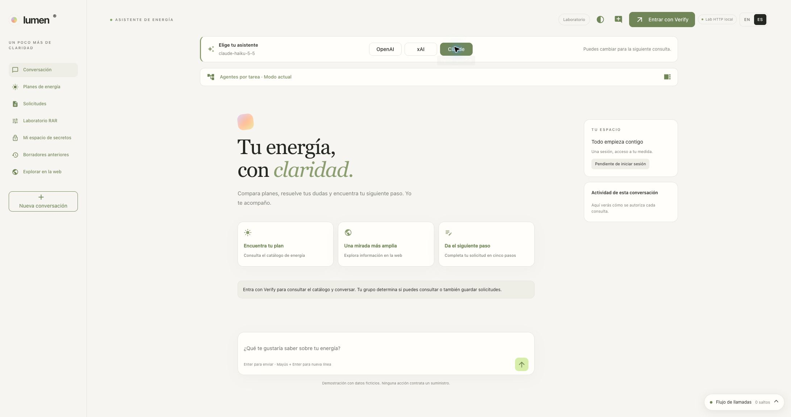

# Lumen · Vault Agentic IAM

Lumen es una demo de autorización para agentes de IA. Utiliza un asistente de
energía como ejemplo: el usuario consulta tarifas, guarda solicitudes con datos
protegidos y puede pedir la aprobación de un contrato ficticio.

**IBM Verify autentica al usuario y Vault decide qué operaciones puede realizar
el agente en su nombre.** La demo permite observar esas decisiones en las llamadas
reales a Vault, MySQL y los proveedores de modelos. Todos los datos y contratos del
recorrido son de prueba; ninguna acción contrata un suministro.

[Instalar](#instalación) · [Probar la demo](#probar-la-demo) ·
[Verificar](#verificación) · [Operar o retirar](#operación) ·
[Manual paso a paso](docs/manual/README.md)



## Qué demuestra

| Recorrido | Qué se comprueba |
|---|---|
| Consultar, guardar o revelar una solicitud | Vault combina permisos del usuario, límites del agente y restricciones RAR de la petición. Las credenciales MySQL son temporales. |
| Proteger datos personales | Transit cifra los datos y Transform tokeniza DNI e IBAN. Los perfiles autorizados pueden recuperarlos. |
| Cambiar de modelo | OpenAI y Claude usan identidades SPIFFE emitidas por Vault; xAI obtiene claves dinámicas. Se cambia de proveedor sin perder la conversación. |
| Contratar con aprobación | Un Validador confirma en Verify mediante CIBA. Después se registra el contrato en MySQL y su propietario puede descargar el PDF. |
| Inspeccionar una operación | La traza de Lumen y Grafana/Tempo/Loki muestran los intercambios y los resultados de autorización. |

La aplicación está escrita con NiceGUI y LangChain Deep Agents. MySQL Enterprise
utiliza KMIP para sus claves de cifrado. La búsqueda web usa Tavily. La interfaz
admite español e inglés.

## Prerrequisitos

El lanzador de este repositorio está preparado para **macOS** y utiliza `launchd`.
Necesitas Podman o Docker arrancado, con capacidad para una VM de Minikube de
**4 CPU y 8 GiB de memoria**. El contexto Kubernetes de la demo es `workshop`.

Instala Bash, Python 3, curl, jq, OpenSSL, Vault CLI, kubectl, **Helm 4**, Minikube,
uv, ngrok, rsync, lsof y ripgrep. `plutil` y `launchctl` vienen con macOS. Node.js
solo es necesario para ejecutar las pruebas JavaScript locales. La CLI `ant` se
utiliza si eliges sincronizar Claude mediante su API administrativa.

| Servicio externo | Qué debes tener preparado |
|---|---|
| IBM Verify | Tenant y cliente API administrativo con los permisos de [00 · Entorno](docs/manual/00-entorno.md#cliente-api-administrativo-en-ibm-verify). |
| Vault Enterprise | Licencia con Agentic IAM, KMIP y Transform. |
| Oracle Container Registry | Cuenta con acceso habilitado a la imagen de MySQL Enterprise. |
| OpenAI | Organización con acceso API, cuota y clave administrativa para preparar proyecto, cuenta de servicio y federación. |
| xAI | Management API key con acceso al equipo de la demo. |
| Claude | Organización con acceso API, cuota y permiso para preparar la federación de una cuenta de servicio. |
| Tavily | API key para la búsqueda web. |
| ngrok | Cuenta y dominio propio para publicar discovery y claves públicas de SPIFFE. |

**El arranque completo configura los tres proveedores.** Elegir uno con
`--provider` cambia la selección inicial, pero no elimina los requisitos de los
otros dos. El lanzador crea la infraestructura local y los recursos de Lumen en
Verify; las cuentas externas y sus permisos se preparan previamente.

## Instalación

Ejecuta los comandos desde la raíz del repositorio. Si prefieres avanzar una
operación cada vez, usa el [instalador guiado](docs/manual/PASO-A-PASO.md). Para
hacer cada operación con comandos individuales, sigue el [manual](docs/manual/README.md).

### Preparar `.env`

Crea la configuración sin sobrescribir una existente:

```bash
cp -n .env.example .env
```

```bash
chmod 600 .env
```

Abre `.env` en tu editor y completa las entradas de [`.env.example`](.env.example):

- Tenant y credenciales administrativas de Verify.
- Credenciales de xAI, OpenAI, Tavily y Oracle, y licencia de Vault.
- Contraseñas iniciales de MySQL y de `lumen-reader`, `lumen-writer` y `lumen-supervisor`.
- Tu `NGROK_DOMAIN`; añade `NGROK_AUTHTOKEN` si ngrok no está autenticado localmente.
- Motor de contenedores. Para Docker, cambia **ambas** variables
  `CONTAINER_ENGINE` y `MINIKUBE_DRIVER` a `docker`.

Los IDs de federación OpenAI/Claude se completan en el siguiente paso. `.env` usa
sintaxis Bash y está excluido de Git. No añadas `VAULT_TOKEN`, `VAULT_ADDR` ni
`VAULT_CACERT`: el instalador genera el bootstrap de Vault y lo guarda en el
directorio privado de estado.

### Preparar OpenAI y Claude por primera vez

Si ya tienes las federaciones de esta demo y sus IDs en `.env`, conserva esos
recursos y pasa a la comprobación de prerrequisitos.

**1. Prepara el emisor de Vault y los recursos OpenAI:**

```bash
./demo.sh prepare-openai
```

Este comando **ya despliega e inicializa Vault** si hace falta. Publica únicamente
discovery/JWKS mediante ngrok y crea o reutiliza el proyecto y la cuenta de servicio
OpenAI. Después completa el [proveedor WIF y su mapping](docs/OPENAI_SPIFFE.md#preparación-inicial-de-openai)
en la consola OpenAI y guarda `OPENAI_IDENTITY_PROVIDER_ID` en `.env`.

**2. Registra la federación Claude.** Reutiliza las claves públicas del emisor que
acabas de preparar. Con el directorio de estado predeterminado, cópialas así:

```bash
(
  source "${LUMEN_STATE_DIR:-$HOME/.local/state/lumen-vault-demo}/vault/config.env"
  export VAULT_ADDR VAULT_TOKEN VAULT_CACERT
  vault read -namespace=verify -format=json spiffe/.well-known/keys |
    jq -c '.data.keys' | pbcopy
)
```

Sigue la [configuración del emisor y la regla en Claude](docs/manual/08-claude-spiffe.md#3-registrar-la-federación-usando-el-portal-claude).
La URL del emisor es `https://<tu-NGROK_DOMAIN>/v1/verify/spiffe`; la regla utiliza
el sujeto y la audiencia indicados en esa guía. Guarda los cinco IDs
`ANTHROPIC_*` de la plantilla en `.env`. El arranque creará el rol Vault de Claude.

**3. Elige cómo mantener actualizadas las claves públicas de Claude:**

| `LUMEN_CLAUDE_SYNC_MODE` | Preparación y comportamiento |
|---|---|
| `api` — valor de la plantilla | Instala `ant` e inicia el perfil administrativo indicado en la [guía Claude](docs/manual/08-claude-spiffe.md). El instalador actualiza y comprueba las claves del emisor existente. |
| `console` | Actualiza las claves en línea desde la consola Claude. El instalador exporta `claude/issuer-keys.json` dentro del directorio de estado, pero no las guarda en Claude. |

Con `console`, después de recrear Vault debes guardar las nuevas claves en el
emisor. Si `start` se detiene en la comprobación Claude, actualízalas y repite el
comando. Ambos modos requieren que pasen la federación y la inferencia reales.
[Sincronización y rotación](docs/OPERACION.md#sincronizar-las-claves-de-claude).

### Comprobar e instalar

Con las entradas y federaciones preparadas:

```bash
./demo.sh check
```

Comprueba herramientas, variables, motor de contenedores y discovery de Verify.
En modo Claude `api`, también comprueba el acceso administrativo al emisor y su
regla. No despliega servicios ni acredita por sí solo todas las integraciones.

```bash
./demo.sh start
```

El comando prepara Vault, MySQL, identidades y políticas, los tres proveedores,
auditoría, observabilidad y la aplicación. Ejecuta pruebas de aplicación e
infraestructura y una inferencia federada con Claude. Si falla, muestra la etapa
y el log privado correspondiente.

Se puede repetir: reutiliza recursos existentes y actualiza su configuración.
Conserva solicitudes guardadas, pero reinicia Lumen y termina sus sesiones.
[Detalle del arranque](docs/OPERACION.md#qué-configura-el-arranque).

## Probar la demo

Abre **[http://localhost:8088](http://localhost:8088)**, pulsa **Entrar con Verify**
y elige **Cloud Directory**. Usa `localhost`, porque el callback OIDC está
configurado con ese nombre. Las contraseñas iniciales son las que elegiste en `.env`.

| Usuario | Recorrido principal |
|---|---|
| `lumen-reader` | Consultar el catálogo y ver solicitudes enmascaradas. |
| `lumen-writer` | Consultar y guardar solicitudes con datos protegidos. |
| `lumen-supervisor` | Consultar y revelar datos mediante Vault; no guardar solicitudes. |

1. Entra como Reader, pide las tarifas y pulsa **Comprobar límites en Vault**.
2. Entra como Writer y crea una solicitud usando **Usar datos de prueba**.
3. Entra como Supervisor, abre la solicitud y revela sus datos.
4. Abre la traza de cada operación para ver la identidad, las llamadas y los
   permisos aplicados. [Recorrido y observabilidad](chatbot/OBSERVABILITY.md).

El selector OpenAI/xAI/Claude cambia el modelo para la siguiente consulta y
conserva la conversación. **EN / ES** cambia el idioma. Estos controles no cambian
los permisos del usuario.

Los recorridos adicionales tienen su propia guía:

- [Agentes por tarea](docs/manual/14-agentes-por-tarea.md): comparar distintos límites con el mismo usuario.
- [Parámetros RAR](docs/manual/15-parametros-rar.md): restringir parámetros de una petición.
- [Espacios personales](docs/manual/16-espacios-personales.md): verificar aislamiento KV entre usuarios.
- [Contratación CIBA](docs/manual/17-contratacion-ciba.md): preparar un Validador, aprobar una solicitud y descargar el PDF. **Una instalación nueva deja esta función deshabilitada hasta completar su prueba real y habilitarla.**

### Acceso a Vault y Grafana

- [Vault](https://127.0.0.1:8443/ui/): las integraciones están en el namespace `verify`.
- [Grafana](http://localhost:3000/d/lumen-iam): panel de trazas y auditoría.

Las instrucciones para recuperar sus credenciales están en
[Acceso a Vault y Grafana](docs/OPERACION.md#acceso-a-vault-y-grafana).

## Verificación

Para comprobar pods, despliegues y endpoints locales:

```bash
./demo.sh status
```

Para ejecutar pruebas de aplicación e infraestructura y comprobar la federación
e inferencia del proveedor elegido:

```bash
./demo.sh verify --provider openai
```

También puedes usar `--provider xai` o `--provider anthropic`. Estas verificaciones
requieren los servicios activos y consumen uso real de los proveedores. El login
humano, las matrices de autorización, CIBA y la revisión visual tienen pruebas
adicionales descritas en sus capítulos; `verify` no equivale a ejecutar todas ellas.

Los informes del lanzador están en `~/.local/state/lumen-vault-demo/reports/` y el
último resultado en `last-run.json`. La [ejecución del 22/10/2026](docs/runs/20261022T122934Z-full-e2e/README.md)
documenta la reinstalación, los resultados y el paso de descarga de navegador que
quedó sin confirmar. El [historial de validación](docs/manual/VALIDACION.md) conserva
las demás ejecuciones con su fecha y alcance.

## Operación

| Comando | Efecto |
|---|---|
| `./demo.sh start` | Preparar o reconciliar la demo y arrancar los procesos locales. |
| `./demo.sh stop` | Detener los procesos locales gestionados; conserva el clúster y sus datos. |
| `bash scripts/demo/start.sh` | Publicar el código de la aplicación y reiniciarla con la infraestructura ya activa. |
| `./demo.sh blocks` | Consultar los bloqueos de acceso. |
| `./demo.sh block database-write` | Bloquear nuevas escrituras y revocar los leases SQL afectados. |
| `./demo.sh unblock database-write` | Retirar ese bloqueo. |

Los objetivos de bloqueo son `xai`, `database-read`, `database-write` y `decrypt`.
[Funcionamiento y alcance](docs/ACCESS_BLOCKS.md). Para logs, claves, rotación,
actualización y problemas de reloj, consulta la [guía de operación](docs/OPERACION.md).

### Volver a empezar desde cero

Primero revisa el inventario:

```bash
./demo.sh remove --dry-run
```

Para ejecutar la retirada:

```bash
./demo.sh remove
```

**Elimina irreversiblemente los datos de Vault, MySQL y observabilidad**, sus
namespaces Kubernetes y volúmenes, y los recursos de Lumen inventariados en Verify.
Conserva el código, `.env`, Minikube, las federaciones externas OpenAI/Claude y la
cuenta real del Validador. Lee el [alcance completo](docs/OPERACION.md#retirar-y-reconstruir)
antes de ejecutarlo. Después, `./demo.sh start` crea de nuevo la demo; si usas
Claude en modo `console`, tendrás que actualizar sus claves públicas.

## Revisión y pruebas locales

Estas comprobaciones usan servicios simulados y no necesitan desplegar la demo.
Si falta el entorno Python, créalo con `bash chatbot/scripts/install.sh`.

```bash
/tmp/vault-chatbot-venv/bin/python -m pytest -q
```

```bash
node --test chatbot/tests/*.test.mjs
```

```bash
python3 scripts/manual/validate.py
```

La última valida sintaxis, enlaces y anclas locales, Markdown de notebooks y
procedencia de las capturas de las guías.
Los notebooks de referencia deben conservarse sin salidas ni contadores de ejecución.

## Documentación del repositorio

| Documento | Para qué sirve |
|---|---|
| [Manual de configuración](docs/manual/README.md) | Entender y ejecutar cada etapa con comandos individuales. |
| [Instalador guiado](docs/manual/PASO-A-PASO.md) | Ejecutar los scripts una operación cada vez y reanudar tras un error. |
| [Aplicación](chatbot/README.md) | Arquitectura, perfiles, proveedores y mantenimiento del código. |
| [Observabilidad](chatbot/OBSERVABILITY.md) | Inspeccionar llamadas, datos capturados y auditoría; incluye la consola de peticiones reales. |
| [Operación](docs/OPERACION.md) | Acceso administrativo, actualización, estado privado y retirada. |
| [Revisión integral del 22/10](docs/runs/20261022T140230Z-workspace-review/README.md) | Interfaz actual, capturas, servicios y límites de la verificación. |
| [Cómo decide Vault · 22/10](docs/runs/20261022T154444Z-vault-decision/README.md) | Desplegable de autorización en cada llamada a Vault, con auditoría correlacionada y sus límites. |
| [Revisión del código](docs/WORKSPACE_REVIEW.md) | Hallazgos, correcciones y pruebas de regresión. |

Los notebooks de la raíz documentan etapas de la demo y reutilizan sus scripts;
no son un requisito del lanzador. [Verify](verify/README.md) y [Okta](okta/README.md)
conservan ejercicios separados. La ruta activa de Lumen usa **IBM Verify**; Okta
está fuera de su instalación.
