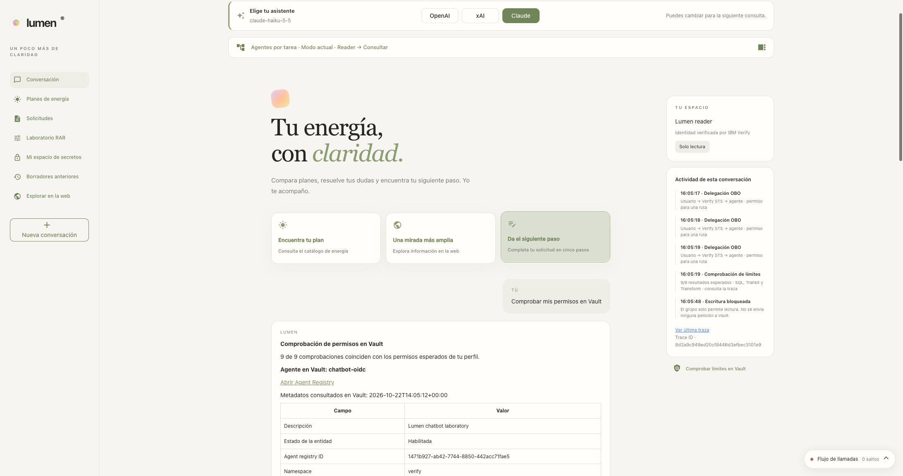
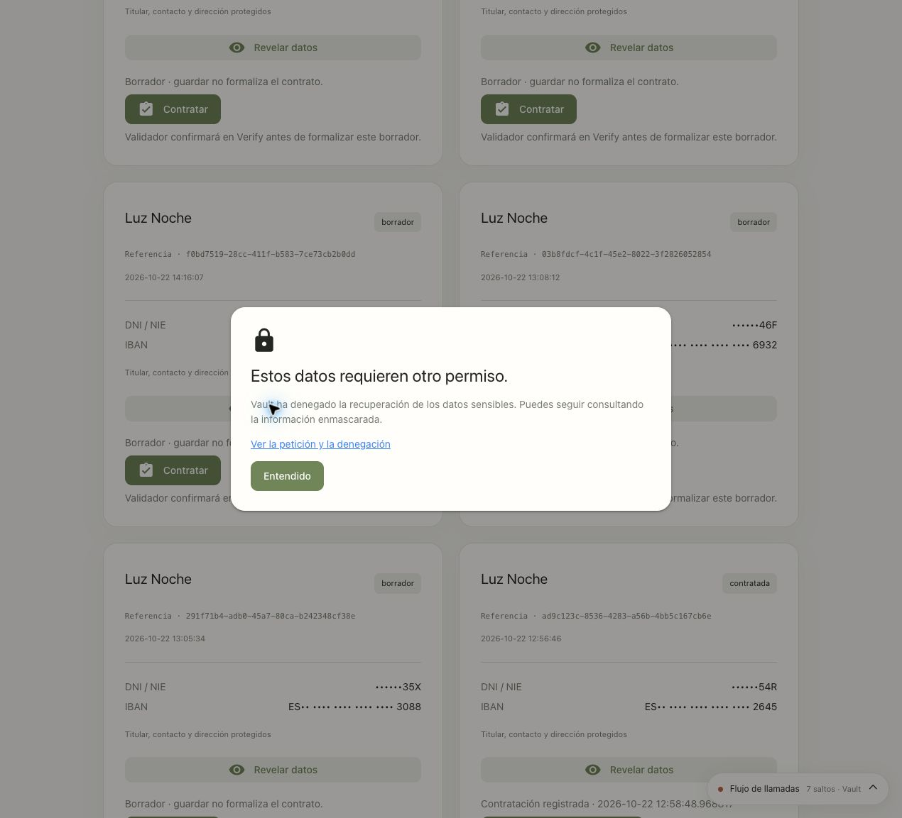
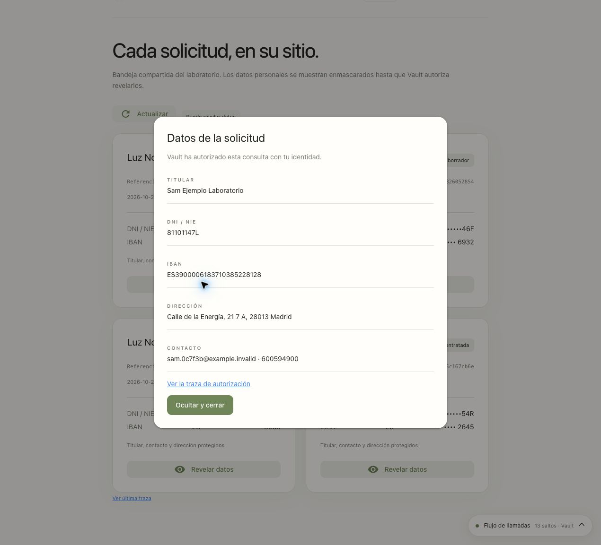
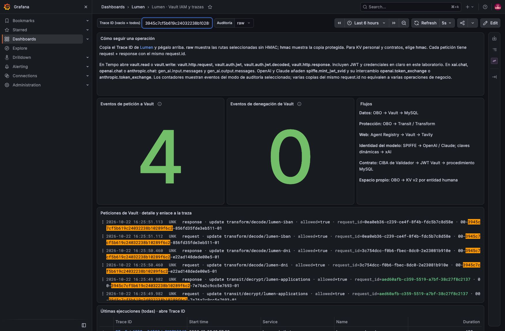
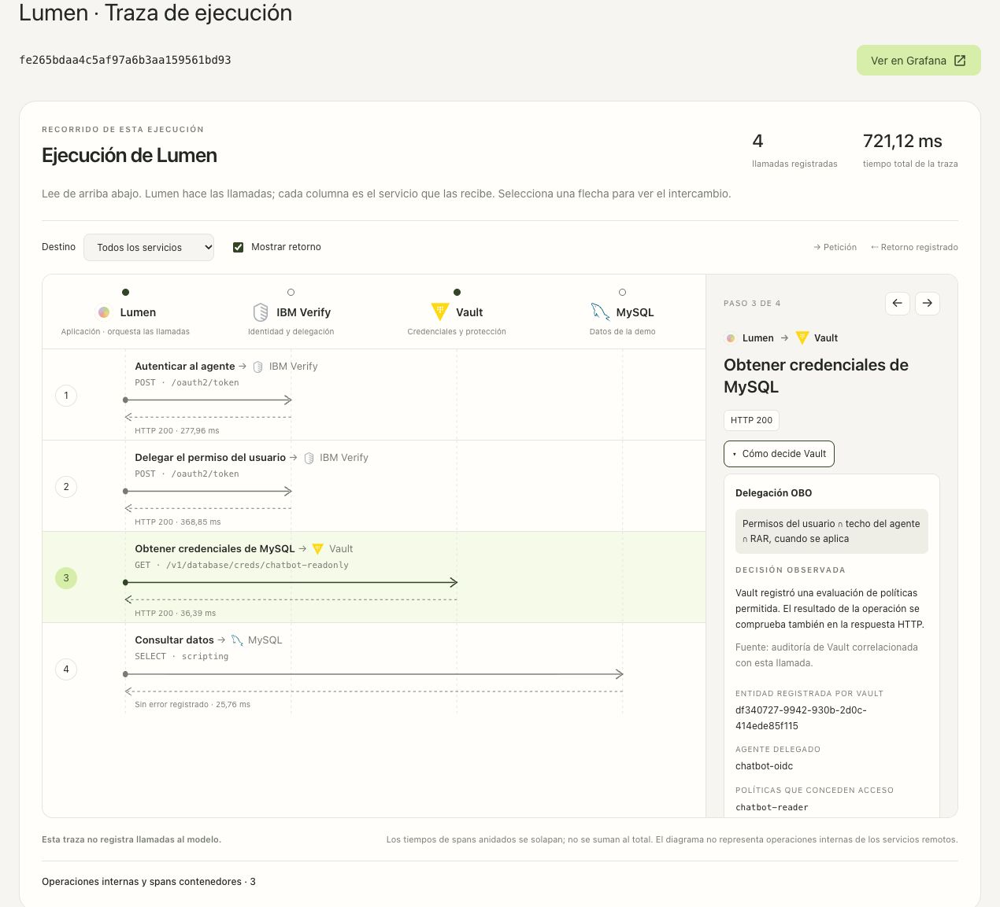
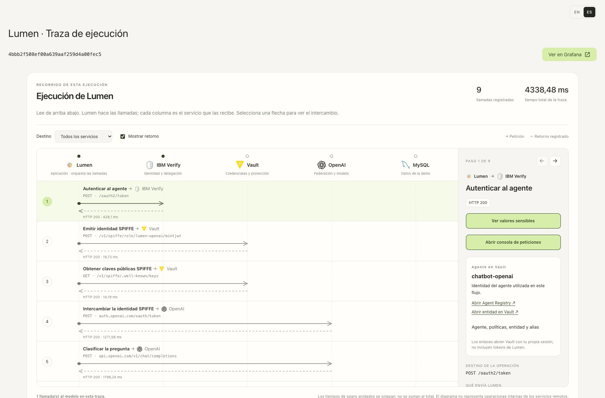
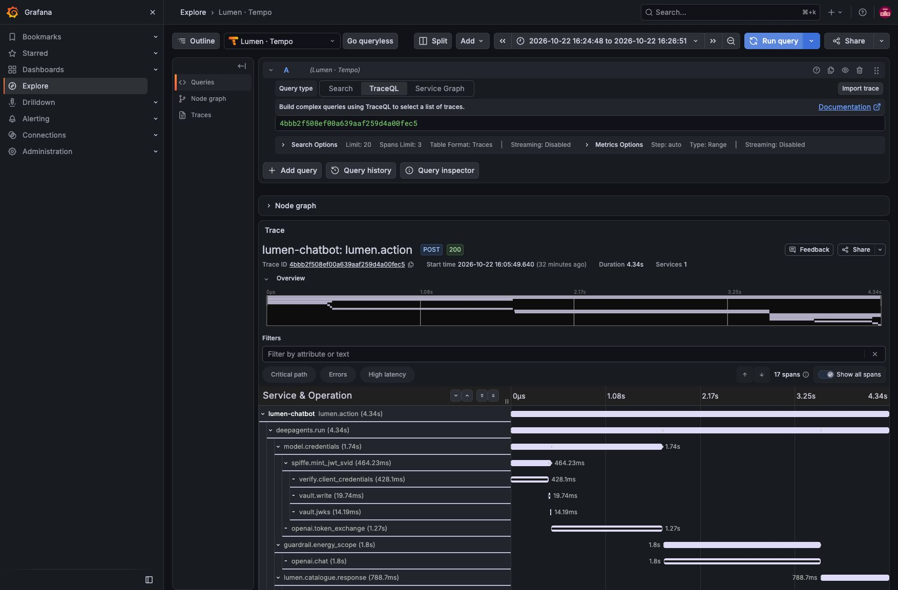

# Lumen: recorrido por usuario y trazabilidad

Cada acción de Lumen genera una traza con las llamadas a Verify, Vault, el
proveedor de IA y MySQL o Tavily que correspondan. El resultado de autorización
se demuestra con la respuesta de Vault y su auditoría. La respuesta del modelo
por sí sola no acredita un permiso.

Esta guía y sus capturas se revisaron el **22/10/2026** contra la interfaz en
funcionamiento. [Evidencias y límites de la revisión](../docs/runs/20261022T140230Z-workspace-review/README.md).
Los [informes del 14 y 15 de octubre](../docs/manual/VALIDACION.md) son históricos:
sus IDs y capturas no describen la instalación actual.

## 1. Qué puede hacer cada usuario

| Usuario | Consultar | Guardar | Revelar DNI/IBAN/perfil | SQL RW |
|---|---|---|---|---|
| lumen-reader | Sí, bandeja enmascarada | No | No | No |
| lumen-writer | Sí, bandeja enmascarada | Sí, formulario confirmado | No | Sí |
| lumen-supervisor | Sí, bandeja enmascarada | No | Sí, Transit/Transform | No |

En Verify, usar **Cloud Directory**. Las credenciales están en `verify/secrets/chatbot/users/{reader,writer,supervisor}`. **Cambiar usuario** solicita un nuevo login OIDC. Los JWT firmados incluyen el grupo; los grupos internos de Vault se reconcilian con `05-sync-groups.sh`.

El bloqueo de «Da el siguiente paso» para lector/supervisor ocurre en la aplicación y no genera una petición a Vault. **Comprobar límites en Vault** hace nueve llamadas reales: SQL RO/RW, secreto administrativo, Transit encrypt/decrypt y Transform encode/decode para DNI e IBAN. Usa OBO y datos ficticios preparados durante el despliegue, por lo que también funciona sin solicitudes guardadas. La UI muestra resultado, permiso esperado y un resumen de coincidencias. Solo HTTP 403 se interpreta como denegación; un fallo del servicio se muestra como error. [Matriz y capturas actualizadas](../docs/PERMISSION_PROBES.md). **Revelar datos** también llega a Vault y produce HTTP 403 para lector/gestor.





## 2. Cómo ver cada petición en el audit log

El dashboard cuenta **eventos de petición** y **eventos de denegación** del modo
seleccionado. No crea una serie por `request.id`: ese cálculo fallaba al superar
el límite de 500 series de Loki. Varias copias del mismo ID cuentan como varios
eventos; para contar operaciones distintas, correlaciona y deduplica `request.id`
en el detalle o usa los informes de verificación.




Abrir [Grafana](http://localhost:3000/d/lumen-iam), acceder como `lumen-admin` con la contraseña de `verify/secrets/chatbot/observability`, y pegar el **Trace ID** de Lumen en el filtro. Elegir `raw` para los intercambios del laboratorio o `hmac` para la copia protegida.

Los filtros raw cubren SQL, Tavily, la prueba administrativa, Transit/Transform
de solicitudes, SPIFFE y xAI. **KV personal y almacenamiento de contratos tienen
auditoría HMAC**: selecciona `hmac` para ver sus decisiones. Que el cliente capture
una petición raw en Tempo no implica que Vault la audite sin HMAC.

```logql
{service="vault-audit", audit_mode="raw"} |= "TRACE_ID"
```

Cada llamada tiene eventos `request` y `response` unidos por `request.id`. La cabecera `traceparent` contiene el Trace ID y Span ID del cliente. `auth.policy_results.allowed` muestra la decisión, `auth.policies` las políticas y `auth.metadata` el actor y RAR. El dashboard cuenta eventos; para distinguir llamadas únicas hay que deduplicar por `request.id`. Las copias internas de forwarding pueden duplicar eventos: el verificador prefiere el par raw autenticado con el mismo request ID.

## 3. Cómo trazar lo que hace el agente

En Lumen: **Ver última traza → Ver en Grafana**. El enlace incluye la ventana temporal de la ejecución; evita buscar una traza antigua con un rango «últimos cinco minutos». El árbol distingue `deepagents.run`, `model.credentials`, `xai.chat`, `tool.*`, `verify.obo_exchange`, `vault.read`/`vault.write`, `mysql.query` y `tavily.search`.

**Ver última traza** abre primero un diagrama interactivo: Lumen aparece como origen y cada servicio como destino. Seleccionar una flecha muestra la operación, ruta, tipo de credencial, respuesta prevista, estado observado y referencia del span. Se puede filtrar por servicio, avanzar llamada a llamada y mostrar u ocultar los retornos. La tabla completa y los contenidos capturados se conservan debajo.

### Cómo decide Vault

Al seleccionar cualquier llamada a Vault, el panel de la derecha ofrece un botón
pequeño **Cómo decide Vault**, junto al estado HTTP. Empieza cerrado. Al abrirlo
consulta la auditoría de esa petición y muestra el tipo de autenticación, la
lógica aplicable, las políticas que concedieron acceso y el RAR registrado.
Funciona con lecturas y escrituras de cualquier ruta mostrada en el diagrama,
incluidos Transit, Transform, Database, KV, SPIFFE, login y revocación.

La explicación distingue OBO, OAuth autónomo, token nativo, root, login y JWKS
públicas. No aplica la fórmula usuario ∩ agente ∩ RAR a todos los mecanismos.
El resultado de políticas y el HTTP se presentan por separado: una evaluación
permitida no garantiza que el motor haya completado la operación. Ante una
denegación, no atribuye la causa a una regla que la auditoría no identifica.

**Evidencia de la decisión** permite inspeccionar una proyección de los eventos:
Request ID, fecha, entidad, actor, políticas y RAR. No incluye tokens, cuerpos,
credenciales ni valores de parámetros RAR. Los registros se correlacionan por
Trace/Span ID o Request ID, comprobando también ruta y namespace. Las copias de
forwarding se distinguen del resultado final. La consulta usa Loki local y no
repite la operación ni modifica políticas de Vault.

El visor conserva el acceso limitado a las trazas de la sesión propietaria,
incluida una segunda comprobación al terminar la consulta. No necesita activar
la captura raw: utiliza los metadatos de auditoría disponibles. Si faltan eventos,
hay resultados incompatibles o Loki no está disponible, lo indica. **Volver a
consultar** permite esperar a la ingestión. No reconstruye una decisión histórica
con las políticas actuales ni presenta el panel como una traza interna del motor ACL.

Disponible en ES/EN y móvil. [Pruebas y alcance](../docs/runs/20261022T154444Z-vault-decision/README.md).



### Relacionar parámetros RAR con el acceso

El [Laboratorio RAR](../docs/manual/15-parametros-rar.md) emite dos tokens OBO por
caso y envía el mismo cuerpo con ambos. **Ver control** y **Ver restricción**
abren `/traces/<trace_id>?span=<span_id>` y seleccionan la llamada a Vault
correspondiente. El visor muestra escenario, caso, fase, RAR y cuerpo ficticio;
la consola conserva la autenticación y el intercambio real.

Los spans `rar.comparison.phase` y `rar.comparison.access` agrupan las operaciones.
`rar.lab.scenario`, `rar.lab.case`, `rar.lab.phase` y `rar.lab.payload` permiten
correlacionarlas. `auth.rar.validated` registra el RAR después de validar el JWT
OBO; `auth.rar.presented` registra el claim presentado a Vault. La decodificación
para observabilidad no sustituye la validación criptográfica. `vault.request_id`
permite pivotar al audit cuando Vault devuelve ese identificador.

Un control 200 seguido de 403 demuestra la diferencia al añadir los parámetros.
Si ambos reciben 403, la UI señala que el acceso ya falla sin las restricciones:
hay que revisar usuario, techo y bloqueos. Los fallos de emisión, conexión y
motor se presentan como no concluyentes. Las trazas de las pruebas por script
viven en el directorio privado `rar-parameters/traces`; las de la UI conservan
el control de acceso de su sesión.

### Idioma del visor

El visor usa la misma preferencia **EN / ES** que Lumen, con detección inicial del navegador. **View latest trace**, **View in Grafana**, **View sensitive values** y **HTTP Basic authentication** corresponden a **Ver última traza**, **Ver en Grafana**, **Ver valores sensibles** y **Autenticación HTTP Basic**. Los títulos, explicaciones, etiquetas accesibles, tiempos y paginación cambian de idioma. Los nombres técnicos de spans, rutas, cabeceras, JWT, `client_secret`, SVID, credenciales SQL y cuerpos de cifrado/descifrado mantienen sus valores originales.

Cambiar el idioma recarga la página y cierra cualquier captura sensible abierta; para verla de nuevo hay que solicitarla dentro de la sesión propietaria vigente. Una pestaña que sigue abierta conserva sus etiquetas hasta recargarse; sus capturas se presentan en el idioma de esa página. El idioma no modifica la captura, la retención ni los permisos. Grafana tiene su propio ajuste de idioma. [Verificación bilingüe](docs/language-verification.json) · [Procedimiento](../docs/manual/10-aplicacion.md#idioma-y-comprobaciones-bilingües).

### Consola para repetir una llamada real

En una traza nueva, selecciona un paso y pulsa **Abrir consola de peticiones / Open request console**. La consola muestra la petición HTTP que preparó el cliente: método, URL, cabeceras de autenticación y cuerpo. En OpenAI, xAI y Anthropic incluye las instrucciones, mensajes e historial, herramientas y parámetros enviados realmente al proveedor, tanto para **Clasificar la pregunta** como para **Consultar el modelo**. No confundir el cuerpo del clasificador con el del agente. Si el SDK reintentó, el selector muestra cada intento capturado.

1. **Cabeceras y autenticación · JSON** aparece siempre abierto, con `Authorization`, `X-Vault-Token` o la cabecera de API key al principio para que la credencial sea visible. Esto se aplica a todas las peticiones HTTP, incluidas la clasificación y la conversación con el modelo, Verify y Vault. Puedes editar las cabeceras completas, el cuerpo, el método y la ruta o los parámetros de la URL. **Restaurar captura** recupera los valores originales. Si el protocolo envía la credencial en el cuerpo (por ejemplo, una assertion SPIFFE), se conserva en ese cuerpo y no se inventa una cabecera.
2. **Enviar petición real** ejecuta una nueva llamada desde el servidor de Lumen. Abrir o editar no ejecuta nada. La respuesta muestra código HTTP, cabeceras, cuerpo y duración; un `401`, `403` o `400` es el resultado del destino, no una simulación.
3. **Copiar cURL** y **Exportar a Postman** incluyen los valores editados y las credenciales actuales del editor. Para llamar a Vault desde otro cliente, configura su CA de confianza; la consola usa la CA de la instalación. Los archivos exportados y el portapapeles permanecen aunque cierres el visor.
4. En MySQL, **Autenticación MySQL** muestra directamente el servidor, puerto, base de datos, usuario y contraseña dinámica en claro, sin desplegables. Incluye el lease y su validez al emitirse. Los valores son de sólo lectura y corresponden a los utilizados al repetir la llamada. Debajo aparecen SQL y parámetros JSON. Puedes editar consulta y parámetros; conserva el servidor, base de datos y login de ese paso. El driver enlaza los parámetros, limita la lectura a 50 filas y confirma las escrituras que permita esa credencial.

Funciona también con Client Credentials y STS de Verify, el intercambio de tokens de OpenAI/Claude, lecturas/escrituras de Vault (secretos, credenciales, SPIFFE, Transit y Transform), JWKS y Tavily. Una operación interna sin tráfico propio no se convierte en una petición ficticia. El login OIDC muestra su intercambio si está en la traza de la sesión; su código de autorización de un solo uso normalmente ya estará consumido.

En Tavily y Anthropic, la autenticación se encuentra en estos campos de la petición capturada:

| Paso | Destino | Credencial visible en la consola |
| --- | --- | --- |
| Búsqueda Tavily | `POST https://api.tavily.com/search` | `Authorization: Bearer …`, con la API key leída de `secrets/data/tavily` por el agente `chatbot-research`. El cuerpo contiene la consulta y sus opciones. |
| Federación de Claude | `POST https://api.anthropic.com/v1/oauth/token` | JWT-SVID en el campo `assertion` del cuerpo JSON, junto con los identificadores de federación. Este paso no lleva cabecera `Authorization`. |
| Clasificar o consultar Claude | `POST https://api.anthropic.com/v1/messages` | `Authorization: Bearer …`, con el access token temporal obtenido en el intercambio anterior. El cuerpo contiene las instrucciones, mensajes, herramientas y parámetros de esa llamada. |

El JWT-SVID de Claude con `jti` es de un solo uso: repetir su intercambio puede devolver un error porque ya fue consumido. La consola conserva la credencial capturada; no emite otra automáticamente.

**Cada envío es real:** puede consumir inferencia, emitir nuevas credenciales, cifrar/descifrar o modificar datos. La consola no ejecuta las herramientas sugeridas por una respuesta del modelo, no renueva tokens, no reasigna credenciales a la sesión y no sustituye la traza original. Para encadenar manualmente llamadas, copia el token devuelto y pégalo en la cabecera/cuerpo del paso siguiente. Si una credencial ha caducado, genera una nueva ejecución de Lumen. Cerrar el panel no deshace una petición ya enviada.

La repetición conserva el mismo protocolo, servidor y puerto del destino capturado. No sigue redirecciones ni usa cookies o credenciales administrativas del servidor. Se recalculan las cabeceras de transporte (`Host`, `Content-Length`, etc.); el cuerpo conserva el texto original, incluido `application/x-www-form-urlencoded`. Cada sesión admite un envío simultáneo. La API comprueba propietario, sesión vigente, origen de la página, modo laboratorio y captura completa no caducada.

Las capturas HTTP reales están **sólo en memoria**, durante diez minutos desde el inicio de la captura del paso: máximo 1 MiB por sección, 500 pasos y 32 MiB en total. Al alcanzar el límite global se descartan los pasos más antiguos. Una petición truncada o ausente no se puede repetir. La respuesta de la consola se limita a 1 MiB; no se almacena en Tempo ni en la conversación. Las trazas antiguas pueden seguir mostrando mensajes de telemetría y los campos raw de Vault/SPIFFE, pero no se reconstruye una petición HTTP exacta a partir de ellos.

La consola y sus mensajes están disponibles en ES/EN; nunca se traducen tokens, cabeceras, cuerpos, SQL ni respuestas del servicio. Al cambiar de paso/pestaña, cerrar o caducar la captura se vacían los editores y respuestas. Es una herramienta del visor para la persona que opera la demo; no amplía las herramientas ni los permisos del LLM.

[Autenticación HTTP visible: verificación](docs/http-authentication-verification.json) · [Captura histórica con token de ejemplo](docs/screenshots/http-authentication-visible.png).

[Informe de verificación de la consola](docs/request-workbench-verification.json) · [Captura de la interfaz](../docs/screenshots/current/request-workbench.jpg).

### Valores de cada llamada

En **modo laboratorio**, selecciona una flecha y pulsa **Ver valores sensibles**. El panel permite consultar y copiar los valores registrados en esa llamada:

- Verify: `client_id`, `client_secret` en claro, cabecera `Authorization: Basic …` completa, petición OAuth, token del agente, `subject_token`, `actor_token` y token OBO devuelto. La sección **Autenticación HTTP Basic** aparece en el login OIDC, Client Credentials y el intercambio STS.
- Vault y federación: JWT presentado a Vault, JWT-SVID emitido y enviado a OpenAI/Claude, y token temporal devuelto por el proveedor.
- MySQL: usuario y contraseña dinámicos, lease, consulta parametrizada y resultado.
- Transit y Transform: cuerpo de entrada y salida, texto en claro, ciphertext, valor original y tokenización. El `plaintext` Base64 de Transit también se presenta decodificado como UTF-8.
- Modelo y Tavily: petición HTTP real, cabeceras y cuerpo, con credencial, mensajes, instrucciones, herramientas y parámetros. La respuesta HTTP también se captura; los reintentos del SDK tienen secciones independientes.

Los JWT se pueden leer decodificados; esa decodificación no verifica su firma. Cada valor pertenece al Trace ID y Span ID seleccionados: no se completan huecos con credenciales de otra llamada. Una respuesta denegada conserva el error recibido, sin inventar un secreto.

El interruptor existente `LUMEN_TRACE_VAULT_RAW=1` habilita el visor. Los valores nuevos de OAuth, HTTP Basic, MySQL y cliente de modelo se conservan solo en memoria durante diez minutos, con límites de tamaño y capacidad; no se añaden al exportador de trazas ni a los resultados de herramientas. Los intercambios raw de Vault/SPIFFE ya capturados mantienen su retención existente en las trazas. La API exige una sesión vigente propietaria de la traza y responde con `Cache-Control: no-store`. Los valores se solicitan al abrir el visor y se ocultan al cambiar de paso, de pestaña o al caducar la sesión/captura; una copia manual permanece en el portapapeles.

Genera una ejecución nueva después de actualizar o reiniciar Lumen. Las trazas anteriores no adquieren retroactivamente valores que no capturaron. Con el modo desactivado, el endpoint no entrega valores sensibles.

[Verificación del visor sensible](docs/trace-sensitive-verification.json): llamadas reales de Verify, Vault, MySQL, OpenAI, Claude y xAI; cifrado, descifrado, destokenización y denegaciones. El informe conserva identificadores y comparaciones, sin credenciales.

[Ampliación de HTTP Basic](docs/trace-basic-auth-verification.json): `client_secret` visible y cabecera completa comprobada contra las credenciales mostradas y las peticiones enviadas por HTTPX.

Las operaciones locales y los spans contenedores se muestran aparte. `verify.token_exchange` mide la petición STS después de obtener el token del agente; `verify.obo_exchange` contiene ambos pasos y la validación local. En trazas anteriores, el diagrama sitúa OBO después de Client Credentials y señala que su duración es inclusiva. `vault.jwks` registra la lectura de claves públicas para validar el JWT-SVID. Las duraciones anidadas no se suman; `UNSET` no equivale a una autorización verificada. El retorno indica que el cliente registró una respuesta; su descripción explica el tipo de datos previsto, sin copiar credenciales al diagrama. Una flecha del modelo representa una invocación lógica del SDK; su consola permite inspeccionar y repetir cada intento HTTP capturado.

La llamada al modelo dentro de `guardrail.energy_scope` se identifica como **Clasificar la pregunta**, separada de las llamadas del agente. [Verificación del diagrama del 20/10/2026](docs/trace-flow-verification.json): consulta real a solicitudes, conversación con Claude, controles interactivos y acceso sin sesión bloqueado.



Con OpenAI, la rama de credenciales añade `spiffe.mint_jwt_svid` y `openai.token_exchange`; con Claude añade `spiffe.mint_jwt_svid` y `anthropic.token_exchange`. Las llamadas al modelo aparecen como `openai.chat` o `anthropic.chat`. La captura siguiente muestra una consulta nueva del catálogo con identidad SPIFFE y credenciales MySQL RO. [Configuración Claude](../docs/manual/08-claude-spiffe.md).

El login OIDC se registra aparte. Las operaciones directas del formulario o los botones de catálogo/Tavily no necesitan pasar por el LLM. Las trazas muestran llamadas del cliente; no instrumentan los procesos internos de Verify, Vault, MySQL, xAI, OpenAI o Tavily. El audit log de Vault aporta evidencia independiente de la autorización. No se captura razonamiento privado del modelo.



## 4. Reproducir el despliegue

```bash
./demo.sh start
./demo.sh verify
```

El lanzador crea Grafana, Loki, Tempo y Alloy en `lumen-observability`, con PVC y puertos limitados a localhost. `remove` elimina también esos datos. Grafana tiene un límite de memoria de 1536 MiB y `GOMEMLIMIT=768MiB`; los port-forward gestionados por `demo.sh` se recuperan mediante `launchd` tras una desconexión. No hay que ejecutar el notebook para arrancar la demo; el [notebook 7](../7_Lumen_Observability.ipynb) documenta las etapas.

Alloy se fija en **1.21.0-rc.0** para incorporar [grafana/alloy#7080](https://github.com/grafana/alloy/pull/7080). La versión 1.20.1 omitía líneas raw cuando stdout/stderr llegaban fuera de orden. Se verificaron la recuperación de eventos originales y una nueva prueba tras actualizar. Es una versión candidata de laboratorio.

## 5. Evidencia y comprobaciones

La [revisión integral del 22/10](../docs/runs/20261022T140230Z-workspace-review/README.md) conserva los resultados y sus límites. El [informe histórico del 15/10](../docs/runs/20261015T114709Z-openai-clean/all-ui-observability.json) mantiene la evidencia de aquella instalación. El verificador compara Tempo con Loki, los JWT del cliente con `auth.client_token`, los cuerpos de petición/respuesta y el par de audit events de cada span, incluidas las denegaciones.

```bash
# Sustituir por el identificador de una ejecución propia:
TRACE_ID=...
bash chatbot/scripts/verify-observability.sh "$TRACE_ID"
```

El visor de Lumen pertenece a la sesión en memoria. Tras reiniciar/cambiar sesión, usar los enlaces de Grafana del informe. Tempo y Loki retienen siete días; después de otro `remove`, solo permanecen los archivos de evidencia del workspace.

`verify-observability.sh` exige comparar también los valores completos de las
rutas capturadas raw por el cliente. Si una traza incluye KV personal o contratos,
esa comparación falla porque la copia de Vault está protegida con HMAC. Para esas
rutas se pueden correlacionar Trace ID, Span ID, ruta, `request.id`, decisión y
pareja request/response; esa correlación no acredita igualdad de valores en claro.

## 6. Recorrido interactivo actual

1. Lector: consultar catálogo/inventario; comparar bloqueo local con las denegaciones reales de Vault.
2. Gestor: pedir al agente preparar una solicitud y completar los cinco pasos. Guardar después de revisar. El resultado es una referencia UUID, no el antiguo botón «Confirmar borrador».
3. Lector y gestor: consultar la bandeja compartida e intentar revelar; ambos reciben 403 de Transit.
4. Supervisor: revelar el mismo registro; comprobar que SQL RW sigue denegado.
5. Tavily: ejecutar «Una mirada más amplia»; el agente registrado usa Client Credentials y únicamente lee su secreto.
6. xAI: comparar emisión, reutilización y sustitución de una clave temporal en `model.credentials`.

La solicitud y todos sus datos son ficticios. La guía de los cinco pasos y sus capturas está en el [README de Lumen](README.md#solicitudes-en-cinco-pasos).

## 7. Texto enviado al modelo y detalle de herramientas

El control `guardrail.energy_scope` precede al agente conversacional. Su llamada de clasificación se distingue como hija de ese span. Una consulta ajena a energía se rechaza sin herramientas de datos/búsqueda. [Recorrido, pruebas y JWT-SVID explícito](../docs/ENERGY_SCOPE_AND_SVID.md).

| Campo | Contenido |
|---|---|
| `lumen.user.message` | Pregunta del usuario |
| `gen_ai.input.messages` | Instrucciones, historial y resultados de herramientas |
| `gen_ai.output.messages` | Respuesta y llamadas a herramientas |
| `gen_ai.tool.definitions` | Herramientas y esquema de argumentos |
| `gen_ai.tool.call.arguments`, `gen_ai.tool.call.result` | Entrada/salida de cada herramienta |
| `lumen.model.parameters`, `gen_ai.usage.*` | Parámetros y consumo devueltos por el proveedor |

Desplegar `xai.chat`, `openai.chat` o `anthropic.chat` en Tempo, según el proveedor, o la llamada numerada en el visor de Lumen. Estos atributos de telemetría se toman en el callback de LangChain antes de invocar el SDK y se filtran. La consola del visor añade, por separado y sólo en memoria, el cuerpo HTTP final sin ese filtrado, con cada intento del SDK. Cada campo indica `.truncated`, `.original_bytes` y `.captured_bytes`.

Los mensajes y resultados se conservan para explicar el flujo. Los filtros del LLM ocultan credenciales conocidas; no garantizan detectar cualquier dato escrito libremente. Los campos del formulario se recogen fuera del chat y `consultar_solicitudes` devuelve solo la proyección enmascarada. Se comparó esta entrada con los datos ficticios guardados y con Tempo.

## 8. Intercambios completos con Vault y JWT sin HMAC

El modo raw solicitado para el laboratorio conserva en cada `vault.read` y `vault.write`:

| Campo | Contenido |
|---|---|
| `vault.http.request` | Método, URL, cabeceras de aplicación y cuerpo enviado |
| `vault.auth.jwt` | JWT completo enviado en `X-Vault-Token` |
| `vault.auth.jwt.decoded` | Cabecera y claims: sujeto, grupo, actor, fechas y RAR |
| `vault.http.response` | Estado HTTP, cabeceras y cuerpo, incluidas credenciales o errores |
| `spiffe.jwt_svid` | JWT-SVID completo emitido por Vault |
| `spiffe.jwt_svid.decoded` | Cabecera/claims SPIFFE y validación local de firma |
| `openai.exchange.subject_token` | JWT-SVID enviado al intercambio de OpenAI |
| `anthropic.exchange.assertion` | JWT-SVID enviado al intercambio RFC 7523 de Claude |

El decodificador visual no verifica la firma; la validación ocurre en el cliente OBO y en Vault. En un audit event autenticado, `auth.client_token` conserva el JWT; `request.client_token` puede ser el identificador derivado de Vault. Un rechazo antes de autenticar, por ejemplo por `nbf`, no tiene la misma estructura: no debe confundirse con una denegación de política.

En modo raw se configuran **seis dispositivos de auditoría**:

- `lumen-stdout`: copia HMAC general.
- `lumen-agent-raw`: lecturas RO/RW, Tavily y la prueba de denegación de `verify-admin` en `verify/`.
- `lumen-protection-raw`: seis rutas exactas de Transit/Transform de solicitudes.
- `lumen-xai-raw`: `verify/xai/creds/lumen`.
- `lumen-xai-access-raw`: autorización de la clave xAI en caché, `verify/secrets/data/chatbot/xai-access`.
- `lumen-spiffe-raw`: emisión del JWT-SVID en los roles `lumen-openai` y `lumen-anthropic`.

Los filtros seleccionan rutas y namespace, no identidades. Alloy añade `audit_mode`, sin convertir tokens en etiquetas. Los eventos raw y spans contienen valores en claro por diseño; los informes públicos de verificación solo guardan metadatos, tamaños y booleanos.

`.env` controla `LUMEN_VAULT_AUDIT_MODE=raw` y `LUMEN_TRACE_VAULT_RAW=1`. La captura de mensajes depende de `LUMEN_TRACE_CONTENT=1`. El límite local por campo es 64 KiB, reducible mediante `LUMEN_TRACE_CONTENT_MAX_BYTES`; Tempo admite atributos de 128 KiB. El archivo auxiliar `/tmp/lumen-telemetry/spans.jsonl` no rota. Los tests unitarios usan otro directorio temporal.

Para ocultar valores en nuevas ejecuciones, cambiar `.env` a `LUMEN_VAULT_AUDIT_MODE=hmac` y `LUMEN_TRACE_VAULT_RAW=0` y repetir `./demo.sh start`. Desactivar además `LUMEN_TRACE_CONTENT` si se quieren solo metadatos del modelo. Esto no transforma ni elimina los registros ya almacenados.

Referencias: [auditoría Vault](https://developer.hashicorp.com/vault/docs/audit), [opciones raw](https://developer.hashicorp.com/vault/api-docs/system/audit), [filtros](https://developer.hashicorp.com/vault/docs/enterprise/audit/filtering).

## 9. Solicitudes protegidas: Transit y Transform

El [notebook 8](../8_Lumen_Protected_Applications.ipynb) documenta claves, transformaciones, políticas y roles. Guardar: SQL para comprobar referencia, Transit encrypt, dos encode y SQL RW para INSERT. Revelar: SQL RO, decrypt y dos decode. Las llamadas `vault.write` incluyen el cuerpo real: Base64 del perfil, ciphertext o token y transformación.

La comprobación de almacenamiento confirma ciphertext y tokens en MySQL, cuatro tablespaces cifrados y `keyring_okv` activo. El supervisor recuperó exactamente los valores introducidos por el gestor. Ninguna herramienta del agente ofrece descifrado; las consultas del modelo siguen enmascaradas aunque el usuario sea supervisor.

## 10. Credenciales dinámicas de xAI

`chatbot-xai` usa Client Credentials con RAR obligatorio → autorización en `secrets/data/chatbot/xai-access` → `xai/creds/lumen?ttl=300` cuando necesita una clave. Se reutiliza la clave en memoria si Vault permite la lectura de autorización, coincide la generación y quedan más de 210 s. El plugin no renueva leases: la sustitución cambia la clave y el lease. Vault elimina la anterior al caducar; no hay fallback estático. [Bloqueos por CLI y comprobación con JWT ya emitidos](../docs/ACCESS_BLOCKS.md).

`model.credentials` registra `cache_hit`, `refresh_reason`, lease anterior/nuevo y vigencia restante. La prueba de 60 s confirma inferencia real y rechazo de la clave caducada por xAI. La prueba histórica de interfaz del 14/10 confirma reutilización y sustitución **antes** de expirar, con ambos eventos correlacionados con Vault. La reconstrucción del 15/10 repitió los 12 checks de ciclo de vida y ocho de RAR/bloqueo; sus informes conservan la fecha de aquella ejecución. Los resultados de la instalación actual se enlazan en la revisión del 22/10.

## 11. Aislamiento de espacios personales

Las operaciones de **Mi espacio de secretos** registran el sujeto OBO, el agente, la entidad propietaria solicitada y la política `lumen-personal-user`. El diagrama distingue lectura, escritura y listado, enlaza el resultado de Vault y conserva la consola de repetición. El contenido personal no se envía al modelo. La auditoría general mantiene HMAC; no se amplían los filtros raw existentes. [Recorrido](../docs/manual/16-espacios-personales.md).

El panel **Aislamiento del espacio personal** explica la creación de la entidad,
el vínculo `issuer + external_id → canonical_id`, la ruta KV por UUID y la
resolución de las identidades humana y agente desde el JWT OBO. Compara la
plantilla humana expandida con la ruta solicitada y distingue la emisión del
token en Verify del resultado de la llamada a Vault. Incluye el motivo del
wildcard del Registry y la intersección con política humana y RAR, en ES/EN.

Las nuevas trazas añaden `personal.subject`, `personal.issuer`, nombres del
usuario y destinatario, `personal.actor_client_id`, nombre del techo personal y
snapshots HCL del catálogo. Son metadatos explicativos; no capturan nuevos tokens,
contraseñas ni valores de secretos. La proyección del RAR en este panel conserva
solo tipo, ruta y capacidades de la ruta seleccionada. Los intercambios completos
mantienen sus controles sensibles existentes. La expansión de la plantilla no
consulta ni evalúa la ACL efectiva: el catálogo puede diferir de políticas
modificadas después. Las trazas históricas no se rellenan con datos actuales y
el resultado HTTP real se muestra por separado de la comparación de UUID.
