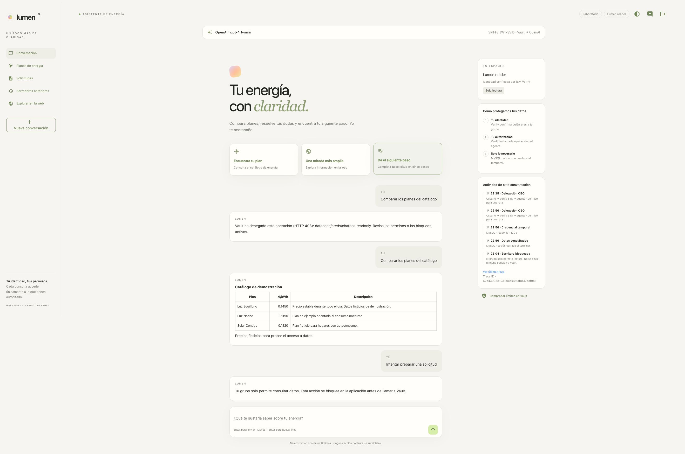
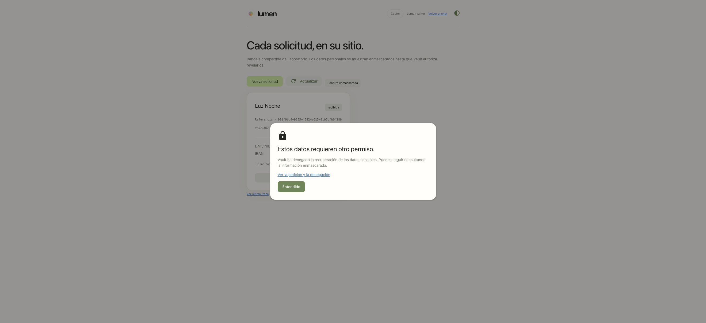
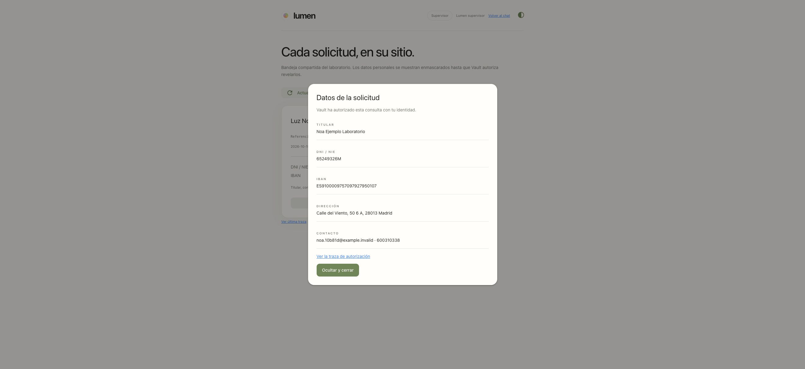
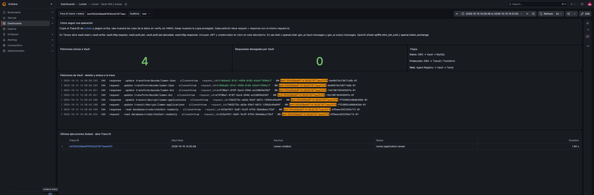
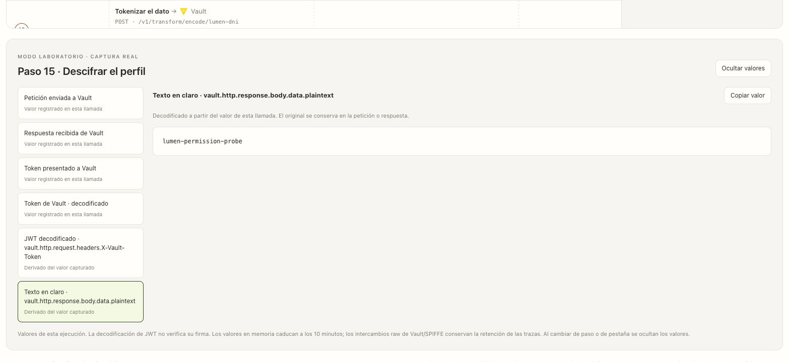
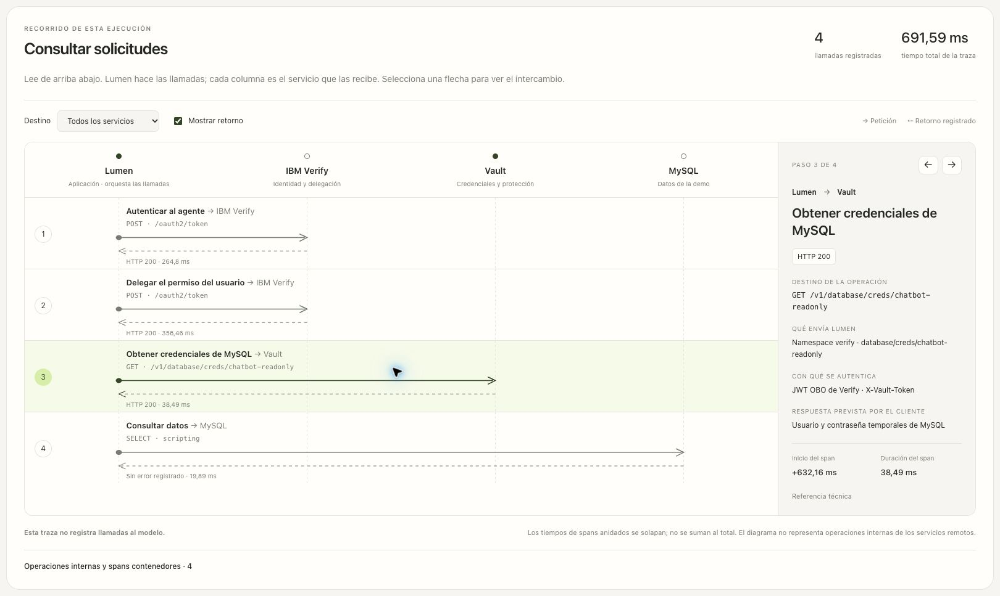
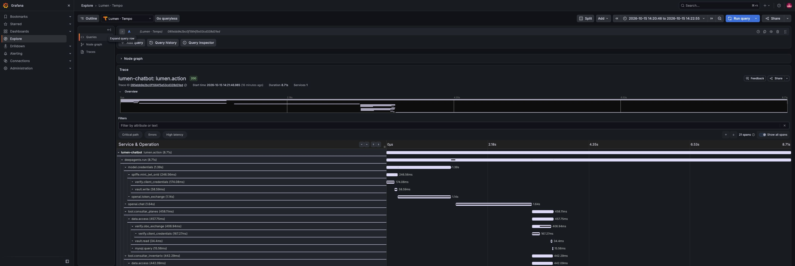

# Lumen: recorrido por usuario y trazabilidad

Esta guía describe el visor interactivo, las capturas sensibles y **EN/ES** de la revisión del **20 de octubre de 2026**. El [historial de validación](../docs/manual/VALIDACION.md) distingue las pruebas de interfaz de las reinstalaciones. Los informes end-to-end del [15 de octubre](../docs/E2E_OPENAI_VERIFICATION.md) y del [14 de octubre](../docs/E2E_VERIFICATION.md) conservan evidencia histórica; sus IDs no acreditan el estado actual ni garantizan que la traza siga disponible.

## 1. Qué puede hacer cada usuario

| Usuario | Consultar | Guardar | Revelar DNI/IBAN/perfil | SQL RW |
|---|---|---|---|---|
| lumen-reader | Sí, bandeja enmascarada | No | No | No |
| lumen-writer | Sí, bandeja enmascarada | Sí, formulario confirmado | No | Sí |
| lumen-supervisor | Sí, bandeja enmascarada | No | Sí, Transit/Transform | No |

En Verify, usar **Cloud Directory**. Las credenciales están en `verify/secrets/chatbot/users/{reader,writer,supervisor}`. **Cambiar usuario** solicita un nuevo login OIDC. Los JWT firmados incluyen el grupo; los grupos internos de Vault se reconcilian con `05-sync-groups.sh`.

El bloqueo de «Da el siguiente paso» para lector/supervisor ocurre en la aplicación y no genera una petición a Vault. **Comprobar límites en Vault** hace nueve llamadas reales: SQL RO/RW, secreto administrativo, Transit encrypt/decrypt y Transform encode/decode para DNI e IBAN. Usa OBO y datos ficticios preparados durante el despliegue, por lo que también funciona sin solicitudes guardadas. La UI muestra resultado, permiso esperado y un resumen de coincidencias. Solo HTTP 403 se interpreta como denegación; un fallo del servicio se muestra como error. [Matriz y capturas actualizadas](../docs/PERMISSION_PROBES.md). **Revelar datos** también llega a Vault y produce HTTP 403 para lector/gestor.





## 2. Cómo ver cada petición en el audit log

Abrir [Grafana](http://localhost:3000/d/lumen-iam), acceder como `lumen-admin` con la contraseña de `verify/secrets/chatbot/observability`, y pegar el **Trace ID** de Lumen en el filtro. Elegir `raw` para los intercambios del laboratorio o `hmac` para la copia protegida.

```logql
{service="vault-audit", audit_mode="raw"} |= "TRACE_ID"
```

Cada llamada tiene eventos `request` y `response` unidos por `request.id`. La cabecera `traceparent` contiene el Trace ID y Span ID del cliente. `auth.policy_results.allowed` muestra la decisión, `auth.policies` las políticas y `auth.metadata` el actor y RAR. El dashboard cuenta peticiones y denegaciones por `request.id` único para evitar duplicados tras una relectura. Las copias internas de forwarding pueden duplicar eventos: el verificador prefiere el par raw autenticado con el mismo request ID.




## 3. Cómo trazar lo que hace el agente

En Lumen: **Ver última traza → Ver en Grafana**. El enlace incluye la ventana temporal de la ejecución; evita buscar una traza antigua con un rango «últimos cinco minutos». El árbol distingue `deepagents.run`, `model.credentials`, `xai.chat`, `tool.*`, `verify.obo_exchange`, `vault.read`/`vault.write`, `mysql.query` y `tavily.search`.

**Ver última traza** abre primero un diagrama interactivo: Lumen aparece como origen y cada servicio como destino. Seleccionar una flecha muestra la operación, ruta, tipo de credencial, respuesta prevista, estado observado y referencia del span. Se puede filtrar por servicio, avanzar llamada a llamada y mostrar u ocultar los retornos. La tabla completa y los contenidos capturados se conservan debajo.

### Idioma del visor

El visor usa la misma preferencia **EN / ES** que Lumen, con detección inicial del navegador. **View latest trace**, **View in Grafana**, **View sensitive values** y **HTTP Basic authentication** corresponden a **Ver última traza**, **Ver en Grafana**, **Ver valores sensibles** y **Autenticación HTTP Basic**. Los títulos, explicaciones, etiquetas accesibles, tiempos y paginación cambian de idioma. Los nombres técnicos de spans, rutas, cabeceras, JWT, `client_secret`, SVID, credenciales SQL y cuerpos de cifrado/descifrado mantienen sus valores originales.

Cambiar el idioma recarga la página y cierra cualquier captura sensible abierta; para verla de nuevo hay que solicitarla dentro de la sesión propietaria vigente. Una pestaña que sigue abierta conserva sus etiquetas hasta recargarse; sus capturas se presentan en el idioma de esa página. El idioma no modifica la captura, la retención ni los permisos. Grafana tiene su propio ajuste de idioma. [Verificación bilingüe](docs/language-verification.json) · [Procedimiento](../docs/manual/10-aplicacion.md#idioma-y-comprobaciones-bilingües).

### Valores de cada llamada

En **modo laboratorio**, selecciona una flecha y pulsa **Ver valores sensibles**. El panel permite consultar y copiar los valores registrados en esa llamada:

- Verify: `client_id`, `client_secret` en claro, cabecera `Authorization: Basic …` completa, petición OAuth, token del agente, `subject_token`, `actor_token` y token OBO devuelto. La sección **Autenticación HTTP Basic** aparece en el login OIDC, Client Credentials y el intercambio STS.
- Vault y federación: JWT presentado a Vault, JWT-SVID emitido y enviado a OpenAI/Claude, y token temporal devuelto por el proveedor.
- MySQL: usuario y contraseña dinámicos, lease, consulta parametrizada y resultado.
- Transit y Transform: cuerpo de entrada y salida, texto en claro, ciphertext, valor original y tokenización. El `plaintext` Base64 de Transit también se presenta decodificado como UTF-8.
- Modelo y Tavily: credencial concreta entregada al cliente en esa invocación. En el modelo es evidencia del SDK, no una captura de cada intento HTTP.

Los JWT se pueden leer decodificados; esa decodificación no verifica su firma. Cada valor pertenece al Trace ID y Span ID seleccionados: no se completan huecos con credenciales de otra llamada. Una respuesta denegada conserva el error recibido, sin inventar un secreto.

El interruptor existente `LUMEN_TRACE_VAULT_RAW=1` habilita el visor. Los valores nuevos de OAuth, HTTP Basic, MySQL y cliente de modelo se conservan solo en memoria durante diez minutos, con límites de tamaño y capacidad; no se añaden al exportador de trazas ni a los resultados de herramientas. Los intercambios raw de Vault/SPIFFE ya capturados mantienen su retención existente en las trazas. La API exige una sesión vigente propietaria de la traza y responde con `Cache-Control: no-store`. Los valores se solicitan al abrir el visor y se ocultan al cambiar de paso, de pestaña o al caducar la sesión/captura; una copia manual permanece en el portapapeles.

Genera una ejecución nueva después de actualizar o reiniciar Lumen. Las trazas anteriores no adquieren retroactivamente valores que no capturaron. Con el modo desactivado, el endpoint no entrega valores sensibles.

[Verificación del visor sensible](docs/trace-sensitive-verification.json): llamadas reales de Verify, Vault, MySQL, OpenAI, Claude y xAI; cifrado, descifrado, destokenización y denegaciones. El informe conserva identificadores y comparaciones, sin credenciales.

[Ampliación de HTTP Basic](docs/trace-basic-auth-verification.json): `client_secret` visible y cabecera completa comprobada contra las credenciales mostradas y las peticiones enviadas por HTTPX.



Las operaciones locales y los spans contenedores se muestran aparte. `verify.token_exchange` mide la petición STS después de obtener el token del agente; `verify.obo_exchange` contiene ambos pasos y la validación local. En trazas anteriores, el diagrama sitúa OBO después de Client Credentials y señala que su duración es inclusiva. `vault.jwks` registra la lectura de claves públicas para validar el JWT-SVID. Las duraciones anidadas no se suman; `UNSET` no equivale a una autorización verificada. El retorno indica que el cliente registró una respuesta; su descripción explica el tipo de datos previsto, sin copiar credenciales al diagrama. Una llamada de modelo representa una invocación lógica del SDK, no cada intento HTTP.

La llamada al modelo dentro de `guardrail.energy_scope` se identifica como **Clasificar la pregunta**, separada de las llamadas del agente. [Verificación del diagrama del 20/10/2026](docs/trace-flow-verification.json): consulta real a solicitudes, conversación con Claude, controles interactivos y acceso sin sesión bloqueado.



Con OpenAI, la rama de credenciales añade `spiffe.mint_jwt_svid` y `openai.token_exchange`; con Claude añade `spiffe.mint_jwt_svid` y `anthropic.token_exchange`. Las llamadas al modelo aparecen como `openai.chat` o `anthropic.chat`. La consulta del lector del 15/10, anterior al control de ámbito, tiene Trace ID `095ebb9e2bc0f1564f5e53cd328d31ed`, con 21 spans y auditoría correlacionada para SPIFFE y credenciales MySQL RO. [Configuración Claude](../docs/manual/08-claude-spiffe.md).

El login OIDC se registra aparte. Las operaciones directas del formulario o los botones de catálogo/Tavily no necesitan pasar por el LLM. Las trazas muestran llamadas del cliente; no instrumentan los procesos internos de Verify, Vault, MySQL, xAI, OpenAI o Tavily. El audit log de Vault aporta evidencia independiente de la autorización. No se captura razonamiento privado del modelo.



## 4. Reproducir el despliegue

```bash
./demo.sh start
./demo.sh verify
```

El lanzador crea Grafana, Loki, Tempo y Alloy en `lumen-observability`, con PVC y puertos limitados a localhost. `remove` elimina también esos datos. Grafana tiene un límite de memoria de 1536 MiB y `GOMEMLIMIT=768MiB`; los port-forward gestionados por `demo.sh` se recuperan mediante `launchd` tras una desconexión. No hay que ejecutar el notebook para arrancar la demo; el [notebook 7](../7_Lumen_Observability.ipynb) documenta las etapas.

Alloy se fija en **1.21.0-rc.0** para incorporar [grafana/alloy#7080](https://github.com/grafana/alloy/pull/7080). La versión 1.20.1 omitía líneas raw cuando stdout/stderr llegaban fuera de orden. Se verificaron la recuperación de eventos originales y una nueva prueba tras actualizar. Es una versión candidata de laboratorio.

## 5. Evidencia y comprobaciones

El [directorio de ejecución](../docs/runs/20261015T114709Z-openai-clean/all-ui-observability.json) conserva los resultados sin credenciales. El verificador compara Tempo con Loki, los JWT del cliente con `auth.client_token`, los cuerpos de petición/respuesta y el par de audit events de cada span, incluidas las denegaciones.

```bash
# Sustituir por el identificador de una ejecución propia:
TRACE_ID=...
bash chatbot/scripts/verify-observability.sh "$TRACE_ID"
```

El visor de Lumen pertenece a la sesión en memoria. Tras reiniciar/cambiar sesión, usar los enlaces de Grafana del informe. Tempo y Loki retienen siete días; después de otro `remove`, solo permanecen los archivos de evidencia del workspace.

## 6. Recorrido interactivo actual

1. Lector: consultar catálogo/inventario; comparar bloqueo local con las denegaciones reales de Vault.
2. Gestor: pedir al agente preparar una solicitud y completar los cinco pasos. Guardar después de revisar. El resultado es una referencia UUID, no el antiguo botón «Confirmar borrador».
3. Lector y gestor: consultar la bandeja compartida e intentar revelar; ambos reciben 403 de Transit.
4. Supervisor: revelar el mismo registro; comprobar que SQL RW sigue denegado.
5. Tavily: ejecutar «Una mirada más amplia»; el agente registrado usa Client Credentials y únicamente lee su secreto.
6. xAI: comparar emisión, reutilización y sustitución de una clave temporal en `model.credentials`.

La solicitud y todos sus datos son ficticios. La guía de los cinco pasos y sus capturas está en el [README de Lumen](README.md#solicitudes-en-cinco-pasos).

## 7. Texto enviado al modelo y detalle de herramientas

El control `guardrail.energy_scope` precede al agente conversacional. Su llamada de clasificación se distingue como hija de ese span. Una consulta ajena a energía se rechaza sin herramientas de datos/búsqueda. [Recorrido, pruebas y JWT-SVID explícito](../docs/ENERGY_SCOPE_AND_SVID.md).

| Campo | Contenido |
|---|---|
| `lumen.user.message` | Pregunta del usuario |
| `gen_ai.input.messages` | Instrucciones, historial y resultados de herramientas |
| `gen_ai.output.messages` | Respuesta y llamadas a herramientas |
| `gen_ai.tool.definitions` | Herramientas y esquema de argumentos |
| `gen_ai.tool.call.arguments`, `gen_ai.tool.call.result` | Entrada/salida de cada herramienta |
| `lumen.model.parameters`, `gen_ai.usage.*` | Parámetros y consumo devueltos por el proveedor |

Desplegar `xai.chat` u `openai.chat` en Tempo, según el proveedor, o la llamada numerada en el visor de Lumen. La captura se toma en el callback de LangChain antes de invocar el SDK: no es una copia del cuerpo HTTP final ni de cada reintento interno del proveedor. Cada campo indica `.truncated`, `.original_bytes` y `.captured_bytes`.

Los mensajes y resultados se conservan para explicar el flujo. Los filtros del LLM ocultan credenciales conocidas; no garantizan detectar cualquier dato escrito libremente. Los campos del formulario se recogen fuera del chat y `consultar_solicitudes` devuelve solo la proyección enmascarada. Se comparó esta entrada con los datos ficticios guardados y con Tempo.


## 8. Intercambios completos con Vault y JWT sin HMAC

El modo raw solicitado para el laboratorio conserva en cada `vault.read` y `vault.write`:

| Campo | Contenido |
|---|---|
| `vault.http.request` | Método, URL, cabeceras de aplicación y cuerpo enviado |
| `vault.auth.jwt` | JWT completo enviado en `X-Vault-Token` |
| `vault.auth.jwt.decoded` | Cabecera y claims: sujeto, grupo, actor, fechas y RAR |
| `vault.http.response` | Estado HTTP, cabeceras y cuerpo, incluidas credenciales o errores |
| `spiffe.jwt_svid` | JWT-SVID completo emitido por Vault |
| `spiffe.jwt_svid.decoded` | Cabecera/claims SPIFFE y validación local de firma |
| `openai.exchange.subject_token` | JWT-SVID enviado al intercambio de OpenAI |
| `anthropic.exchange.assertion` | JWT-SVID enviado al intercambio RFC 7523 de Claude |

El decodificador visual no verifica la firma; la validación ocurre en el cliente OBO y en Vault. En un audit event autenticado, `auth.client_token` conserva el JWT; `request.client_token` puede ser el identificador derivado de Vault. Un rechazo antes de autenticar, por ejemplo por `nbf`, no tiene la misma estructura: no debe confundirse con una denegación de política.

En modo raw se configuran **seis dispositivos de auditoría**:

- `lumen-stdout`: copia HMAC general.
- `lumen-agent-raw`: lecturas RO/RW, Tavily y la prueba de denegación de `verify-admin` en `verify/`.
- `lumen-protection-raw`: seis rutas exactas de Transit/Transform de solicitudes.
- `lumen-xai-raw`: `verify/xai/creds/lumen`.
- `lumen-xai-access-raw`: autorización de la clave xAI en caché, `verify/secrets/data/chatbot/xai-access`.
- `lumen-spiffe-raw`: emisión del JWT-SVID en los roles `lumen-openai` y `lumen-anthropic`.

Los filtros seleccionan rutas y namespace, no identidades. Alloy añade `audit_mode`, sin convertir tokens en etiquetas. Los eventos raw y spans contienen valores en claro por diseño; los informes públicos de verificación solo guardan metadatos, tamaños y booleanos.

`.env` controla `LUMEN_VAULT_AUDIT_MODE=raw` y `LUMEN_TRACE_VAULT_RAW=1`. La captura de mensajes depende de `LUMEN_TRACE_CONTENT=1`. El límite local por campo es 64 KiB, reducible mediante `LUMEN_TRACE_CONTENT_MAX_BYTES`; Tempo admite atributos de 128 KiB. El archivo auxiliar `/tmp/lumen-telemetry/spans.jsonl` no rota. Los tests unitarios usan otro directorio temporal.

Para ocultar valores en nuevas ejecuciones, cambiar `.env` a `LUMEN_VAULT_AUDIT_MODE=hmac` y `LUMEN_TRACE_VAULT_RAW=0` y repetir `./demo.sh start`. Desactivar además `LUMEN_TRACE_CONTENT` si se quieren solo metadatos del modelo. Esto no transforma ni elimina los registros ya almacenados.

Referencias: [auditoría Vault](https://developer.hashicorp.com/vault/docs/audit), [opciones raw](https://developer.hashicorp.com/vault/api-docs/system/audit), [filtros](https://developer.hashicorp.com/vault/docs/enterprise/audit/filtering).

## 9. Solicitudes protegidas: Transit y Transform

El [notebook 8](../8_Lumen_Protected_Applications.ipynb) documenta claves, transformaciones, políticas y roles. Guardar: SQL para comprobar referencia, Transit encrypt, dos encode y SQL RW para INSERT. Revelar: SQL RO, decrypt y dos decode. Las llamadas `vault.write` incluyen el cuerpo real: Base64 del perfil, ciphertext o token y transformación.

La comprobación de almacenamiento confirma ciphertext y tokens en MySQL, cuatro tablespaces cifrados y `keyring_okv` activo. El supervisor recuperó exactamente los valores introducidos por el gestor. Ninguna herramienta del agente ofrece descifrado; las consultas del modelo siguen enmascaradas aunque el usuario sea supervisor.

## 10. Credenciales dinámicas de xAI

`chatbot-xai` usa Client Credentials con RAR obligatorio → autorización en `secrets/data/chatbot/xai-access` → `xai/creds/lumen?ttl=300` cuando necesita una clave. Se reutiliza la clave en memoria si Vault permite la lectura de autorización, coincide la generación y quedan más de 210 s. El plugin no renueva leases: la sustitución cambia la clave y el lease. Vault elimina la anterior al caducar; no hay fallback estático. [Bloqueos por CLI y comprobación con JWT ya emitidos](../docs/ACCESS_BLOCKS.md).

`model.credentials` registra `cache_hit`, `refresh_reason`, lease anterior/nuevo y vigencia restante. La prueba de 60 s confirma inferencia real y rechazo de la clave caducada por xAI. La prueba histórica de interfaz del 14/10 confirma reutilización y sustitución **antes** de expirar, con ambos eventos correlacionados con Vault. La reconstrucción del 15/10 repitió los 12 checks de ciclo de vida y ocho de RAR/bloqueo; sus informes están en la verificación actual.


