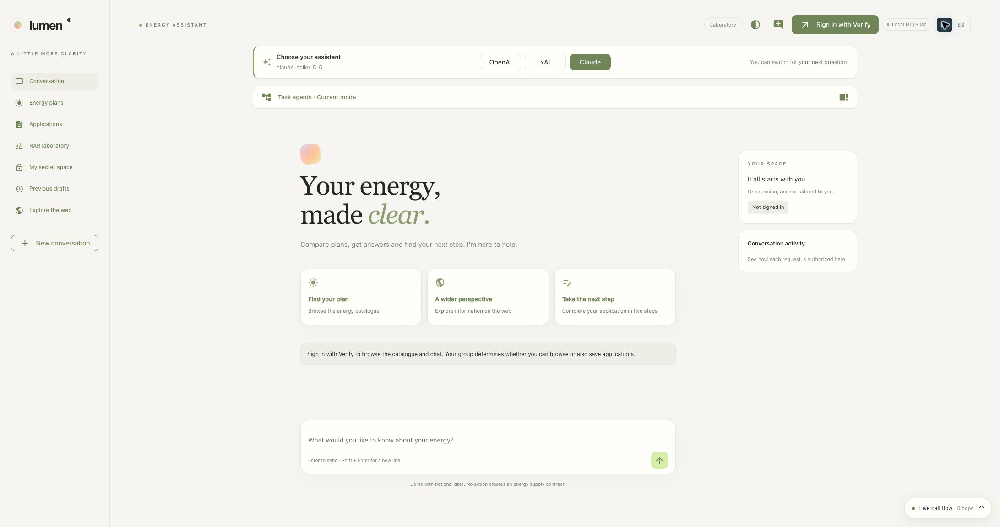
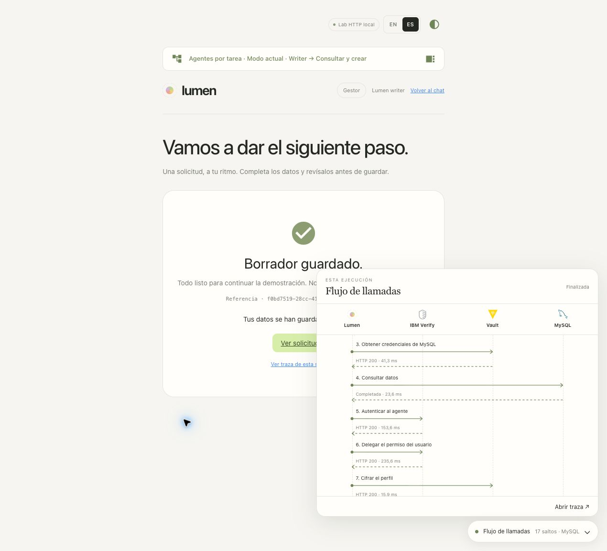
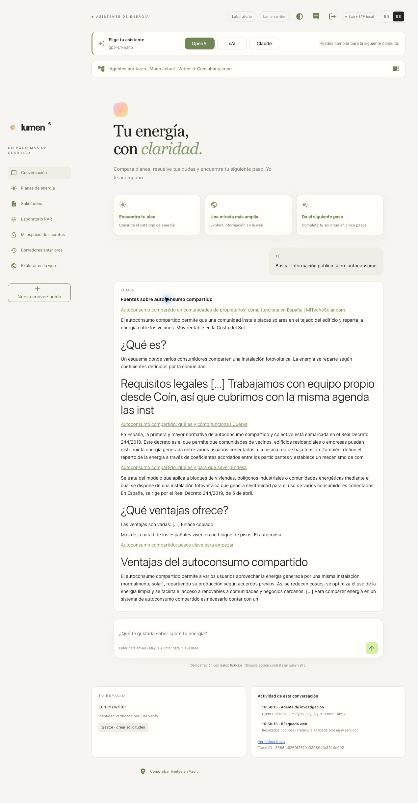
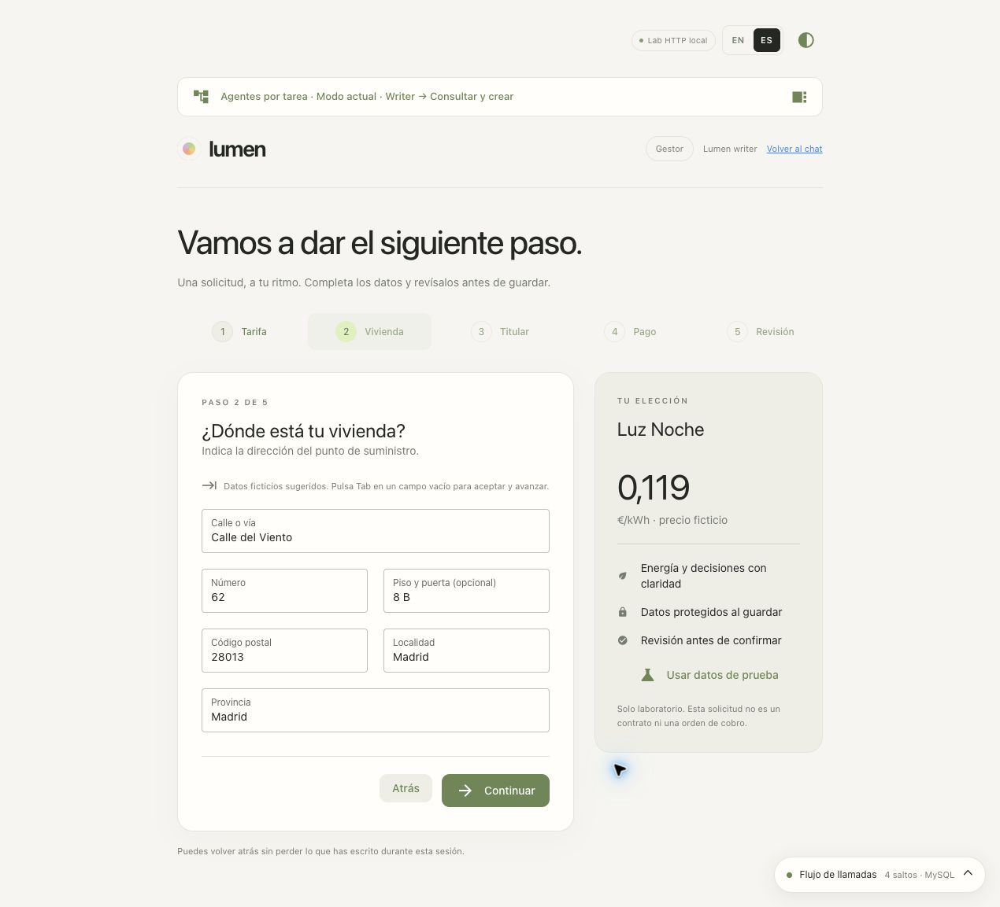
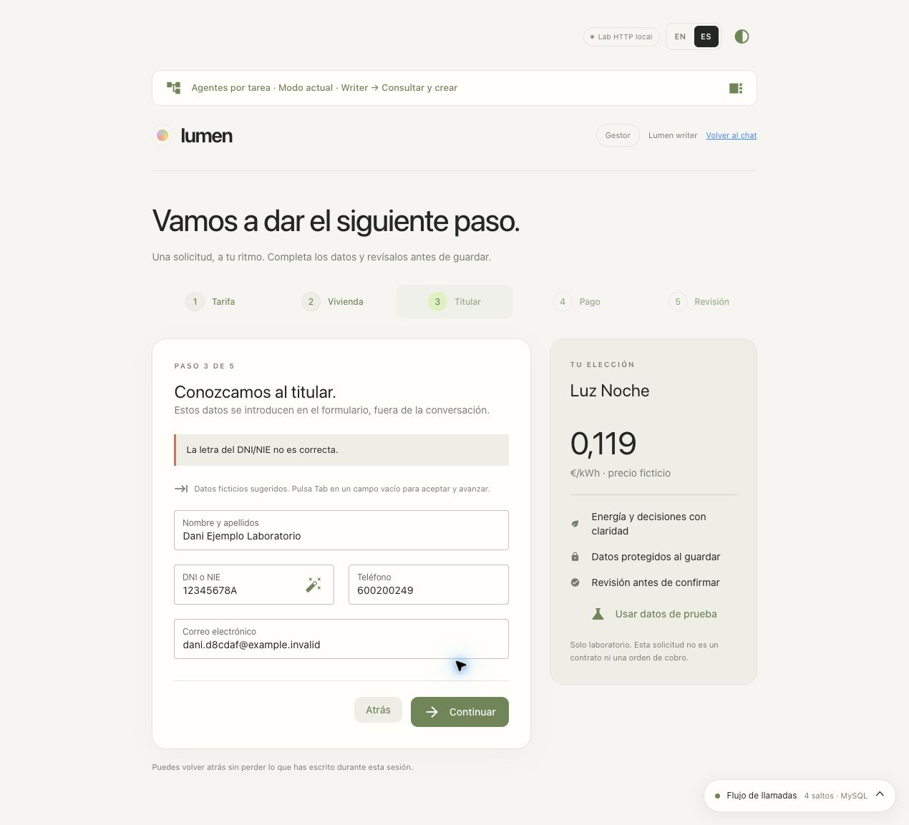
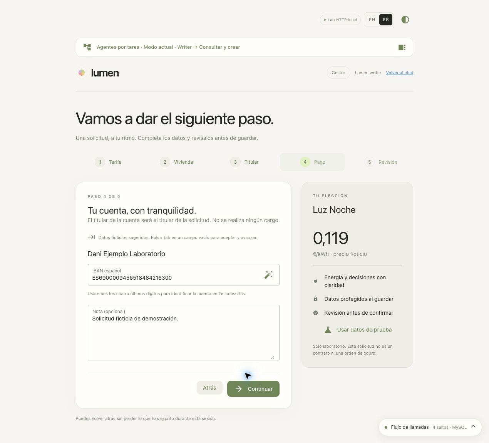
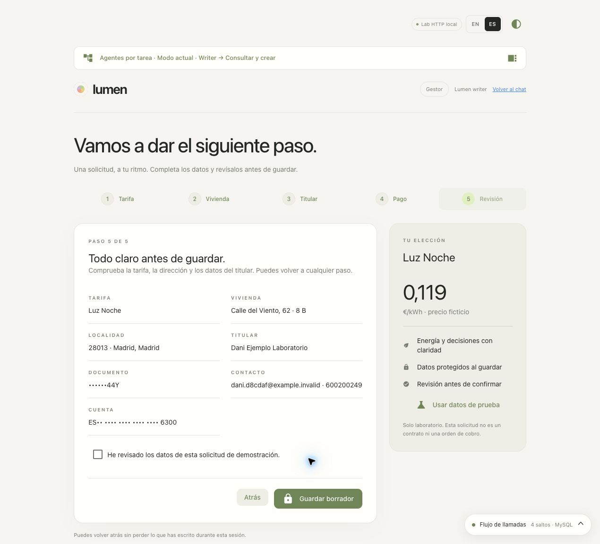
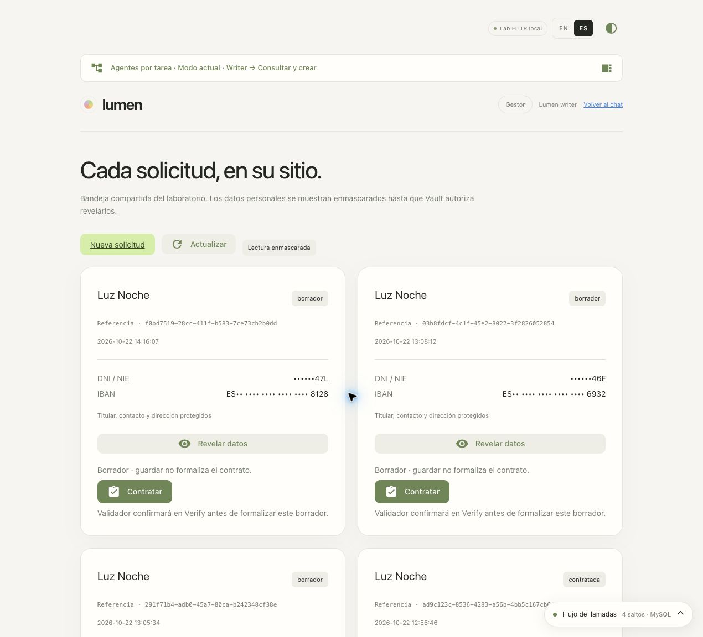
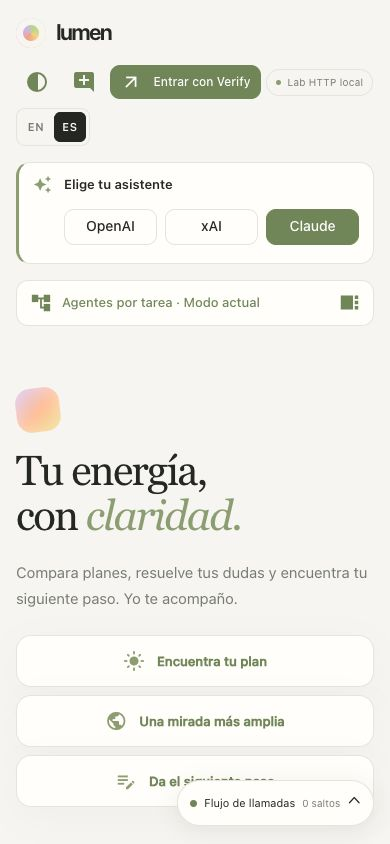
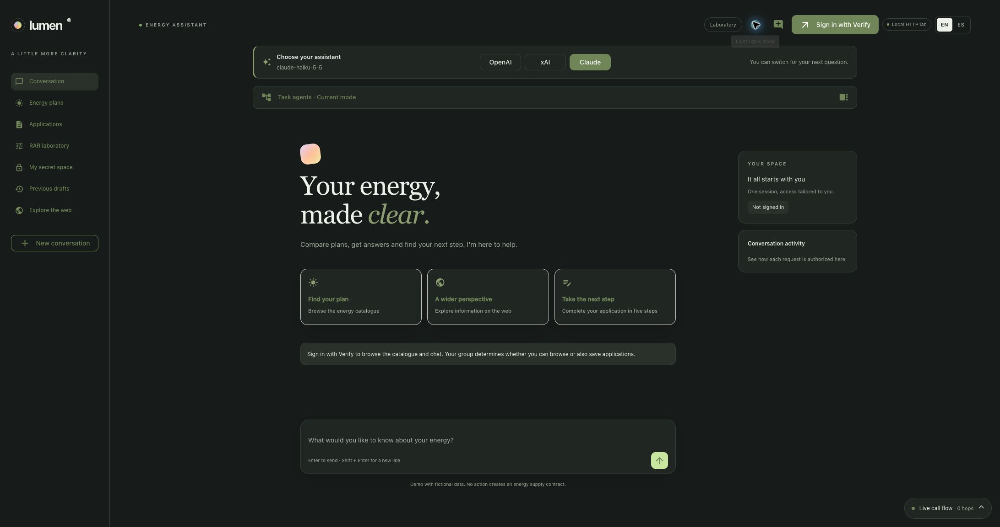

# Lumen · tu energía, con claridad

Lumen es una demo de un asistente de energía con tres proveedores de IA: OpenAI,
xAI y Claude. La interfaz usa NiceGUI y el agente usa LangChain Deep Agents.
IBM Verify autentica al usuario; Vault autoriza el acceso a los datos y entrega
las credenciales temporales. Las tarifas, solicitudes y contratos son ficticios.


Para instalar, configurar `.env` y arrancar, sigue el [README principal](../README.md).
Esta guía describe la aplicación, sus identidades y sus recorridos. Una vez
instalada, abre **http://localhost:8088** y entra con Verify.

| Recorrido | Qué demuestra | Guía |
|---|---|---|
| Conversación y catálogo | Selección OpenAI/xAI/Claude; datos MySQL consultados por OBO | [Identidades y flujos](#identidades-y-flujos-del-agente) |
| Búsqueda pública | Agente autónomo que obtiene Tavily desde Vault | [Demostración](#demostración) |
| Solicitudes | Formulario de cinco pasos, cifrado Transit y tokenización Transform | [Solicitudes protegidas](#solicitudes-en-cinco-pasos) |
| Contratación ficticia | Writer guarda un borrador; Validador confirma por CIBA antes de formalizar | [CIBA y PDF](../docs/manual/17-contratacion-ciba.md) |
| Agentes por tarea | Intersección de permisos humanos, techo del agente y RAR | [Selección y matriz](../docs/manual/14-agentes-por-tarea.md) |
| Laboratorio RAR | Control y restricciones de parámetros sobre peticiones reales | [Escenarios RAR](../docs/manual/15-parametros-rar.md) |
| Mi espacio de secretos | KV v2 por identidad humana, con denegación de acceso cruzado | [Espacios personales](../docs/manual/16-espacios-personales.md) |
| Trazas | Llamadas, autorización y resultados; correlación con Vault y Grafana | [Observabilidad](OBSERVABILITY.md) |

Las capturas de esta guía corresponden a la interfaz revisada el **22/10/2026**.
La [revisión integral](../docs/runs/20261022T140230Z-workspace-review/README.md)
explica lo comprobado y sus límites. Las reinstalaciones anteriores conservan
sus resultados en los [informes fechados](../docs/manual/VALIDACION.md).

## Idioma español e inglés

La preferencia se decide al cargar cada página, antes y después del login:

| Prioridad | Comportamiento |
|---|---|
| Elección manual | Los botones **EN / ES**, arriba a la derecha del chat, formulario, bandeja y trazas, guardan `lumen_language` durante un año. La cookie es de este navegador y origen; no del usuario de Verify. |
| Navegador | Sin una elección guardada, se interpreta `Accept-Language`, incluidas variantes como `en-US`, `en-GB`, `es-ES` o `es-MX` y sus prioridades `q`. Se elige la preferencia admitida con mayor prioridad. |
| Sin coincidencia | Se usa inglés si el navegador solo pide idiomas no admitidos. Si no envía `Accept-Language`, se usa español. |

El cambio recarga la página actual y actualiza textos, etiquetas accesibles, validaciones, formatos numéricos, tablas y diagrama. Conserva la conversación, el paso y los datos del formulario durante la sesión y la llamada de traza enlazada mediante `?span=`. Si hay una operación en curso, hay que esperar a que termine. La elección persiste al recargar y al volver a iniciar sesión; para probar otra vez la detección automática, elimina solo la cookie `lumen_language` de `localhost` o usa un perfil de navegador sin esa cookie. Una pestaña ya abierta mantiene su idioma hasta recargarla.

Las siguientes respuestas del asistente usan el idioma elegido con OpenAI, xAI o Claude. Las respuestas de catálogo y propuestas construidas por el servidor, así como los rechazos de ámbito, también están traducidas. El historial ya escrito, los nombres de planes, datos introducidos, citas de fuentes y valores capturados conservan su contenido original. **EN/ES no cambia los permisos**, el proveedor seleccionado ni la autenticación. El portal externo de IBM Verify y Grafana conservan sus propios ajustes de idioma.

| Español | English |
|---|---|
| Entrar con Verify | Sign in with Verify |
| Solicitudes | Applications |
| Continuar solicitud | Continue application |
| Usar datos de prueba | Use test data |
| Guardar borrador | Save draft |
| Ver última traza | View latest trace |
| Ver valores sensibles | View sensitive values |
| Autenticación HTTP Basic | HTTP Basic authentication |

### Mantener y actualizar las traducciones

El catálogo [translations_en.json](app/translations_en.json) traduce los textos españoles de la aplicación. [i18n.py](app/i18n.py) resuelve la preferencia; el idioma se pasa explícitamente a la respuesta y a cada página. Al añadir textos, conserva los mismos marcadores `{nombre}` en ambos idiomas. Las traducciones de trazas se aplican a títulos y explicaciones, nunca a `section.value`, JWT, secretos, cuerpos HTTP o parámetros SQL. La tabla técnica y las capturas permiten inspeccionar los datos originales.

La instalación copia el catálogo junto con `chatbot/app/`; no necesita variables de idioma en `.env` ni cambios de políticas o recursos. En una instalación gestionada ya activa, `bash scripts/demo/start.sh` publica el código local en su runtime y reinicia Lumen. Para un proceso manual, detenerlo y repetir [10, sección 3](../docs/manual/10-aplicacion.md#3-crear-bootstrap-y-arrancar-sin-credenciales-administrativas). El reinicio descarta sesiones, conversaciones, formularios no guardados y capturas en memoria; eso es distinto de pulsar EN/ES.

La [guía de comprobación bilingüe](../docs/manual/10-aplicacion.md#idioma-y-comprobaciones-bilingües) cubre navegador, cambio manual, formulario, chat y trazas. El [informe del 20/10/2026](docs/language-verification.json) conserva los resultados y el alcance: respuestas en inglés con los tres proveedores y regreso a español con Claude. Las pruebas locales están en [test_i18n.py](tests/test_i18n.py), [test_trace_inspection.py](tests/test_trace_inspection.py) y [trace_flow_ui.test.mjs](tests/trace_flow_ui.test.mjs).



## Identidades y flujos del agente

Este diagrama muestra la rama xAI. La [rama OpenAI SPIFFE](../docs/OPENAI_SPIFFE.md#flujo-de-una-consulta) sustituye solo la obtención de la credencial del modelo; conserva OIDC, OBO y las herramientas. El banner permite elegir OpenAI, xAI o Claude para la siguiente consulta, sin reiniciar y conservando la conversación. Cada sesión tiene su propia selección. Los modelos básicos por defecto son `gpt-4.1-nano`, `grok-4.3` y `claude-haiku-5-5`.

```mermaid
sequenceDiagram
    actor U as Usuario
    participant C as Lumen / Deep Agents
    participant I as IBM Verify
    participant V as Vault · verify
    participant D as MySQL
    participant T as Tavily
    participant X as xAI / Grok
    U->>I: Authorization Code + PKCE
    I-->>C: ID token + access token con groups y may_act
    U->>C: Consultar o preparar solicitud
    C->>I: Client Credentials de chatbot-xai + RAR
    I-->>C: JWT firmado con rutas exactas
    C->>V: GET secrets/data/chatbot/xai-access en cada ejecución
    C->>V: GET xai/creds/lumen?ttl=300
    V-->>C: API key dinámica y lease de 5 minutos
    C->>X: Inferencia con la clave temporal
    X-->>C: Respuesta o llamada a herramientas
    C->>I: Client Credentials del actor chatbot-oidc
    C->>I: Token exchange: subject + actor + RAR
    I-->>C: JWT OBO (sub humano, actor-token.sub)
    C->>V: JWT OBO → database/creds/chatbot-readonly o readwrite
    V-->>C: Usuario y contraseña MySQL · TTL 120 s
    C->>D: SQL parametrizado con credencial temporal
    D-->>C: Datos autorizados
    C-->>U: Respuesta; confirmar antes de escribir
    U->>C: Buscar información pública
    C->>I: Client Credentials de chatbot-research
    I-->>C: JWT del agente
    C->>V: JWT autónomo → secrets/data/tavily
    V-->>C: TAVILY_API_KEY
    C->>T: Búsqueda de un tema público
    T-->>C: Fuentes
    C-->>U: Respuesta con enlaces
```

El LLM interpreta peticiones y utiliza herramientas. **La autorización está en el backend, Vault y MySQL**, fuera del modelo. No recibe contraseñas, JWT ni la clave de Tavily en el prompt. El proveedor seleccionado recibe el texto de la conversación y los datos devueltos por herramientas para responder. El catálogo y las solicitudes de esta demo son ficticios. Las herramientas de archivos, shell y delegación genérica de Deep Agents están excluidas.

Las consultas del catálogo y la preparación de propuestas tienen una respuesta construida por el servidor a partir de una lectura OBO actual de MySQL. El modelo clasifica la intención y la tarifa elegida; el servidor valida esa elección y los permisos. Solo anuncia una propuesta después de crear `session.pending`, que muestra el botón **Continuar solicitud**. Para lectores explica la limitación. La sesión conserva evidencia de las consultas del catálogo para no confundir respuestas anteriores con operaciones reales.

Para reproducir el recorrido con Claude, OpenAI y xAI: `bash chatbot/scripts/verify-catalogue.sh` desde la raíz. Usa los usuarios de prueba lector y escritor, hace inferencias reales y consultas OBO, y prepara propuestas en memoria sin guardar solicitudes. El resultado y las trazas quedan en `chatbot/docs/catalogue-verification.json`.

Para Tavily, el agente elige entre temas públicos de energía (`autoconsumo`, `tarifas`, `ahorro`, `movilidad`); el backend construye la consulta. No se incorporan filas de MySQL ni texto privado a esas búsquedas. No se utiliza la búsqueda nativa de xAI: la búsqueda pasa por Tavily y Vault.

## Usuarios, grupos y alcance

| Usuario Verify | Grupo | Acceso SQL | Credencial en Vault |
|---|---|---|---|
| `lumen-reader` | `chatbot-readers` | SELECT en `scripting.*` | `secrets/chatbot/users/reader` |
| `lumen-writer` | `chatbot-writers` | SELECT, INSERT, UPDATE, DELETE en `scripting.*` | `secrets/chatbot/users/writer` |
| `lumen-supervisor` | `chatbot-supervisors` | SELECT en `scripting.*`; revelar mediante Vault | `secrets/chatbot/users/supervisor` |

Los tres son usuarios **Cloud Directory**; elegir esa opción al entrar en Verify. No usar IBMid para ellos. Los usuarios anteriores `test1` y el administrador no participan en este flujo. Las contraseñas se consultan en Vault, namespace `verify`; nunca se incluyen en el README ni en salidas de Jupyter.

1. `03-verify-users.sh` crea usuarios/grupos por SCIM, sin correos, y activa contraseñas por API con `usershouldnotneedtoresetpassword: true`.
2. `05-sync-groups.sh` asigna la app a los tres grupos, crea entidades humanas y reconcilia grupos internos de Vault.
3. Verify emite `groups` firmado. En las pruebas contiene los nombres `chatbot-readers`, `chatbot-writers` o `chatbot-supervisors`, además de `allUsers`. La aplicación acepta exclusivamente nombres/IDs configurados; `allUsers` no concede acceso.
4. Vault intersecta la política humana, el límite del agente y RAR. El lector no puede obtener la credencial RW aunque solicite ese RAR al STS.

**No hay sincronización nativa automática del claim con políticas.** Ejecutar el script 05 después de cambiar miembros, reiniciar Lumen si cambia el mapa de grupos y pedir un nuevo login. Para revocar acceso, sincronizar Vault inmediatamente; los JWT duran hasta 600 s. Si un usuario pertenece al grupo de gestores además de otro grupo, obtiene RW y la unión de sus políticas de Vault.

Los roles son permisos de **base de datos**, no seguridad por fila o columna. «Borradores anteriores» filtra `service_requests` por `subject_id`. La nueva bandeja «Solicitudes» muestra una proyección enmascarada compartida de `energy_applications` para comparar los tres perfiles sobre el mismo registro. Un cliente SQL RO podría leer ciphertext y tokens; necesita permisos independientes de Vault para recuperarlos en claro. El agente conversacional no expone SQL arbitrario. La UI crea solicitudes ficticias confirmadas; no hay contratación real.

## Instalación

El punto de entrada es `./demo.sh` desde la raíz del workspace. Configura infraestructura, Verify, Vault, aplicación y observabilidad. Antes del primer arranque, completa los [prerrequisitos](../README.md#prerrequisitos) y la [preparación de `.env`](../README.md#preparar-env). La clave estática `secrets/xai` no es un requisito.

```bash
./demo.sh
./demo.sh status
./demo.sh verify
```

El cliente administrativo necesita `manageAppAccessAdmin`, `manageAuthDetailTypes`, `manageSTSClients`, `readUsers`, `manageUserStandardGroups` y `manageUsersPwdReset`. Los clientes de ejecución no reciben esos permisos. Los scripts usan una plantilla OIDC sin secretos, no un ID de aplicación fijado ni un login humano previo.

Los seis permisos administrativos anteriores se usan únicamente durante el aprovisionamiento. El [ejercicio histórico de bootstrap por UI](../verify/README.md) conserva sus capturas fechadas; no representan los recursos recién creados por `remove` / `start`.

El entorno Python es `/tmp/vault-chatbot-venv`, recreable con `uv` y [requirements.lock.txt](requirements.lock.txt). El estado de despliegue persiste fuera de `/tmp`. El lanzador conserva datos y clientes existentes, y reinicia Lumen para cargar la configuración. Los puertos de la demo escuchan solo en localhost.

## Configuración de Verify y Vault

| Recurso | Finalidad |
|---|---|
| `vault-chatbot-oidc` | Login humano y actor del flujo OBO, Code + PKCE, JWT 600 s, claim `may_act` y `groups` |
| `vault-chatbot-sts` | Intercambio sujeto + actor, RAR exacto, claim `actor-token.sub` |
| `vault-chatbot-research` | Client Credentials del agente autónomo, sin asignación de usuarios |
| `vault-chatbot-xai` | Solo Client Credentials, JWT 600 s; sin Authorization Code ni refresh tokens |
| `vault-chatbot-openai`, `vault-chatbot-anthropic` | Client Credentials y RAR para emitir la identidad SPIFFE de cada proveedor |
| Clientes por tarea | Login PKCE y actor OBO de Consulta, Creación y Revelado |
| `vault-chatbot-contract` | CIBA exclusivo para la confirmación del Validador |
| Agente `chatbot-oidc` | Techo OBO de datos, protección, espacio personal y PDFs propios; RAR obligatorio |
| Agente `chatbot-research` | Solo `secrets/data/tavily`; RAR opcional para Client Credentials |
| Agente `chatbot-xai` | RAR obligatorio: `read` en `xai/creds/lumen` y en el registro de autorización `secrets/data/chatbot/xai-access`; deny administrativo en su entidad |
| Agente `chatbot-openai` | RAR obligatorio: `update` en `spiffe/role/lumen-openai/mintjwt`, audiencia OpenAI obligatoria |
| `database/config/chatbot-mysql` | Administrador MySQL propio; contraseña rotada por Vault |
| `database/roles/chatbot-readonly` | SELECT; TTL 120 s, máximo 300 s |
| `database/roles/chatbot-readwrite` | SELECT/INSERT/UPDATE/DELETE; mismo TTL |

Los IDs no sensibles se guardan en [agents.json](docs/agents.json) y [users.json](docs/users.json). La app research utiliza exclusivamente Client Credentials, sin Authorization Code ni refresh tokens; no tiene usuarios/grupos asignados.

El perfil STS del laboratorio no incluye una audiencia restringida. La aplicación comprueba firma RS256, issuer, caducidad, sujeto, actor y RAR exactos; Vault valida su perfil OAuth y sus políticas. Los tokens de login OIDC sí se validan contra el client ID como audiencia. Este detalle debe revisarse al adaptar la demo a producción.

## Secretos y ejecución

Todos los caminos siguientes son KV v2, namespace `verify`, mount `secrets`:

| Secreto | Uso |
|---|---|
| `verify-admin` | Aprovisionamiento por API; nunca cargado por el chatbot |
| `chatbot/oidc`, `chatbot/research`, `chatbot/xai`, `chatbot/openai`, `chatbot/anthropic`, `chatbot/sts` | Configuración y credenciales OAuth privadas del servidor |
| `chatbot/runtime` | Clave de almacenamiento de preferencias y mapa de grupos |
| `chatbot/model` | Catálogo y selección inicial; `vault_dynamic` para xAI, `vault_spiffe` para OpenAI/Claude; sin claves de inferencia |
| `chatbot/task-agents`, `chatbot/contracts` | Configuración de los agentes por tarea y contratación CIBA |
| `xai_mgmt` | Management key del plugin; el chatbot no puede leerla |
| `xai` | Ruta estática histórica: no se crea ni se utiliza al reconstruir Lumen |
| `tavily` | Clave obtenida por la identidad autónoma registrada |
| `chatbot/users/reader`, `chatbot/users/writer`, `chatbot/users/supervisor` | Credenciales de prueba |

`run.sh` genera un token de bootstrap de cinco minutos que solo lee la configuración y los clientes OAuth del chatbot. El proceso Python carga esos datos y revoca el token. No hereda el token raíz. La política de bootstrap no lee MySQL, Tavily, el cliente administrativo, `secrets/xai`, `secrets/xai_mgmt` ni `xai/creds/lumen`. Los accesos OBO y autónomos presentan JWT de Verify directamente a Vault. La contratación CIBA utiliza un login JWT separado que emite un token nativo Vault de hasta 120 s; [flujo y permisos](../docs/manual/17-contratacion-ciba.md#quién-autoriza-cada-paso).

El catálogo de modelos es opcional si Vault responde 403/404. Una respuesta 429
o un error de servidor detiene el arranque con un diagnóstico; no se interpreta
como una instalación sin modelos. El bootstrap se revoca también si falla la carga.

La clave xAI dinámica se conserva en memoria y se reutiliza mientras su vigencia permita completar otra ejecución. Se reemplaza automáticamente cuando no queda tiempo suficiente. Tavily se lee cada búsqueda. Tras rotar los secretos OAuth, reiniciar Lumen. La sesión y el historial operativo están en memoria del servidor; el navegador se autentica con una cookie opaca HttpOnly/SameSite=Lax. La instrumentación del laboratorio persiste además mensajes y los intercambios con Vault, incluidos JWT y credenciales dinámicas, según los interruptores de observabilidad. Las preferencias de tema se guardan aparte. LangSmith tracing está desactivado. Los temporales de credenciales tienen permisos privados y se eliminan al terminar.

## xAI con claves dinámicas

`./demo.sh start` prepara los tres proveedores. `--provider xai` solo cambia la selección inicial del banner. Para revisar únicamente esta parte con Vault ya disponible:

```bash
bash scripts/demo/xai.sh
bash chatbot/scripts/configure-xai.sh
bash chatbot/scripts/verify-xai.sh
```

`configure-xai.sh` crea/reutiliza `vault-chatbot-xai` en Verify, habilita el tipo RAR `vault:path_access`, guarda su secreto OAuth en `verify/secrets/chatbot/xai` y registra `chatbot-xai` en Vault con RAR obligatorio. Su política permite leer `xai/creds/lumen` y el registro de autorización `secrets/data/chatbot/xai-access`. El motor se configura mediante `scripts/demo/xai.sh`, también invocado por el notebook 4. Conserva el rol existente; los valores iniciales 5 min/10 min solo se aplican si falta el rol. El agente solicita 300 s explícitamente. Al crear el alias se reaplica el perfil OAuth existente sin cambiar su ID: en el Vault 2.1.2 de esta imagen fue necesario recargarlo después del reinicio para resolver el issuer.

**Patrón elegido:** Client Credentials para la clave de inferencia, porque pertenece a la aplicación; OBO para MySQL, Transit y Transform, porque allí se aplica el permiso del usuario. OBO también es OAuth 2.0, mediante token exchange. La llamada a xAI sigue usando una API key, ahora emitida por Vault; xAI no recibe el JWT de Verify. Referencias: [agente registrado](https://developer.hashicorp.com/vault/ai/iam/setup-agent), [delegación OBO](https://developer.hashicorp.com/vault/ai/iam/setup-obo).

Antes de cada `deepagents.run`, la aplicación obtiene un JWT con RAR y lee `secrets/data/chatbot/xai-access` en Vault. Si Vault lo permite, la generación coincide con la de la clave en memoria y quedan más de **210 s** —180 s de presupuesto y 30 s de margen— la reutiliza. En caso contrario solicita otra a `xai/creds/lumen?ttl=300`. Un lock evita emisiones duplicadas cuando llegan varias consultas a la vez. No emite claves mientras el chat está inactivo. El TTL lo concede Vault; si entrega menos tiempo, la ejecución se limita a ese plazo menos 30 s.

El plugin actual no implementa renovación de leases: se obtiene **una clave nueva**, con otro lease, antes de que la anterior deje de ser utilizable. No se simula una renovación extendiendo solo el temporizador local. Vault revoca las claves al caducar y, cuando el rol tiene `set_native_expiry=true`, xAI recibe también `expireTime`. No se revoca anticipadamente la anterior porque puede seguir siendo utilizada por una ejecución en curso. El agente no necesita permisos sobre `sys/leases`. Si falla la sustitución, la nueva consulta falla sin volver a una clave estática ni usar una credencial caducada.

El [script de verificación](scripts/verify-xai.sh) usa una clave desechable de 60 s: prueba inferencia real, denegaciones de acceso y rechazo tras la caducidad. El informe se guarda sin secretos en [xai-dynamic-verification.json](docs/xai-dynamic-verification.json). En Tempo, `model.credentials` incluye `vault.credential.cache_hit`, motivo de sustitución, ID de lease, tiempo restante e identidad del agente; `model.authorization` contiene la lectura que reautoriza la caché y `xai.chat` muestra la inferencia. Cada ejecución tiene una lectura de autorización en Vault; solo las que necesitan una clave nueva leen además `xai/creds/lumen`.

Puedes bloquear cada recurso desde `./demo.sh block xai|database-read|database-write|decrypt` y restaurarlo con `unblock`. Consulta [comandos, políticas, revocación y recorrido visual](../docs/ACCESS_BLOCKS.md). RAR restringe cada JWT; las políticas `deny` permiten cambiar el acceso también para JWT ya emitidos. Los informes de ciclo de vida de abajo son anteriores a esta ampliación; la [verificación RAR/bloqueo](docs/xai-rar-block-verification.json) documenta la prueba nueva.

El ciclo histórico del 14/10 comprobó en Chrome tres consultas reales: emisión inicial, reutilización del mismo lease y sustitución por otro antes de caducar. [Ciclo de vida verificado](docs/xai-runtime-verification.json) · [Correlación Tempo/Loki](docs/xai-observability-verification.json). La suite incluye concurrencia, sustitución fallida, expiración, límite de ejecución y ausencia de retorno a la clave estática.

## Demostración

La [revisión integral del 22/10](../docs/runs/20261022T140230Z-workspace-review/README.md) documenta este recorrido con la interfaz actual, servicios reales y trazas. La [reinstalación previa del mismo día](../docs/runs/20261022T122934Z-full-e2e/README.md) contiene la retirada, el arranque desde cero y la aprobación CIBA.

1. Entrar como **lumen-reader**, usando Cloud Directory. Pedir «Consulta el catálogo y el inventario». Puede leer los tres planes y los tres equipos de ejemplo. «Da el siguiente paso» bloquea la escritura localmente. «Comprobar límites en Vault» prueba nueve rutas: SQL, administración, Transit y Transform, con resultado y permiso esperado. [Matriz y capturas](../docs/PERMISSION_PROBES.md).
2. Cambiar a **lumen-writer**. Pedir «Prepara una solicitud para Luz Noche, plan 2». El agente ofrece **Continuar solicitud**; todavía no ha guardado datos.
3. Completar tarifa, vivienda, titular, pago y revisión. Marcar la revisión y pulsar **Guardar borrador**. Se guarda una única solicitud ficticia protegida.
4. En **Solicitudes**, lector y gestor ven la bandeja compartida enmascarada. **Revelar datos** produce una denegación real de Vault para ambos.
5. Cambiar a **lumen-supervisor**: puede revelar el mismo registro mediante Transit y Transform. Sigue sin permiso RW ni creación de solicitudes.
6. **Una mirada más amplia** ejecuta el agente autónomo Tavily. El rol humano no le concede acceso SQL: usa su propia identidad registrada.
7. **Ver última traza → Ver en Grafana** permite seguir modelo, herramientas, OBO, Vault y MySQL. Los enlaces usan una ventana temporal absoluta. El visor local depende de la sesión; los enlaces de Grafana duran lo que retenga Tempo.




## Solicitudes en cinco pasos

Los campos vacíos muestran sugerencias **aleatorias y ficticias**. **Tab** acepta la sugerencia y avanza; **Shift+Tab** retrocede sin rellenar. Lo escrito manualmente se conserva. DNI e IBAN tienen además un botón de sugerencia; «Usar datos de prueba» rellena el borrador completo.

Cada nuevo borrador genera sus valores una vez, sin cambiarlos al volver atrás. El DNI incluye letra de control y el IBAN español tiene controles válidos con código bancario `0000` de laboratorio. La validación del servidor sigue activa. Los nombres y correos usan ejemplos ficticios y `example.invalid`; no hace falta buscar un documento ni una cuenta reales.






### Permisos independientes

Esta matriz corresponde al **Modo actual**. Un agente por tarea puede restringir
aún más cada permiso; consulta la matriz de Agentes por tarea.

| Operación | Lector | Gestor | Supervisor |
|---|---|---|---|
| Catálogo, inventario y bandeja enmascarada | Sí | Sí | Sí |
| Guardar borrador | No | Sí | No |
| Transit encrypt + Transform encode | No | Sí | No |
| Transit decrypt + Transform decode | No | No | Sí |
| Credencial SQL RW | No | Sí | No |
| Secreto administrativo de Verify | No | No | No |





### Qué guarda MySQL y qué hace Vault

`energy_applications` guarda la tarifa, el estado y la referencia; `profile_ciphertext` contiene nombre, dirección, contacto y nota cifrados con Transit (`vault:v1:…`). DNI e IBAN se guardan como tokens de Transform, además de sus pistas enmascaradas. Las cuatro tablas de `scripting` están cifradas en reposo mediante MySQL/KMIP.

Guardar requiere cinco operaciones de Vault: credencial SQL para comprobar la referencia, Transit encrypt, dos Transform encode y credencial SQL RW para el INSERT. Revelar requiere cuatro: SQL RO, Transit decrypt y dos Transform decode. Cada una obtiene un JWT OBO con RAR para la ruta concreta. El formulario usa una referencia estable para evitar duplicados al reintentar.

Los campos del formulario no se incorporan al historial ni a los prompts. `consultar_solicitudes` devuelve la proyección enmascarada: referencia, tarifa, estado, fecha y pistas. El visor de trazas raw del laboratorio sí conserva los intercambios con Vault por configuración explícita; eso es independiente de lo que recibe el proveedor del modelo.

### Interfaz y trazas

**Consola de peticiones:** en cada paso de una traza nueva, **Abrir consola de peticiones** muestra la petición real editable (URL, método, cabeceras/token y cuerpo). Incluye mensajes, instrucciones y herramientas del LLM, los intercambios Verify/Vault y un editor SQL para MySQL. **Enviar petición real** ejecuta la llamada; también puedes copiar cURL o exportar a Postman. Los tokens no se renuevan y las capturas en memoria caducan a los diez minutos. [Uso, efectos y límites](OBSERVABILITY.md#consola-para-repetir-una-llamada-real).

La revisión del 22/10 comprueba los temas claro/oscuro, ES/EN y el formulario a **390 px**, sin desbordamiento horizontal. Las capturas y sus dimensiones se registran en el manifiesto de imágenes.





## Verificación

Las pruebas locales se ejecutan desde la raíz, con el entorno de
`scripts/install.sh` ya preparado:

```bash
/tmp/vault-chatbot-venv/bin/python -m pytest -q
```

```bash
node --test chatbot/tests/*.test.mjs
```

```bash
python3 scripts/manual/validate.py
```

Usan servicios simulados y temporales; las trazas unitarias no se exportan a Tempo.
La [revisión del 22/10](../docs/WORKSPACE_REVIEW.md#revisión-del-22-de-octubre-de-2026)
registra el resultado y los casos de regresión. Para comprobar la instalación
real, también desde la raíz:

```bash
./demo.sh verify
```

Para repetir los flujos con las tres cuentas ficticias y los servicios activos,
usa `bash scripts/manual/verify.sh`. No retira la instalación; sí crea datos de
prueba, emite credenciales temporales y aplica/restaura los bloqueos de la demo.
[Alcance y requisitos](../docs/manual/13-repeticion-script.md). Las matrices de
agentes, RAR y espacios personales tienen sus verificadores en las guías enlazadas.

## Límites y adaptación

Es una demo con datos ficticios. La contratación CIBA simula una formalización; no contrata suministros ni realiza cobros. Los permisos SQL son de tabla, no seguridad por fila. El claim firmado y la sincronización de grupos de Vault son controles distintos. El perfil OAuth aplica `clock_skew_leeway=15` segundos, igual que el cliente; una VM con minutos de desfase debe sincronizarse antes de continuar.

El notebook base de Verify es un ejercicio histórico separado; `start` crea las identidades de Lumen sin depender de él. Tras `remove`, las antiguas trazas y secretos del cluster dejan de existir aunque sus capturas permanezcan como archivos históricos.

## Ámbito del asistente y JWT-SVID

Las consultas fuera de energía o del uso de esta demo se rechazan antes de ejecutar herramientas. Un seguimiento como «venga» conserva el rechazo; una pregunta nueva de energía puede continuar. [Control, evidencias y campos JWT-SVID de las trazas](../docs/ENERGY_SCOPE_AND_SVID.md). Los resultados y el alcance de las pruebas actuales están en la revisión integral enlazada al inicio.
## Agentes opcionales por tarea

La interfaz incluye **Agentes por tarea**, con **Modo actual** como valor inicial.
El botón abre un panel a la derecha del chat, superpuesto en tablet y móvil, con
desplazamiento propio; no expande la tabla encima de la conversación.
Su matriz **usuario × agente** resalta la combinación activa y permite pulsar otras
celdas para comparar permisos esperados y ver si el límite viene del usuario o del
agente. La vista previa no cambia la sesión ni consulta las políticas actuales de
Vault; el botón de comprobar límites conserva las pruebas reales.
Consulta, Creación de solicitudes y Revelado de datos tienen clientes Verify y
techos OBO independientes. Cambiar requiere un nuevo login y descarta conversación
y borrador sin guardar. Los permisos del usuario siguen aplicándose.
Ver [instalación, límites y pruebas](../docs/manual/14-agentes-por-tarea.md).

### Laboratorio de parámetros RAR

**Laboratorio RAR** abre `/laboratorio-rar` con el usuario y agente de la sesión.
Incluye seis escenarios: versión permitida, lotes prohibidos, parámetros
obligatorios, combinación de restricciones, transformación explícita y revelado
de un único perfil ficticio. La UI muestra las reglas y cuerpos antes de enviar,
compara dos peticiones reales y enlaza el control y la restricción con sus pasos
en la traza. Un `403 → 403` se distingue de un `200 → 403`: los parámetros no
pueden ampliar los permisos del usuario ni el techo del agente.

La preparación amplía el esquema RAR conocido de Verify conservando su ID y crea
dos perfiles sintéticos cifrados. No cambia ACL, techos, clientes ni la versión
de Vault. El chat sigue usando su RAR habitual; los parámetros se añaden solo en
las comparaciones explícitas. [Escenarios, instalación y repetición](../docs/manual/15-parametros-rar.md)
· [Pruebas reales](docs/rar-parameters-verification.json).

### Agente de Vault en permisos y trazas

La comprobación de límites identifica el agente OBO y consulta su registro,
entidad, alias y políticas en Vault. El detalle de cada llamada de la traza añade
la identidad correspondiente, enlaces a Vault y el HCL de sus políticas. Distingue
el agente por tarea, los proveedores y la búsqueda. Los datos llevan fecha de
consulta y los enlaces usan la sesión propia de Vault del navegador.

El arranque provisiona una credencial de inspección independiente, limitada a
metadatos de los agentes de Lumen. Los permisos de negocio se conservan.
Ver [alcance, enlaces y operación del inspector](../docs/manual/14-agentes-por-tarea.md#identificar-al-agente-y-pivotar-a-vault).
