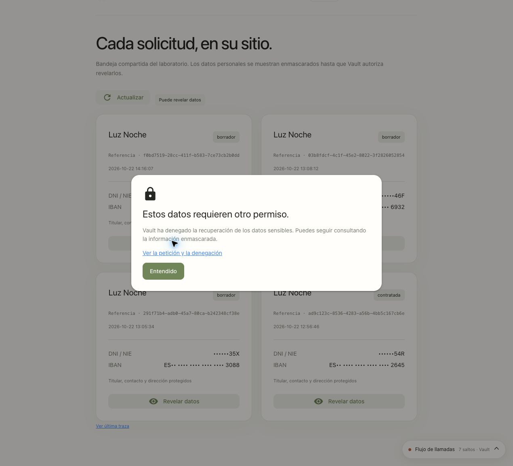

# Bloquear accesos durante la demostración

Con Vault y Lumen activos, ejecuta desde la raíz del workspace:

```bash
./demo.sh blocks
./demo.sh block xai
./demo.sh unblock xai
./demo.sh block database-read
./demo.sh unblock database-read
./demo.sh block database-write
./demo.sh unblock database-write
./demo.sh block decrypt
./demo.sh unblock decrypt
```

Los comandos usan la conexión administrativa generada al inicializar Vault. No requieren añadir secretos a `.env`, reiniciar la aplicación ni volver a entrar en Verify. El alcance es Lumen en el namespace `verify`, para todos sus usuarios. `unblock` retira únicamente ese bloqueo adicional: conserva las restricciones de grupos, RAR y políticas de base. Varios bloqueos pueden coexistir.

| Control | Rutas denegadas en Vault | Efecto visible |
|---|---|---|
| `xai` | `xai/creds/lumen`, `secrets/data/chatbot/xai-access` | Un nuevo mensaje libre recibe un HTTP 403 de Vault antes de invocar el LLM. Los botones que consultan datos directamente siguen funcionando. |
| `database-read` | `database/creds/chatbot-readonly`, `database/creds/chatbot-readwrite` y `database/creds/chatbot-contract` | Fallan catálogo, inventario, solicitudes y formalización de contratos; se revocan los tres tipos de leases. |
| `database-write` | `database/creds/chatbot-readwrite` y `database/creds/chatbot-contract` | El gestor puede consultar con RO; guardar borradores o formalizar contratos recibe 403 al pedir la credencial. |
| `decrypt` | `transit/decrypt/lumen-applications`, `transform/decode/lumen-dni`, `transform/decode/lumen-iban` | El supervisor ve la lista enmascarada, pero no puede revelar los datos. Cifrado y tokenización permanecen disponibles para el gestor. |

El acceso habitual usa RO para SELECT y RW para guardar borradores. Ambos permiten leer. La contratación añade una credencial diferente, limitada a EXECUTE del procedimiento; los bloqueos de base de datos incluyen también este rol.

## Qué cambia realmente en Vault

Hay cuatro políticas independientes: `lumen-block-xai`, `lumen-block-database-read`, `lumen-block-database-write` y `lumen-block-decrypt`. Normalmente contienen solo un comentario. Al bloquear escritura, por ejemplo, el comando guarda en `lumen-block-database-write`:

```hcl
path "database/creds/chatbot-readwrite" {
  capabilities = ["deny"]
}
path "database/creds/chatbot-contract" {
  capabilities = ["deny"]
}
```

El `deny` prevalece sobre el permiso de la política de base. RAR debe permitir la ruta, pero nunca puede superar una denegación de la política. No se edita el JWT ni se espera a que caduque: las nuevas peticiones se evalúan contra la política actual de Vault. [Políticas de Vault](https://developer.hashicorp.com/vault/docs/concepts/policies) · [RAR](https://developer.hashicorp.com/vault/ai/iam/concepts/rar/enforcement).

La asociación depende del flujo:

- **Contratación CIBA:** los tres bloqueos se asignan al token nativo mediante `auth/ciba-contract/role/validator`; este paso no utiliza OBO.
- **xAI autónomo:** `lumen-block-xai` forma parte de las políticas de la entidad `chatbot-xai`. Es lo que limita Client Credentials.
- **MySQL y protección de datos OBO:** los tres bloqueos forman parte de `ceiling_policies` de `chatbot-oidc` y de los agentes por tarea. Vault comprueba tanto los permisos del usuario como ese límite del actor. Las políticas límite del registro se aplican a OBO; por sí solas no bloquean el acceso autónomo. [Agent registry](https://developer.hashicorp.com/vault/ai/iam/concepts/agent-registry).

`start` conserva las políticas de bloqueo existentes. `remove` elimina el Vault de la demo; el siguiente `start` crea las cuatro políticas inactivas. Las verificaciones de funcionamiento normal presuponen que no hay bloqueos: consulta `./demo.sh blocks` antes de ejecutar `verify`.

Para inspeccionar la política desde la CLI:

```bash
(
  source ~/.local/state/lumen-vault-demo/vault/config.env
  export VAULT_ADDR VAULT_TOKEN VAULT_CACERT
  vault policy read -namespace=verify lumen-block-database-write
  vault read -namespace=verify agent-registry/registration/display-name/chatbot-oidc
)
```

Si usas `LUMEN_STATE_DIR`, sustituye la ruta del ejemplo. En la UI de Vault selecciona el namespace `verify` y abre Policies → ACL Policies.

## RAR y claves xAI en caché

Verify recibe `authorization_details` en Client Credentials y devuelve un JWT firmado con estas dos rutas:

```json
[
  {"type":"vault:path_access","path":"xai/creds/lumen","capabilities":["read"]},
  {"type":"vault:path_access","path":"secrets/data/chatbot/xai-access","capabilities":["read"]}
]
```

Lumen valida la firma, issuer, caducidad, identidad del cliente y coincidencia exacta del RAR. El registro de `chatbot-xai` exige RAR; no hay fallback a un JWT sin esa restricción.

Antes de cada ejecución se lee `chatbot/xai-access` con ese JWT. Este registro contiene únicamente una generación de caché, no una API key. Su ACL permite que Vault deniegue también una ejecución que habría reutilizado una clave vigente. La clave se reutiliza mientras cubra el presupuesto de la ejecución y el margen de caducidad; el bloqueo no exige emitir una clave nueva por cada mensaje.

`block xai` instala primero el deny y revoca de forma síncrona los leases `xai/creds/lumen/`. `unblock xai` cambia la generación antes de retirar el deny. Así, incluso si nadie envía un mensaje durante el bloqueo, una clave revocada no se reutiliza después. Un fallo de revocación devuelve error y deja el deny activo; no se usa `revoke-force`.

En Vault 2.1.2 de esta imagen, `/sys/capabilities-self` rechazó los JWT externos durante la comprobación. Por eso esta versión utiliza una lectura KV real para reautorizar la caché, en lugar de presentar una comprobación de capacidades como si hubiera funcionado.

## Recorrido en la interfaz

1. **xAI:** selecciona xAI y escribe una pregunta sobre energía. Ejecuta `block xai` y envía otra: aparece la ruta denegada y HTTP 403. Ejecuta `unblock xai` y repite: se obtiene una clave nueva y vuelve la respuesta.
2. **Lectura:** entra como lector o gestor. Abre Planes de energía, ejecuta `block database-read` y pulsa otra vez el botón. Tras `unblock database-read`, repite sin cerrar sesión.
3. **Escritura:** entra como gestor y completa una solicitud ficticia hasta Revisión. Ejecuta `block database-write` y pulsa **Guardar borrador**. La lectura sigue disponible; el INSERT no llega a MySQL. Ejecuta `unblock database-write` y reintenta.
4. **Descifrado:** entra como supervisor. Abre Solicitudes, ejecuta `block decrypt` y pulsa Revelar datos. La lista permanece enmascarada. Tras `unblock decrypt`, la misma operación vuelve a funcionar.

`Comprobar límites en Vault` hace peticiones reales a las nueve rutas SQL/Transit/Transform. La columna Esperado describe los permisos normales del perfil; un bloqueo administrativo produce una diferencia deliberada entre esa columna y Resultado.

En cada acción, **Ver última traza → Ver en Grafana** permite seguir el JWT/RAR, la ruta y la respuesta. En un bloqueo xAI no debe aparecer `xai.chat`; al bloquear una lectura SQL no debe aparecer `mysql.query`. En el formulario bloqueado puede aparecer el SELECT previo para comprobar duplicados, pero no el INSERT. Los cambios administrativos quedan también en la auditoría de Vault (`sys/policies/acl/lumen-block-*` y, cuando corresponda, `sys/leases/revoke-prefix/*`).

## Límites del bloqueo

Se bloquean las peticiones posteriores a Vault y se revocan los leases de las rutas SQL/xAI afectadas. Una petición ya en curso, una conexión MySQL ya abierta o información que el navegador ya haya mostrado no se deshacen. El comando no borra el historial del chat ni el texto ya revelado. Para comprobar de nuevo una lectura, usa el botón correspondiente: el modelo puede recordar información recibida antes del bloqueo.

El root token administrativo no queda bloqueado por estas políticas de Lumen. La aplicación no recibe ese token ni puede modificar las políticas.

## Validación

[Prueba real xAI](../chatbot/docs/xai-rar-block-verification.json): JWT sin RAR y con RAR incorrecto denegados; mismo JWT permitido → bloqueado → permitido; token nuevo también denegado durante el bloqueo; lease emitido revocado. Se puede repetir con `bash chatbot/scripts/test-xai-block.sh` después de exportar `VAULT_ENV_FILE` apuntando a la conexión generada. La prueba requiere xAI inicialmente desbloqueado y lo deja desbloqueado.

El [ensayo de reinstalación del 22/10](runs/20261022T122934Z-full-e2e/README.md)
y la [revisión integral posterior](runs/20261022T140230Z-workspace-review/README.md)
registran los resultados con la instalación actual. Comprueba la fecha y el alcance
de cada informe antes de reutilizar un resultado.

El [ensayo del 15/10](runs/20261015-rar-blocks/summary.json) y su
[correlación de auditoría](runs/20261015-rar-blocks/observability.json) se conservan
como histórico. La falta de algunas copias raw de Loki observada allí se corrigió
en la [reconstrucción posterior de ese día](E2E_OPENAI_VERIFICATION.md#trazas-y-auditoría).
No se presenta como una limitación pendiente ni se usan sus capturas como interfaz actual.

La [contratación CIBA](manual/17-contratacion-ciba.md) usa `database/creds/chatbot-contract`. Los bloqueos `database-read` y `database-write` incluyen este rol y revocan sus leases. El rol JWT CIBA también adjunta el bloqueo de descifrado.

## Bloqueo comprobado en la interfaz actual




