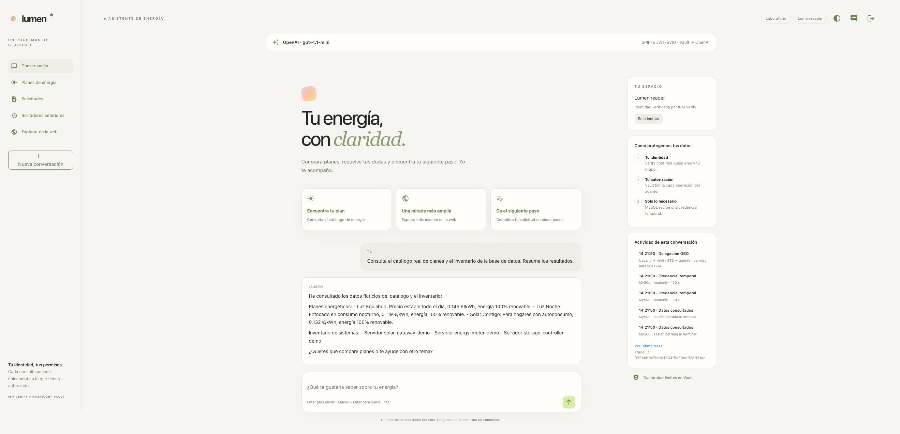
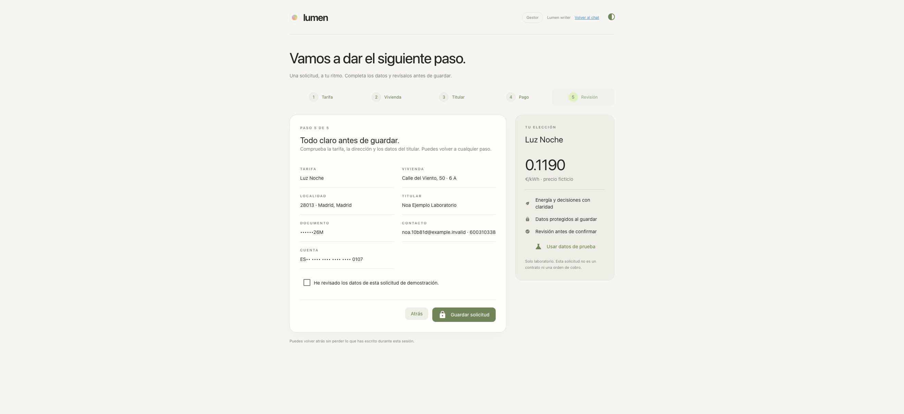
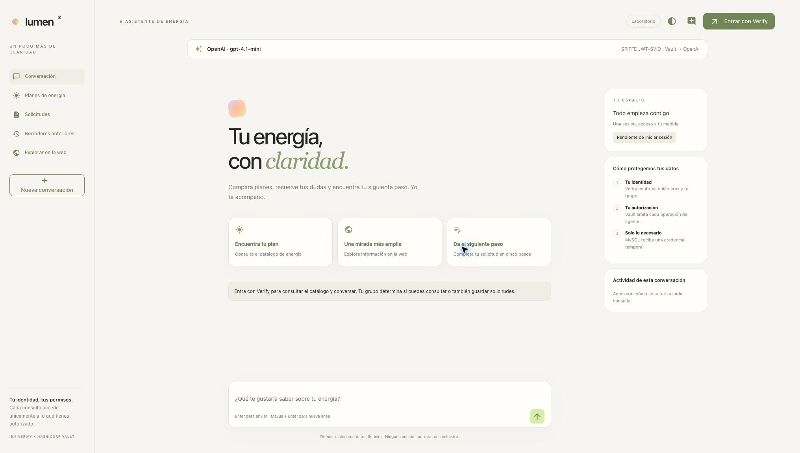

# Reconstrucción end-to-end — OpenAI SPIFFE

> Histórico: este informe corresponde al ciclo automatizado anterior. El despliegue se retiró después para la [instalación manual](manual/VALIDACION.md); sus trazas y capturas no corresponden al clúster actual.
Verificación real del **15 de octubre de 2026**, en Minikube `workshop`, Vault Enterprise `josemerchan/vault-xai:2.1.2-ent` e IBM Verify `merchan.verify.ibm.com`. Se eliminaron los recursos, se comprobó el estado vacío y se reconstruyó la demo desde `.env`. Las capturas de esta página pertenecen al despliegue nuevo.

Referencia reproducible: [notebook 9 — OpenAI/Vault SPIFFE](../9_OpenAI_Vault_SPIFFE.ipynb). [Guía de integración](OPENAI_SPIFFE.md). Evidencias: `runs/20261015T114709Z-openai-clean/`.

## Retirada y reconstrucción

Se ejecutaron `./demo.sh remove --dry-run`, `./demo.sh remove` y `CHATBOT_VERIFY_ACCESS=1 ./demo.sh start`. El flag activa checks OBO adicionales después del login real de cada usuario; no simula su identidad.

| Comprobación | Resultado y evidencia |
|---|---|
| Retirada de Verify | 11 recursos: cuatro apps, STS, tres usuarios y tres grupos. [Resultado](runs/20261015T114709Z-openai-clean/remove.json) |
| Retirada de Kubernetes | Se retiraron los diez volúmenes de la demo; quedaron cero namespaces y cero PV de la demo. Bootstrap anterior eliminado; `.env` conservado. [Estado limpio](runs/20261015T114709Z-openai-clean/clean-state.json) |
| Recursos Verify recreados | Mismos 11 nombres, todos con identificadores nuevos. [Comparación](runs/20261015T114709Z-openai-clean/verify-resources-recreated.json) |
| Identidad nueva de Vault | Root token distinto, namespaces con otros UID y claves SPIFFE nuevas. [Comparación sin secretos](runs/20261015T114709Z-openai-clean/recreation.json) |
| Arranque automático | `auto` eligió OpenAI al existir ambas credenciales administrativas. [Etapas](runs/20261015T114709Z-openai-clean/start-auto-openai.json) |
| Confianza externa | Se conservaron proyecto, cuenta de servicio, proveedor y mapping OpenAI. El proyecto tiene cero API keys estáticas. [Comprobación](runs/20261015T114709Z-openai-clean/openai-provisioning.json) |
| Issuer público | Discovery/JWKS publicados; cuatro rutas privadas devuelven 404. [Resultados](runs/20261015T114709Z-openai-clean/public-route-checks.txt) |

**Alcance de “desde cero”:** los datos y recursos operativos de la demo se recrean. Se conservan `.env`, el cliente administrativo de Verify, el esquema RAR compartido, Minikube/cachés y la confianza administrativa en OpenAI. La creación inicial de esa confianza sigue siendo un prerrequisito externo documentado en el notebook; no se ha recreado el mapping por endpoints privados del dashboard.

El primer arranque encontró un HTTP 503 de OpenAI y se reanudó después de añadir reintentos GET. Otro intento detectó JWT “not valid yet”: la VM había quedado unos 14 minutos atrás durante la prueba. Se sincronizó el reloj con el host y se mantuvo `caffeinate` durante la validación. El arranque posterior terminó correctamente; no se amplió la tolerancia ni se desactivó validación TLS/JWT. [Intento 503](runs/20261015T114709Z-openai-clean/start-transient-503.json) · [Intento con desfase](runs/20261015T114709Z-openai-clean/start-clock-skew.json).

## Casos de uso evaluados

| Caso | Resultado observado |
|---|---|
| OpenAI SPIFFE | JWT-SVID nuevo, token exchange e inferencia reales; una segunda ejecución obtiene otra credencial. Cinco comprobaciones correctas |
| Lector | OpenAI consulta catálogo e inventario mediante herramientas y OBO SQL RO; escritura local bloqueada; SQL RW y recuperación de sensibles reciben 403 |
| Gestor | Prepara la solicitud con Deep Agents/OpenAI; completa cinco pasos y guarda con SQL RW, Transit encrypt y Transform encode; no puede revelar |
| Supervisor | Consulta la bandeja enmascarada, recupera perfil/DNI/IBAN con OBO y no puede crear solicitudes ni obtener SQL RW |
| Permisos | 9/9 rutas coinciden para cada perfil: **27 comprobaciones** de SQL, administración, Transit y Transform |
| OBO al iniciar sesión | **20/20 checks** con usuarios reales: SQL SELECT, frontera de INSERT/rollback y denegación del secreto Tavily |
| Tavily autónomo | Agente registrado, Client Credentials, secreto en Vault y resultados públicos; sin delegación del usuario para ese secreto |
| `block database-read` | El lector recibe 403 sin cambiar sesión; al desbloquear vuelve a consultar |
| `block database-write` | Guardado rechazado; cero filas parciales. Tras desbloquear se guarda una única solicitud |
| `block decrypt` | Incluso el supervisor recibe 403; tras desbloquear recupera los valores originales |
| xAI | Cambio real de proveedor, emisión dinámica, inferencia y rechazo de clave caducada; 12/12 checks |
| RAR/bloqueo xAI | RAR ausente/incorrecto denegado, JWT anterior y nuevo bloqueados, lease revocado y recuperación tras desbloquear; 8/8 checks |
| Presentación | Temas claro/oscuro, móvil 390 px sin desbordamiento y favicon servido igual al del workspace |

Informes: [114 pruebas de aplicación + dos subcasos y etapas de verificación](runs/20261015T114709Z-openai-clean/verify-openai-run.json), [18 checks de infraestructura](runs/20261015T114709Z-openai-clean/infrastructure-tests.json), OBO [lector](runs/20261015T114709Z-openai-clean/obo-readonly.json), [gestor](runs/20261015T114709Z-openai-clean/obo-readwrite.json), [supervisor](runs/20261015T114709Z-openai-clean/obo-supervisor.json), [OpenAI](runs/20261015T114709Z-openai-clean/openai-inference.json), [xAI dinámico](runs/20261015T114709Z-openai-clean/xai-dynamic.json) y [xAI RAR/bloqueo](runs/20261015T114709Z-openai-clean/xai-blocks.json).

## Recorrido de los usuarios

El lector consulta datos con OpenAI; la actividad muestra credenciales SQL temporales obtenidas mediante OBO.



[Permisos del lector](runs/20261015T114709Z-openai-clean/screenshots/reader-permissions.jpg) · [Escritura denegada](runs/20261015T114709Z-openai-clean/screenshots/reader-write-denied.jpg) · [Lectura bloqueada](runs/20261015T114709Z-openai-clean/screenshots/reader-database-blocked.jpg) · [Lectura restaurada](runs/20261015T114709Z-openai-clean/screenshots/reader-database-restored.jpg) · [Tavily](runs/20261015T114709Z-openai-clean/screenshots/reader-tavily.jpg).

El gestor pide al agente preparar Luz Noche y completa el formulario. Se aceptaron dirección, titular, DNI e IBAN ficticios mediante Tab; un DNI con letra incorrecta se rechazó antes de avanzar. Ninguna acción contrata un suministro ni realiza cargos.



[Preparación por el agente](runs/20261015T114709Z-openai-clean/screenshots/writer-agent-prepares.jpg) · [Tarifa](runs/20261015T114709Z-openai-clean/screenshots/wizard-1-plan.jpg) · [Vivienda](runs/20261015T114709Z-openai-clean/screenshots/wizard-2-address.jpg) · [Validación DNI](runs/20261015T114709Z-openai-clean/screenshots/wizard-invalid-dni.jpg) · [Pago](runs/20261015T114709Z-openai-clean/screenshots/wizard-4-payment.jpg) · [Guardado bloqueado](runs/20261015T114709Z-openai-clean/screenshots/writer-save-blocked.jpg) · [Guardado correcto](runs/20261015T114709Z-openai-clean/screenshots/writer-save-success.jpg).

La solicitud `991f9bb8-9255-4582-a015-8cb5cfb0428b` queda en MySQL con `profile_ciphertext` de Transit, `dni_token`, `iban_token` y pistas enmascaradas. Se comprobó que los documentos originales normalizados no aparecen en la fila. [Evidencia de almacenamiento](runs/20261015T114709Z-openai-clean/protected-storage.json) y [cero filas tras la escritura bloqueada](runs/20261015T114709Z-openai-clean/blocked-save-database.json).


[Gestor: recuperación denegada](runs/20261015T114709Z-openai-clean/screenshots/writer-reveal-denied.jpg) · [Lector: vista enmascarada](runs/20261015T114709Z-openai-clean/screenshots/reader-masked-application.jpg) · [Lector: recuperación denegada](runs/20261015T114709Z-openai-clean/screenshots/reader-reveal-denied.jpg) · [Supervisor bloqueado](runs/20261015T114709Z-openai-clean/screenshots/supervisor-decrypt-blocked.jpg) · [Supervisor sin escritura](runs/20261015T114709Z-openai-clean/screenshots/supervisor-write-denied.jpg).

El DNI y el IBAN recuperados coinciden con las sugerencias originales; tras cerrar el diálogo no permanecen en el DOM. Los cinco spans de llamadas al modelo contienen prompts/respuestas, y el DNI/IBAN del formulario no aparecen en esos mensajes. [Comparación de UI](runs/20261015T114709Z-openai-clean/reveal-ui.json) · [Modelo y favicon](runs/20261015T114709Z-openai-clean/model-content-ui-checks.json).

## Trazas y auditoría

Se correlacionaron **16 trazas de los casos de uso, 229 spans y 55 operaciones de Vault**. Cada operación tiene su par request/response, incluidos los 403. Se compararon JWT enviado, JWT de auditoría, cuerpo y respuesta, sin copiar secretos al informe. [Resultado completo](runs/20261015T114709Z-openai-clean/all-ui-observability.json) · [Índice de Trace IDs](runs/20261015T114709Z-openai-clean/ui-traces.json).


La traza del catálogo/inventario es `095ebb9e2bc0f1564f5e53cd328d31ed`, con 21 spans. La recuperación del supervisor es `0e41593d38eb8f16182d37877aeafd70`, con SQL RO, Transit decrypt y dos Transform decode. Los enlaces de [la guía OpenAI](OPENAI_SPIFFE.md#trazas) abren Grafana con el intervalo correcto.

**Incidencia corregida:** Alloy 1.20.1 perdía cuatro eventos raw de petición, aunque estaban presentes en `kubectl logs`. Se observó una línea con timestamp `12:23:52.075392321Z` después de otra `12:23:52.075436363Z`, el caso descrito en [grafana/alloy#7076](https://github.com/grafana/alloy/issues/7076). Se fijó **1.21.0-rc.0**, que contiene [la corrección #7080](https://github.com/grafana/alloy/pull/7080). Al releer los logs originales, los cuatro eventos aparecieron en Loki y pasaron las 16 trazas. Además pasó una [nueva prueba de nueve rutas posterior a la actualización](runs/20261015T114709Z-openai-clean/fresh-after-alloy-fix.json).

Se conserva [el diagnóstico previo](runs/20261015T114709Z-openai-clean/audit-gaps.json); los informes individuales fallidos de `traces/` describen esa primera pasada, no el resultado final. No se sustituyeron valores ni se relajaron las comparaciones. El dashboard cuenta `request.id` únicos para que la relectura no infle los contadores. Se configuró `updateIntervalSeconds: 30` para detectar cambios del ConfigMap por sondeo; los eventos de filesystem no habían actualizado el dashboard. [Comportamiento documentado por Grafana](https://grafana.com/docs/grafana/latest/administration/provisioning/#detect-updates-to-provisioned-dashboards-files).

La versión de Alloy es candidata y está fijada expresamente para este laboratorio. La corrección no convierte el scraping de logs en almacenamiento inmutable: una caída larga, rotación de logs o determinadas reconexiones siguen requiriendo un sink duradero en producción. Los eventos raw contienen credenciales según la configuración solicitada para el lab; los informes JSON públicos incluyen solo metadatos y booleanos.


## Reproducción y estado final

```bash
./demo.sh remove --dry-run
./demo.sh remove
CHATBOT_VERIFY_ACCESS=1 ./demo.sh start
./demo.sh verify --provider openai
# Entrar con cada usuario y recorrer los casos anteriores.

# Regresión de la alternativa xAI:
./demo.sh start --provider xai
./demo.sh verify --provider xai
bash chatbot/scripts/test-xai-block.sh
./demo.sh start --provider openai
```

`start` conserva los bloqueos; la prueba restaura todos con `unblock`. `remove` borra también las trazas del cluster. Las capturas e informes del workspace permanecen como evidencia fechada. Los recursos externos OpenAI se conservaron durante todo el ciclo. El notebook es una referencia por etapas con celdas Bash, sin salidas ni credenciales; `demo.sh` sigue siendo el punto de entrada de un solo paso.


Se dejó **OpenAI · gpt-4.1-mini · SPIFFE JWT-SVID** activo. La [última instalación](runs/20261015T114709Z-openai-clean/final-start-openai.json), la [verificación final](runs/20261015T114709Z-openai-clean/final-verify-openai.json), la [inferencia final](runs/20261015T114709Z-openai-clean/final-openai-inference.json) y su [correlación Tempo/Loki](runs/20261015T114709Z-openai-clean/final-openai-observability.json) pasaron después de volver desde xAI. Los cuatro bloqueos adicionales están retirados; siguen aplicándose los permisos de cada perfil y RAR. La solicitud ficticia de la prueba se conserva para demostrar su lectura.

[Estado de servicios](runs/20261015T114709Z-openai-clean/final-status.txt) · [Estado de bloqueos](runs/20261015T114709Z-openai-clean/final-blocks.txt) · [Resumen de evidencias](runs/20261015T114709Z-openai-clean/summary.json) · [Validación estática de notebooks, scripts y enlaces](workspace-static-checks.json).


