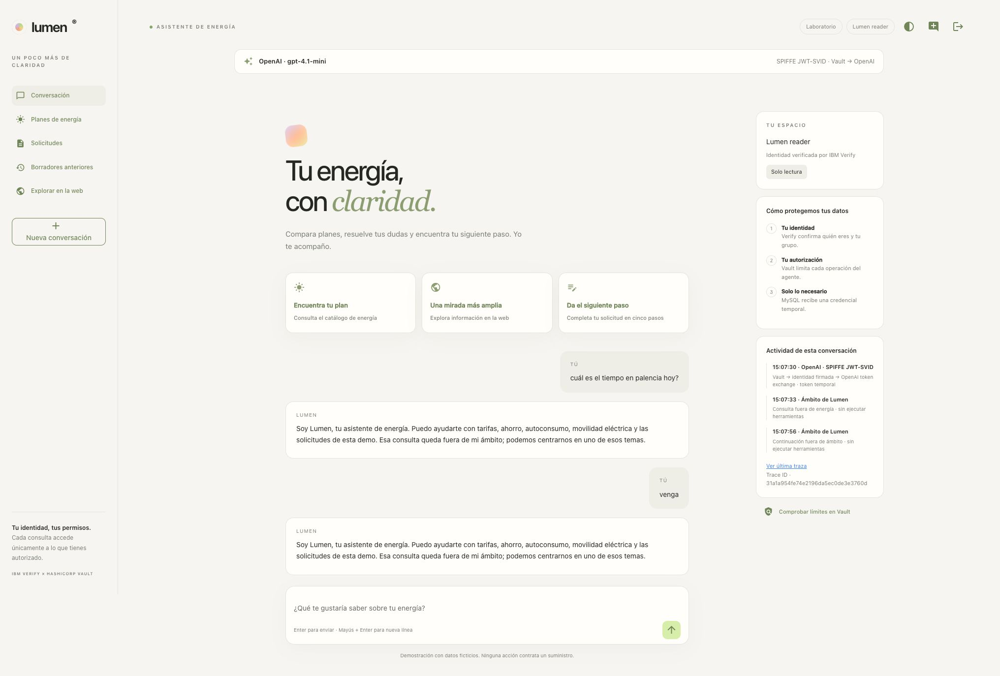
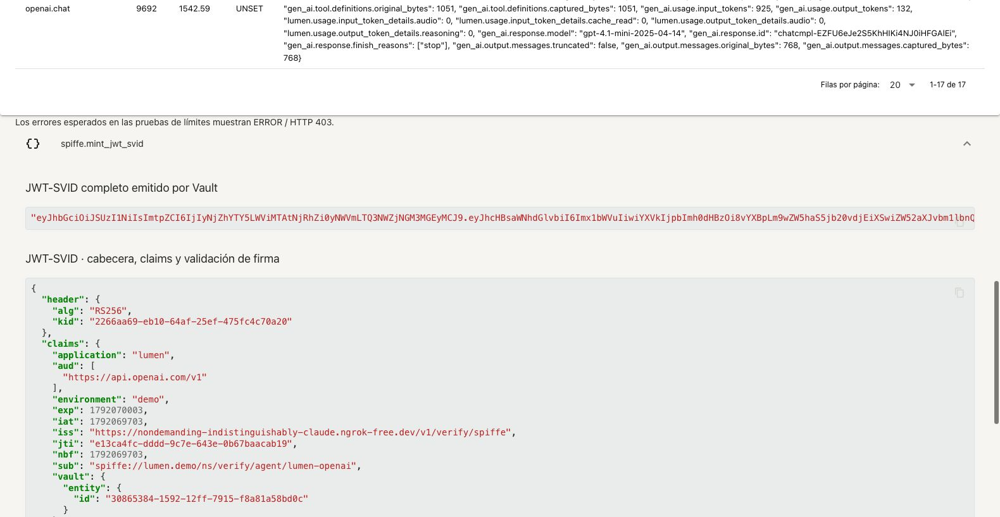
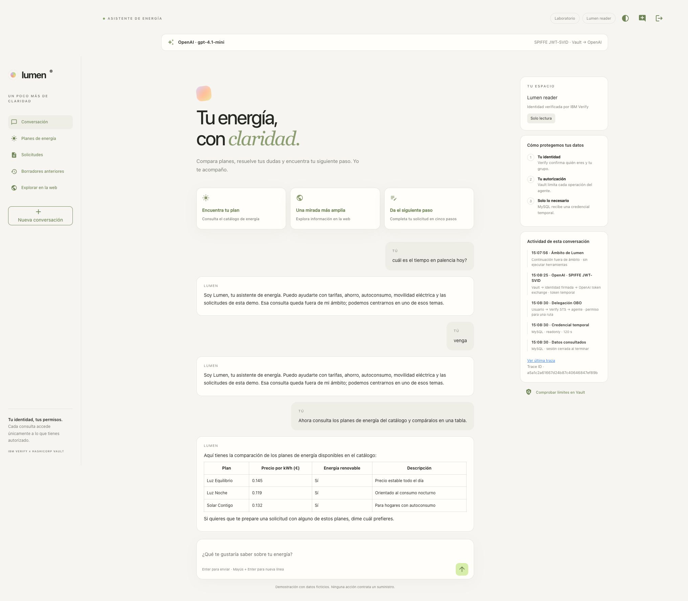

# Ámbito de Lumen y JWT-SVID en las trazas

Actualizado el 15 de octubre de 2026, después de la reconstrucción end-to-end. Se mantiene OpenAI `gpt-4.1-mini` con SPIFFE. La búsqueda Tavily conserva los cuatro temas públicos de energía; no se ha ampliado a consultas generales.

## Control antes del agente

El [control de ámbito](../chatbot/app/guardrails.py) se ejecuta desde `reply`, antes de construir el agente conversacional y darle herramientas. Usa una llamada independiente al mismo modelo, con salida estructurada y sin herramientas de datos o búsqueda. Clasifica energía, funciones de esta demo, conversación básica o fuera de ámbito. El historial solo ayuda a resolver referencias como «venga».

Si rechaza la consulta, el servidor devuelve una respuesta fija de redirección a energía. No se ejecuta el agente ni se consulta Tavily/MySQL/Transit/Transform. Si falla la clasificación o no devuelve el esquema esperado, tampoco se ejecuta el agente. El prompt del agente refuerza el mismo límite y prohíbe ofrecer búsquedas, enlaces o continuaciones sobre otros temas.

Una continuación breve tras ese rechazo —«venga», «sí», «continúa»— se rechaza directamente, sin otra llamada al modelo ni emisión de identidad. Una pregunta nueva de energía sí pasa al clasificador. Las preguntas sobre cómo afecta la lluvia a paneles solares están dentro del ámbito; preguntar el pronóstico de una ciudad queda fuera. Mezclar una petición válida con otra ajena se rechaza.

El clasificador añade una llamada al modelo por consulta normal y comparte el presupuesto de 180 segundos de la ejecución. Para clasificar con OpenAI se necesita primero el JWT-SVID y el intercambio: una petición rechazada puede tener esa operación de Vault, pero no operaciones de datos/búsqueda. Las ACL de Vault, RAR y los permisos SQL siguen siendo la frontera de autorización. La clasificación semántica es probabilística; las pruebas acreditan los casos evaluados, no una garantía para cualquier texto adversarial.

En las trazas: `guardrail.energy_scope`, con `guardrail.allowed`, `guardrail.category`, `guardrail.stage` y, para la continuación local, `guardrail.rule=blocked_followup`. La llamada de clasificación `openai.chat` es hija de ese span y conserva entrada/salida según el modo de captura del modelo.



## Ver el JWT-SVID

En una ejecución nueva, abrir **Ver última traza** y expandir:

| Paso | Campo | Qué muestra |
|---|---|---|
| `spiffe.mint_jwt_svid` | `spiffe.jwt_svid` | JWT-SVID completo emitido por Vault |
| `spiffe.mint_jwt_svid` | `spiffe.jwt_svid.decoded` | Cabecera, claims y resultado de validación local de firma |
| `openai.token_exchange` | `openai.exchange.subject_token` | El mismo JWT-SVID enviado a OpenAI |

La tabla de metadatos muestra además `kid`, `jti`, issuer, audiencia, SPIFFE ID, `iat` y `exp`. La firma se valida con RS256 y JWKS de Vault antes de marcar `signature_verified=true`.

El JWT de Verify presentado **a Vault** sigue en `vault.auth.jwt`; es distinto del JWT-SVID emitido **por Vault**. El access token que devuelve OpenAI se usa solo en el servidor para inferencia. El JWT-SVID no se incorpora a los mensajes del modelo ni a las herramientas de negocio.

**Ver en Grafana** abre la misma traza de Tempo. Los campos raw dependen de `LUMEN_TRACE_VAULT_RAW=1`, ya habilitado en este laboratorio; con `0` desaparecen token y claims completos de nuevas trazas. Los datos grandes conservan indicadores de truncado. Las trazas anteriores no se reescriben: en ellas el JWT-SVID estaba dentro de `vault.http.response`, no en estos campos explícitos.



## Verificación

- 123 tests y dos subcasos correctos.
- 12/12 decisiones con OpenAI real: meteorología, continuación antigua, continuación rechazada, intento de cambiar las instrucciones, mezcla de temas, programación general y seis casos permitidos.
- Seis comprobaciones del JWT-SVID: coincide con la respuesta de Vault y con `subject_token`, firma y sujeto válidos, captura completa y ausencia en los mensajes del modelo.
- [Evaluación reproducible](runs/20261015-energy-scope-svid/live-evaluation.json) y [correlación real con la auditoría de Vault](runs/20261015-energy-scope-svid/live-audit-correlation.json).

```bash
# Con la demo arrancada; hace llamadas reales al proveedor activo.
bash chatbot/scripts/verify-guardrails.sh
```

El script usa una sesión técnica solo para emitir la identidad del modelo y evaluar el clasificador. No suplanta usuarios ni prueba permisos OBO humanos; el recorrido de Chrome usa el login real de `lumen-reader`.

Referencia: [OpenAI function calling y selección de herramientas](https://developers.openai.com/api/docs/guides/function-calling#tool-choice). La salida estructurada del clasificador tiene una única función de decisión; el código de aplicación aplica esa decisión antes de ejecutar Deep Agents.

En Chrome se repitieron exactamente «cuál es el tiempo en palencia hoy?» y «venga»: ambas se rechazaron. La primera traza tiene nueve spans y solo la emisión SPIFFE como operación de Vault; la segunda tiene tres spans, sin modelo ni Vault. Después, una consulta nueva del catálogo produjo 17 spans, con `tool.consultar_planes`, OBO y SELECT real. [Resumen de interfaz](runs/20261015-energy-scope-svid/summary.json) · [Correlación con Vault](runs/20261015-energy-scope-svid/ui-audit-correlation.json).



[Ver esta ejecución en Grafana, con su JWT-SVID](http://localhost:3000/explore?schemaVersion=1&orgId=1&panes=%7B%22lumen%22%3A%7B%22datasource%22%3A%22lumen-tempo%22%2C%22queries%22%3A%5B%7B%22refId%22%3A%22A%22%2C%22queryType%22%3A%22traceql%22%2C%22query%22%3A%22a5a1c2a61667d24b87c40646847ef89b%22%2C%22datasource%22%3A%7B%22type%22%3A%22tempo%22%2C%22uid%22%3A%22lumen-tempo%22%7D%7D%5D%2C%22range%22%3A%7B%22from%22%3A%221792069640942%22%2C%22to%22%3A%221792069772181%22%7D%7D%7D). El enlace local al visor depende de la sesión; Grafana conserva la traza mientras dure la retención.
