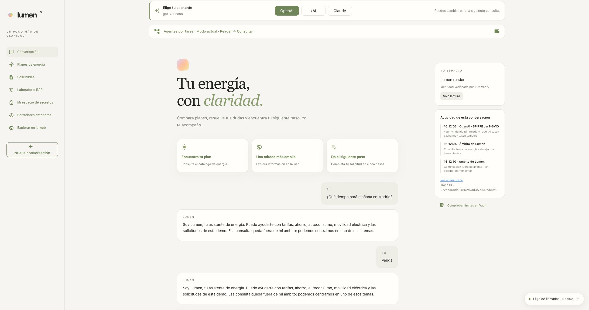

# Lumen scope and JWT-SVID in traces

Scope classification uses the provider selected in Lumen. The screenshots
in this guide were refreshed on **10/22/2026**. Public energy searches
are in scope; data permissions still depend on Vault.

## Check before the agent

The [scope control](../chatbot/app/guardrails.py) runs from `reply`, before the conversational agent is built and given tools. It uses a separate call to the same model, with structured output and no data or search tools. It classifies energy, features of this demo, basic conversation or out of scope. The history only helps resolve references such as «venga» ("go on").

If it rejects the query, the server returns a fixed response redirecting to energy in the language selected in Lumen, Spanish or English. The agent is not run and Tavily/MySQL/Transit/Transform are not queried. If the classification fails or does not return the expected schema, the agent is not run either. The agent prompt reinforces the same limit and forbids offering searches, links or follow-ups on other topics.

A short follow-up after that rejection («venga», «sí», «continúa», "go ahead", "continue") is rejected directly, without another model call or identity issuance. Both versions of the rejection are recognized even if EN/ES was switched between messages. A new energy question does go to the classifier. Questions about how rain affects solar panels are in scope; asking for a city's weather forecast is out of scope. Mixing a valid request with an unrelated one is rejected.

The classifier adds one model call per normal query and shares the run's 180-second budget. To classify with OpenAI, the JWT-SVID and the exchange are needed first: a rejected request may include that Vault operation, but no data/search operations. Vault ACLs, RAR and SQL permissions remain the authorization boundary. Semantic classification is probabilistic; the tests demonstrate the evaluated cases, not a guarantee for any adversarial text.

In traces: `guardrail.energy_scope`, with `guardrail.allowed`, `guardrail.category`, `guardrail.stage` and, for the local follow-up, `guardrail.rule=blocked_followup`. The classification call `openai.chat`, `xai.chat` or `anthropic.chat` is a child of that span and keeps input/output according to the model capture mode. The chosen language is passed to the agent for its new answers; it does not rewrite the history or the tool data. Catalog/proposal answers are built by the server in that language after a current authorized query. [Bilingual checks](manual/10-aplicacion.md#idioma-y-comprobaciones-bilingües).



## Viewing the JWT-SVID

In a new run, open **View latest trace / Ver última traza**, select the Vault call that issues the identity or the exchange with the provider and click **View sensitive values / Ver valores sensibles**. The viewer shows the values actually captured and their decoded versions; EN/ES translates the titles, not the tokens. [How it works and retention](../chatbot/OBSERVABILITY.md#valores-de-cada-llamada).

In Tempo, the issuance and exchange spans also keep these explicit fields:

| Step | Field | What it shows |
|---|---|---|
| `spiffe.mint_jwt_svid` | `spiffe.jwt_svid` | Full JWT-SVID issued by Vault |
| `spiffe.mint_jwt_svid` | `spiffe.jwt_svid.decoded` | Header, claims and result of the local signature validation |
| `openai.token_exchange` | `openai.exchange.subject_token` | The same JWT-SVID sent to OpenAI |
| `anthropic.token_exchange` | `anthropic.exchange.assertion` | Single-use JWT-SVID sent to Claude |

The metadata table also shows `kid`, `jti`, issuer, audience, SPIFFE ID, `iat` and `exp`. The signature is validated with RS256 and Vault's JWKS before `signature_verified=true` is set.

The Verify JWT presented **to Vault** is still in `vault.auth.jwt`; it is different from the JWT-SVID issued **by Vault**. The access token returned by OpenAI is used on the server for inference; in lab mode it can also be inspected in the capture of the exchange response. The JWT-SVID is not included in the model messages or in the business tools.

**View in Grafana** opens the same Tempo trace. The raw fields depend on `LUMEN_TRACE_VAULT_RAW=1`, already enabled in this lab; with `0`, the full token and claims disappear from new traces. Large data keeps truncation markers. Earlier traces are not rewritten: in them, the JWT-SVID was inside `vault.http.response`, not in these explicit fields.

[Historical screenshot: JWT-SVID and claims in the local viewer](runs/20261015-energy-scope-svid/screenshots/jwt-svid-expanded.jpg)

## Verification

The [full review of 10/22](runs/20261022T140230Z-workspace-review/README.md)
records the weather rejection, the blocked follow-up and recovery with an
explicit catalog request. It also keeps a false rejection by OpenAI of
a search about solar self-consumption and of questions about Lumen's OBO architecture.
The policy clarifies both cases and the OpenAI classifier uses temperature 0;
the conversation keeps its configuration. 16 cases with the initial provider
and 48 cases with additional phrasings across the three providers were repeated.
A classifier rejection does not demonstrate a Vault denial.

To repeat the evaluation of the configured initial provider:

```bash
# With the demo running; makes real calls to the active provider.
bash chatbot/scripts/verify-guardrails.sh
```

The script uses a technical session only to issue the model identity and evaluate the classifier. It does not impersonate users or test human OBO permissions; the Chrome walkthrough uses the real `lumen-reader` sign-in.

Reference: [OpenAI function calling and tool choice](https://developers.openai.com/api/docs/guides/function-calling#tool-choice). The classifier's structured output has a single decision function; the application code applies that decision before running Deep Agents.


The [adversarial run of 10/15](runs/20261015-energy-scope-svid/live-evaluation.json)
and its [audit correlation](runs/20261015-energy-scope-svid/live-audit-correlation.json)
are historical evidence. Open **View latest trace** in your own session to
inspect a current run.
