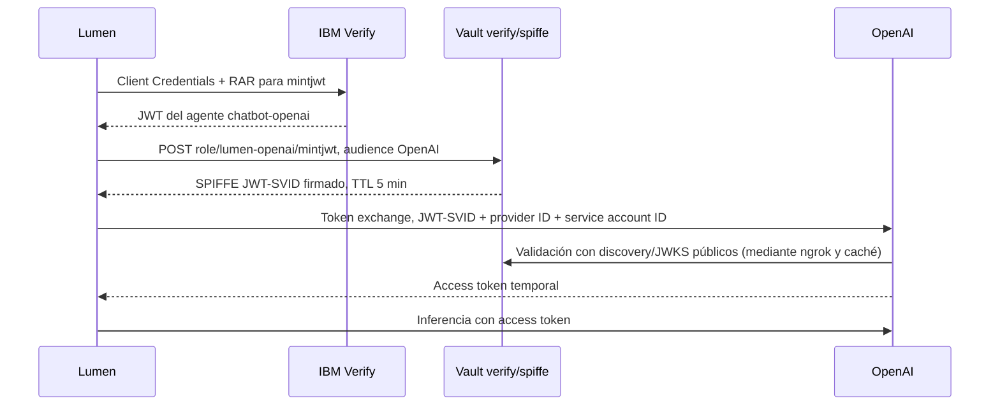

# OpenAI mediante SPIFFE JWT-SVID emitido por Vault

Lumen permite elegir **OpenAI**, **xAI** o **Claude** en el banner y muestra el modelo seleccionado. OpenAI y Claude usan SPIFFE JWT-SVID; xAI usa su Secret Engine dinámico. El cambio se aplica a la siguiente consulta, sin reiniciar ni repetir el login. **EN / ES** selecciona independientemente el idioma de la interfaz y las respuestas. [Comprobación bilingüe](manual/10-aplicacion.md#idioma-y-comprobaciones-bilingües). El login humano y las operaciones MySQL/Transit/Transform siguen usando Verify OIDC y OBO.

## Verificación y capturas

La [reinstalación del 22/10](runs/20261022T122934Z-full-e2e/README.md) comprobó
el intercambio y la inferencia con claves SPIFFE nuevas. La
[revisión de documentación e interfaz](runs/20261022T140230Z-workspace-review/README.md)
registra las comprobaciones posteriores y las capturas que utiliza esta guía.


[Inicio](screenshots/current/home.jpg) · [Modo oscuro](screenshots/current/home-dark.jpg)
· [Móvil a 390 px](screenshots/current/home-mobile.jpg).

El [informe del 15/10](E2E_OPENAI_VERIFICATION.md) conserva la reconstrucción
anterior. Las capturas del portal externo que se enlazan más abajo están fechadas;
no representan el estado actual de ese portal ni los IDs de tu instalación.

## Prerrequisitos y selección

Completa los prerrequisitos comunes del [README](../README.md). Para OpenAI añade a `.env`:

```bash
OPENAI_ADMIN_API_KEY='...'
LUMEN_MODEL_PROVIDER=auto
LUMEN_OPENAI_MODEL=gpt-4.1-nano
NGROK_DOMAIN=nondemanding-indistinguishably-claude.ngrok-free.dev
NGROK_AUTHTOKEN='' # Opcional si ngrok ya está autenticado localmente
SPIFFE_TRUST_DOMAIN=lumen.demo
```

Usa un dominio que pertenezca a tu cuenta ngrok. La API key administrativa se utiliza únicamente para preparar/verificar el proyecto y la cuenta de servicio, y se almacena además en `verify/secrets/openai-admin`. No se carga en el proceso Python ni se utiliza para inferencia. La organización necesita acceso al modelo elegido y facturación/cuota disponibles.

El arranque completo configura **OpenAI, xAI y Claude** y exige las entradas de
los tres. La selección solo determina el proveedor inicial del chat:

| Configuración | Selección inicial |
|---|---|
| `LUMEN_MODEL_PROVIDER=auto` con las entradas completas | OpenAI |
| `LUMEN_MODEL_PROVIDER=openai`, `xai` o `anthropic` | Proveedor explícito |
| `./demo.sh start --provider openai`, `xai` o `anthropic` | Prevalece sobre `.env` para esa ejecución |

`prepare-openai` es la excepción: prepara únicamente la base necesaria para
registrar la federación OpenAI antes del primer arranque completo.

## Preparación inicial de OpenAI

En **Organization → Admin keys**, crea `lumen-demo-provisioning` con permisos **Restricted → Organization Administration: Write** y las demás categorías en **None**. Guarda su valor en `OPENAI_ADMIN_API_KEY` dentro del `.env` privado; la clave solo se muestra una vez. Después ejecuta:

```bash
./demo.sh prepare-openai
```

Este comando despliega/inicializa Vault si es necesario, prepara `verify/spiffe`, publica discovery/JWKS y crea o reutiliza el proyecto `lumen-vault-demo` y la cuenta de servicio `lumen-chatbot`. Guarda `OPENAI_PROJECT_ID` y `OPENAI_SERVICE_ACCOUNT_ID` en `.env`. Si crear la cuenta genera una API key estática, revoca inmediatamente esa nueva clave: la aplicación utilizará WIF.

El alta del Workload Identity Provider y su mapping se realiza una vez en la [UI oficial de OpenAI](https://platform.openai.com/settings/organization/security/workload-identity-provider). La documentación pública consultada expone su configuración por UI y el endpoint de intercambio; no se utilizan endpoints privados del dashboard para automatizar su creación.

1. Crea el proveedor OIDC `lumen-vault-spiffe`.
2. **Issuer:** `https://<NGROK_DOMAIN>/v1/verify/spiffe`.
3. **Audience:** `https://api.openai.com/v1`.
4. Usa discovery normal; deja desactivados JWKS subido y discovery personalizado. No hacen falta transformaciones de atributos.
5. En sus detalles crea un mapping `lumen-chatbot` con **Key:** `sub` y **Value:** `spiffe://lumen.demo/ns/verify/agent/lumen-openai`. Si cambias el trust domain, adapta este valor.
6. Selecciona el proyecto y cuenta de servicio generados. Limita permisos a `api.model.request` y `api.model.read`.
7. Guarda el ID del proveedor en `.env` como `OPENAI_IDENTITY_PROVIDER_ID`. Conserva los IDs de proyecto/cuenta que preparó el script.

La confianza en un emisor y el permiso del mapping son configuraciones administrativas. Son prerrequisitos externos reutilizables; los arranques posteriores no requieren volver a la UI.

La UI agrupa `api.model.read` como **List models → Read** y `api.model.request` como **Model capabilities → Request**. El contador muestra los permisos internos incluidos en esas categorías; las demás categorías permanecen en **None**.

## Arranque y verificación

```bash
./demo.sh start --provider openai
```

```bash
./demo.sh verify --provider openai
```

El arranque completo conserva datos y reconcilia las tres integraciones; reinicia
Lumen, por lo que hay que entrar de nuevo con Verify. Para cambiar a xAI o Claude
durante una conversación, utiliza el selector de la interfaz. `verify` comprueba
el intercambio real y una inferencia del proveedor indicado; guarda los metadatos
OpenAI en `chatbot/docs/openai-spiffe-verification.json`.

`stop` detiene también ngrok y el publicador de JWKS. `remove` elimina la infraestructura local y los clientes de Lumen en Verify, incluido `vault-chatbot-openai`. **Conserva el proyecto, la cuenta de servicio, el proveedor y el mapping de OpenAI**, junto con sus IDs en `.env`. Al reconstruir Vault, el mismo issuer publica las nuevas claves; OpenAI puede actualizar JWKS al encontrar un `kid` nuevo.

## Flujo de una consulta



Vault es el emisor del JWT-SVID. El acceso a su motor se autentica con el cliente autónomo Verify de Lumen, registrado en Agent Registry y con RAR obligatorio. Su ACL solo permite `spiffe/role/lumen-openai/mintjwt` para la audiencia de OpenAI. Este diseño reutiliza la identidad disponible en el laboratorio; **no despliega SPIRE ni implementa su atestación de procesos/nodos**.

El `sub` identifica exactamente `spiffe://lumen.demo/ns/verify/agent/lumen-openai`. El motor añade `iss`, `aud`, `iat`, `exp`, `kid`, `jti` y la procedencia de la entidad Vault. El `jti` sirve para correlación; no convierte el JWT en un token de un solo uso.

Antes del intercambio, Lumen valida firma, issuer, audiencia, subject y caducidad con las claves públicas de Vault. OpenAI vuelve a validar la identidad y el mapping. El token devuelto por OpenAI ocupa el campo Bearer del SDK; no es una API key estática.

## Vigencia y renovación

Cada ejecución del agente obtiene un JWT-SVID nuevo y realiza un nuevo token exchange. No se retienen tokens OpenAI entre ejecuciones ni se almacena un refresh token. La ejecución exige más de 210 segundos de vigencia inicial y tiene un máximo de 180 segundos, con margen de 30 segundos antes de expirar. Si no hay vigencia suficiente, se rechaza el inicio. La siguiente consulta vuelve a emitir e intercambiar; no existe fallback a una API key estática.

Las claves xAI mantienen su propio mecanismo de caché, reautorización y reemplazo antes de caducar. `block xai` solo afecta a xAI; los bloqueos `database-read`, `database-write` y `decrypt` son compartidos por ambos proveedores porque controlan las herramientas OBO.

## Publicación mediante ngrok

El plan gratuito utilizado rechazó las acciones de Traffic Policy. La solución utiliza el servidor de archivos de ngrok sobre un directorio que contiene únicamente documentos públicos de Vault:

- `/v1/verify/spiffe/.well-known/openid-configuration`
- `/v1/verify/spiffe/.well-known/keys`

Un publicador Bash descarga esos documentos sin token de Vault, verifica su contenido y los actualiza cada 30 segundos. Si Vault deja de responder, retira las copias hasta recuperar la conexión. El túnel no reenvía peticiones a la API de Vault; las rutas administrativas y de secretos no existen en ese servidor. Ngrok y OpenAI pueden mantener sus propias cachés de documentos públicos.

El directorio público se mantiene separado de `.env`, las credenciales y los logs. El túnel no activa inspección de peticiones. `NGROK_DOMAIN` controla el host estable utilizado por el issuer.

## Trazas

En **Ver última traza → Ver en Grafana** aparecen `verify.client_credentials`, `spiffe.mint_jwt_svid`, `vault.write`, `openai.token_exchange` y los spans del modelo/herramientas. Se registran el SPIFFE ID, issuer, audiencia, `kid`, `jti`, caducidad, IDs del mapping y estados HTTP. El modo raw de laboratorio captura el JWT-SVID en la respuesta de Vault y, desde la ampliación del 15/10, en `spiffe.jwt_svid` del span de emisión. `spiffe.jwt_svid.decoded` incluye los claims y su validación, y `openai.exchange.subject_token` identifica el token enviado a OpenAI. [Campos y control de ámbito](ENERGY_SCOPE_AND_SVID.md). La Admin key no forma parte del runtime ni de esas trazas.

La revisión actual comprueba la consulta real del catálogo y los campos del JWT-SVID. Consulta las [evidencias y límites](runs/20261022T140230Z-workspace-review/README.md) y las [pruebas de ámbito](ENERGY_SCOPE_AND_SVID.md).

La consulta anterior al control de ámbito, de catálogo e inventario del lector, tiene Trace ID `095ebb9e2bc0f1564f5e53cd328d31ed`: **21 spans**, tres llamadas a Vault y sus seis eventos de auditoría. [Abrir en Grafana](http://localhost:3000/explore?schemaVersion=1&orgId=1&panes=%7B%22lumen%22%3A%7B%22datasource%22%3A%22lumen-tempo%22%2C%22queries%22%3A%5B%7B%22refId%22%3A%22A%22%2C%22queryType%22%3A%22traceql%22%2C%22query%22%3A%22095ebb9e2bc0f1564f5e53cd328d31ed%22%2C%22datasource%22%3A%7B%22type%22%3A%22tempo%22%2C%22uid%22%3A%22lumen-tempo%22%7D%7D%5D%2C%22range%22%3A%7B%22from%22%3A%221792066846985%22%2C%22to%22%3A%221792066975691%22%7D%7D%7D). El visor local requiere la sesión que originó la traza; tras cambiar usuario o reiniciar, usar Grafana.


Se detectó pérdida de cuatro copias raw al intercalar stdout/stderr con Alloy 1.20.1. La actualización de laboratorio a **1.21.0-rc.0** incorpora [la corrección oficial](https://github.com/grafana/alloy/pull/7080); al releer los logs originales se recuperaron los eventos y pasaron las comparaciones completas. También pasó una prueba nueva posterior. [Diagnóstico y verificación](E2E_OPENAI_VERIFICATION.md). Es una versión candidata fijada para esta demo.

Los informes del 15/10 pertenecen a un despliegue ya retirado. Las [trazas del ciclo manual del 16/10](runs/20261016T064722Z-manual-script/TRAZAS.md) también son evidencia fechada. Para comprobar la instalación activa, genera una ejecución nueva; el [historial de validación](manual/VALIDACION.md) enlaza las comprobaciones posteriores de interfaz, proveedores e idiomas.

## Referencias

- [OpenAI: SPIFFE workload identity federation](https://developers.openai.com/api/docs/guides/workload-identity-federation/spiffe).
- [OpenAI: token exchange y caducidad](https://developers.openai.com/api/reference/workload-identity-federation).
- [Vault: SPIFFE secrets engine](https://developer.hashicorp.com/vault/docs/secrets/spiffe).
- [Artículo de HashiCorp utilizado como referencia](https://www.hashicorp.com/en/blog/implementing-workload-identity-with-hashicorp-vault-and-spiffe).
- [Repositorio de referencia vault-spiffe](https://github.com/DarthVaderRC/vault-spiffe), especialmente el flujo de emisión JWT-SVID. No se ejecutan sus despliegues kind/SPIRE en este workspace.

Anthropic queda para el siguiente ejercicio; no se presenta como integración SPIFFE implementada en esta versión.
