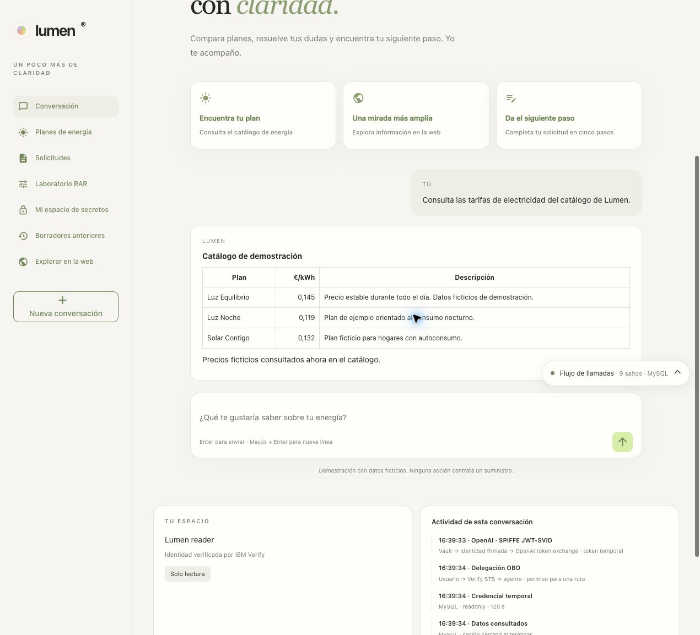
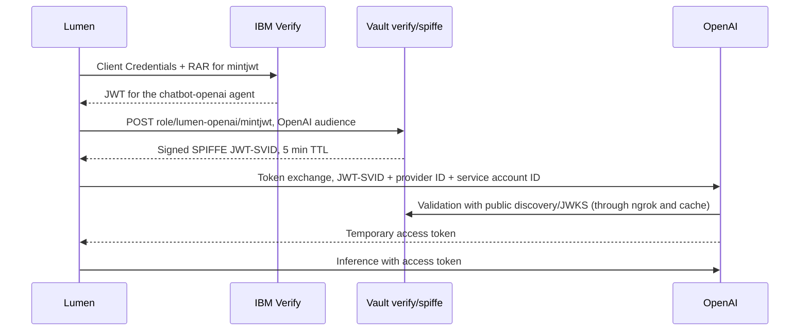

# OpenAI through a Vault-issued SPIFFE JWT-SVID

Lumen lets you choose **OpenAI**, **xAI** or **Claude** in the banner and shows the selected model. OpenAI and Claude use SPIFFE JWT-SVIDs; xAI uses its dynamic Secret Engine. The change applies to the next query, without restarting or signing in again. **EN / ES** independently selects the language of the interface and the answers. [Bilingual check](manual/10-aplicacion.md#idioma-y-comprobaciones-bilingües). Human sign-in and MySQL/Transit/Transform operations still use Verify OIDC and OBO.

## Verification and screenshots

The [reinstallation of 10/22](runs/20261022T122934Z-full-e2e/README.md) checked
the exchange and inference with new SPIFFE keys. The
[documentation and interface review](runs/20261022T140230Z-workspace-review/README.md)
records the later checks and the screenshots used in this guide.



[Home](screenshots/current/home.jpg) · [Dark mode](screenshots/current/home-dark.jpg)
· [Mobile at 390 px](screenshots/current/home-mobile.jpg).

The [10/15 report](E2E_OPENAI_VERIFICATION.md) keeps the earlier
rebuild. The screenshots of the external portal linked below are dated;
they do not represent the current state of that portal or the IDs of your installation.

## Prerequisites and selection

Complete the common prerequisites in the [README](../README.md). For OpenAI, add to `.env`:

```bash
OPENAI_ADMIN_API_KEY='...'
LUMEN_MODEL_PROVIDER=auto
LUMEN_OPENAI_MODEL=gpt-5.6-luna
NGROK_DOMAIN=nondemanding-indistinguishably-claude.ngrok-free.dev
NGROK_AUTHTOKEN='' # Optional if ngrok is already authenticated locally
SPIFFE_TRUST_DOMAIN=lumen.demo
```

Use a domain that belongs to your ngrok account. The administrative API key is used only to prepare/verify the project and the service account, and it is also stored in `verify/secrets/openai-admin`. It is not loaded into the Python process or used for inference. The organization needs access to the chosen model and available billing/quota.

The full startup configures **OpenAI, xAI and Claude** and requires the entries for
all three. The selection only determines the chat's initial provider:

| Configuration | Initial selection |
|---|---|
| `LUMEN_MODEL_PROVIDER=auto` with all entries filled in | OpenAI |
| `LUMEN_MODEL_PROVIDER=openai`, `xai` or `anthropic` | Explicit provider |
| `./demo.sh start --provider openai`, `xai` or `anthropic` | Takes precedence over `.env` for that run |

`prepare-openai` is the exception: it prepares only the base needed to
register the OpenAI federation before the first full startup.

<a id="preparación-inicial-de-openai"></a>
## Initial OpenAI setup

In **Organization → Admin keys**, create `lumen-demo-provisioning` with **Restricted → Organization Administration: Write** permissions and the other categories set to **None**. Save its value in `OPENAI_ADMIN_API_KEY` in the private `.env`; the key is shown only once. Then run:

```bash
./demo.sh prepare-openai
```

This command deploys/initializes Vault if needed, prepares `verify/spiffe`, publishes discovery/JWKS and creates or reuses the `lumen-vault-demo` project and the `lumen-chatbot` service account. It saves `OPENAI_PROJECT_ID` and `OPENAI_SERVICE_ACCOUNT_ID` in `.env`. If creating the account generates a static API key, revoke that new key immediately: the application will use WIF.

The Workload Identity Provider and its mapping are registered once in the [official OpenAI UI](https://platform.openai.com/settings/organization/security/workload-identity-provider). The public documentation consulted exposes its configuration through the UI and the exchange endpoint; private dashboard endpoints are not used to automate its creation.

1. Create the `lumen-vault-spiffe` OIDC provider.
2. **Issuer:** `https://<NGROK_DOMAIN>/v1/verify/spiffe`.
3. **Audience:** `https://api.openai.com/v1`.
4. Use normal discovery; leave uploaded JWKS and custom discovery disabled. No attribute transformations are needed.
5. In its details, create a `lumen-chatbot` mapping with **Key:** `sub` and **Value:** `spiffe://lumen.demo/ns/verify/agent/lumen-openai`. If you change the trust domain, adapt this value.
6. Select the generated project and service account. Limit permissions to `api.model.request` and `api.model.read`.
7. Save the provider ID in `.env` as `OPENAI_IDENTITY_PROVIDER_ID`. Keep the project/account IDs the script prepared.

Trusting an issuer and granting the mapping permission are administrative settings. They are reusable external prerequisites; later startups do not require going back to the UI.

The UI groups `api.model.read` as **List models → Read** and `api.model.request` as **Model capabilities → Request**. The counter shows the internal permissions included in those categories; the other categories remain at **None**.

## Startup and verification

```bash
./demo.sh start --provider openai
```

```bash
./demo.sh verify --provider openai
```

The full startup keeps data and reconciles the three integrations; it restarts
Lumen, so you have to sign in with Verify again. To switch to xAI or Claude
during a conversation, use the selector in the interface. `verify` checks
the real exchange and an inference with the given provider; it saves the OpenAI
metadata in `chatbot/docs/openai-spiffe-verification.json`.

`stop` also stops ngrok and the JWKS publisher. `remove` deletes the local infrastructure and the Lumen clients in Verify, including `vault-chatbot-openai`. **It keeps the OpenAI project, service account, provider and mapping**, along with their IDs in `.env`. When Vault is rebuilt, the same issuer publishes the new keys; OpenAI can refresh JWKS when it finds a new `kid`.

<a id="flujo-de-una-consulta"></a>
## Flow of a query



Vault is the JWT-SVID issuer. Access to its engine is authenticated with Lumen's autonomous Verify client, registered in Agent Registry with mandatory RAR. Its ACL only allows `spiffe/role/lumen-openai/mintjwt` for the OpenAI audience. This design reuses the identity available in the lab; **it does not deploy SPIRE or implement its process/node attestation**.

The `sub` identifies exactly `spiffe://lumen.demo/ns/verify/agent/lumen-openai`. The engine adds `iss`, `aud`, `iat`, `exp`, `kid`, `jti` and the provenance of the Vault entity. The `jti` is used for correlation; it does not turn the JWT into a single-use token.

Before the exchange, Lumen validates the signature, issuer, audience, subject and expiry with Vault's public keys. OpenAI validates the identity and the mapping again. The token returned by OpenAI fills the SDK's Bearer field; it is not a static API key.

## Validity and renewal

Each agent run obtains a new JWT-SVID and performs a new token exchange. OpenAI tokens are not kept between runs and no refresh token is stored. A run requires more than 210 seconds of initial validity and lasts at most 180 seconds, with a 30-second margin before expiry. If there is not enough validity left, the start is rejected. The next query issues and exchanges again; there is no fallback to a static API key.

xAI keys keep their own caching, reauthorization and replace-before-expiry mechanism. `block xai` only affects xAI; the `database-read`, `database-write` and `decrypt` blocks are shared by both providers because they control the OBO tools.

## Publishing through ngrok

The free plan used rejected Traffic Policy actions. The solution uses the ngrok file server on a directory that contains only public Vault documents:

- `/v1/verify/spiffe/.well-known/openid-configuration`
- `/v1/verify/spiffe/.well-known/keys`

A Bash publisher downloads those documents without a Vault token, verifies their content and refreshes them every 30 seconds. If Vault stops responding, it removes the copies until the connection recovers. The tunnel does not forward requests to the Vault API; the administrative and secret paths do not exist on that server. Ngrok and OpenAI can keep their own caches of public documents.

The public directory is kept separate from `.env`, credentials and logs. The tunnel does not enable request inspection. `NGROK_DOMAIN` controls the stable host used by the issuer.

<a id="trazas"></a>
## Traces

**View latest trace → View in Grafana** shows `verify.client_credentials`, `spiffe.mint_jwt_svid`, `vault.write`, `openai.token_exchange` and the model/tool spans. The SPIFFE ID, issuer, audience, `kid`, `jti`, expiry, mapping IDs and HTTP statuses are recorded. The lab raw mode captures the JWT-SVID in the Vault response and, since the 10/15 extension, in `spiffe.jwt_svid` on the issuance span. `spiffe.jwt_svid.decoded` includes the claims and their validation, and `openai.exchange.subject_token` identifies the token sent to OpenAI. [Fields and scope control](ENERGY_SCOPE_AND_SVID.md). The Admin key is not part of the runtime or those traces.

The current review checks the real catalog query and the JWT-SVID fields. See the [evidence and limits](runs/20261022T140230Z-workspace-review/README.md) and the [scope tests](ENERGY_SCOPE_AND_SVID.md).

The reader's catalog and inventory query from before the scope control has Trace ID `095ebb9e2bc0f1564f5e53cd328d31ed`: **21 spans**, three Vault calls and their six audit events. [Open in Grafana](http://localhost:3000/explore?schemaVersion=1&orgId=1&panes=%7B%22lumen%22%3A%7B%22datasource%22%3A%22lumen-tempo%22%2C%22queries%22%3A%5B%7B%22refId%22%3A%22A%22%2C%22queryType%22%3A%22traceql%22%2C%22query%22%3A%22095ebb9e2bc0f1564f5e53cd328d31ed%22%2C%22datasource%22%3A%7B%22type%22%3A%22tempo%22%2C%22uid%22%3A%22lumen-tempo%22%7D%7D%5D%2C%22range%22%3A%7B%22from%22%3A%221792066846985%22%2C%22to%22%3A%221792066975691%22%7D%7D%7D). The local viewer requires the session that produced the trace; after switching users or restarting, use Grafana.


Four raw copies were found to be lost when stdout/stderr were interleaved with Alloy 1.20.1. The lab upgrade to **1.21.0-rc.0** includes [the official fix](https://github.com/grafana/alloy/pull/7080); when the original logs were reread, the events were recovered and the full comparisons passed. A new later test also passed. [Diagnosis and verification](E2E_OPENAI_VERIFICATION.md). It is a release candidate pinned for this demo.

The 10/15 reports belong to a deployment that has since been removed. The [traces from the 10/16 manual cycle](runs/20261016T064722Z-manual-script/TRAZAS.md) are also dated evidence. To check the active installation, generate a new run; the [validation history](manual/VALIDACION.md) links the later interface, provider and language checks.

## References

- [OpenAI: SPIFFE workload identity federation](https://developers.openai.com/api/docs/guides/workload-identity-federation/spiffe).
- [OpenAI: token exchange and expiry](https://developers.openai.com/api/reference/workload-identity-federation).
- [Vault: SPIFFE secrets engine](https://developer.hashicorp.com/vault/docs/secrets/spiffe).
- [HashiCorp article used as a reference](https://www.hashicorp.com/en/blog/implementing-workload-identity-with-hashicorp-vault-and-spiffe).
- [vault-spiffe reference repository](https://github.com/DarthVaderRC/vault-spiffe), especially the JWT-SVID issuance flow. Its kind/SPIRE deployments are not run in this workspace.

Anthropic is left for the next exercise; it is not presented as an implemented SPIFFE integration in this version.
