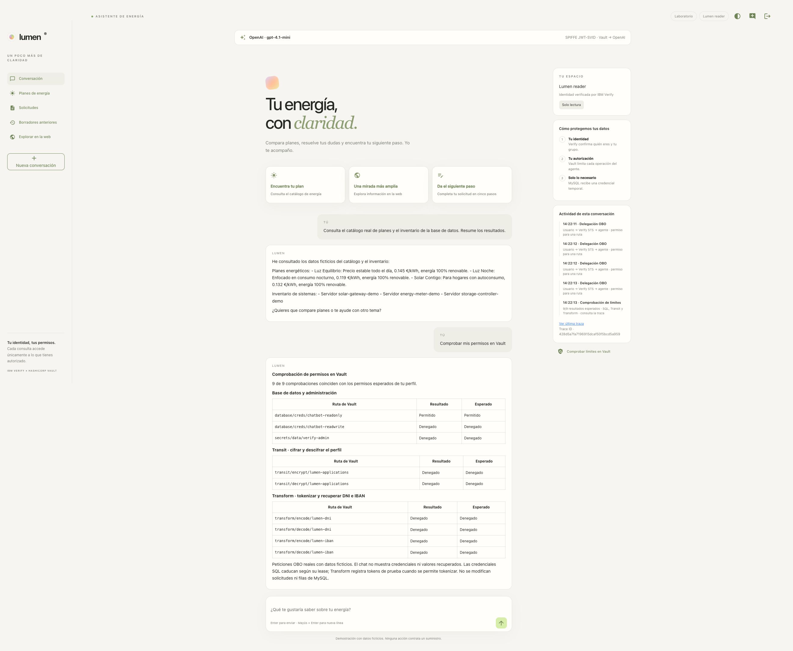
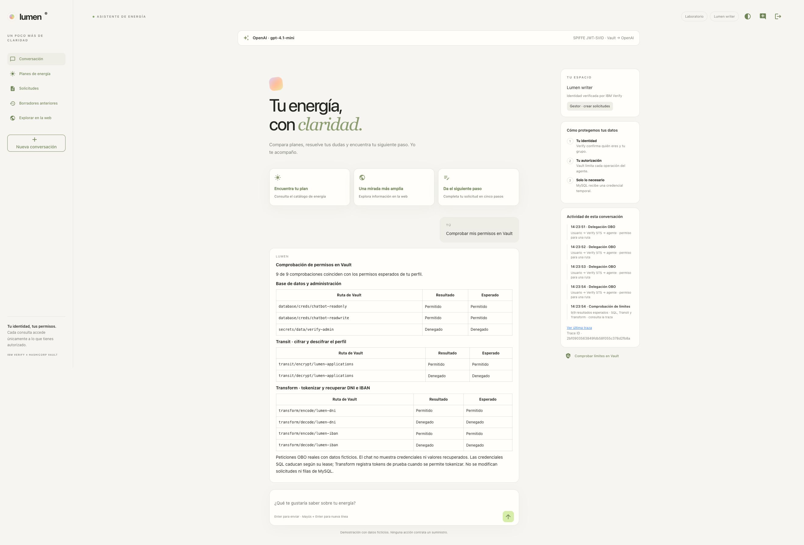

# Comprobación de permisos: SQL, Transit y Transform

Desde el **15 de octubre de 2026**, el botón **Comprobar límites en Vault** ejecuta nueve peticiones reales. La respuesta se divide en base de datos/administración, Transit y Transform. Cada fila muestra el resultado de Vault y el permiso esperado del perfil; el resumen indica cuántas comprobaciones coinciden.

| Ruta en el namespace `verify` | Lector | Gestor | Supervisor |
|---|---|---|---|
| `database/creds/chatbot-readonly` | Permitido | Permitido | Permitido |
| `database/creds/chatbot-readwrite` | Denegado | Permitido | Denegado |
| `secrets/data/verify-admin` | Denegado | Denegado | Denegado |
| `transit/encrypt/lumen-applications` | Denegado | Permitido | Denegado |
| `transit/decrypt/lumen-applications` | Denegado | Denegado | Permitido |
| `transform/encode/lumen-dni` | Denegado | Permitido | Denegado |
| `transform/decode/lumen-dni` | Denegado | Denegado | Permitido |
| `transform/encode/lumen-iban` | Denegado | Permitido | Denegado |
| `transform/decode/lumen-iban` | Denegado | Denegado | Permitido |

Transit cifra o descifra el perfil de una solicitud. Transform tokeniza o recupera DNI e IBAN. El gestor puede proteger datos para guardarlos; el supervisor puede recuperar los originales. El lector solo consulta la proyección enmascarada.

## Cómo se comprueba

Cada ruta obtiene su propio JWT mediante OBO. Las lecturas SQL/KV usan RAR `read`; las seis peticiones POST de Transit/Transform usan RAR `update`. Se consulta Vault incluso cuando se espera una denegación: los grupos determinan la columna «Esperado», pero el resultado procede de la respuesta real.

Solo HTTP 403 se presenta como «Denegado». Errores de red, OBO o del servicio no se interpretan como un permiso denegado. En las operaciones autorizadas de descifrado/recuperación se compara además el dato recuperado con el valor ficticio original. Un resultado inesperado queda reflejado en la tabla y en el resumen.

Durante el aprovisionamiento, `04-vault-agents.sh` invoca `configure-permission-probe.sh` después de crear la configuración del runtime. Este prepara una muestra cifrada y dos tokens de datos ficticios, y los conserva en `secrets/chatbot/runtime`. Su creación es idempotente y mantiene los grupos y la clave de sesión existentes. La aplicación ya podía leer esa configuración: no se añaden permisos al token de bootstrap ni a los perfiles humanos.

Esto permite probar `decrypt` y `decode` en una instalación vacía, sin consultar solicitudes de clientes y sin depender de que antes entre un gestor. Cada prueba autorizada de `encode` crea tokens ficticios en Transform; las credenciales SQL emitidas caducan según su lease. El chat no muestra credenciales ni valores recuperados y no se modifican filas de MySQL.

## Capturas de los tres perfiles

**Lector: una ruta permitida y ocho denegadas.**

**Gestor: cinco rutas permitidas y cuatro denegadas.**

**Supervisor: cuatro rutas permitidas y cinco denegadas.**

## Trazas y auditoría

**Ver última traza → Ver en Grafana** muestra el span `permissions.probe` y las nueve operaciones, incluidas las denegaciones. `probe.check_count` indica el número de rutas y `probe.matches_expected` si coinciden con el perfil. Los spans `vault.read`/`vault.write` conservan HTTP status, ruta, JWT OBO y petición/respuesta conforme al modo raw del laboratorio. En Loki, filtrar por el mismo Trace ID para ver los pares request/response.

Las capturas de esta página pertenecen a la reconstrucción del 15/10 con OpenAI. El resto del recorrido está en el [informe actual](E2E_OPENAI_VERIFICATION.md).

## Resultado de la reconstrucción del 15 de octubre

Pasaron 114 pruebas de aplicación y dos subcasos. Las sesiones OIDC de los tres perfiles completaron nueve comprobaciones cada una: **27 operaciones y 87 spans**. Cada petición y respuesta se correlacionó con Loki/Tempo, incluidos JWT y cuerpos. El resumen completo también incluye el resto de los casos de uso.

| Perfil | Permitidas | Denegadas | Grafana |
|---|---|---|---|
| Lector | 1 | 8 | [Abrir traza](http://localhost:3000/explore?schemaVersion=1&orgId=1&panes=%7B%22lumen%22%3A%7B%22datasource%22%3A%22lumen-tempo%22%2C%22queries%22%3A%5B%7B%22refId%22%3A%22A%22%2C%22queryType%22%3A%22traceql%22%2C%22query%22%3A%22428d5a7fa7196915dcaf50f5bcd5a959%22%2C%22datasource%22%3A%7B%22type%22%3A%22tempo%22%2C%22uid%22%3A%22lumen-tempo%22%7D%7D%5D%2C%22range%22%3A%7B%22from%22%3A%221792066869263%22%2C%22to%22%3A%221792066993220%22%7D%7D%7D) |
| Gestor | 5 | 4 | [Abrir traza](http://localhost:3000/explore?schemaVersion=1&orgId=1&panes=%7B%22lumen%22%3A%7B%22datasource%22%3A%22lumen-tempo%22%2C%22queries%22%3A%5B%7B%22refId%22%3A%22A%22%2C%22queryType%22%3A%22traceql%22%2C%22query%22%3A%222bf0903563849fdb58f055c378d2fb8a%22%2C%22datasource%22%3A%7B%22type%22%3A%22tempo%22%2C%22uid%22%3A%22lumen-tempo%22%7D%7D%5D%2C%22range%22%3A%7B%22from%22%3A%221792066965374%22%2C%22to%22%3A%221792067094945%22%7D%7D%7D) |
| Supervisor | 4 | 5 | [Abrir traza](http://localhost:3000/explore?schemaVersion=1&orgId=1&panes=%7B%22lumen%22%3A%7B%22datasource%22%3A%22lumen-tempo%22%2C%22queries%22%3A%5B%7B%22refId%22%3A%22A%22%2C%22queryType%22%3A%22traceql%22%2C%22query%22%3A%22c10b6819d0466a8bee095880851d9f85%22%2C%22datasource%22%3A%7B%22type%22%3A%22tempo%22%2C%22uid%22%3A%22lumen-tempo%22%7D%7D%5D%2C%22range%22%3A%7B%22from%22%3A%221792067286282%22%2C%22to%22%3A%221792067420001%22%7D%7D%7D) |

[Correlación completa](runs/20261015T114709Z-openai-clean/all-ui-observability.json) · [Prueba adicional de nueve rutas tras actualizar Alloy](runs/20261015T114709Z-openai-clean/fresh-after-alloy-fix.json).

La primera prueba de este botón, anterior a la retirada, queda como [evidencia histórica](runs/20261015-permission-probes/summary.json). Encontró copias raw ausentes en Loki. La reconstrucción permitió reproducir el problema y corregirlo actualizando Alloy a 1.21.0-rc.0; se recuperaron los eventos originales y pasó la correlación completa. Los detalles y el uso explícito de esa versión candidata están en el [informe actual](E2E_OPENAI_VERIFICATION.md#trazas-y-auditoría). Las antiguas trazas fueron eliminadas por `remove`.

La salida actual incluye la identidad del agente OBO de la sesión y metadatos
consultados directamente en Vault, con enlaces al registro, entidad, alias y
políticas. Esta información contextual no sustituye las nueve decisiones HTTP.
La traza identifica por separado los agentes de los proveedores y de Tavily.
Consulta [la ficha del agente y sus enlaces](manual/14-agentes-por-tarea.md#identificar-al-agente-y-pivotar-a-vault)
para el alcance de la credencial de inspección y la fecha de los metadatos.
