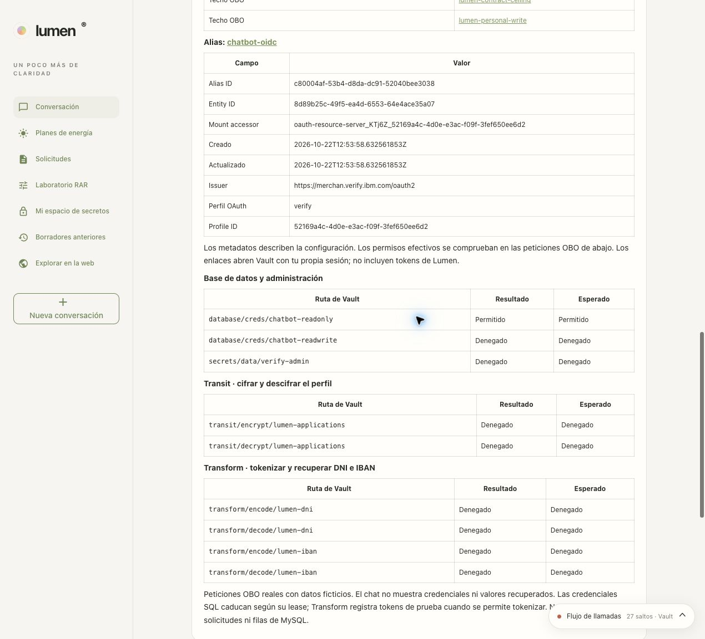
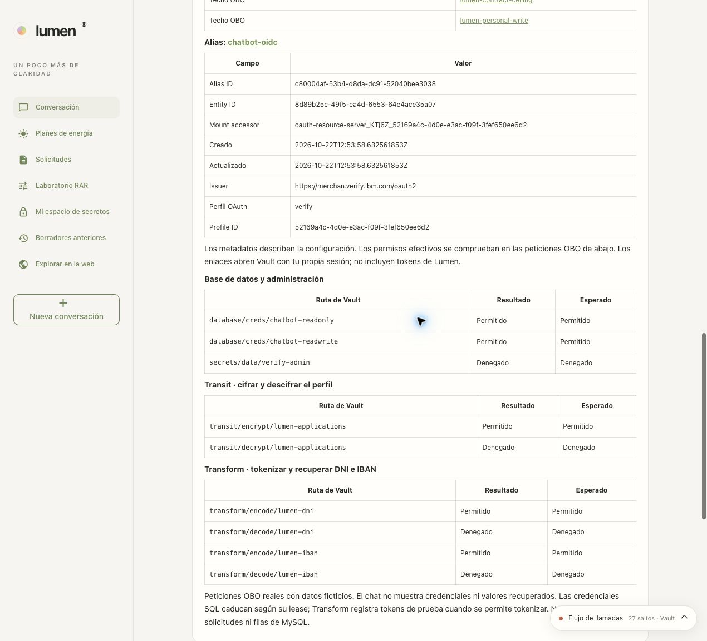
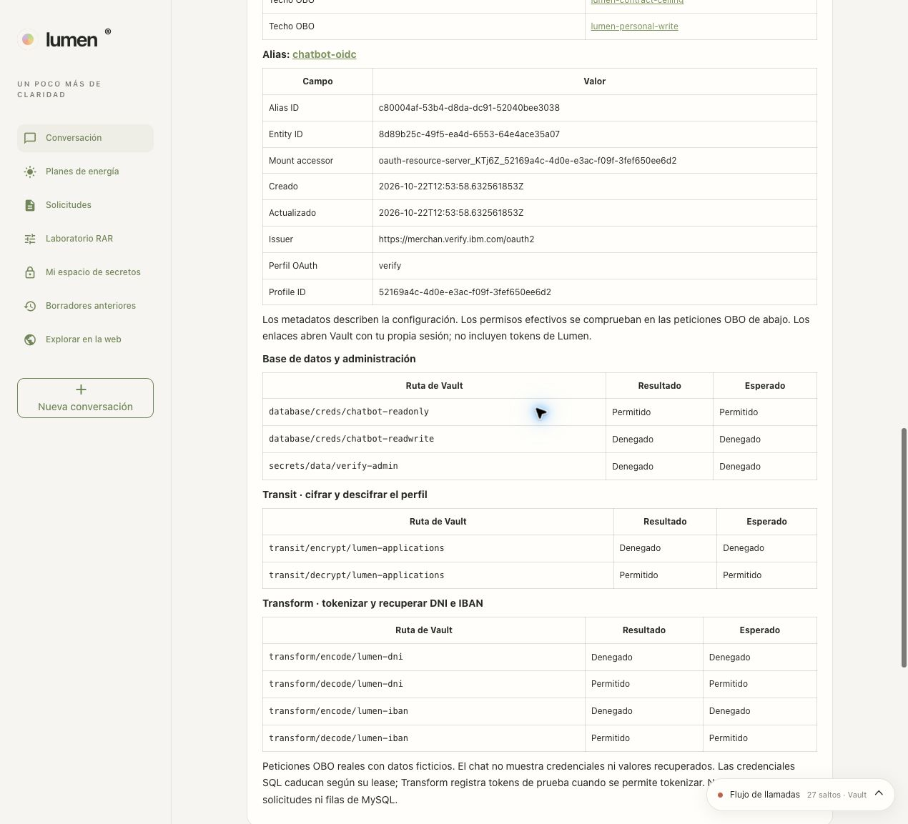

# Permission check: SQL, Transit and Transform

The **Check limits in Vault** button runs nine real requests. The response is split into database/administration, Transit and Transform. Each row shows the Vault result and the profile's expected permission; the summary states how many checks match.

| Path in the `verify` namespace | Reader | Writer | Supervisor |
|---|---|---|---|
| `database/creds/chatbot-readonly` | Allowed | Allowed | Allowed |
| `database/creds/chatbot-readwrite` | Denied | Allowed | Denied |
| `secrets/data/verify-admin` | Denied | Denied | Denied |
| `transit/encrypt/lumen-applications` | Denied | Allowed | Denied |
| `transit/decrypt/lumen-applications` | Denied | Denied | Allowed |
| `transform/encode/lumen-dni` | Denied | Allowed | Denied |
| `transform/decode/lumen-dni` | Denied | Denied | Allowed |
| `transform/encode/lumen-iban` | Denied | Allowed | Denied |
| `transform/decode/lumen-iban` | Denied | Denied | Allowed |

The matrix corresponds to the **Standard / Current mode** agent, with no administrative
blocks. A task agent can restrict it; the check uses the
active combination and shows its identity in Vault.

Transit encrypts or decrypts an application's profile. Transform tokenizes or retrieves the DNI and IBAN. The writer can protect data in order to save it; the supervisor can retrieve the originals. The reader only queries the masked projection.

## How it is checked

Each path obtains its own JWT through OBO. SQL/KV reads use RAR `read`; the six Transit/Transform POST requests use RAR `update`. Vault is queried even when a denial is expected: the groups determine the "Expected" column, but the result comes from the real response.

Only HTTP 403 is shown as "Denied". Network, OBO or service errors are not interpreted as a denied permission. For authorized decrypt/retrieval operations, the retrieved data is also compared with the original fictitious value. An unexpected result is reflected in the table and in the summary.

During provisioning, `04-vault-agents.sh` calls `configure-permission-probe.sh` after creating the runtime configuration. It prepares an encrypted sample and two fictitious data tokens, and keeps them in `secrets/chatbot/runtime`. Its creation is idempotent and keeps the existing groups and session key. The application could already read that configuration: no permissions are added to the bootstrap token or to the human profiles.

This makes it possible to test `decrypt` and `decode` on an empty installation, without querying customer applications and without depending on a writer having signed in first. Each authorized `encode` test creates fictitious tokens in Transform; the issued SQL credentials expire according to their lease. The chat does not show credentials or retrieved values, and no MySQL rows are modified.

## Screenshots of the three profiles

**Reader: one path allowed and eight denied.**

**Writer: five paths allowed and four denied.**

**Supervisor: four paths allowed and five denied.**

## Traces and auditing

**View latest trace → View in Grafana** shows the `permissions.probe` span and the nine operations, including the denials. `probe.check_count` gives the number of paths and `probe.matches_expected` whether they match the profile. The `vault.read`/`vault.write` spans keep the HTTP status, path, OBO JWT and request/response according to the lab raw mode. In Loki, filter by the same Trace ID to see the request/response pairs.

The screenshots were refreshed on **10/22/2026**. The results and Trace IDs of
this review are in the [full review report](runs/20261022T140230Z-workspace-review/README.md).
To get a navigable trace, click the button in your own session: local traces
are tied to it and expire. The JSON reports are dated evidence.

The [historical 10/15 report](E2E_OPENAI_VERIFICATION.md#trazas-y-auditoría)
keeps the Alloy ingestion diagnosis and its fix; it is not an
outstanding limitation of the current interface.

The current output includes the session's OBO agent identity and metadata
queried directly from Vault, with links to the registration, entity, alias and
policies. This contextual information does not replace the nine HTTP decisions.
The trace identifies the provider agents and the Tavily agent separately.
See [the agent card and its links](manual/14-agentes-por-tarea.md#identificar-al-agente-y-pivotar-a-vault)
for the scope of the inspection credential and the date of the metadata.
