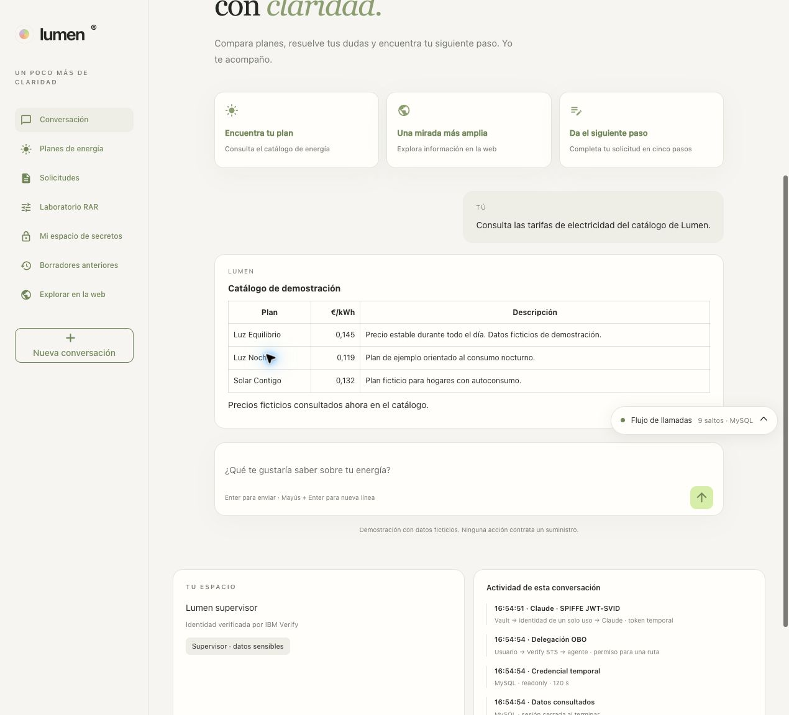

# 08 · Claude con SPIFFE JWT-SVID de Vault

[Índice](README.md) · Requiere [00–05](README.md#prerrequisitos-y-orden) · Después: [09 · observabilidad](09-observabilidad.md) y [10 · aplicación](10-aplicacion.md)

Esta rama autentica a Lumen en Claude mediante una identidad emitida por Vault. No necesita una API key de inferencia ni una Admin API key de Anthropic. La confianza externa conserva sus IDs, pero las claves públicas deben actualizarse en Claude después de recrear el almacenamiento de Vault. Los comandos Vault usan exclusivamente su CLI.

El arranque `./demo.sh start` sincroniza las claves en línea del emisor existente mediante la API oficial y después comprueba la federación y una inferencia real de Claude. Guarda el array público en `claude/issuer-keys.json` y el resultado de lectura posterior en `claude/issuer-sync.json`, dentro de `LUMEN_STATE_DIR`.

La sincronización requiere instalar la CLI oficial con `brew install anthropics/tap/ant` e iniciar sesión una vez con `ant auth login --profile lumen-admin --scope org:admin`, eligiendo la organización de esta demo. Ese permiso administrativo queda en el perfil local del instalador, fuera de Vault y del chatbot. La CLI renueva el token; si la sesión deja de ser válida, el instalador pide repetir el acceso. Puedes elegir otro perfil mediante `LUMEN_CLAUDE_ADMIN_PROFILE`. [Requisito OAuth de la API oficial](https://platform.claude.com/docs/en/manage-claude/wif-admin-api).

## 1. Entradas y orden de ejecución

Si la API de administración devuelve 404 también mediante la CLI oficial, selecciona `export LUMEN_CLAUDE_SYNC_MODE=console` en la sesión. El instalador exportará `claude/issuer-keys.json`, sin afirmar que se haya sincronizado: reemplaza ese array en las claves en línea del emisor existente desde la consola. Los bloques de federación e inferencia de este capítulo siguen siendo obligatorios. En el lanzador se usa `LUMEN_CLAUDE_SYNC_MODE=console ./demo.sh start`; repetirlo tras la actualización si la primera comprobación se detuvo. No cambiar la regla, el sujeto, la audiencia ni los permisos.

Preparar una organización Claude con acceso a la API, cuota y permiso para crear emisores, reglas y cuentas de servicio. En `.env` conservar las entradas comunes de 00 y `NGROK_DOMAIN`. Esta identidad es independiente de OpenAI y xAI; para el selector de la aplicación se preparan las tres ramas.

```bash
source "${LUMEN_STATE_DIR:-$HOME/.local/state/lumen-vault-demo}/manual/session.sh"
source "$LUMEN_STATE_DIR/vault/config.env"
export VAULT_ADDR VAULT_CACERT VAULT_TOKEN VAULT_NAMESPACE=verify
: "${NGROK_DOMAIN:?Falta el dominio ngrok de tu cuenta}"
export SPIFFE_TRUST_DOMAIN="${SPIFFE_TRUST_DOMAIN:-lumen.demo}"
export SPIFFE_ISSUER="https://$NGROK_DOMAIN/v1/verify/spiffe"
export ANTHROPIC_AUDIENCE=https://api.anthropic.com
export ANTHROPIC_SPIFFE_SUBJECT="spiffe://$SPIFFE_TRUST_DOMAIN/ns/verify/agent/lumen-anthropic"
```

## 2. Configurar el emisor y el rol en Vault

El mount puede compartirse con OpenAI, pero el rol, el sujeto, la audiencia y el agente son independientes. No cambiar el trust domain o el issuer de un mount que ya esté en uso por otra integración.

```bash
if ! vault secrets list -format=json | jq -e 'has("spiffe/")' >/dev/null; then
  vault secrets enable -path=spiffe spiffe
fi
jq -n --arg domain "$SPIFFE_TRUST_DOMAIN" --arg issuer "$SPIFFE_ISSUER" '{
  trust_domain:$domain,jwt_issuer_url:$issuer,jwt_oidc_compatibility_mode:true,
  jwt_signing_algorithm:"RS256",key_lifetime:"24h",bundle_refresh_hint:"1h"
}' | vault write spiffe/config -
jq -n --arg sub "$ANTHROPIC_SPIFFE_SUBJECT" '{
  template:({sub:$sub,application:"lumen",environment:"demo"}|tojson),ttl:"5m",use_jti_claim:true
}' | vault write spiffe/role/lumen-anthropic -
vault read spiffe/role/lumen-anthropic
vault read -format=json spiffe/.well-known/openid-configuration | jq '.data'
vault read -format=json spiffe/.well-known/keys | jq -ce '.data.keys|length>0'
vault read -format=json spiffe/.well-known/keys | jq -c '.data.keys' | pbcopy
```

El último comando copia únicamente el array de claves **públicas** JWKS. No copia la clave privada del firmante. El issuer conserva el dominio ngrok solicitado, pero la configuración validada de Claude usa **Claves en línea**: en la prueba real, tanto discovery como la URL JWKS servidos por el dominio ngrok gratuito devolvieron `jwks_unavailable` a Claude aunque respondían correctamente desde curl. No exponer el puerto/API de Vault.

## 3. Registrar la federación usando el portal Claude

Abrir [Identidad de carga de trabajo](https://platform.claude.com/settings/workload-identity-federation) y pulsar **Conectar carga de trabajo → Custom OIDC**.

| Campo del emisor | Valor |
|---|---|
| Nombre | `lumen-vault-spiffe` |
| URL del emisor / `iss` | Valor de `$SPIFFE_ISSUER` |
| Fuente JWKS | `Claves en línea` |
| Conjunto JWK (JSON) | Pegar el array copiado con `vault read ... | jq -c '.data.keys' | pbcopy` |
| Protección JTI de un solo uso | Activada |
| Vida máxima de la assertion | Una hora; el rol Vault emite cinco minutos |

Guardar el emisor y sus IDs la primera vez. Para un emisor existente, `bash scripts/demo/claude-issuer.sh` actualiza únicamente sus claves públicas y comprueba la persistencia del cambio; también lo ejecutan `start` y el paso guiado `claude-jwks`. Si haces la configuración sin automatización, abre **Editar**, sustituye el conjunto JWK y guarda. Verificar que los `kid` mostrados por Claude coinciden con:

```bash
vault read -format=json spiffe/.well-known/keys | jq -r '.data.keys[].kid'
```

| Campo de la regla | Valor |
|---|---|
| Nombre | `lumen-vault-claude` |
| Sujeto exacto | `spiffe://lumen.demo/ns/verify/agent/lumen-anthropic` (adaptar el trust domain si se cambió) |
| Audiencia | `https://api.anthropic.com` |
| Workspace | Solo `Default` en esta prueba; no todos los workspaces futuros |
| Alcance OAuth | `workspace:developer` |
| Duración de access token | Diez minutos; comprobar el `expires_in` realmente devuelto |
| Cuenta de servicio nueva | `lumen-chatbot-claude`, rol Developer |

No añadir comodín al sujeto. Si se usa otro workspace, la cuenta de servicio debe pertenecer a él. La regla concede acceso a la API Claude; los permisos de MySQL, Transit y Transform siguen dependiendo de Verify/OBO y Vault.

La documentación de Claude define también `workspace:inference`, más estrecho, pero el portal de esta organización solo mostró `workspace:developer` y `org:admin`. Se eligió `workspace:developer`, el menor de los dos valores disponibles; no usar `org:admin`. Si el portal ofrece `workspace:inference`, puede elegirse y debe ajustarse la comprobación de `scope` del paso 8.

Guardar en `.env` los IDs que presenta el asistente: `ANTHROPIC_FEDERATION_ISSUER_ID`, `ANTHROPIC_FEDERATION_RULE_ID`, `ANTHROPIC_ORGANIZATION_ID`, `ANTHROPIC_SERVICE_ACCOUNT_ID` y `ANTHROPIC_WORKSPACE_ID`. Son identificadores, no contraseñas. Mantener `LUMEN_MODEL_PROVIDER=auto` y añadir `LUMEN_ANTHROPIC_MODEL=claude-haiku-5-5`; el paso 9 comprueba que el modelo esté disponible. No guardar JWT-SVID ni access tokens en `.env`.

La sección de prueba del portal es opcional: cada JWT con `jti` solo se intercambia una vez. Un token usado allí no se puede reutilizar en curl. Las pruebas de los pasos 8–10 emiten sus propios tokens nuevos.

[Captura histórica: Emisor Claude con las dos claves públicas de Vault](../runs/20261016-claude-spiffe/screenshots/02-issuer-inline-jwks.jpg)

```bash
source "$MANUAL/session.sh"
: "${ANTHROPIC_FEDERATION_RULE_ID:?Copia el ID de la regla desde Claude}"
: "${ANTHROPIC_ORGANIZATION_ID:?Copia el ID de organización desde Claude}"
: "${ANTHROPIC_SERVICE_ACCOUNT_ID:?Copia el ID de la cuenta desde Claude}"
: "${ANTHROPIC_WORKSPACE_ID:?Copia el ID del workspace desde Claude}"
```

## 4. Crear el cliente del workload en Verify

Renovar el token administrativo siguiendo [03, sección 1](03-verify.md#1-obtener-un-token-administrativo). Crear únicamente un cliente con Client Credentials, JWT y RAR obligatorio:

```bash
PROVIDER=anthropic
curl --fail --silent --show-error --header "@$MANUAL/verify.headers" \
  "$TENANT/v1.0/applications" > "$MANUAL/apps.json"
APP_ID=$(jq -r --arg name "vault-chatbot-$PROVIDER" '[._embedded.applications[]|select(.name==$name)|
  ._links.self.href|split("/")[-1]]|if length>1 then error("Duplicado") else .[0]//empty end' "$MANUAL/apps.json")
if [ -z "$APP_ID" ]; then
  jq --arg name "vault-chatbot-$PROVIDER" --argjson ttl 300 '
    .+{name:$name,description:"Lumen model workload"} |
    .providers.oidc.properties.grantTypes |= with_entries(.value=(if .key=="clientCredentials" then "true" else "false" end)) |
    .providers.oidc.properties.generateRefreshToken="false" |
    .providers.oidc.properties.accessTokenExpiry=$ttl |
    .providers.oidc.token.attributeMappings=[] |
    .providers.oidc.token.accessTokenType="jwt" |
    .providers.oidc.properties.additionalConfig.restrictAuthDetailTypes=true |
    .providers.oidc.properties.additionalConfig.ignoreUnknownAuthDetailTypes=false |
    .providers.oidc.properties.additionalConfig.authDetailTypes=[{type:"vault:path_access"}]
  ' verify/config/oidc-template.json > "$MANUAL/provider-app.json"
  curl --fail --silent --show-error --request POST --header "@$MANUAL/verify.headers" \
    --data-binary "@$MANUAL/provider-app.json" "$TENANT/v1.0/applications" > "$MANUAL/created.json"
  curl --fail --silent --show-error --header "@$MANUAL/verify.headers" \
    "$TENANT/v1.0/applications" > "$MANUAL/apps.json"
  APP_ID=$(jq -er --arg name "vault-chatbot-$PROVIDER" '._embedded.applications[]|select(.name==$name)|
    ._links.self.href|split("/")[-1]' "$MANUAL/apps.json")
fi
curl --fail --silent --show-error --header "@$MANUAL/verify.headers" \
  "$TENANT/v1.0/applications/$APP_ID" > "$MANUAL/provider-app-check.json"
jq -e '.providers.oidc.properties.grantTypes.clientCredentials=="true" and
  .providers.oidc.token.accessTokenType=="jwt" and
  .providers.oidc.properties.additionalConfig.restrictAuthDetailTypes==true and
  .providers.oidc.properties.additionalConfig.ignoreUnknownAuthDetailTypes==false and
  any(.providers.oidc.properties.additionalConfig.authDetailTypes[]; .type=="vault:path_access")' \
  "$MANUAL/provider-app-check.json"
jq --arg id "$APP_ID" '{application_id:$id,client_id:.providers.oidc.properties.clientId,
  client_secret:.providers.oidc.properties.clientSecret}' "$MANUAL/provider-app-check.json" | \
  vault kv put -mount=secrets "chatbot/$PROVIDER" -
```

## 5. Registrar la identidad y sus límites en Vault

```bash
vault policy write chatbot-anthropic - <<'HCL'
path "spiffe/role/lumen-anthropic/mintjwt" {
  capabilities = ["update"]
  required_parameters = ["audience"]
  allowed_parameters = { "audience" = ["https://api.anthropic.com"] }
}
HCL

cid=$(vault kv get -format=json -mount=secrets chatbot/anthropic | jq -er .data.data.client_id)
vault write identity/entity/name/chatbot-anthropic external_id="$cid" policies=chatbot-anthropic
entity=$(vault read -field=id identity/entity/name/chatbot-anthropic)
alias_id=$(vault read -format=json "identity/entity/id/$entity" | \
  jq -r '.data.aliases[]?|select(.name=="chatbot-anthropic")|.id')
if [ -z "$alias_id" ]; then
  vault write identity/entity-alias name=chatbot-anthropic canonical_id="$entity" \
    issuer="$TENANT/oauth2" external_id="$cid"
fi
jq -n --arg entity "$entity" '{display_name:"chatbot-anthropic",entity_id:$entity,
  ceiling_policies:["chatbot-anthropic"],no_default_ceiling_policy:true,
  optional_authorization_details:false,description:"Lumen model workload with mandatory RAR"
}' | vault write agent-registry/register -
vault read agent-registry/registration/display-name/chatbot-anthropic
vault policy write chatbot-bootstrap chatbot/policies/bootstrap.hcl
```

El agente solo puede emitir el sujeto fijo del rol con la audiencia Claude. No puede emitir el rol OpenAI, leer la base de datos ni leer el secreto administrativo.

## 6. Preparar el perfil Claude para el catálogo

```bash
SPIFFE_ISSUER="https://$NGROK_DOMAIN/v1/verify/spiffe"
ANTHROPIC_SPIFFE_SUBJECT="spiffe://${SPIFFE_TRUST_DOMAIN:-lumen.demo}/ns/verify/agent/lumen-anthropic"
jq -n --arg model "${LUMEN_ANTHROPIC_MODEL:-claude-haiku-5-5}" \
  --arg rule "$ANTHROPIC_FEDERATION_RULE_ID" --arg org "$ANTHROPIC_ORGANIZATION_ID" \
  --arg account "$ANTHROPIC_SERVICE_ACCOUNT_ID" --arg workspace "$ANTHROPIC_WORKSPACE_ID" \
  --arg issuer "$SPIFFE_ISSUER" --arg sub "$ANTHROPIC_SPIFFE_SUBJECT" '{
  provider:"anthropic",model:$model,credential_source:"vault_spiffe",
  credential_path:"spiffe/role/lumen-anthropic/mintjwt",auth_flow:"spiffe_jwt_svid",
  federation_rule_id:$rule,organization_id:$org,service_account_id:$account,
  workspace_id:$workspace,issuer:$issuer,spiffe_id:$sub,audience:"https://api.anthropic.com"
}' > "$MANUAL/model-anthropic.json"
```

Este archivo contiene configuración, no una API key. Se incorpora al catálogo conjunto en el capítulo [10](10-aplicacion.md). El único secreto persistente propio de esta rama es el client secret de Verify en `secrets/chatbot/anthropic`, que autentica al workload ante Vault.

## 7. Obtener el JWT de Verify con RAR

```bash
vault kv get -format=json -mount=secrets chatbot/anthropic | jq '.data.data' > "$MANUAL/anthropic-client.json"
jq -jr '"Authorization: Basic "+((.client_id+":"+.client_secret)|@base64)+
  "\nContent-Type: application/x-www-form-urlencoded\n"' \
  "$MANUAL/anthropic-client.json" > "$MANUAL/anthropic-verify.headers"
jq -n '{grant_type:"client_credentials",scope:"openid profile email",
  authorization_details:([{type:"vault:path_access",path:"spiffe/role/lumen-anthropic/mintjwt",capabilities:["update"]}]|tojson)}' | \
  form_encode > "$MANUAL/anthropic-verify.form"
curl --fail --silent --show-error --header "@$MANUAL/anthropic-verify.headers" \
  --data-binary "@$MANUAL/anthropic-verify.form" "$TENANT/oauth2/token" > "$MANUAL/anthropic-verify.json"
```

## 8. Emitir un JWT-SVID con el agente e intercambiarlo

Emitir una identidad nueva para **cada** intercambio. El JWT de Verify autoriza la emisión en Vault; la assertion enviada a Claude es el JWT-SVID distinto que devuelve Vault.

```bash
(
  export VAULT_TOKEN=$(jq -er .access_token "$MANUAL/anthropic-verify.json")
  vault write -format=json spiffe/role/lumen-anthropic/mintjwt \
    audience="$ANTHROPIC_AUDIENCE" > "$MANUAL/anthropic-svid.json"
)
jq -er .data.token "$MANUAL/anthropic-svid.json" > "$MANUAL/anthropic-svid.jwt"
jq -R 'split(".")[1]|gsub("-";"+")|gsub("_";"/")|@base64d|fromjson|{iss,sub,aud,iat,exp,jti}' \
  "$MANUAL/anthropic-svid.jwt"
```

La decodificación con jq permite inspeccionar los claims; no verifica la firma. Claude valida la firma con JWKS. La aplicación la comprueba además localmente con PyJWT.

```bash
jq -n --rawfile token "$MANUAL/anthropic-svid.jwt" \
  --arg rule "$ANTHROPIC_FEDERATION_RULE_ID" --arg org "$ANTHROPIC_ORGANIZATION_ID" \
  --arg account "$ANTHROPIC_SERVICE_ACCOUNT_ID" --arg workspace "$ANTHROPIC_WORKSPACE_ID" '{
  grant_type:"urn:ietf:params:oauth:grant-type:jwt-bearer",assertion:($token|rtrimstr("\n")),
  federation_rule_id:$rule,organization_id:$org,service_account_id:$account,workspace_id:$workspace
}' > "$MANUAL/anthropic-exchange.json"
curl --fail --silent --show-error --header 'Content-Type: application/json' \
  --header 'anthropic-version: 2023-06-01' --data-binary "@$MANUAL/anthropic-exchange.json" \
  https://api.anthropic.com/v1/oauth/token > "$MANUAL/anthropic-access.json"
jq -e '.token_type=="Bearer" and .expires_in>210 and .scope=="workspace:developer"' "$MANUAL/anthropic-access.json"
jq '{token_type,expires_in,scope}' "$MANUAL/anthropic-access.json"
jq -jer '"Authorization: Bearer "+.access_token+"\nContent-Type: application/json\nanthropic-version: 2023-06-01\n"' \
  "$MANUAL/anthropic-access.json" > "$MANUAL/anthropic-inference.headers"
```

El grant es `jwt-bearer` (RFC 7523), diferente del `token-exchange` utilizado por Verify/OBO y OpenAI. No repetir este POST automáticamente ante un timeout: podría haberse consumido el `jti`. Emitir otra assertion si hay que reintentar. El access token se presenta como **Authorization: Bearer**, nunca como `x-api-key`.

## 9. Consultar los modelos e invocar Claude

```bash
curl --fail --silent --show-error --header "@$MANUAL/anthropic-inference.headers" \
  'https://api.anthropic.com/v1/models?limit=100' > "$MANUAL/anthropic-models.json"
jq '{has_more,models:[.data[]|{id,display_name}]}' "$MANUAL/anthropic-models.json"
jq -e --arg model "${LUMEN_ANTHROPIC_MODEL:-claude-haiku-5-5}" \
  'any(.data[];.id==$model)' "$MANUAL/anthropic-models.json"
```

Si el catálogo está paginado y el modelo no figura, consultar la página siguiente antes de decidir que falta. Usar un ID disponible para esta organización y actualizar `.env` y el paso 6; no asumir que un alias histórico sigue vigente.

```bash
jq -n --arg model "${LUMEN_ANTHROPIC_MODEL:-claude-haiku-5-5}" '{model:$model,max_tokens:64,
  messages:[{role:"user",content:"Responde solo: CLAUDE SPIFFE OK"}]}' > "$MANUAL/anthropic-message.json"
curl --fail --silent --show-error --header "@$MANUAL/anthropic-inference.headers" \
  --data-binary "@$MANUAL/anthropic-message.json" https://api.anthropic.com/v1/messages \
  > "$MANUAL/anthropic-result.json"
jq -e 'any(.content[];.type=="text" and (.text|contains("CLAUDE SPIFFE OK")))' "$MANUAL/anthropic-result.json"
jq '{model,content,usage}' "$MANUAL/anthropic-result.json"
```

La inferencia consume cuota del workspace. Si transcurrieron varios minutos entre pasos, repetir 7–8 para obtener un token nuevo antes de llamar al modelo.

## 10. Comprobar límites y protección contra repetición

Reutilizar deliberadamente la assertion ya consumida: debe devolver 401. En **Eventos de autenticación** del portal debe aparecer `jti_reused`.

```bash
code=$(curl --silent --show-error --output "$MANUAL/anthropic-replay.json" --write-out '%{http_code}' \
  --header 'Content-Type: application/json' --header 'anthropic-version: 2023-06-01' \
  --data-binary "@$MANUAL/anthropic-exchange.json" https://api.anthropic.com/v1/oauth/token)
[ "$code" = 401 ]
jq -n --argjson status "$code" '{replay_http_status:$status,denied:($status==401)}'
```

Probar que el mismo JWT con RAR no autoriza otra audiencia, otro motor ni el secreto administrativo. También se verifica que un JWT nuevo sin RAR no puede emitir SVID:

```bash
(
  export VAULT_TOKEN=$(jq -er .access_token "$MANUAL/anthropic-verify.json")
  for target in database/creds/chatbot-readonly secrets/data/verify-admin; do
    if vault read -format=json "$target" > "$MANUAL/anthropic-denied.json" 2> "$MANUAL/anthropic-denied.err"; then
      echo "Acceso inesperado: $target" >&2; exit 1
    fi
    rg -q 'Code: 403' "$MANUAL/anthropic-denied.err"
  done
  if vault write -format=json spiffe/role/lumen-anthropic/mintjwt audience=https://api.openai.com/v1 \
    > "$MANUAL/anthropic-denied.json" 2> "$MANUAL/anthropic-denied.err"; then exit 1; fi
  rg -q 'Code: 403' "$MANUAL/anthropic-denied.err"
)
curl --fail --silent --show-error --header "@$MANUAL/anthropic-verify.headers" \
  --data 'grant_type=client_credentials&scope=openid%20profile%20email' \
  "$TENANT/oauth2/token" > "$MANUAL/anthropic-no-rar.json"
(
  export VAULT_TOKEN=$(jq -er .access_token "$MANUAL/anthropic-no-rar.json")
  if vault write -format=json spiffe/role/lumen-anthropic/mintjwt audience="$ANTHROPIC_AUDIENCE" \
    > "$MANUAL/anthropic-denied.json" 2> "$MANUAL/anthropic-denied.err"; then exit 1; fi
  rg -q 'Code: 403' "$MANUAL/anthropic-denied.err"
)
printf 'RAR, audiencia y aislamiento del agente: comprobados.\n'
```

## 11. Ejecutar Lumen y repetir el laboratorio

Continuar con [09](09-observabilidad.md) y [10](10-aplicacion.md). El capítulo 10 publica el catálogo y arranca Lumen. Después, elegir **Claude** en el banner; debe mostrar `claude-haiku-5-5`. Cambiar de proveedor no requiere reiniciar. Las capturas siguientes documentan la interfaz anterior al selector.



Cada ejecución obtiene un JWT-SVID y un access token nuevos. La ejecución está limitada a 180 segundos, exige más de 210 segundos de vigencia disponible y reserva 30 de margen. No se mantiene una API key estática ni se reutiliza una assertion en la siguiente consulta. La renovación consiste en emitir otra identidad y canjearla de nuevo.

La rama del modelo no cambia los permisos de los tres usuarios: el catálogo, las solicitudes, Transit y Transform siguen usando OBO; Tavily usa su agente registrado. En **Ver última traza → Ver en Grafana**, revisar `spiffe.mint_jwt_svid`, `anthropic.token_exchange`, `anthropic.chat` y los spans de herramientas/Vault. En modo raw, `spiffe.jwt_svid` y `anthropic.exchange.assertion` muestran el JWT; el access token Claude no se añade a los prompts ni a las trazas.

[Captura histórica: Traza de verificación con dos identidades nuevas y dos intercambios Claude](../runs/20261016-claude-spiffe/screenshots/05-grafana-claude-trace.jpg)

[Captura histórica: Claims y metadatos del JWT-SVID emitido por Vault](../runs/20261016-claude-spiffe/screenshots/06-grafana-jwt-svid-attributes.jpg)

El [ensayo por script](13-repeticion-script.md) reproduce los bloques locales sobre una federación ya registrada y sincroniza las claves públicas antes del intercambio. El perfil administrativo debe estar autenticado antes del ensayo. La retirada conserva los recursos externos de Claude y sus IDs, como hace con OpenAI. Si se cambia el dominio o el sujeto, actualizar también el emisor/regla del portal antes de repetir; el sincronizador se detiene ante una identidad distinta.

La validación real del 16/10/2026 produjo canjes correctos, una inferencia con `claude-haiku-5-5`, un token nuevo por ejecución y el rechazo `jti_reused` al intentar reutilizar la assertion. Los `jwks_unavailable` anteriores de la captura corresponden a los intentos de discovery/URL directa que motivaron el modo en línea.

[Captura histórica: Eventos de autenticación: canjes correctos y replay rechazado](../runs/20261016-claude-spiffe/screenshots/03-authentication-events.jpg)

Referencias oficiales: [SPIFFE](https://platform.claude.com/docs/en/manage-claude/wif-providers/spiffe), [contrato WIF](https://platform.claude.com/docs/en/manage-claude/wif-reference) y [gestión por API](https://platform.claude.com/docs/en/manage-claude/wif-admin-api). Esta última requiere OAuth `org:admin`; una Admin API key no sirve para sus endpoints WIF. Esta guía usa el portal para establecer esa confianza, sin conceder administración a Lumen.
