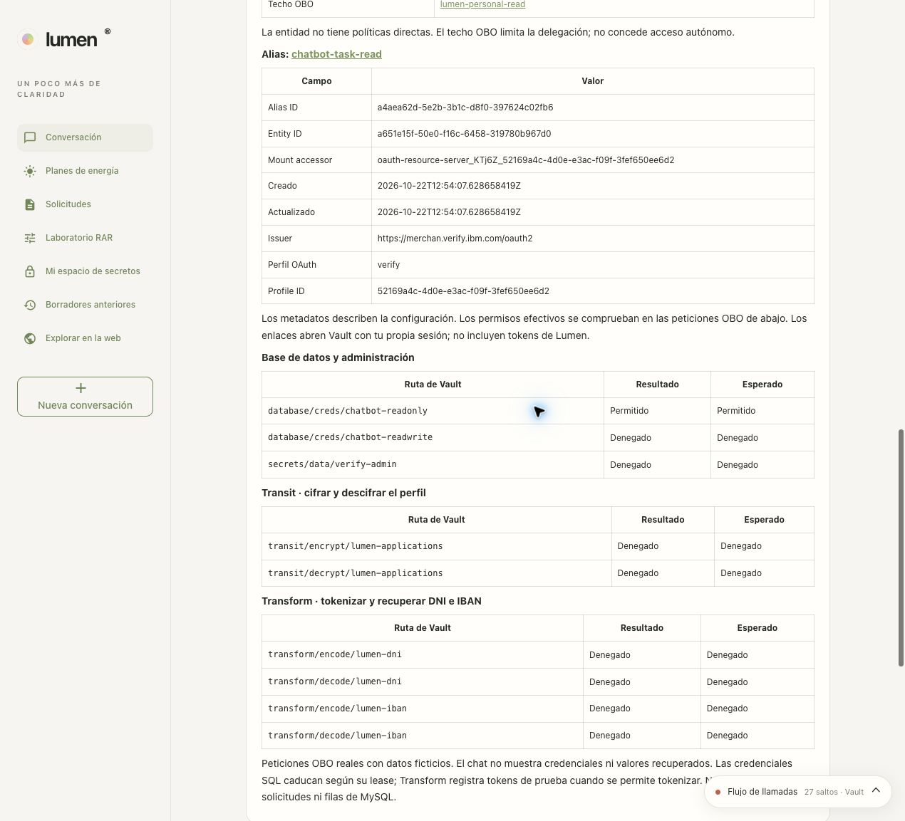

# 14 · Task agents, activated from Lumen

This extension adds three OAuth identities and their OBO ceilings. The initial mode
is still **Modo actual** (*Current mode*), with `chatbot-oidc`. The existing clients,
the users' policies, the model providers and their SPIFFE federations
are not changed.

## Using it from the interface

1. Press **Agentes por tarea** (*Task agents*), below the provider selector, to open the
   permissions side panel.
2. Choose **Consulta** (*Read access*), **Creación de solicitudes** (*Application creation*) or **Revelado de datos** (*Data disclosure*).
3. Press **Activar y entrar con Verify** (*Activate and sign in with Verify*) and complete the login.
4. Run the operation and look at its trace. `verify.client_credentials` and
   `verify.token_exchange` identify the agent used.
5. To go back, select **Modo actual** and sign in again.

The selector and its messages are available in Spanish and English. The choice
is tied to the authenticated session and is kept when navigating between the conversation
and applications. A more powerful agent is never chosen automatically based on the path.

### Visual permission matrix

The **Agentes por tarea** button opens a matrix of users and agents on the right.
It starts closed, and opening it does not add a block above the conversation. On a
wide desktop (more than 1700 px) it shares space with the chat. On tablet and mobile
it overlays the chat; up to 760 px it takes the available width. The panel has its own
scrolling and an always-visible close button. It can be closed with Escape from the
panel, and focus returns to the button that opened it. The chat draft is kept.

It highlights the authenticated user's profile, the active agent's column and the
**Tu sesión** (*Your session*) cell. The summary at the top shows the expected operations; it also
remains on the open button when the panel is closed.

| User | Estándar (*Standard*) | Consulta | Creación | Revelado |
|---|---|---|---|---|
| Reader | Query | Query | Query | Query |
| Writer | Query and create | Query | Query and create | Query |
| Supervisor | Query and reveal | Query | Query | Query and reveal |

Press any cell to compare: for query, create and
reveal, the detail shows whether the user, the agent or both allow it. For example, Reader + Revelado
indicates that the user limits revealing; Supervisor + Consulta indicates that the
agent limits it. When you press a cell, the **Identidad del agente** (*Agent identity*) dropdown selects
that column's agent. The chosen row is still only a comparison: it does not change
the authenticated user. **Vista previa** (preview) does not change the active identity, the session
or the permissions. **Volver a mi combinación** (*Back to my combination*) restores both the cell and the
dropdown to the active agent. Choosing another option in the selector also updates
the preview for your profile; activating it still requires pressing
**Activar y entrar con Verify**.

The active profile is derived from the authenticated groups, not from the user name.
If the groups combine write and reveal, a **Perfil combinado** (*Combined profile*) row is added;
an unknown group is shown with no access. Without a session, no cell is marked
as active. The table can scroll horizontally on small screens, and
its cells can be activated with the keyboard. It is available in ES/EN.

The matrix is explanatory, based on the demo profiles: it does not read the Vault
policies live or run operations. Verify authenticates and issues the OBO token;
**Vault** evaluates user ∩ agent ceiling ∩ RAR for each request. Blocks or
other changes in Vault can restrict further. **Comprobar límites en Vault** (*Check limits in Vault*) remains
the check of the real calls. Querying includes the catalog,
inventory and masked applications; revealing retrieves the protected data.

[Desktop panel](../screenshots/current/permissions-desktop.jpg)
· [Tablet](../screenshots/current/permissions-tablet.jpg)
· [Mobile](../screenshots/current/permissions-mobile.jpg)
· [October 22 review](../runs/20261022T140230Z-workspace-review/README.md).
The panel screenshots were taken without a session; they check the layout and the
selection, not the effective Vault permissions.

Comparison captured in the current interface:
[Reader + Revelado](../screenshots/current/permission-matrix.jpg)
· [Earlier matrix tests](../../chatbot/docs/permission-matrix-verification.json).
[Synchronized table and dropdown](../screenshots/current/permission-matrix.jpg)
· [Earlier selection test](../../chatbot/docs/permission-matrix-selector-verification.json).

**Visible change when activating the extension:** switching agents starts a
new session. The conversation and the unsaved draft of that session are lost;
already saved applications remain. The selector warns before the switch and
refuses to switch during an operation. The new login is required because each
human token authorizes only its own client through `may_act.client_id`.

## Limits

| Mode | Identity in Vault | OBO ceiling |
|---|---|---|
| Current | `chatbot-oidc` | The previous behavior: user permissions and RAR |
| Consulta (read access) | `chatbot-task-read` | MySQL RO credentials |
| Creación de solicitudes (application creation) | `chatbot-task-write` | MySQL RO/RW, Transit encrypt and Transform encode |
| Revelado de datos (data disclosure) | `chatbot-task-reveal` | MySQL RO, Transit decrypt and Transform decode |

**User permissions, agent ceiling and exact RAR** are always intersected.
For example:

- A writer with Consulta can query, but Vault denies RW credentials,
  encryption, tokenization, decryption and detokenization.
- A reader with Creación still cannot write: the agent does not extend their profile.
- A supervisor with Consulta cannot reveal; with Revelado they can, according to
  the existing policies.
- The three identities keep the global blocks from [chapter 12](12-bloqueos.md).

Consulta can read the catalog, inventory and the masked inbox. Its limit
applies to the existing SQL RO role, not to individual tables. The inbox is still
shared. This extension does not introduce row-level isolation or approvals.

The OpenAI, xAI and Claude providers and the Tavily search keep their current
identities. Task agents control the business OBO operations; they are not
three parallel runs of the model.

## Installation and reruns

`./demo.sh start`, the guided walkthrough and the Lumen notebook include the
preparation of these identities. To add them to an existing installation,
from the repository root:

```bash
bash -c 'source scripts/demo/common.sh; load_inputs; bash chatbot/scripts/configure-task-agents.sh'
```

The script first checks the STS, OAuth profile and groups; it creates or reconciles:

- The Verify apps `vault-chatbot-task-read`, `vault-chatbot-task-write` and
  `vault-chatbot-task-reveal`, with Authorization Code, PKCE S256 and Client
  Credentials. It does not enable ROPC or refresh tokens.
- Their assignments to the lab's three groups.
- Three policies, entities without autonomous permissions, aliases and agent
  registrations with mandatory RAR and no `default` ceiling.
- `verify/secrets/chatbot/task-agents`, published only when all
  three profiles are complete, and read access to it in `chatbot-bootstrap`.

Then the code and configuration are loaded into Lumen. This restarts the process
and requires a new login:

```bash
bash scripts/demo/start.sh
```

An installation without the optional catalog keeps using the current mode; the
interface indicates that the extension is not prepared. The original agent is not used
as a silent fallback when a task agent fails.

General removal also includes the three new apps in its inventory.
Always check `./demo.sh remove --dry-run` before deleting resources.

## Real verification

```bash
bash chatbot/scripts/verify-task-agents.sh
```

It uses Authorization Code + PKCE with the fictitious users already installed; it does not
modify their passwords or bypass authentication challenges. It checks the four
modes with the three user profiles:

- Nine real Vault decisions per combination, including denials with
  a RAR that does describe the requested path.
- A real query of the MySQL catalog.
- Rejection by Verify if someone tries to exchange the human token with another actor.
- Revocation of the database leases issued for each case.

The [report](../../chatbot/docs/task-agents-verification.json) contains no tokens
or passwords. The login artifacts remain in the private state
directory. The unit tests also verify that the callback uses the audience
and `may_act` of the chosen client and that the original mode works without the extension.

## Other extensions

| Item | Status |
|---|---|
| 1. Separate agents per task | Implemented as an interface option |
| 2. RAR parameter restrictions | [Optional lab with six scenarios, real comparison and traces](15-parametros-rar.md) |
| 3. Per-user secret spaces | [Optional KV v2 lab, isolation by human entity and traces](16-espacios-personales.md) |
| 4. Approval of sensitive operations | Pending |
| 5. Per-agent blocking and revocation | Pending; the global blocks are kept |
| 6. Visual authorization comparator | Interactive matrix of expected permissions available; the check-limits button tests the active agent. Live comparison of all combinations pending |

References: [Agent Registry](https://developer.hashicorp.com/vault/ai/iam/concepts/agent-registry),
[OBO](https://developer.hashicorp.com/vault/ai/iam/setup-obo) and
[delegation in Verify](https://docs.verify.ibm.com/verify/docs/oauth-20-token-exchange).

<a id="identificar-al-agente-y-pivotar-a-vault"></a>

## Identify the agent and pivot to Vault

**Comprobar límites en Vault** now shows the OBO agent tied to the session,
in addition to the nine real decisions. The details card queries Vault at that moment:
registration and ID, description, owner, dates, entity status, RAR
requirement, `default` ceiling, OBO ceiling policies and the entity's direct
policies. It includes the entity's ID and dates, its groups and the aliases with their
accessor, issuer and OAuth profile. Policies inherited from groups, if any,
are queried in Vault; the card does not compute effective permissions from the HCL.

The links open the **Agent Registry**, the **entity**, each **alias** and each
**ACL policy** in the `verify` namespace. In Vault 2.1.2 the agent panel is
a dialog without its own URL: the registry link opens the table, where you search for
the name shown in Lumen. Entities, aliases and policies do have direct URLs.
Vault uses your browser's own session; the links never carry tokens.

In the trace window, each call shows **Agente en Vault** (*Vault agent*) and lets you
expand **Agente, políticas, entidad y alias** (*Agent, policies, entity and aliases*). The policies include their HCL.
The card carries the query time: it is the current configuration when the
trace is opened, not a snapshot of the policies in force when an old trace happened.
A failed metadata query is flagged explicitly and does not replace or alter
the HTTP decisions of the OBO tests.

The identity depends on the call:

- OBO and business operations: `chatbot-oidc` or the chosen `chatbot-task-*`.
- Credentials and model calls: `chatbot-openai`, `chatbot-anthropic` or `chatbot-xai`.
- Tavily search: `chatbot-research`.
- MySQL: the agent that obtained the dynamic credential is shown. MySQL receives
  a username and password, not the Vault entity.
- Public JWKS: no authenticated agent is attributed to reading public keys.

### Inspection credential

`chatbot/scripts/run.sh` installs `chatbot-agent-inspector` from
`chatbot/policies/agent-inspector.hcl` and obtains a one-hour periodic token,
independent of the bootstrap token and the OAuth clients. Lumen renews it every twenty
minutes and revokes it on a normal shutdown. It only allows reading Lumen's eight entities
and registrations by name, the listed policies and the `verify` OAuth
profile (that read requires `read` + `sudo` on its exact path). It does not allow listing entities, reading secrets, issuing SQL credentials or
modifying agents or policies. The token stays on the server and is not included in the
sensitive capture, the diagram or its links.

The managed startup copies the policy alongside the runtime. It is applied with the
usual Lumen startup; it does not require recreating users, agents or the cluster.
`LUMEN_VAULT_UI_URL` lets you set the Vault address reachable from the
browser (by default `https://127.0.0.1:8443`, without `/ui`). It does not change the address
used by the API calls. The Lumen session is lost when the application restarts.

### Ceiling checked from the interface

In the October 22 review, Supervisor signed in with **Consulta** from the selector and
repeated the nine calls. SQL RO was still allowed; Transit decrypt and Transform
decode were denied, even though the user can reveal with Estándar.


