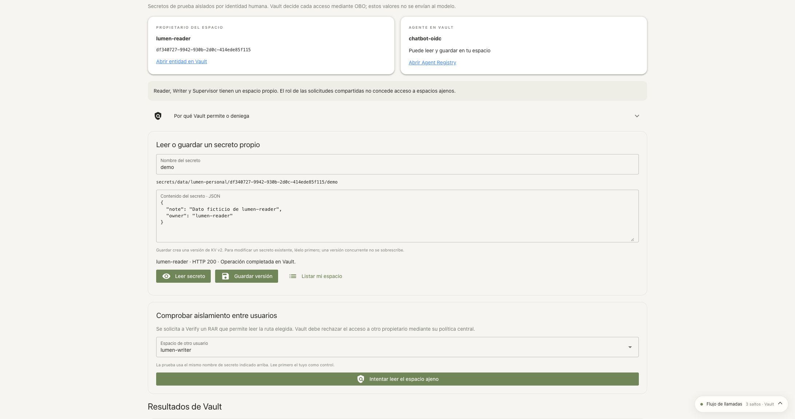
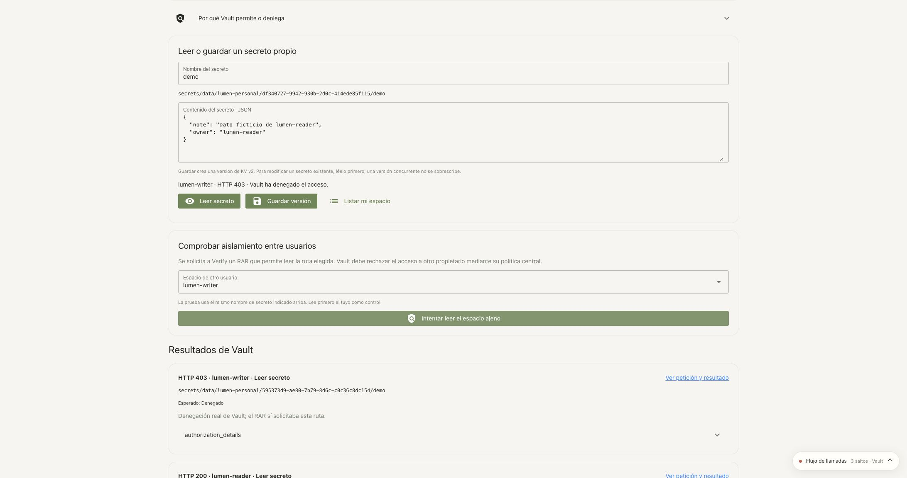
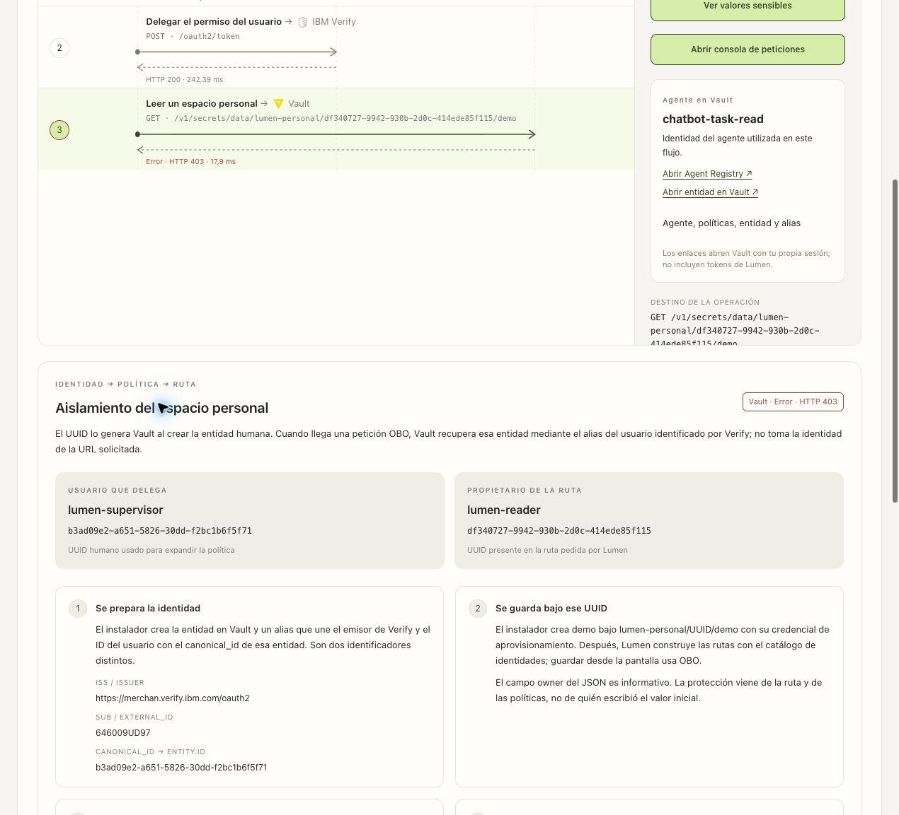

# 16 · Per-user secret spaces

**Mi espacio de secretos** (*My secret space*) adds a KV v2 lab with OBO and isolation
by human identity, in the `verify` namespace. It keeps the shared inbox,
MySQL, Transit, Transform and the model credentials. These values are not
sent to the LLM.

## Preparation

After the `grupos` step, with the [Python runtime installed](10-aplicacion.md#2-instalar-el-runtime),
run from the repository root:

```bash
bash scripts/manual/paso-a-paso.sh ejecutar espacios-personales
```

It loads `.env` and the private Vault connection. It requires the three users, their
human entities and the standard agent. It includes any task agents that
exist. `./demo.sh start` includes the same step. To load only the
application changes on an existing installation:

```bash
bash scripts/demo/start.sh
```

The restart ends the Lumen sessions; sign in again with Verify.

The installer adds:

- The `lumen-personal-user` policy and the `lumen-personal-users` internal group, with
  the demo's three human entities.
- `lumen-personal-read` or `lumen-personal-write` ceilings on the OBO registrations,
  keeping their previous ceilings and blocks. It does not grant these permissions
  to the agents as autonomous policies.
- One fictitious `demo` secret per user, only if it has never existed. It keeps
  values, versions and deleted secrets on reruns.
- A catalog of identities and policies in `secrets/chatbot/personal-spaces`.
  The bootstrap token can read that catalog, but not the personal values.

The agent and group reconcilers reapply the extension if it was already
installed. It uses the `secrets` KV v2 mount and a separate prefix,
`lumen-personal`; it does not create engines or namespaces per person.

## Policy and scope

The same central policy applies to all three users:

```hcl
path "secrets/data/lumen-personal/{{identity.entity.id}}/*" {
  capabilities = ["create", "read", "update"]
}
path "secrets/metadata/lumen-personal/{{identity.entity.id}}/*" {
  capabilities = ["list"]
}
path "secrets/metadata/lumen-personal/{{identity.entity.id}}" {
  capabilities = ["list"]
}
```

Vault resolves the template with the **human** entity of the OBO flow. The actual
path contains its UUID. Switching agents keeps the same space.

## Where `identity.entity.id` comes from and how it reaches authorization

There are two distinct identities: the person who delegates and the agent that acts.
The UUID that organizes the personal space is that of the **person in Vault**,
not the Verify user ID or the UUID of the agent's entity.

| Stage | What happens | Where to check it |
|---|---|---|
| Prepare the identities | `05-sync-groups.sh` creates `chatbot-human-<Verify ID>`; Vault assigns its UUID. The alias links Verify's `issuer` and the user's `external_id` to that UUID in `canonical_id`. | Human entity and alias in Vault; the `verify` OAuth profile identifies the issuer. |
| Prepare the space | `configure-personal-spaces.py` reads that UUID and publishes the catalog Lumen uses. It adds the entity to the `lumen-personal-users` group, which assigns `lumen-personal-user`. | `secrets/chatbot/personal-spaces` catalog, group and policy in the `verify` namespace. |
| Create the first secret | The installer writes the fictitious `demo` data to `secrets/data/lumen-personal/<human UUID>/demo` with its provisioning credential. Later writes from the screen use OBO. | KV v2 path. The JSON's `owner` field only describes the data; it does not establish its security owner. |
| Obtain the delegation | Lumen presents Verify with the human token, the agent token and the operation's RAR. The signed OBO JWT contains the human `sub`, the agent's `actor-token.sub` and `authorization_details`. | OBO exchange and JWT of this run in the trace. |
| Access Vault | Lumen sends that JWT in `X-Vault-Token`. Vault validates it and uses the OAuth profile's `user_claim=sub` and `actor_claim=actor-token.sub` to resolve both aliases separately. The human alias leads to its `canonical_id`. | `verify` OAuth profile, human and agent aliases, request to Vault. |
| Decide | Vault expands the template with the human UUID and requires **human policies ∩ agent ceiling ∩ RAR**. The requested path does not decide who the user is. | Vault response and audit entries correlated by `request_id`. |

For example, with a human `A` and an agent whose ceiling contains
`secrets/data/lumen-personal/*`, the human policy expands to
`secrets/data/lumen-personal/A/*`. Requesting `secrets/data/lumen-personal/B/demo`
in the RAR does not change `A` into `B`: the alias is resolved from the token's
identity. In this demo's configuration, Vault denies access to someone else's space even if
Verify issued the OBO JWT with HTTP 200.

The wildcard in the Registry lets the same agent serve the spaces of several
people. Each call is still limited by the specific person's policy.
Even on their own path, the Consulta or Revelado ceiling prevents writing.

| User | Estándar | Consulta | Creación | Revelado |
|---|---|---|---|---|
| Reader | Read and save own | Read own | Read and save own | Read own |
| Writer | Read and save own | Read own | Read and save own | Read own |
| Supervisor | Read and save own | Read own | Read and save own | Read own |
| Access to another owner | Denied | Denied | Denied | Denied |

This matrix applies to the personal space. Reader still cannot create shared
applications; Supervisor is still subject to their reveal ceiling. Each owner
receives central permission over their test secrets, and the agent can reduce it
to read-only. Deletion is not enabled from this screen.

## Checking from the interface

1. Sign in with **Reader + Estándar** and open **Mi espacio de secretos** from the menu.
2. Keep the name `demo` and press **Leer secreto** (*Read secret*): HTTP 200 and a
   fictitious value whose owner is `lumen-reader`.
3. Press **Listar mi espacio** (*List my space*): names within your UUID appear.
4. Change the JSON note and press **Guardar versión** (*Save version*). A new name lets you
   create another secret. To modify an existing one, read it first: the write
   carries `options.cas`; an old version receives HTTP 400 without overwriting.
5. In **Comprobar aislamiento entre usuarios** (*Check isolation between users*), select Writer or Supervisor
   and press **Intentar leer el espacio ajeno** (*Attempt to read the other space*): it must return HTTP 403.
6. Open **Ver petición y resultado** (*View request and result*). Check the OBO user, the agent,
   the other user's path in `authorization_details`, the entity IDs and Vault's
   403. Lumen does not simulate the rejection or omit that path from the RAR.
7. Switch to the **Consulta** agent and authenticate the same user again. Their UUID
   and values are kept. Reading works; saving returns HTTP 403 because of the ceiling.
8. Repeat as **Supervisor**: it does not allow reading Reader's personal secrets.

**Por qué Vault permite o deniega** (*Why Vault allows or denies*) shows the HCL published by the installer,
with links to the current policies and entity in Vault. The real requests
are the proof of effective access. The links use your Vault session without
tokens in the URL.

In the trace, **Aislamiento del espacio personal** (*Personal space isolation*) walks through this flow in
four steps and shows, in Spanish or English:

- The person who delegates and the owner of the path, with their UUIDs shown separately.
- `issuer`, `sub / external_id`, `canonical_id` and the registered agent client.
- The human template, its expansion with the user's UUID and the requested path.
- The result of the selected service. An HTTP 200 from Verify only proves
  that the token was issued; select the Vault call to see the access.
- **Por qué hay un wildcard en el Registry** (*Why the Registry contains a wildcard*): human HCL and the agent's personal
  ceiling kept in the trace, plus the RAR's type, path and capabilities.
- **Origen de los datos y cómo comprobarlo** (*Data provenance and how to verify it*): provenance and lookup points
  in Vault, along with links to the official documentation.

The names, UUIDs and HCL are snapshots of the provisioned catalog that Lumen
records when running the operation. The expansion shown is an explanation of
the demo's rule, **not a query of the effective ACL or an evaluation of
all Vault policies**. Later changes can make the catalog
diverge from the current configuration. Vault's real response remains
the evidence of the observed access. A 403 does not by itself identify all the
rules involved; an allowed path belonging to someone else is flagged for policy review.

Old traces keep their IDs and show «No registrado» (not recorded) when
information is missing; they are not filled in with the current configuration. Run a new
operation to get the new fields. The panel does not show tokens or secret
values: they remain available in the sensitive controls and the console of that
same call.

HTTP 404 indicates a nonexistent secret; HTTP 400 can indicate a version
conflict. Neither is presented as proof of isolation. The sensitive captures
and the replay console include the real token, body and response, with the
lab's existing controls and retention.

The general audit device records these paths with HMAC. The specialized raw filters
of other engines are not extended. The Lumen trace keeps the capture
according to `LUMEN_TRACE_VAULT_RAW`; its `request_id` allows correlating the audit.

## Repeatable verification

```bash
bash chatbot/scripts/verify-personal-spaces.sh
```

It runs Authorization Code + PKCE for three users and four agents. It checks
reading/listing of own secrets, write ceilings, subsequent reads, CAS conflicts
and read/list/write denials between owners. It only writes
fictitious values to `verification`. The tokens stay in the private state
directory. The [report](../../chatbot/docs/personal-spaces-verification.json)
contains results, paths and traces, without secret values.

References: [policy templates](https://developer.hashicorp.com/vault/docs/concepts/policies#templated-policies),
[OBO](https://developer.hashicorp.com/vault/ai/iam/setup-obo) and
[KV v2 and CAS](https://developer.hashicorp.com/vault/api-docs/secret/kv/kv-v2).

## Current screenshots

The [October 22 review](../runs/20261022T140230Z-workspace-review/README.md) checked own-space reads and denial of cross-user access with the current interface.





### Visual explanation of the isolation

The October 22 review checked the current panel in Spanish, English and at 390 px.
Supervisor with Consulta read their own space (200) and Vault rejected Reader's (403).
The panel distinguishes the human UUID from the requested owner and shows how the
policy expands; Verify's response is not confused with Vault permission.



[English version](../screenshots/current/personal-isolation-en.jpg) ·
[Mobile view](../screenshots/current/personal-isolation-mobile.jpg).
