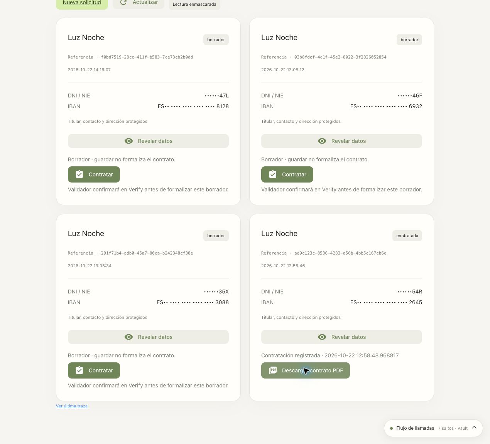

# 17 · Contract a draft with CIBA

Saved applications are **drafts**. Writer can finalize one of their own
with **Contratar** (*Finalize contract*), using Estándar or Creación de solicitudes. The Validator confirms
in IBM Verify; only then is the protected status written to MySQL. The owning
Writer can download the PDF contract, also in later sessions.

This extension replaces the PDF approval experiment for Supervisor.
Supervisor keeps the usual reveal through OBO. There are no Control Groups.
The contract is fictitious: it is not a commercial contract or a charge.

## Prepare and enable

From the repository root, after agents, groups and MySQL, with the
[Python runtime installed](10-aplicacion.md#2-instalar-el-runtime):

```bash
bash scripts/manual/guided-run.sh bash chatbot/scripts/configure-contracts.sh
```

The wrapper loads `.env` and exports the Vault bootstrap path, also
from a new terminal. The installer keeps the selected Validator.
On this tenant it is the existing account `jose.merchan@ibm.com@www.ibm.com`
(ID `64300857U3`), which receives the request by email. Its password,
profile and administrative privileges are kept. To select another existing account:

```bash
bash scripts/manual/guided-run.sh bash chatbot/scripts/configure-contracts.sh --validator 'usuario@dominio.example'
```

Without a previous selection it prepares `lumen-validator`, with a fictitious email: **it cannot
receive an OTP by email**. Before verifying, choose a real account or configure
its authentication method in Verify. The installer does not assume mobile push.
Changing the CIBA client or the Validator disables the feature until it is verified again.

The following test signs in as Writer, creates **one fictitious draft** and
sends a request to the Validator. Check the `Lumen contrato …` text before
confirming it in Verify. This script waits for the approval; it does not replace it:

```bash
bash chatbot/scripts/verify-contracts.sh
```

If it finishes successfully, it writes `chatbot/docs/contracts-verification.json`
and `$LUMEN_STATE_DIR/contracts/lumen-contrato-verificado.pdf`. Then:

```bash
bash scripts/manual/guided-run.sh bash chatbot/scripts/configure-contracts.sh --enable
```

```bash
bash scripts/demo/start.sh
```

The restart ends the Lumen sessions. Sign in again. `./demo.sh start`
and the `contratacion` guided step prepare the extension, keeping it enabled
if the client and Validator are still the verified ones. A new installation
stays disabled until the real test is completed.

## Verification in the interface

1. Sign in as **Writer + Estándar** or **Writer + Creación de solicitudes**.
2. Create an application with the fictitious data and press **Guardar borrador** (*Save draft*).
3. Open **Solicitudes** (*Applications*). Only your drafts show **Contratar**.
4. Press **Contratar**. The window shows the Validator, the reference and the message
   that must match Verify. While waiting, no contract row exists.
5. The Validator confirms in Verify. If they reject it or it expires, the draft is kept.
6. After the commit, **Descargar contrato PDF** (*Download contract PDF*) appears. The inbox shows
   `contratada`, the date and the download button.
7. The window shows a single link to the latest CIBA trace; when finished it is
   called **Ver traza de contratación** (*View contracting trace*). Select CIBA, the Vault login, the SQL credential
   and `CALL lumen_contracts.formalize` to inspect each exchange.
8. Sign out and sign in again as the same Writer: the PDF is still available.

Closing the dialog stops the polling. **Ver contratación pendiente** (*View pending contract*) reopens it.
A pending request lives in memory for at most ten minutes; after a restart
you need to request another one. Confirmed contracts and their PDFs persist.

<a id="quién-autoriza-cada-paso"></a>

## Who authorizes each step

| Step | Identity and credential | Control |
|---|---|---|
| Read/save draft | Writer user + agent, OBO JWT | Vault applies human policies ∩ agent ceiling ∩ RAR. |
| Request CIBA | Confidential client `vault-chatbot-contract` → Verify | Lumen binds `auth_req_id` to the Writer, agent, draft and the hash of its content. |
| Confirm | Validator → Verify | The client only allows CIBA; the other grants, including client_credentials, are disabled. |
| Vault login | Validator's ID token → `auth/ciba-contract/login` | Vault validates the signature, issuer, the audience exclusive to the CIBA client and the Validator's exact subject. |
| Obtain SQL credential | Native Vault token → `database/creds/chatbot-contract` | `lumen-contract-confirm` policy, assigned to the token, never to the OBO group/entity. |
| Finalize | Temporary SQL user → `CALL lumen_contracts.formalize` | EXECUTE only; the procedure validates the owner and snapshot, inserts and commits. |
| Publish PDF | Native Vault token → KV v2 | After the commit, PDF under `lumen-contracts/<Writer human entity>/<contract_id>`. |
| Download | Owning Writer + agent, OBO JWT | `lumen-contract-owner` policy with `{{identity.entity.id}}`, agent ceiling and read RAR. |

**The CIBA login is native Vault JWT authentication, not OBO.** The trace states
this explicitly and does not attribute the session's agent to it. The change does not elevate
the permissions of the Writer or their agent: a separate operation uses the confirmation
of another identity. CIBA authenticates and obtains confirmation; Lumen maintains the binding
to the draft. Vault does not interpret the message text or decide which contract to
sign, and MySQL does not validate the JWT directly.

## Protected field and SQL permissions

The authoritative field is **`lumen_contracts.contracts.status = 'contratada'`**.
A separate database is used because the existing Writer role has permissions on
`scripting.*`. It cannot write to `lumen_contracts`.

The original `scripting.energy_applications` table keeps its data and its historical
status. The inbox obtains the visible status through a LEFT JOIN: without a
contract it is `borrador`; with a contract it shows the protected status. Existing drafts are not
converted automatically.

The temporary `chatbot-contract` user only receives EXECUTE on the procedure.
Its definer account is locked for login and has the read,
insert and locking permissions required. The FOR UPDATE lock also requires UPDATE;
it is limited to the identifying columns of the tables read. Those permissions
are not given to Writer or to the temporary SQL user.

The procedure locks the draft and the plan, verifies its hash and owner,
and stores the reference, requester, Validator, date, plan, hashes and encrypted PDF.
The application_id primary key makes retries idempotent. A trigger
prevents updating a contracted draft, and the FK prevents deleting it. The ordinary
credential can only read the record's public columns, not its encrypted PDF.

The PDF uses Transit `lumen-contracts` for its encrypted copy in MySQL. The
download copy in KV contains the base64-encoded PDF; KV provides encryption at rest
and per-owner ACLs. Base64 **is not encryption**. Lumen checks its SHA-256 against
MySQL on download. The logo is at the top right; the company name, CIF tax ID and headquarters are
fictitious. The content is not sent to the LLM.

## Limits, errors and recovery

- The Vault token lasts at most 120 s; the SQL credential, 60 s by default and
  120 s at most. Lumen revokes the token and its leases when finished.
- The `database-read`, `database-write` and `decrypt` blocks also limit
  the CIBA operation. The database block commands also revoke
  the corresponding SQL leases. Editing only an ACL does not revoke an SQL credential
  that has already been issued; that credential follows its lease or the token's revocation.
- The decryption block prevents preparing new contracts, but does not withdraw PDFs
  already published in the Writer's space or copies already downloaded.
- Without CIBA, the ordinary login token fails on the JWT mount, and the Writer's OBO
  fails when requesting the contracting SQL role. The tests verify both.
- CIBA does not by itself produce a single-use JWT or per-row SQL authorization.
  The credential allows running the procedure during its lifetime; **Lumen**
  binds the approval to the draft and the snapshot. An operator with access to the
  lab's captured credentials can repeat calls within that
  scope. Vault/MySQL administrators are also outside this barrier.
- A change to the draft during the wait prevents finalizing the old snapshot.
  A rejection does not create a contract.
- The periodic cleanup respects a confirmation in progress; the operation checks
  expiration before finalizing and keeps the snapshot until it finishes. A
  cancellation marks the request as an error and deletes its sensitive state. If a
  commit was already in progress, refresh the inbox to learn the persisted result.
- If the commit succeeds but the KV publication fails, the contract already exists. Refresh
  the inbox, try to download and use **Recuperar PDF con CIBA** (*Recover PDF with CIBA*). The procedure
  returns the original contract and its original PDF is published, without duplicating it.
- Downloading is limited to the owning Writer; Reader and Supervisor do not get
  access to these PDFs through their role. The session is checked to still be valid and
  the same after waiting for the lock and before delivering the PDF. Supervisor keeps
  the reveal of applications.
- The trace console keeps the real requests when capture is
  enabled. Repeating a revoked credential or a consumed code returns the service's real
  error. It is not renewed automatically to simulate success.

The real tests and their date are in
[contracts-verification.json](../../chatbot/docs/contracts-verification.json).
They are evidence of that run, not a guarantee about later changes.

The [October 22, 2026 rehearsal](../runs/20261022T122934Z-full-e2e/README.md) includes
a real approval by the Validator, nine passing checks, a single idempotent
commit and two backend downloads with the same SHA-256. Chrome showed the
persisted contract after restarting and ran its PDF button; receipt
of the file in the browser was not confirmed by the tool.

## References

- [IBM Verify SaaS: initiate CIBA](https://docs.verify.ibm.com/verify/v2.0/reference/post_oauth2-ciba).
- [OpenID CIBA Core](https://openid.net/specs/openid-client-initiated-backchannel-authentication-core-1_0.html).
- [Vault: JWT auth and claim restrictions](https://developer.hashicorp.com/vault/api-docs/auth/jwt).
- [MySQL: locking reads and privileges](https://dev.mysql.com/doc/refman/8.4/en/innodb-locking-reads.html).

Removing the demo includes its CIBA clients and the `chatbot-validators` group, identified by the `externalId=lumen-demo:contract-validators` marker. The real account chosen as Validator is kept. Only the fictitious `lumen-*` accounts with an `@example.invalid` email are included in the deletion inventory. The old client from the PDF experiment is disabled during migration.

## Current inbox



The [October 22 interface review](../runs/20261022T140230Z-workspace-review/README.md) checked again that the approved contract was present. It did not request a new CIBA approval: it uses the evidence from that same day's reinstallation. The tool again timed out waiting for the download event; receipt of the file in Chrome remains unconfirmed.
