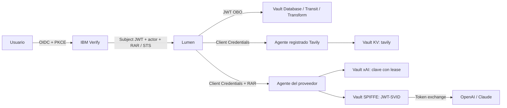

# Configuración manual de Lumen · Vault Agentic IAM

Estos documentos explican qué configura la demo y cómo reproducirlo desde una terminal, sin ejecutar notebooks ni `demo.sh start`. Incluyen cuerpos JSON, políticas, comandos y verificaciones. Actualizadas con el selector de proveedores, el visor interactivo y sensible de trazas y el soporte **EN/ES**, comprobado el **20 de octubre de 2026**. El alcance de las comprobaciones actuales y los ensayos históricos se distingue en [VALIDACION](VALIDACION.md).

## Prerrequisitos y orden

Para ejecutar el recorrido con control de cada paso, usa el [script paso a paso](PASO-A-PASO.md):

```bash
bash scripts/manual/paso-a-paso.sh
```

Muestra qué va a hacer, espera Enter y ejecuta un solo paso. Guarda el progreso y permite reanudar una instalación incompleta sin copiar bloques ni mantener variables en una terminal.

Prepara antes las entradas de [00 · Entorno y credenciales](00-entorno.md). No necesitas un Vault inicializado: el capítulo 01 crea el clúster y genera su root token. Las cuentas externas y licencias sí se preparan antes. Los capítulos siguientes explican los comandos y las verificaciones del recorrido; si los ejecutas directamente, utiliza **Bash**.

| Orden | Documento | Resultado |
|---|---|---|
| 00 | [Entorno](00-entorno.md) | Variables, cuentas, credenciales y archivos privados |
| 01 | [Vault en Minikube](01-vault.md) | TLS, Raft, init/unseal, namespace y KV |
| 02 | [MySQL, KMIP y Database](02-mysql.md) | Cifrado en reposo y credenciales RO/RW temporales |
| 03 | [IBM Verify](03-verify.md) | RAR, OIDC, STS, usuarios y grupos |
| 04 | [Identidades y agentes en Vault](04-vault-iam.md) | Perfil OAuth, entidades, aliases, ACL y Agent Registry |
| 05 | [Transit y Transform](05-proteccion.md) | Perfil cifrado, DNI/IBAN tokenizados y pruebas de permisos |
| 06 | [xAI dinámico](06-xai.md) | Rama xAI: plugin, RAR, claves con lease y reemplazo |
| 07 | [OpenAI con SPIFFE](07-openai-spiffe.md) | Rama OpenAI: ngrok, JWT-SVID, WIF y token exchange |
| 08 | [Claude con SPIFFE](08-claude-spiffe.md) | JWT-SVID de Vault, WIF RFC 7523 y protección JTI |
| 09 | [Auditoría y trazas](09-observabilidad.md) | Vault audit, Alloy, Loki, Tempo y Grafana |
| 10 | [Arranque y recorridos](10-aplicacion.md) | Catálogo conjunto, runtime, selectores de proveedor e idioma y pruebas de los tres proveedores |
| 11 | [OBO a mano](11-obo.md) | Login PKCE, actor, token exchange RAR y llamadas a Vault |
| 12 | [Bloqueos y revocación](12-bloqueos.md) | Deny para tokens antiguos/nuevos y revocación de leases |
| 13 | [Repetición por script](13-repeticion-script.md) | Retirada, ejecución de bloques, sincronización de claves Claude y validación |

Completa 00–05, prepara **los tres proveedores en 06–08** y continúa con 09–10. Cada capítulo genera un perfil JSON privado; el capítulo 10 los publica juntos en `secrets/chatbot/model`, sin que el último proveedor borre los anteriores. La aplicación carga las tres identidades al arrancar y el usuario cambia de proveedor en el banner. `LUMEN_MODEL_PROVIDER=auto` solo fija OpenAI como selección inicial. Los capítulos 11–12 explican OBO y los bloqueos independientemente del LLM.

El idioma inicial se toma del navegador; **EN / ES** guarda una elección explícita. La [comprobación bilingüe de 10](10-aplicacion.md#idioma-y-comprobaciones-bilingües) explica la prioridad, conservación del formulario y equivalencias de botones. No requiere entradas nuevas de instalación.

Para una instalación ya preparada, sigue [la actualización sin reconstrucción](10-aplicacion.md#actualizar-una-instalación-existente). Las evidencias anteriores al selector siguen identificadas como históricas en [VALIDACION](VALIDACION.md); actualizar estas guías no equivale a haber repetido una retirada completa.

## Cómo leer y ejecutar los ejemplos

- **Instalación nueva:** ejecuta los pasos de creación. Los POST externos no se repiten a ciegas: los documentos indican cómo inventariar y reutilizar IDs. En una demo ya instalada, empieza por las verificaciones y omite creaciones; no sobrescribas contraseñas ni claves de recuperación.
- **Vault:** todos los comandos usan `vault`. `vault write ruta -` recibe JSON por stdin y conserva arrays y booleanos. No es necesario convertirlo a una llamada HTTP.
- **Namespaces:** `kmip/`, catálogo de plugins y dispositivos audit se configuran en root; OAuth, agentes y motores de aplicación viven en `verify`. El namespace Kubernetes `vault` es otro concepto.
- **Archivos reutilizados:** los YAML y plantillas JSON del repositorio son parte de la configuración y están enlazados. Se inspeccionan y aplican directamente; no se ocultan operaciones detrás de los scripts de despliegue.
- **Credenciales:** las respuestas sensibles se guardan en `$MANUAL`, con permisos privados. No copies sus valores al Markdown. El root token se usa para aprovisionar; la aplicación recibe un token bootstrap limitado y lo revoca después de cargar su configuración.
- **Verificación:** se distingue leer configuración de emitir credenciales o hacer una inferencia. Las pruebas con root comprueban el motor; las pruebas OBO comprueban los permisos del usuario/agente.



Verify/OBO es la integración activa. [Okta](../../okta/) permanece archivado; no se configura en estas guías. OpenAI y Claude usan sujetos SPIFFE, roles y protocolos de intercambio independientes. Las capturas y resultados históricos se consultan en sus capítulos e informes; sus IDs no se utilizan como entradas en los comandos.

Para continuar una instalación, vuelve a abrir el [script paso a paso](PASO-A-PASO.md). El [ensayo de retirada y reconstrucción de 13](13-repeticion-script.md) es un flujo distinto que elimina recursos; no es necesario para reanudar.
