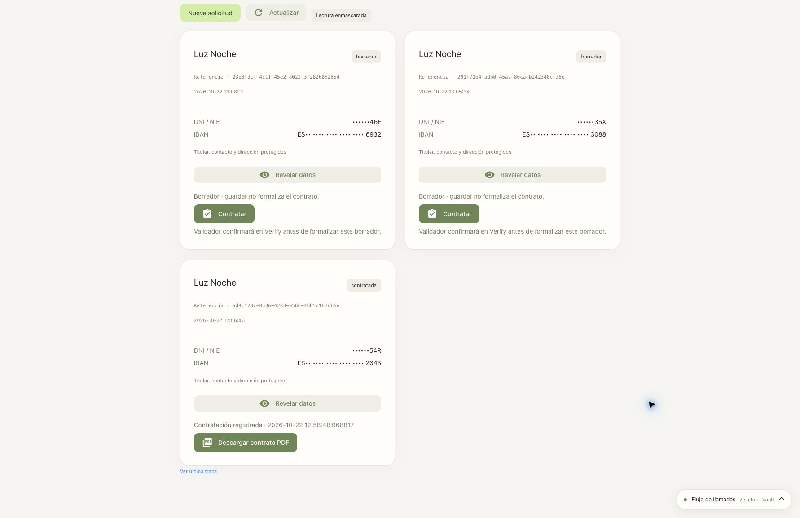

# Retirada y reinstalación de Lumen · 22 de octubre de 2026

Se eliminaron los recursos operativos de Lumen, se reinstalaron y se verificaron
los flujos reales de Verify, Vault, MySQL, modelos y observabilidad. La aprobación
CIBA del Validador terminó correctamente. La instalación queda arrancada y la
contratación habilitada. La recepción del archivo PDF desde Chrome es el único
paso de esta comprobación de interfaz que no quedó acreditado.

- Aplicación: <http://localhost:8088>.
- Grafana: <http://localhost:3000/d/lumen-iam>.
- [Estado agregado](verification-state.json) y [salud/runtime final](runtime-final.json).

## Alcance de la retirada y nueva instalación

| Recurso de Lumen | Retirados | Creados | Evidencia |
|---|---:|---:|---|
| Namespaces `vault`, `mysql`, `lumen-observability` | 3 | 3 | UIDs nuevos |
| Volúmenes persistentes | 10 | 10 | UIDs nuevos |
| Aplicaciones/STS, grupos y usuarios Verify inventariados | 19 | 17 | Todos los IDs nuevos |

Se retiraron definitivamente los recursos antiguos `lumen-validator` y
`vault-chatbot-pdf-approval`. El Validador actual es una cuenta real existente;
su cuenta, contraseña y privilegios administrativos se conservaron. También se
conservaron el cliente administrativo de Verify, RAR, las cuentas e identidades
de federación externas OpenAI/Claude, Minikube, imágenes, código y entradas de
aprovisionamiento. Los leases xAI se revocaron antes de retirar Vault.

La retirada terminó a las **12:52:19 UTC**. Se comprobó la ausencia de los tres
namespaces y de sus volúmenes antes de reinstalar. El estado manual anterior se
archivó en el directorio privado de esta ejecución.

[Inventario anterior](before.json) · [Plan](remove-plan.json) ·
[Retirada](remove.json) · [Ausencia posterior](after-remove.json) ·
[Recursos nuevos](recreated-resources.json) · [Inventario final](after-inventory.json).

`.env` conserva byte a byte el contenido anterior y solo añade la opción pública
`LUMEN_CLAUDE_SYNC_MODE=console`, con su comentario. Se mantienen permisos `600`.
[Comprobación de preservación](inputs-preservation.json).

## Resultados

| Comprobación | Resultado | Evidencia |
|---|---|---|
| Suite completa final con captura de contenido/Vault activada | 513 pruebas y 2 subtests correctos | [tests](test-results.json) |
| JavaScript | 12 pruebas correctas | [tests](test-results.json) |
| Sintaxis y documentación | 36 documentos, 264 bloques Bash, 92 scripts, 651 enlaces, 88 archivos Python y 11 notebooks; sin errores | [validación estática](static-validation.json) |
| MySQL, privilegios y Tavily | 18 comprobaciones correctas | [infraestructura](infrastructure-tests.json) |
| `demo.sh verify --provider openai` | Cinco etapas correctas, incluida inferencia SPIFFE | [verificación](verification.json) |
| Recorrido real con tres perfiles y tres modelos | 137 comprobaciones, 54 trazas; todas correctas | [workflows](workflows.json) |
| Agentes por tarea | 12 combinaciones, 36 checks; incluyen 108 decisiones de Vault | [agentes](task-agents-verification.json) |
| Espacios personales | 12 combinaciones, 120 comprobaciones correctas | [espacios](personal-spaces-verification.json) |
| Parámetros RAR | 4 casos, 25 comprobaciones correctas | [RAR](rar-parameters-verification.json) |
| Contratación CIBA con aprobación humana | 9 comprobaciones correctas | [CIBA](contracts-verification.json) |
| Bloqueos al terminar | Todos inactivos | [estado](final-state.json) |
| Runtime | Código publicado coincide, salud correcta y sin credenciales de aprovisionamiento heredadas | [runtime](runtime-final.json) |

El recorrido usa Authorization Code + PKCE real para Reader, Writer y Supervisor;
verifica permisos OBO, guardado idempotente, datos enmascarados y revelado por
Supervisor. Prueba bloqueos SQL/descifrado con JWT antiguos y nuevos y restaura
el acceso. OpenAI, xAI y Claude consultan catálogo y llaman realmente a Tavily,
con fuentes HTTPS. Se comprueban cambios de proveedor por sesión, rechazos de
preguntas ajenas a energía, refresco/revocación xAI y controles SPIFFE de audiencia,
reutilización de JWT y separación de RAR. Las 54 trazas se correlacionan con
Tempo y con peticiones/respuestas de Vault en Loki.

### CIBA y PDF

El Validador aprobó la solicitud con el mensaje `Lumen contrato ad9c123c 722db5`.
La prueba confirmó que no existe una fila mientras la petición está pendiente,
que Writer no puede usar el rol SQL de contratación con OBO y que las credenciales
ordinarias no sirven para el login CIBA. Se registró un único contrato, se repitió
el commit sin duplicarlo y se rechazó modificar el borrador contratado.

- Solicitud: `ad9c123c-8536-4283-a56b-4bb5c167cb6e`.
- Contrato: `722db59b-a886-4122-b789-75f644b6fdbc`.
- SHA-256 de las dos descargas del backend:
  `559cfb1820cfd71c57b20f84b92c3e8d6606bad2bbffa9eefac95e097ee6ce13`.

El PDF generado tiene una página; se comprobaron identificador, hash, texto y
renderizado. El archivo está en `output/pdf/lumen-contrato-verificado.pdf`, desde
la raíz del repositorio. Todos los datos de este contrato son ficticios.
`.gitattributes` trata los PDF como binarios: evita falsos errores de espacios y
mezclas de texto sin modificar los bytes ni el hash del documento verificado.

### Interfaz y límite de la descarga en Chrome

Chrome completó login OIDC de Writer, la prueba de nueve permisos y una consulta
de catálogo con Claude. Las dos trazas de esas operaciones se comprobaron en
Tempo/Loki: [interfaz](ui-verification.json), [observabilidad](ui-observability.json).

Después de publicar la última corrección y reiniciar, se volvió a entrar con
Verify. La bandeja mantuvo el contrato y su botón PDF. Las dos pulsaciones de
descarga produjeron trazas de backend sin errores; la última es
`31cfdaaa42bbaa5bbe5b94cfb288e334`. Sin embargo, la automatización agotó la espera
de 20 segundos del evento de descarga y no confirmó el archivo guardado por
Chrome. La revisión automática rechazó abrir `chrome://downloads/` porque solo
admite HTTP/HTTPS. No se atribuye a esa prueba una descarga de navegador verificada.

## Incidencias encontradas y corregidas

1. **API administrativa Claude: HTTP 404.** El perfil OAuth `lumen-admin` era
   válido, pero tanto el script como la CLI oficial fallaban al leer los emisores.
   Se añadió preflight de acceso al emisor/regla y el modo explícito `console`.
   Este exporta solo claves públicas y deja la sincronización pendiente; la
   verificación funcional sigue siendo obligatoria. Se actualizó únicamente la
   JWKS inline del emisor existente y se comparó íntegramente con la guardada en
   la consola. Pasó la inferencia federada. [Evidencia](claude-console-sync.json),
   [inferencia](anthropic-spiffe-verification.json),
   [procedimiento para futuras reconstrucciones](../../manual/08-claude-spiffe.md).
2. **Cliente PDF antiguo sin `clientId`.** Verify omite el campo en la aplicación
   deshabilitada. La retirada admite solo su nombre, descripción, plantilla y
   estados exactos; protege el cliente administrador. El configurador CIBA
   tolera el campo ausente. Se añadieron pruebas de rechazo de recursos ajenos.
3. **Primera instalación detenida en tres tests.** Sus dobles HTTP carecían de
   petición asociada, necesaria al capturar trazas. Se corrigieron los dobles y
   pasó `demo.sh verify`; no se alteró la lógica HTTP de producción.
   [Intento inicial conservado](installation-first-attempt.json).
4. **Falso rechazo del guardrail en el primer recorrido.** La petición técnica
   que nombraba `buscar_en_web` fue clasificada fuera de ámbito. El harness usa
   ahora una petición natural sobre autoconsumo solar y comprueba ámbito,
   llamada real y fuentes por separado. No se relajó el guardrail. El primer
   [intento fallido](workflows-first-attempt.json) se conserva; el segundo pasó
   las 137 comprobaciones. No se infiere fiabilidad universal del clasificador.
5. **Error de `Timer.cancel` al cerrar páginas.** NiceGUI pasaba el cliente a
   un parámetro keyword-only. Un callback sin argumentos resuelve el error. La
   prueba con borrado real de un cliente NiceGUI falló antes y pasó después;
   la suite final incluye esta regresión. El código está publicado en el runtime.

El [preflight inicial](preflight.json) y los intentos fallidos conservan su estado
y fecha originales; el [estado agregado final](verification-state.json) refleja
el resultado posterior. Las pruebas locales de 505 casos anteriores a esta
reinstalación siguen documentadas en la [revisión del workspace](../../WORKSPACE_REVIEW.md).

Los logs íntegros y los datos de ejecución privados se conservan en
`~/.local/state/lumen-e2e/20261022T122934Z-full-e2e`, fuera del repositorio. Este
directorio público contiene inventarios, resultados, IDs y capturas, sin tokens
ni contraseñas. Las evidencias acreditan esta ejecución, no cambios posteriores.
