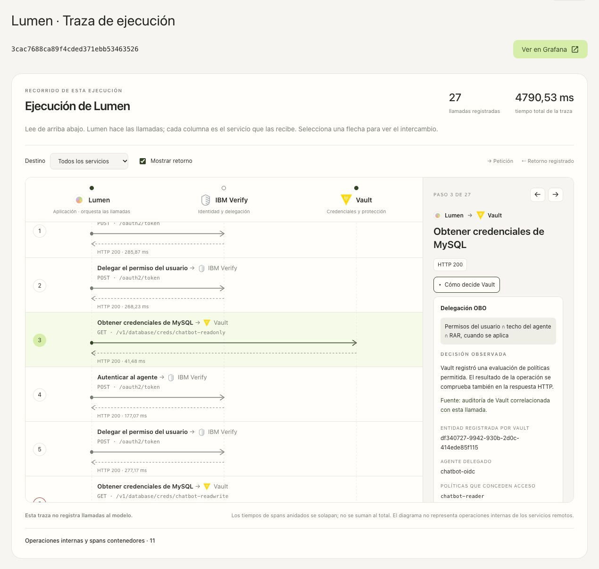
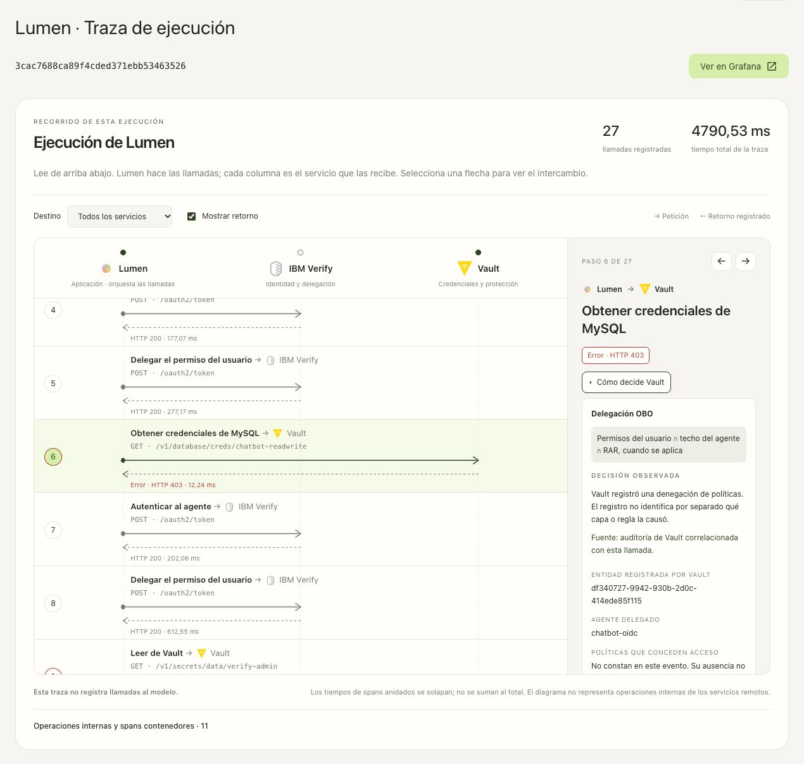
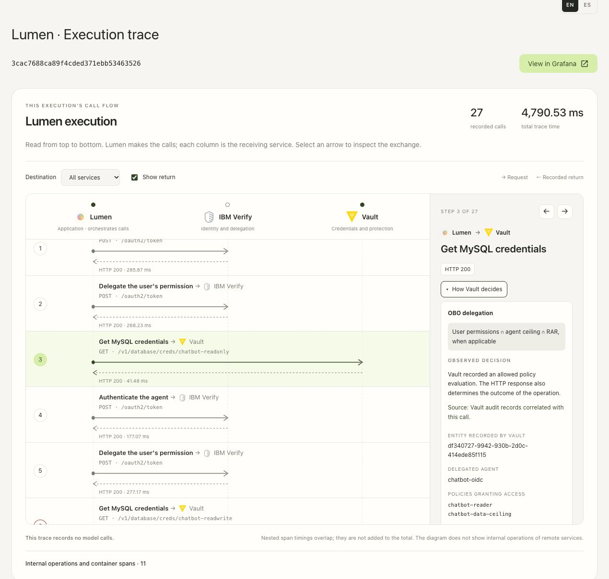
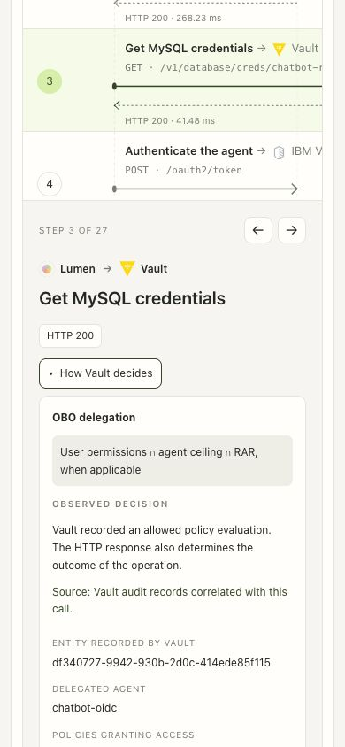
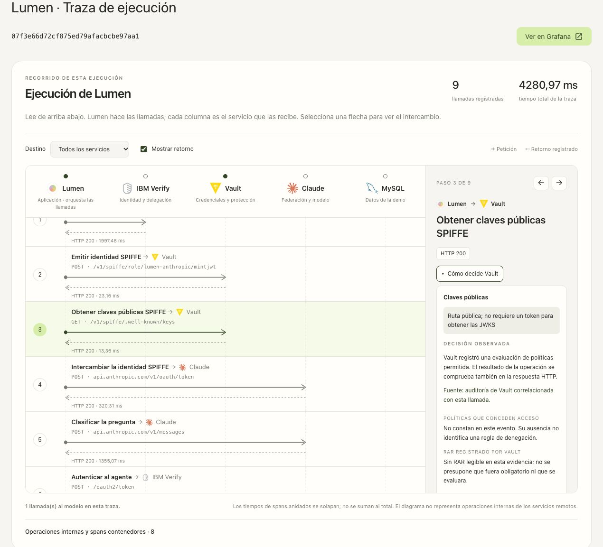
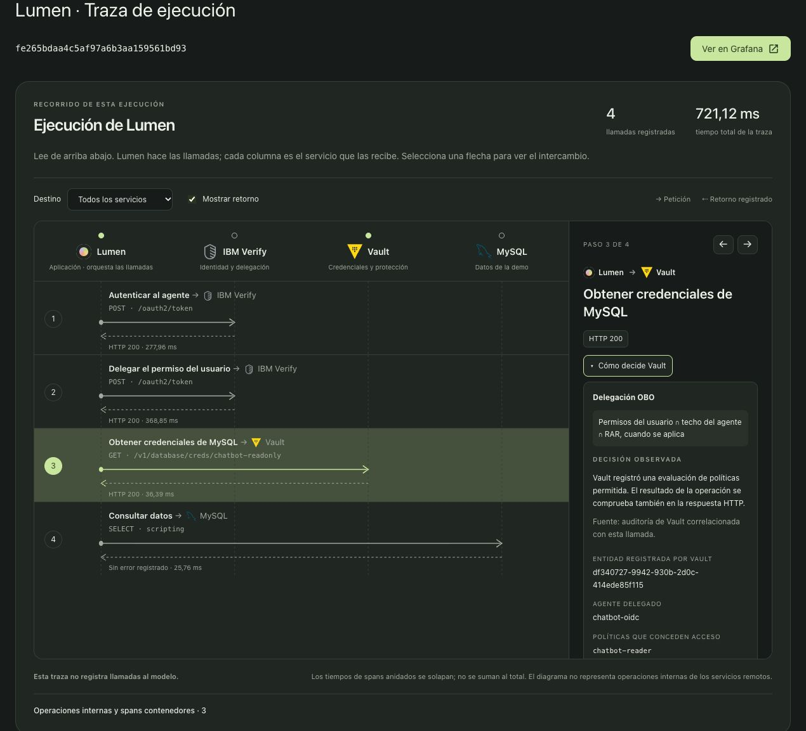

# Cómo decide Vault · 22 de octubre de 2026

Cada llamada a Vault en el diagrama de ejecución incorpora un botón pequeño,
**Cómo decide Vault / How Vault decides**, debajo del estado HTTP. Empieza cerrado
y consulta la auditoría al abrirlo. Al cambiar de paso, destino o pestaña descarta
la evidencia cargada. Funciona independientemente del visor de valores sensibles.

Se corrigió también la persistencia del tema: la preferencia usa almacenamiento
de usuario modificable después de cargar la página y la página de trazas la
hereda, igual que el chat y las solicitudes.

## Evidencia y alcance

La explicación distingue delegación OBO, OAuth del agente, token nativo, root,
login y claves públicas. Correlaciona la llamada con `traceparent` o el
`request.id` registrado, además de ruta y namespace. Los intentos de reenvío al
nodo activo no se presentan como la decisión final.

Muestra identidad, actor, políticas que concedieron acceso y una proyección del
RAR. No entrega tokens, cuerpos de auditoría ni valores de parámetros RAR.
Exige una sesión vigente propietaria de la traza, también después de consultar
Loki, y devuelve `Cache-Control: no-store`.

El resultado de políticas y la respuesta HTTP se muestran por separado. Una
denegación no identifica necesariamente la regla o capa que la causó. Si la
auditoría no está disponible, falta, es parcial o resulta ambigua, la interfaz
lo indica. No consulta políticas actuales para reconstruir una decisión antigua.
«Volver a consultar» solo repite la lectura de auditoría; no repite la operación.

La cobertura incluye cualquier ruta de los pasos `vault.read`, `vault.write` y
`vault.jwks` registrados por Lumen. No incorpora al diagrama peticiones externas
a la aplicación ni convierte la auditoría en una traza interna del motor ACL.

## Verificación

- Suite completa: **565 pruebas Python y 2 subtests**, sin fallos.
- Interacción del componente: **15 pruebas JavaScript**, sin fallos.
- Tras vincular la página de trazas al tema del chat: **89 pruebas específicas**,
  sin fallos; se mantienen los resultados de la suite completa anterior.
- Suite específica de autorización: **33 pruebas**, repetidas tras comprobar
  explícitamente que el endpoint funciona con `LUMEN_TRACE_VAULT_RAW=0`.
- Chrome real: OBO permitido y denegado; apertura/cierre y limpieza al cambiar de
  paso; OAuth autónomo; JWKS pública; ES/EN y móvil a 390 px sin desbordamiento
  horizontal. La sesión caducada dejó de entregar evidencia. El tema oscuro se
  comprobó después de corregir su persistencia, con una nueva lectura de catálogo.
- Dos flujos reales generaron **12 llamadas a Vault**, todas correlacionadas:
  nueve comprobaciones Reader y una consulta de catálogo con Claude. Ocho
  denegaciones esperadas y cuatro evaluaciones permitidas. Los modos token
  nativo, root y login se cubren con pruebas controladas; esta ejecución no
  vuelve a solicitar una aprobación CIBA.

[Resultados de auditoría de los flujos reales](live-audit-checks.json) ·
[Contraste adicional con tres llamadas anteriores](recorded-audit-checks.json) ·
[Verificación reproducible](verification.json) ·
[Comprobaciones de interfaz](ui-checks.json) ·
[Manifiesto de capturas](screenshots/manifest.json)

La guía de [observabilidad](../../../chatbot/OBSERVABILITY.md#cómo-decide-vault),
los README, el [manual](../../manual/10-aplicacion.md), el generador y el
[notebook 7](../../../7_Lumen_Observability.ipynb) incluyen el componente.
Las capturas fechadas anteriores se conservan como evidencia histórica.
