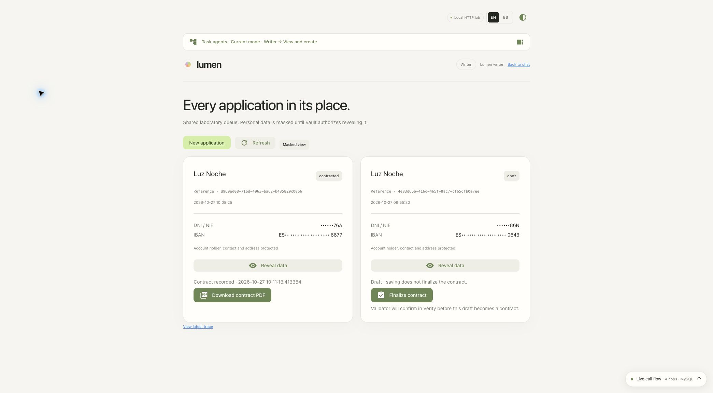

# Manual and script validation — 27 October 2026

The demo was removed and rebuilt twice: first from the manual guide blocks, then independently with `demo.sh`. Both installations passed the functional and authorization checks below. The final script deployment is running at <http://localhost:8088>, with contracting enabled and all temporary access blocks inactive.

[Consolidated results](results.json) · [Corrections](findings.json) · [Preserved inputs](preserved-inputs.json)

Source commit: `350b892d94423be532a5a0bc3689b1df1977e2f5`, plus the uncommitted fixes described here. Existing Claude-authored changes were preserved.

## Results

| Verification | Manual installation | Script installation |
| --- | --- | --- |
| Cleanup | 3 namespaces, 10 PVs, 17 Verify resources | 3 namespaces, 10 PVs, 18 Verify resources |
| Main workflows | [137 checks, 54 traces](manual/workflows.json) | [137 checks, 54 traces](script/workflows.json) |
| MySQL, agent permissions and Tavily | [18 checks](manual/infrastructure-tests.json) | [18 checks](script/infrastructure-tests.json) |
| Task agents | [36 checks / 12 combinations](manual/task-agents-verification.json) | [36 checks / 12 combinations](script/task-agents-verification.json) |
| Personal spaces | [120 checks / 12 combinations](manual/personal-spaces-verification.json) | [120 checks / 12 combinations](script/personal-spaces-verification.json) |
| RAR parameters | [25 checks](manual/rar-parameters-verification.json) | [25 checks](script/rar-parameters-verification.json) |
| CIBA with human approval | [9 checks](manual/contracts-verification.json) | [9 checks](script/contracts-verification.json) |
| Browser UI | [9 checks](manual/ui-verification.json) | [6 checks](script/ui-verification.json), plus [contract persistence and download attempt](script/contract-ui-verification.json) |

The final script verification passed [585 Python tests and 2 subtests](script/python-tests.json). All [15 JavaScript tests](javascript-tests.json) and the [static validation](static-validation.json) passed. The running application matches all [55 source/static files](script/runtime-source.json).

The workflow checks cover real OIDC/PKCE and OBO, three permission matrices, masked application data, Writer save/idempotency, Supervisor decrypt/decode, denied reads/writes/reveals, old and fresh JWTs during policy changes, all three model providers, Tavily and scope rejection, xAI refresh/revocation, and trace/audit correlation in Tempo/Loki. The dedicated [xAI script](script/xai-dynamic-verification.json) also verified real expiry of a 60-second credential; its 12 checks passed.

## Two independent installations

The first cleanup and installation used `scripts/manual/rehearse.sh rebuild`, which executes the actual Bash blocks from guides 00–10 and extensions 14, 16 and 17. It did not call `demo.sh start`. The [installation report](manual/installation.json) records 219 block executions. The OpenAI example initially failed and was corrected before resuming the remaining guide blocks. Manual services were relaunched after executor process cleanup.

After the manual checks, [the second cleanup](script/remove.json) removed the rebuilt resources. [Before](script/before.json) and [after](script/after.json) inventories prove new namespace UIDs; the user inventories also have new Verify IDs. The extra eighteenth resource was the synthetic validator created during setup. The existing human validator was preserved.

`LUMEN_LEGACY_VAULT_COMPAT=0 bash demo.sh start` completed provisioning, Claude inference and runtime isolation. Its [report](script/start.json) remains marked incomplete because one test inherited the live compatibility override while expecting the default cleanup behavior. After fixing the isolated test fixture, `LUMEN_LEGACY_VAULT_COMPAT=0 bash demo.sh verify --provider openai` [completed all five stages](script/verify.json), including the full suite, infrastructure and real OpenAI inference. Provisioning was not repeated to conceal the earlier test failure.

Claude runs in console synchronization mode. Only the new public Vault signing keys were updated in the existing issuer in each cycle; the identity mapping, permissions, JTI protection and one-hour maximum lifetime were preserved. Real federation, replay/audience checks and inference then passed.

## Corrections and observed incidents

- The manual OpenAI example now uses `max_completion_tokens` and requires a non-empty `SPIFFE OK` response. The previous `max_tokens` parameter returned HTTP 400 for `gpt-5.6-luna`.
- Permission verifiers inspect structured trace count/result attributes instead of Spanish UI strings. Tests cover English, Spanish and unexpected access. Scope refusals use the session language, and deployment-step assertions match the English launcher output.
- A separate lab took port 8443 and wrote its own `/tmp/vault` files. The foreign forward was released without signalling it. The removal guard correctly stopped on foreign keys. The new optional `LUMEN_LEGACY_VAULT_COMPAT=0` disables legacy adoption/copy/cleanup; default startup now also refuses foreign legacy settings. The other lab's keys and files were preserved. See [the interruption record](environment-interruption.json).
- Several attempts failed with a TLS `ConnectError` while connecting to Verify. Subsequent complete runs passed. These intermittent connection failures are recorded separately; no application retry or TLS-validation bypass was added. See [manual attempt 2](manual/workflows-attempt-2.json) and [script attempt 1](script/workflows-attempt-1.json).
- The first CIBA request in the script cycle stayed `authorization_pending` until the Writer session expired. It remained a draft. A fresh request received actual approval and passed all nine checks. See [the unsuccessful attempt](script/contracts-attempt-1.json) and [final evidence](script/contracts-verification.json).

## Browser evidence and limit

Chrome verified real Reader/Writer/Supervisor logins, English/Spanish UI, permission checks, draft creation, masking, denied Writer reveal, and provider switching without losing the session/conversation. After restarting the final app, the approved contract remained visible and the earlier unapproved request remained a draft:

The PDF download button completed the backend flow with successful OBO and Vault reads in trace `27eab948934a4c1500bd814ecfd52aeb`. The CIBA test verified the PDF bytes, SHA-256 and repeated owner retrieval. **Saving the PDF in Chrome remains unverified**: the download event timed out, and browser policy blocked opening `chrome://downloads/`. No workaround was attempted. PDFs, credentials, tokens and full operational logs remain in private local state.

The original `.env` is unchanged. Minikube, external OpenAI/Claude federation, the Verify administration client/shared RAR schema, source and historical reports were preserved. Temporary test access blocks are inactive; normal group, agent and RAR restrictions remain enforced.
