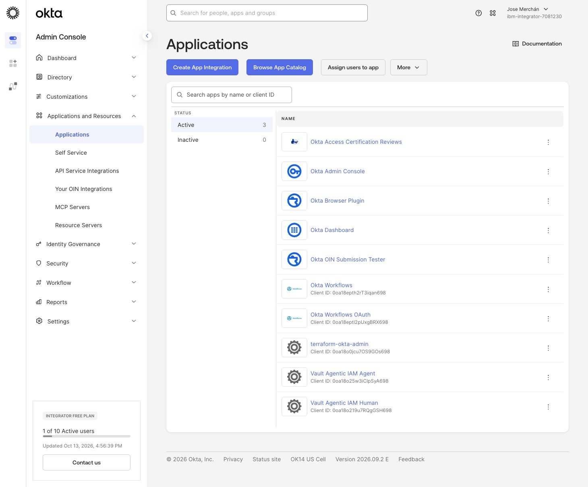
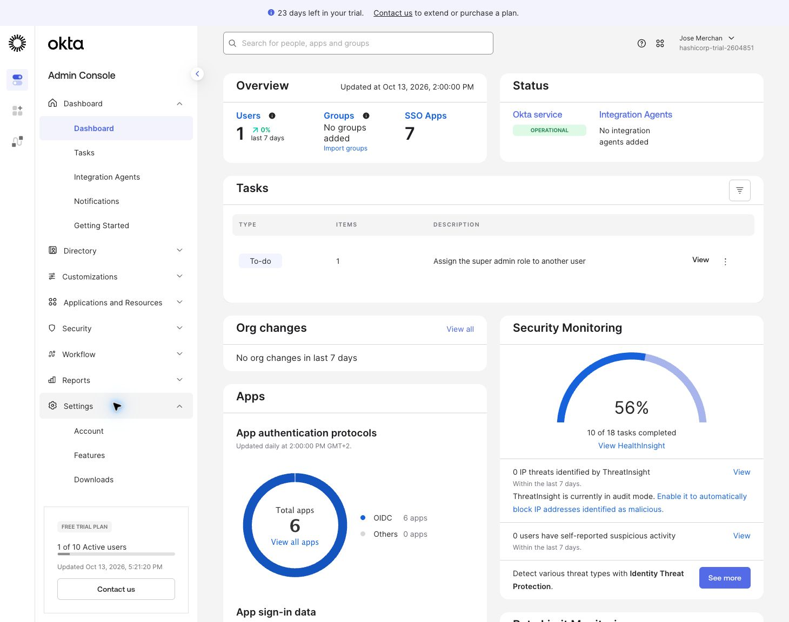
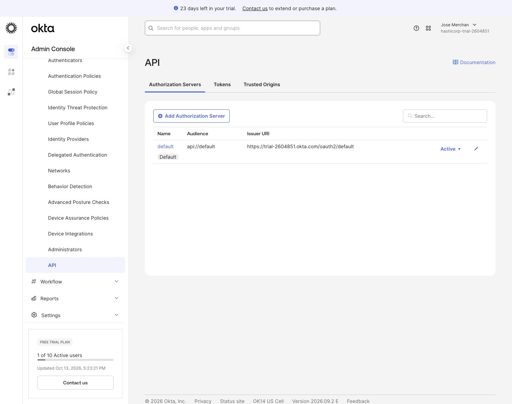
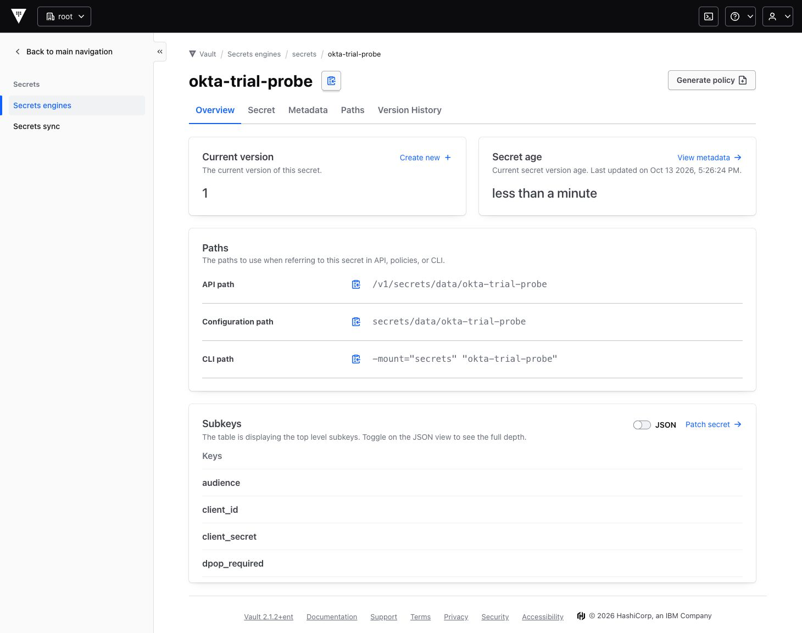
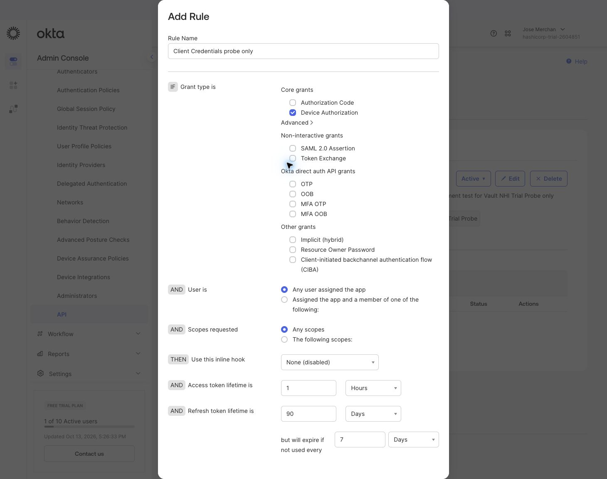
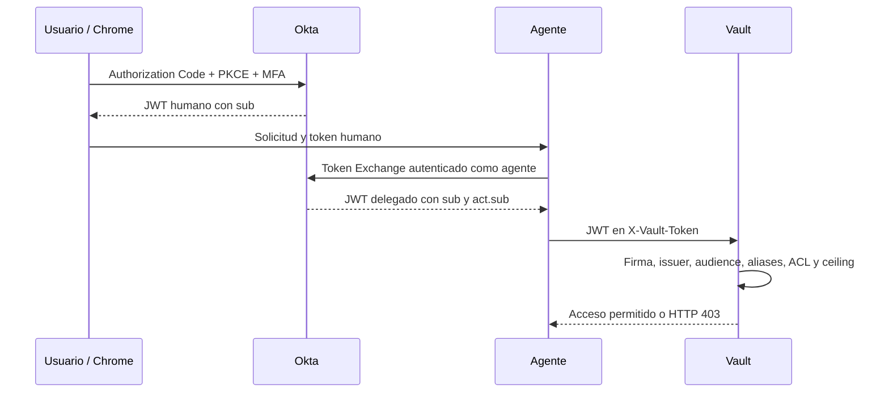
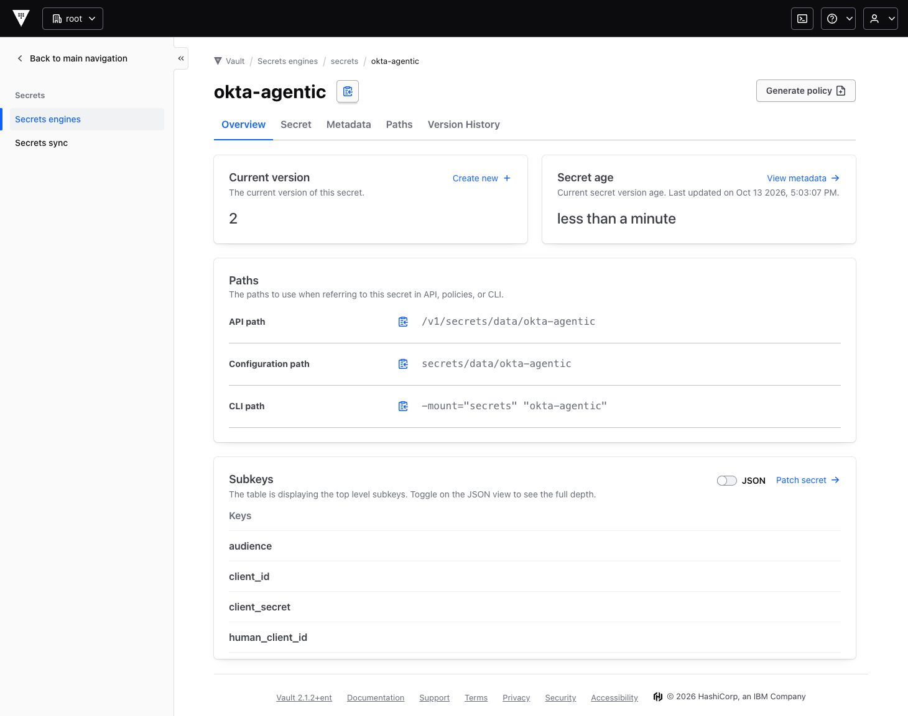
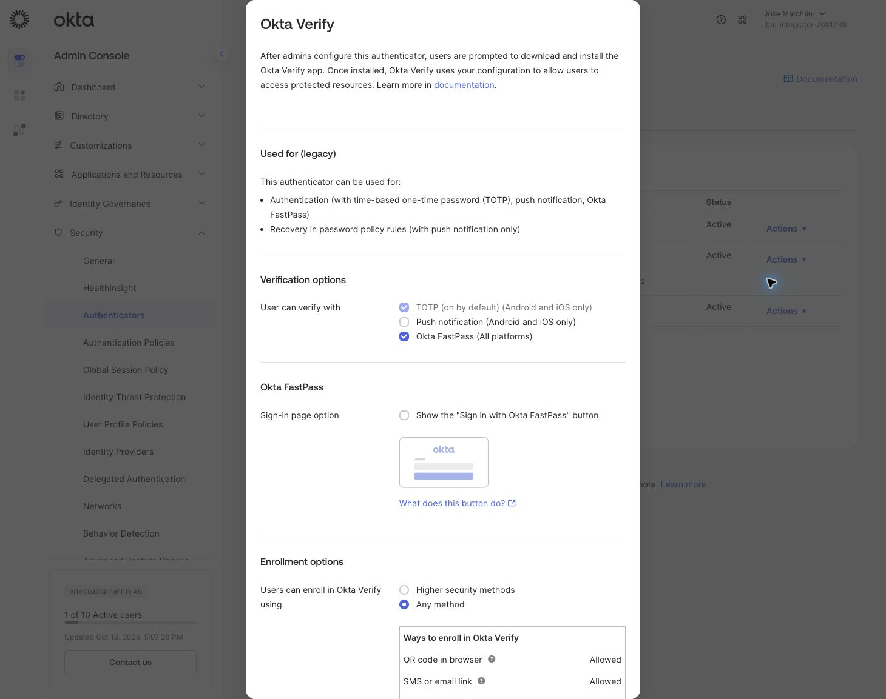

# Okta + Vault Agentic IAM y OBO

**Trabajo aparcado.** Material agrupado en `okta/` para retomarlo cuando esté disponible el SKU NHI. Los comandos de este documento se ejecutan desde esta carpeta (`cd okta` desde la raíz del laboratorio).

Configuración aplicada con Terraform el **13 de octubre de 2026**. Vault está en Minikube (`2.1.2+ent`) y Okta es `integrator-7081230.okta.com`, con **Integrator Free Plan**.

El procedimiento ejecutable está en [4_Okta_Vault_Agentic_IAM_OBO.ipynb](4_Okta_Vault_Agentic_IAM_OBO.ipynb). La [preparación inicial de Terraform](docs/bootstrap-okta.md) conserva los pasos y capturas del bootstrap.

## Estado real

| Componente | Resultado |
|---|---|
| Terraform | 15 recursos gestionados con Okta 7.0.0 y Vault 5.12.0 |
| Okta | Aplicación humana, servicio del agente, scope `vault.read`, política para ambos clientes y regla de grants |
| Vault | Perfil OAuth, entidades humana/agente, alias del agente, registro, políticas y dos secretos sintéticos |
| Credenciales | Guardadas desde Chrome en KV v2 `secrets/okta-agentic`, versión 2 |
| Client Credentials | Probado: HTTP 400 `invalid_grant`; falta **NHI Authentication Tokens SKU** |
| Login humano | Authorization Code + PKCE completado después de registrar FastPass; firma, issuer, audience y caducidad del JWT verificados |
| Alias humano | Creado con Terraform a partir del `sub` verificado del JWT humano |
| OBO | Probado con token humano válido: HTTP 400 `invalid_grant`, falta NHI Authentication Tokens SKU |
| Acceso del agente a Vault | Pendiente de obtener un token de agente o delegado; **no verificado de extremo a extremo** |

Respuesta real de Okta al solicitar el token de máquina:

```text
The NHI Authentication Tokens SKU is not enabled. Contact your Account Executive
 to enable the SKU to use the requested grant type or token exchange flow.
```

La existencia de las opciones en la UI no acredita la licencia. El rechazo NHI se comprobó tanto con Client Credentials como con Token Exchange OBO, este último con un subject token humano válido.



### Comprobación del trial alternativo

El **13 de octubre de 2026** se accedió desde Chrome a `trial-2604851-admin.okta.com`. La consola confirmó **FREE TRIAL PLAN**, con **23 días restantes**, y el servidor de autorización `default` activo: issuer `https://trial-2604851.okta.com/oauth2/default`, audience `api://default`.

En **Settings → Features** no aparece una opción para activar NHI. Se creó por UI, con autorización del usuario, el cliente **Vault NHI Trial Probe** (`0oa18o3v5esdbEzB5698`), sin conceder roles administrativos ni scopes de la API de Okta. Su secreto se guardó desde Chrome en **KV v2 `secrets/okta-trial-probe`, versión 1**.

Se añadió el scope `vault.trial.probe` (implícito, no predeterminado, no publicado) y una política asignada exclusivamente a ese cliente. El formulario de reglas no ofrece **Client Credentials**, incluso con los grants avanzados desplegados. Se canceló la regla: la política permanece sin reglas y no concede acceso.

La solicitud real de `client_credentials` al endpoint del trial, con autenticación Basic y prueba DPoP ES256, devolvió **HTTP 400 `invalid_grant`: NHI Authentication Tokens SKU is not enabled**. Este rechazo se produce antes de poder completar la política de Client Credentials. El trial está vigente, pero el SKU requerido no está habilitado. No se obtuvo ningún token ni se verificó OBO en el trial.

La prueba se reproduce con:

```bash
.venv/bin/python scripts/trial_probe.py
```

El script lee la credencial desde Vault, conserva DPoP y maneja el desafío `use_dpop_nonce` si el servidor lo solicita. Guarda exclusivamente evidencia no secreta en [trial-probe-result.json](docs/trial-probe-result.json); el resultado observado no llegó a solicitar nonce. Véase la [documentación de DPoP de Okta](https://developer.okta.com/docs/guides/dpop/).

**Siguiente requisito externo:** solicitar a Okta que habilite **NHI Authentication Tokens** en `trial-2604851.okta.com` (o en una organización Platform adecuada). Después habrá que completar la regla y repetir la emisión antes de configurar OBO en esa organización. La configuración Terraform aplicada continúa usando Integrator; los recursos de diagnóstico del trial se crearon por UI y no están gestionados por ese estado Terraform.









## Flujo preparado



Este diagrama representa la configuración preparada, no una prueba superada.

| Parámetro | Valor |
|---|---|
| Issuer | `https://integrator-7081230.okta.com/oauth2/default` |
| JWKS | `https://integrator-7081230.okta.com/oauth2/default/v1/keys` |
| Audience | `api://default` |
| Client ID agente | `0oa18o25w3iCIpSyA698` |
| Client ID humano | `0oa18o219u7RQgGSH698` |
| Callback | `http://localhost:9876/callback` |
| Perfil Vault | `sys/config/oauth-resource-server/okta-agentic` |
| Registro del agente | `okta-agentic-agent` |

El agente y su ceiling permiten exclusivamente `read` sobre `secrets/data/agentic-demo/shared`. El humano puede leer además `secrets/data/agentic-demo/human-only`; esa segunda ruta sirve para demostrar el límite del ceiling en OBO. No se conceden permisos sobre las credenciales administrativas o de integración.

RAR es obligatorio en el perfil y opcional **solo para este agente** mediante `vault_agent_registration.optional_authorization_details = true`. En OBO sin RAR deben aplicarse las políticas del humano y el ceiling del agente. Los scripts exigen un token real firmado por Okta con `sub` y `act.sub`; no fabrican delegaciones.

## Ejecutar Terraform

Desde la carpeta `okta/`, con Terraform instalado y Vault accesible:

```bash
python3 scripts/terraform_okta.py init
python3 scripts/terraform_okta.py validate
python3 scripts/terraform_okta.py plan
python3 scripts/terraform_okta.py apply
```

[terraform/okta](terraform/okta) contiene ambos providers. El wrapper analiza `/tmp/vault/config.env` sin ejecutar su contenido, valida TLS con la CA y obtiene la credencial administrativa desde `secrets/okta`. Las credenciales se pasan por variables de entorno.

El estado y los datos de Terraform quedan en `~/.local/share/okta-vault-agentic/`, fuera de Google Drive. Conservar ese directorio para seguir gestionando estos recursos; perderlo puede llevar a intentar crear duplicados. El lockfile fija las versiones instaladas.

Ambas aplicaciones usan `omit_secret = true`: sus client secrets no quedan en el estado. Se copiaron desde **Applications → aplicación → General → Client secrets** al editor JSON de Vault. Hay que copiar el valor real, no la representación enmascarada del campo. Tras recrear una aplicación deben actualizarse sus credenciales en Vault.

El secreto `secrets/okta-agentic` contiene:

- `client_id` y `client_secret`: agente.
- `human_client_id` y `human_client_secret`: aplicación humana.
- `issuer`, `jwks_uri`, `audience`, `scope` y `redirect_uri`.



Los tokens de las pruebas se almacenan en `secrets/okta-agentic-session` únicamente cuando se obtienen correctamente. Su caducidad OAuth no elimina automáticamente sus versiones de KV. No imprimirlos ni incorporarlos al notebook.

## FastPass: organización y dispositivo

**FastPass ya está habilitado** en **Security → Authenticators → Okta Verify → Actions → Edit → Okta FastPass (All platforms)**.

Para usarlo desde Chrome en el Mac, registrar también ese Mac:

1. Abrir el [portal de usuario](https://integrator-7081230.okta.com/app/UserHome).
2. Ir a **nombre → Settings → Security methods → Okta Verify → Set up another**.
3. Instalar y registrar Okta Verify para macOS; habilitar verificación del dispositivo o Touch ID según las indicaciones.
4. Repetir el login del notebook con la nueva URL que genere.

La política **Any two factors** exige resistencia al phishing e interacción del usuario. El TOTP de Okta Verify en el móvil no satisface esa condición por sí solo. Se conserva la política actual. FastPass y el SKU NHI son requisitos independientes.



El login humano se completó tras registrar FastPass en el equipo. La captura muestra el callback local, sin códigos ni tokens.


## Pruebas reproducibles

Al retomarlo, crear el entorno Python dentro de `okta/` con los comandos siguientes. El entorno `.venv` que ya existe en la raíz del laboratorio no se ha trasladado, porque los entornos virtuales contienen rutas absolutas.

```bash
python3 -m venv .venv
.venv/bin/python -m pip install -r requirements-agentic.txt

# Requiere el SKU NHI habilitado.
.venv/bin/python scripts/agentic_demo.py machine

# Abrir la URL impresa y completar MFA en Chrome.
.venv/bin/python scripts/agentic_demo.py login

# Crear el alias humano utilizando el sub verificado.
python3 scripts/terraform_okta.py plan
python3 scripts/terraform_okta.py apply

# Intercambiar el token humano por un token delegado.
.venv/bin/python scripts/agentic_demo.py obo
.venv/bin/python scripts/agentic_demo.py verify

# Comprobación separada de la configuración persistida.
.venv/bin/python scripts/verify_configuration.py
```

`login` escucha en `127.0.0.1:9876`, valida `state`, usa PKCE S256 y omite los códigos de los logs. Los scripts validan firma RS256 con JWKS, issuer, audience y caducidad. OBO exige el `sub` humano y `act.sub` igual al cliente agente. El subject verificado queda en `~/.local/share/okta-vault-agentic/human.tfvars.json`, que el wrapper carga automáticamente.

Las pruebas de cada flujo esperan lectura de `shared` (200), escritura en esa ruta (403), lectura de `human-only` (403) y lectura del bootstrap `secrets/okta` (403). Estos resultados siguen pendientes de tokens reales. [verification.json](docs/verification.json) recoge comprobaciones de configuración, no certifica el flujo OBO.

## Adaptaciones y límites

- Para OBO se separa la aplicación humana (Authorization Code y Refresh Token) de la aplicación de servicio (Client Credentials y Token Exchange), conforme al flujo de Okta.
- Se usa `sub` como `user_claim`, coherente con el flujo documentado por Okta. No se presupone que exista el `oid` usado en el ejemplo de HashiCorp. El alias humano espera una verificación criptográfica de su token.
- La solicitud máquina usa `vault.read`, sin PKCE ni scopes de la API administrativa de Okta.
- `skip_authentication_policy = true` conserva la política asignada por Okta y evita una consulta que requiere permisos adicionales. No desactiva MFA.
- El perfil usa `audiences = ["api://default"]`. El scope se marca por defecto en el servidor compartido, conforme a la guía; otras políticas que admitan todos los scopes podrían también incluirlo. Un scope no concede por sí solo permisos en Vault.
- El provider Vault expone el UUID del perfil como `id`; los aliases incluyen accessor, `issuer` y `external_id`.
- No se crea un auth mount JWT: OAuth Resource Server valida el JWT directamente en cada petición. Las pruebas llaman a rutas KV v2 explícitas para evitar el preflight de `vault kv get`.
- La entidad y el alias humanos están creados; el alias procede del `sub` de un JWT real cuya firma fue verificada.

## Referencias

- [Okta para Agentic IAM](https://developer.hashicorp.com/vault/ai/iam/providers/okta)
- [Acceso del agente](https://developer.hashicorp.com/vault/ai/iam/setup-agent)
- [Delegación OBO](https://developer.hashicorp.com/vault/ai/iam/setup-obo)
- [RAR opcional](https://developer.hashicorp.com/vault/ai/iam/make-rar-optional)
- [Token Exchange OBO en Okta](https://developer.okta.com/docs/guides/set-up-token-exchange/main/)
- [Okta Verify para macOS](https://help.okta.com/eu/en-us/Content/Topics/end-user/ov-setup-macos.htm)
- [Terraform OAuth Resource Server](https://github.com/hashicorp/terraform-provider-vault/blob/v5.12.0/website/docs/r/oauth_resource_server_config_profile.html.md)
- [Terraform Agent Registration](https://github.com/hashicorp/terraform-provider-vault/blob/v5.12.0/website/docs/r/agent_registration.html.md)
