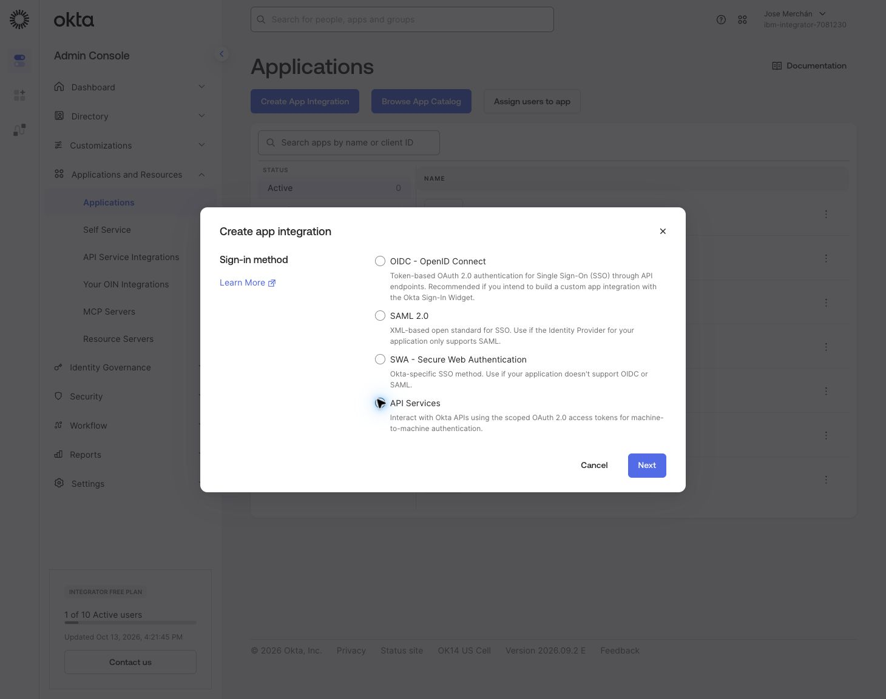
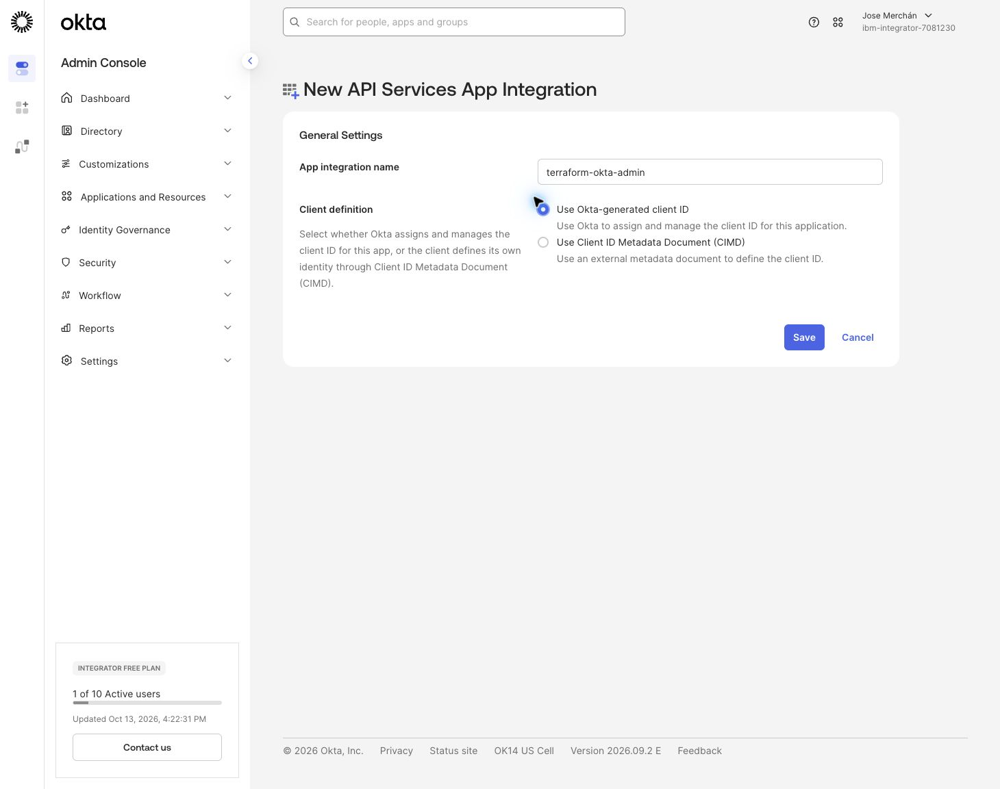
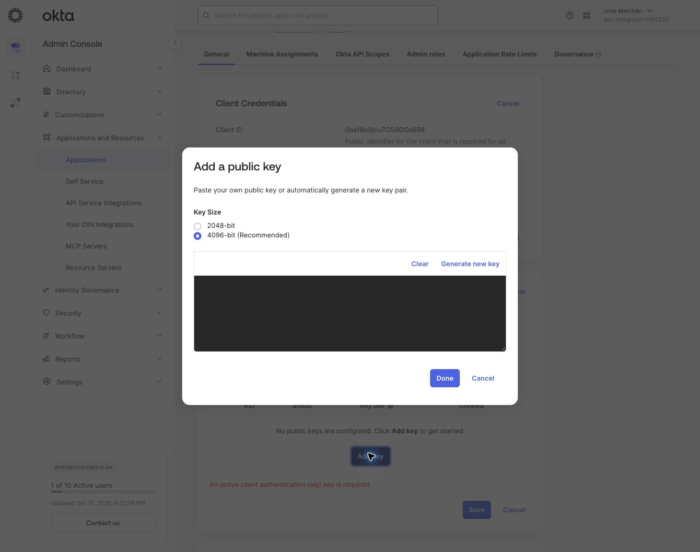
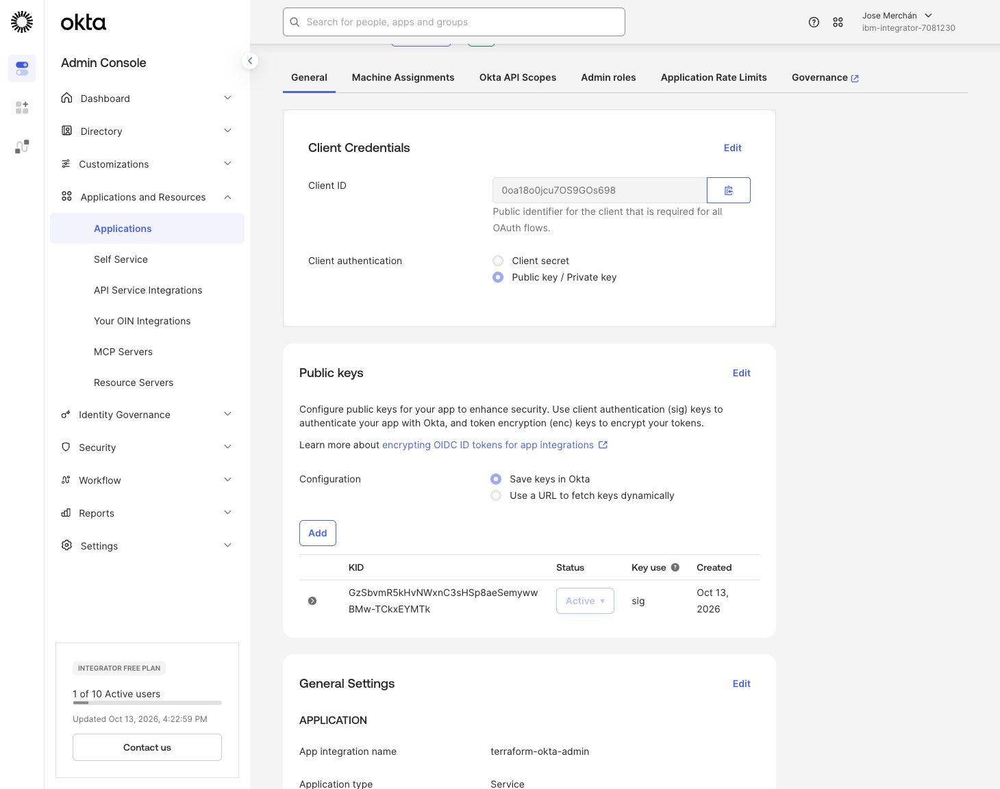
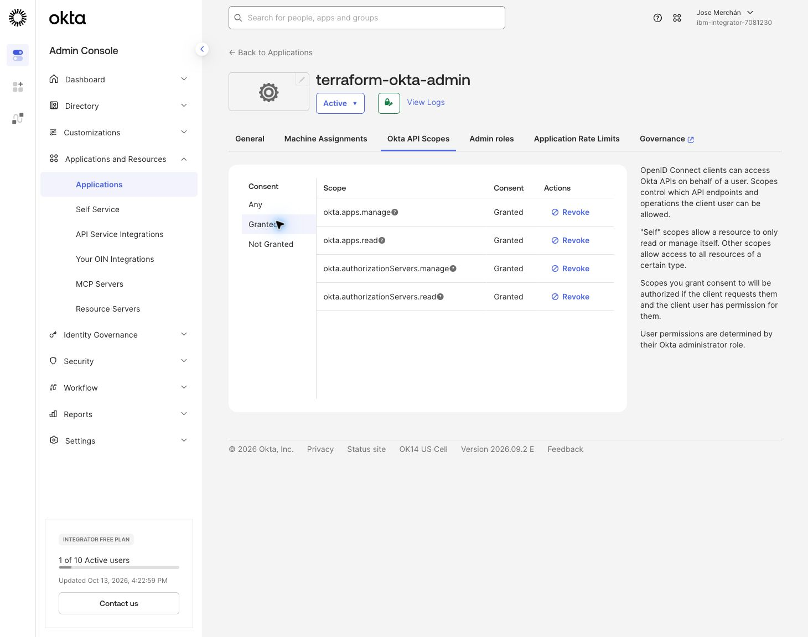
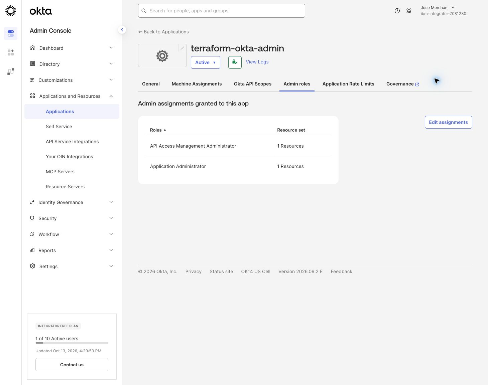
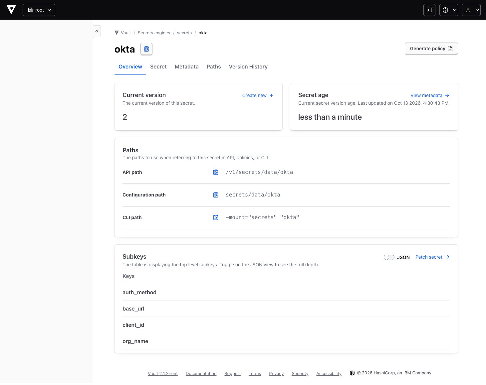

# Okta y Vault: acceso inicial de Terraform

Configuración realizada el 13 de octubre de 2026 mediante Chrome. Esta fase prepara la identidad con la que Terraform administrará Okta. La configuración del agente y de Agentic IAM en Vault corresponde a la siguiente fase.

## Resultado verificado

| Componente | Configuración |
|---|---|
| Organización Okta | `integrator-7081230.okta.com` |
| Plan observado | Integrator Free Plan |
| Aplicación | `terraform-okta-admin` |
| Tipo | API Services / Service |
| Client ID | `0oa18o0jcu7OS9GOs698` |
| Autenticación | OAuth 2.0 Client Credentials con `private_key_jwt` |
| Clave | RSA de 4096 bits; clave pública activa en Okta |
| Vault | `https://127.0.0.1:8443`, versión `2.1.2+ent` |
| Secreto | Motor KV v2 `secrets`, ruta `okta`, versión 2 |
| Prueba | Terraform 1.15.8, provider `okta/okta` 7.0.0; lectura real del servidor `default` completada |

No se guardan claves privadas ni tokens en este repositorio. Las capturas muestran configuración pública o valores ocultos.

## 1. Crear la aplicación para Terraform

En Okta, abrir **Applications and Resources → Applications → Create App Integration**. Seleccionar **API Services** y pulsar **Next**.



Introducir `terraform-okta-admin`, seleccionar **Use Okta-generated client ID** y guardar. El Client ID generado identifica esta aplicación; debe conservarse junto con la configuración del provider.



## 2. Generar y registrar las claves

En la pestaña **General**, abrir **Public keys → Edit → Add key**. Mantener **4096-bit (Recommended)** y seleccionar **Generate new key**.



Seleccionar **PEM** en la clave privada y conservarla de forma segura antes de cerrar el diálogo: Okta solo la muestra una vez. En esta ejecución se transfirió directamente al formulario de Vault a través de Chrome, sin escribirla en un archivo local ni capturarla en una imagen.

Pulsar **Done**, guardar la sección **Public keys** y comprobar que la clave aparece **Active**, con uso `sig`. En **Client Credentials → Edit**, seleccionar **Public key / Private key** y guardar. Okta avisa de que sustituye el client secret generado inicialmente; ese client secret inicial no se utiliza.



En esta ejecución la clave privada se convirtió en memoria a PEM PKCS#1 antes de guardar la versión 2 en Vault. La conversión conserva la misma clave pública. El provider actual también documenta soporte de PEM PKCS#8.

La opción DPoP que presentaba la aplicación se mantuvo habilitada; la autenticación con el provider 7.0.0 funcionó en la prueba realizada.

## 3. Conceder los scopes de las APIs

En **Okta API Scopes**, conceder exclusivamente estos scopes y verificar el filtro **Granted**:

| Scope | Uso |
|---|---|
| `okta.apps.read` | Consultar aplicaciones |
| `okta.apps.manage` | Crear y gestionar aplicaciones |
| `okta.authorizationServers.read` | Consultar servidores de autorización |
| `okta.authorizationServers.manage` | Gestionar servidores de autorización y su configuración |



## 4. Asignar los roles administrativos

En **Admin roles → Edit assignments**, asignar:

- **Application Administrator**, sin limitarlo a aplicaciones existentes, para permitir la creación de las aplicaciones de la demo.
- **API Access Management Administrator**, cuyo alcance, según la consola, abarca toda la organización.

Guardar con **Save Changes** y comprobar que ambos roles aparecen en la aplicación. No se asignó Super Administrator ni Organization Administrator. Estos dos roles siguen dando capacidad administrativa sobre las aplicaciones y los servidores de autorización de la organización; los cuatro scopes delimitan las APIs que puede solicitar este cliente.



## 5. Guardar la configuración en Vault

En Vault, abrir **Secrets engines → secrets → Create secret**, con ruta `okta`. Guardar estos campos:

| Campo | Contenido |
|---|---|
| `auth_method` | `private_key_jwt` |
| `base_url` | `okta.com` |
| `org_name` | `integrator-7081230` |
| `client_id` | Client ID de `terraform-okta-admin` |
| `private_key_id` | KID de la clave pública activa |
| `private_key` | Clave privada PEM, preservando sus saltos de línea |
| `scopes` | Los cuatro scopes anteriores, separados por comas |

Durante esta ejecución el formulario de pares clave/valor devolvió `no data provided`. El guardado se completó desde el editor **JSON** y se verificó posteriormente leyendo el secreto. No incluir el JSON real en documentación ni capturas.

Rutas del secreto:

- API: `/v1/secrets/data/okta`
- ACL de lectura KV v2: `secrets/data/okta`
- CLI: `vault kv get -mount=secrets okta` — muestra los valores; evitarlo en terminales grabados o compartidos.
- Metadatos, sin mostrar la clave: `vault kv metadata get -mount=secrets okta`



## 6. Comprobación de autenticación con Terraform

La configuración se verificó fuera de la carpeta sincronizada, en un directorio temporal. Un proceso leyó `/tmp/vault/config.env`, validó TLS con `/tmp/vault/vault.ca` y recuperó la versión 2 de `secrets/okta`. La clave se pasó al proceso Terraform mediante variables de entorno, sin usar un data source de Vault que incorporase el secreto al estado.

| Campo de Vault | Variable de entorno del provider |
|---|---|
| `org_name` | `OKTA_ORG_NAME` |
| `base_url` | `OKTA_BASE_URL` |
| `client_id` | `OKTA_API_CLIENT_ID` |
| `private_key_id` | `OKTA_API_PRIVATE_KEY_ID` |
| `private_key` | `OKTA_API_PRIVATE_KEY` |
| `scopes` | `OKTA_API_SCOPES` |

La prueba utilizó `provider "okta"` con credenciales del entorno y un único data source `okta_auth_server` con `name = "default"`. Se ejecutaron `terraform fmt -check`, `terraform validate` y `terraform plan`. No se ejecutó `apply`.

Resultado observado:

```text
Success! The configuration is valid.

data.okta_auth_server.default: Reading...
data.okta_auth_server.default: Read complete after 2s [id=aus18epnuvgGHFWvA698]

No changes. Your infrastructure matches the configuration.
```

Esta prueba confirma que Terraform pudo recuperar la credencial desde Vault, autenticarse en Okta y consultar el servidor de autorización. No prueba todavía operaciones de escritura, emisión de tokens para el agente ni acceso Agentic IAM a Vault.

## Referencias

- [Habilitar acceso de Terraform a Okta](https://developer.okta.com/docs/guides/terraform-enable-org-access/main/)
- [Configuración y variables del provider Okta](https://github.com/okta/terraform-provider-okta/blob/master/docs/index.md)
- [Agentic IAM de Vault](https://developer.hashicorp.com/vault/ai)

Las capturas adicionales del formulario de Vault y de la asignación de roles se conservan en `docs/screenshots/` para ampliar los pasos de instalación.
