# IBM Verify + Vault Agentic IAM

**Contratación con CIBA:** Writer formaliza un borrador propio tras la confirmación de Validador en Verify. Vault entrega una credencial SQL de EXECUTE y MySQL registra el contrato; después Writer descarga su PDF mediante OBO. [Preparación, límites y verificación](../docs/manual/17-contratacion-ciba.md).

> Este documento conserva el ejercicio base `verify-agent` y su bootstrap por UI. Para desplegar **Lumen completo**, usar [`./demo.sh`](../README.md): no requiere la sesión `verify-human-session` ni ejecutar este notebook. La configuración RAR/perfil compartida se prepara con `scripts/configure-base.sh`. Los resultados y capturas siguientes corresponden a sus fechas de ejecución. La retirada completa del 14/10/2026 eliminó aquel estado de Vault; `start` recrea las identidades de Lumen, no `verify-agent`. El [informe end-to-end](../docs/E2E_VERIFICATION.md) acredita aquella ejecución; el alcance de revisiones posteriores se recoge en [VALIDACION](../docs/manual/VALIDACION.md).

Para practicar con **oauth2c y los clientes actuales de Lumen**, utiliza el [notebook 10](../10_OAuth2c_Verify_Vault.ipynb): Client Credentials, Authorization Code + PKCE, OBO con RAR, acceso directo a Vault e inspección de tokens. Usa `chatbot/oidc`, `chatbot/sts` y `chatbot/research`; no depende de las identidades ni sesiones del ejercicio histórico de abajo. [Validación local y alcance](docs/oauth2c-notebook-validation.json).

La [revisión local del 22/10](../docs/WORKSPACE_REVIEW.md#revisión-del-22-de-octubre-de-2026)
comprueba también estos scripts y notebooks. Los usuarios nuevos de Lumen se crean
con activación pendiente hasta instalar su contraseña definitiva; así se puede
reanudar si se pierde la respuesta del POST. [Procedimiento manual](../docs/manual/03-verify.md#5-crear-los-tres-usuarios-de-prueba).

Tenant: `https://merchan.verify.ibm.com`. Configuración del laboratorio siguiendo la [guía de HashiCorp](https://developer.hashicorp.com/vault/ai/iam/providers/verify).

## Estado

**13 de octubre de 2026:** integración aplicada y verificada en el namespace **`verify`** de Vault. Funcionan el acceso autónomo con Client Credentials y la delegación OBO mediante Token Exchange. Han pasado las ocho pruebas de acceso y denegación del [informe de ejecución](docs/api-verification.json).

El [notebook de configuración Bash/API](5_IBM_Verify_Vault_Agentic_IAM_Bash.ipynb) contiene los scripts completos, peticiones JSON y pasos de ejecución. Usa celdas `%%bash` sobre el kernel IPython; la implementación no contiene scripts Python. El bootstrap administrativo se hizo una vez mediante Chrome; la aplicación, RAR, STS y los recursos de Vault se configuran por API.

Las capturas 01–05 documentan el formulario durante su preparación; las capturas 06–08 muestran la configuración guardada y la custodia en Vault. Las capturas 09–12 muestran los recursos de la integración completada por API.

La integración anterior con Okta se conserva en [../okta/](../okta/README.md). Este procedimiento no cambia sus recursos.

## 0. Crear un usuario en Verify

En **Identidades → Usuarios y grupos → Usuarios**, pulsar **Añadir usuario**. El formulario permite seleccionar **Cloud Directory** o **IBMid** como proveedor de identidades.

1. Seleccionar el proveedor que utilizará el usuario para autenticarse. La captura del formulario muestra la opción **IBMid**.
2. Mantener **Estado → Activado**.
3. Rellenar **Nombre de usuario** y **Correo electrónico preferido**. Para una cuenta que vaya a iniciar sesión, usar su identificador real en el proveedor elegido y un correo accesible.
4. Completar **Nombre** y **Apellidos** si procede. Los demás datos de perfil y contacto son opcionales; **Segundo nombre** aparece deshabilitado en el formulario consultado.
5. Pulsar **Guardar** y abrir la ficha del usuario para comprobar su estado, dominio e **ID de usuario**. El ID lo asigna Verify: no se introduce manualmente.

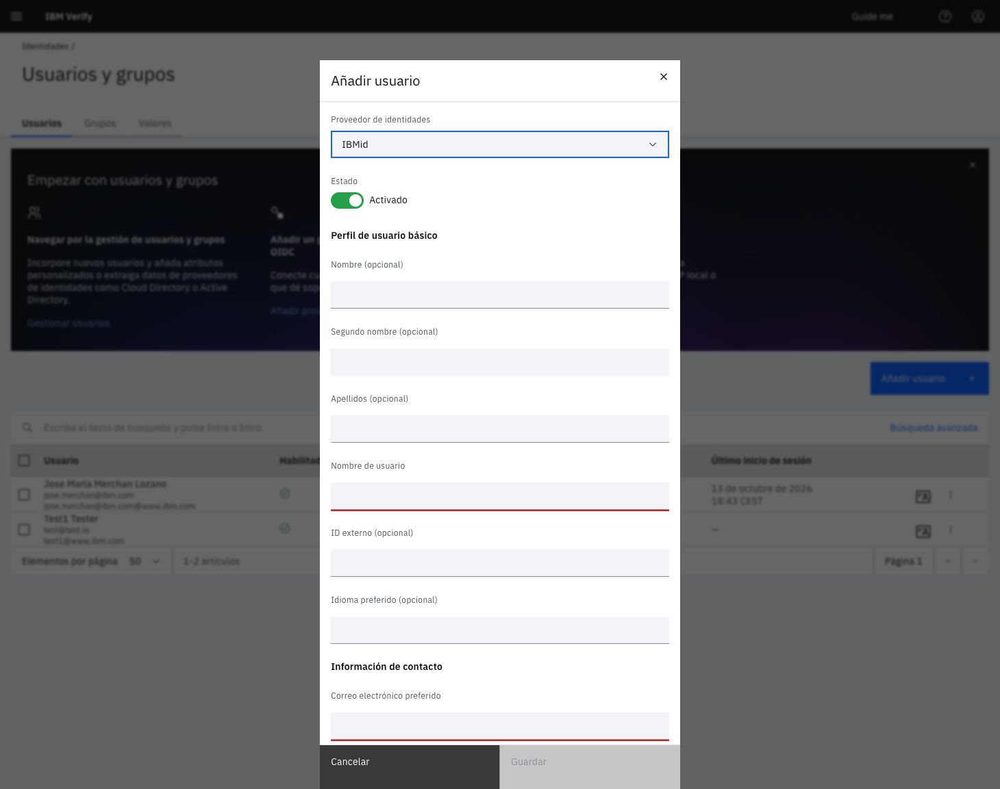

### Usuario de ejemplo existente

La [ficha de Test1 Tester](https://merchan.verify.ibm.com/ui/admin/directory/users-and-groups/users/6470001HRI), consultada el 13 de octubre de 2026, muestra:

| Campo | Valor observado |
|---|---|
| Nombre de usuario | `test1` |
| Nombre completo | `Test1 Tester` |
| Nombre / Segundo nombre / Apellidos | `Test1` / `Tester` / sin valor |
| Correo electrónico preferido | `test@test.io` |
| Dominio | `www.ibm.com` |
| ID de usuario | `6470001HRI` |
| Estado | Habilitado |
| Creado el | 13 de octubre de 2026, 18:09 CEST |
| Grupos / identidades enlazadas | 0 / 0 |
| Último inicio de sesión | Sin registro |

Esta captura documenta el usuario ya existente. Para documentar el alta se abrió el formulario y se cerró sin guardar; no se creó otra cuenta ni se modificó `test1`.

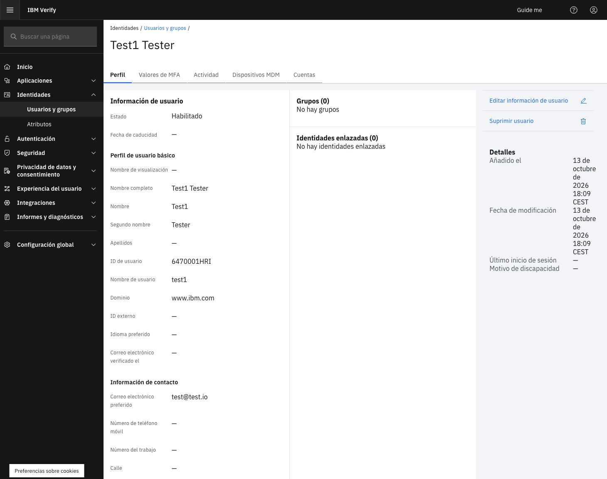

### Relación con la prueba OBO

Crear la ficha de directorio no acredita que el usuario pueda autenticarse. En particular, esta revisión no ha probado el acceso de `test1`. Las ocho pruebas OBO documentadas más abajo se ejecutaron con el usuario humano de ID `64300857U3`, distinto de este ejemplo.

Para incorporar este usuario a una prueba OBO hay que comprobar primero su autenticación, obtener su token con PKCE y configurar en Vault la entidad, el alias y las políticas correspondientes a su `sub`. Después se deben repetir las pruebas. El notebook actual conserva la configuración del humano ya probado; la creación de esta ficha no añade automáticamente una identidad autorizada en Vault.

## 1. Configuración general

En **Aplicaciones → Añadir aplicación → OpenID Connect**:

| Campo | Valor |
|---|---|
| Nombre | `vault-authn-entry` |
| Empresa | `Merchan LTD`, ya introducido por el usuario |
| Propietario | Jose Maria Merchan Lozano, ya seleccionado |
| Descripción | Laboratorio Vault Agentic IAM: autenticación OIDC de usuarios y agentes, con delegación OBO mediante STS. |
| Habilitado / Mostrar en el launchpad | Marcados |

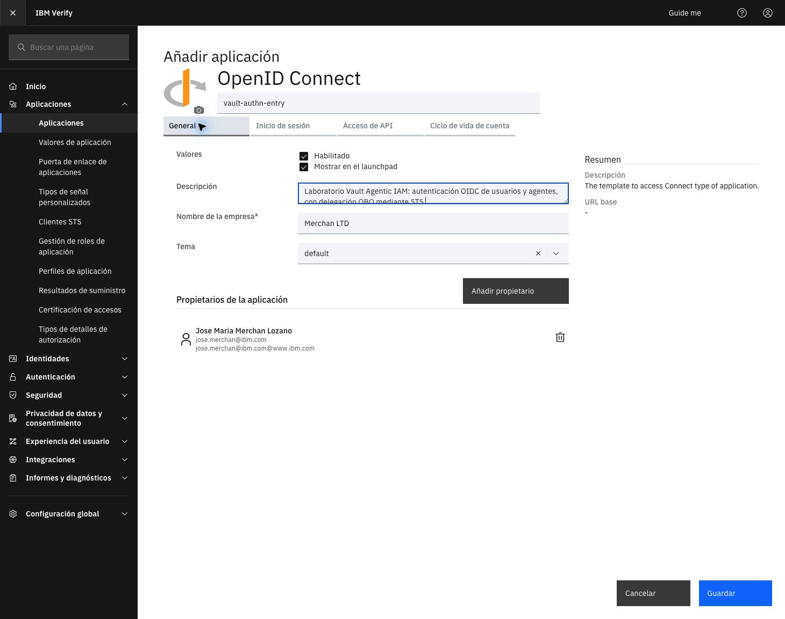

## 2. Grants y respuestas

En **Inicio de sesión**:

| Campo | Valor |
|---|---|
| Dirección URL de la aplicación | `https://127.0.0.1:8443/ui/` |
| Grants | Código de autorización, Credenciales del cliente y ROPC |
| Tipo de respuesta | Solo `código` |
| Modalidad de respuesta | Solo `Consulta` (`query`) |
| Inhabilitar inicio de sesión | Desmarcado |

La URL de aplicación abre Vault localmente desde este Mac. Es un punto de entrada del laboratorio; no configura por sí misma el inicio de sesión de la UI de Vault con Verify.

ROPC ya estaba seleccionado y se conserva para reproducir la demostración de la guía. HashiCorp limita su uso a desarrollo. El flujo con navegador seguirá usando Authorization Code y PKCE.

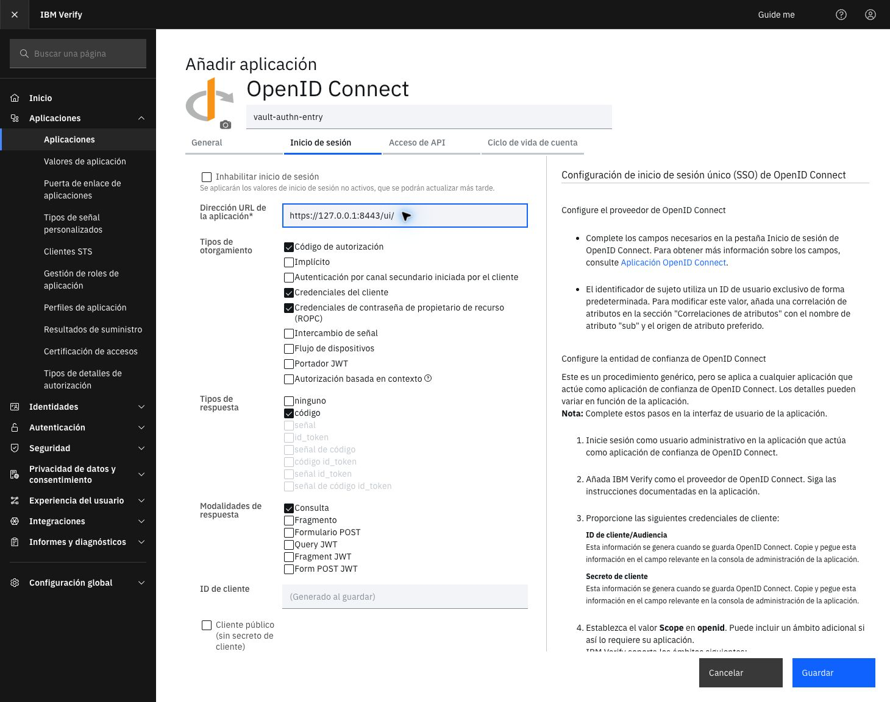

## 3. Cliente y callback

| Campo | Valor |
|---|---|
| Cliente público (sin secreto de cliente) | Desmarcado: cliente confidencial |
| URI de redirección | `http://localhost:9876/callback` |
| Autenticación de cliente | Secreto de cliente básico (`client_secret_basic`) |
| Requiere PKCE | Marcado |
| Requiere PAR | Desmarcado |

El callback será atendido por el script OAuth local cuando se ejecute la prueba. No es la URL de Vault. El Client ID y el secreto se generaron al guardar y se almacenaron mediante Chrome en KV v2 `secrets/verify`, dentro del namespace `verify`. Los archivos y capturas del proyecto no contienen el secreto.

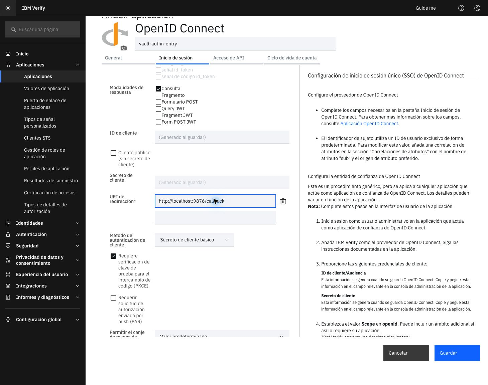

## 4. Tokens

| Campo | Valor |
|---|---|
| Formato del access token | `JWT` |
| Caducidad del access token | `3600` segundos |
| Generar token de renovación | Marcado |
| Caducidad del refresh token | `86400` segundos |
| Renovar duración del refresh token | Desmarcado |
| Algoritmo de firma | `RS256` |
| Audiencias adicionales | Sin añadir; se deberá verificar `aud` en el JWT emitido |

El campo **URI JWKS** de esta aplicación se deja vacío: está destinado a las claves del cliente, no a copiar el JWKS del servidor Verify.

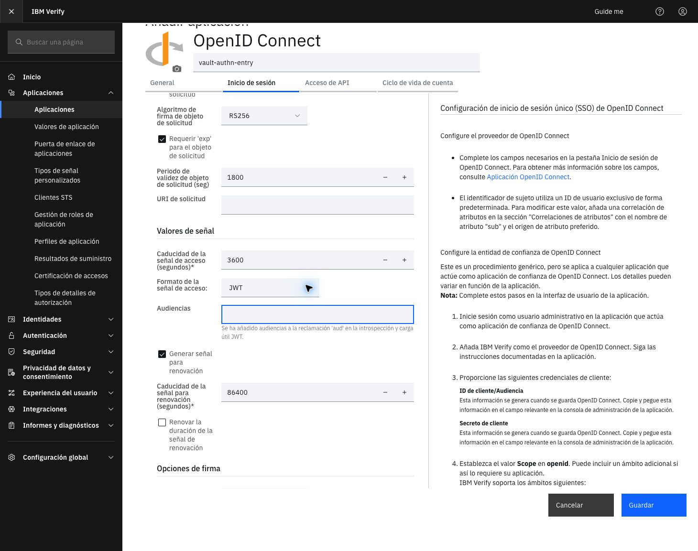

## 5. Scopes

Activar **Restringir ámbitos personalizados** y añadir `email`, `openid` y `profile`. Se conserva la restricción de acceso a API con cero permisos administrativos de usuario y no usuario.

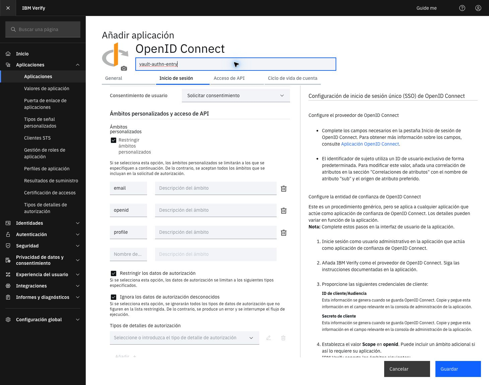

## 6. Guardar y asignar acceso

Guardar la aplicación. En **Titularidades**, seleccionar **Acceso automático para todos los usuarios y grupos**, guardar y aceptar la actualización del flujo de trabajo. Este es el acceso elegido para el laboratorio siguiendo la guía.

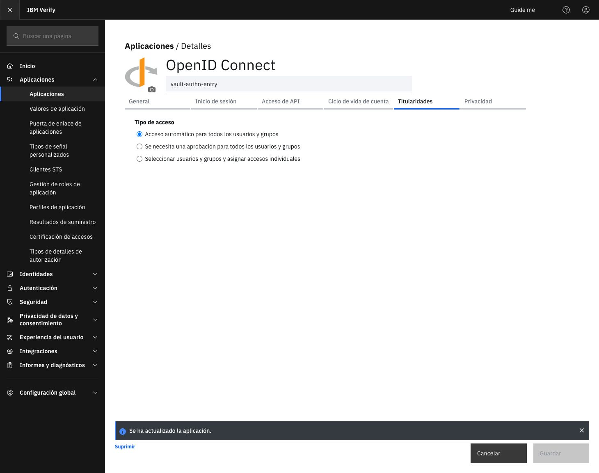

## 7. Preparar may_act para OBO

En **Inicio de sesión → Configuración de punto final → Introspección → Editar**:

1. Desplegar la flecha junto a **Añadir atributo** y seleccionar **Añadir regla personalizada**.
2. Introducir `{"client_id":"<CLIENT_ID_REAL_DE_LA_APLICACIÓN>"}`.
3. Usar `may_act` como atributo de destino, aceptar y guardar la aplicación.

Se ha guardado la regla con el Client ID real, sin regenerar la credencial. La ejecución posterior comprobó `may_act.client_id` en el token humano obtenido con Authorization Code + PKCE y completó el intercambio OBO. El JWT de Client Credentials no contiene `may_act`: esa claim corresponde al token del sujeto humano.

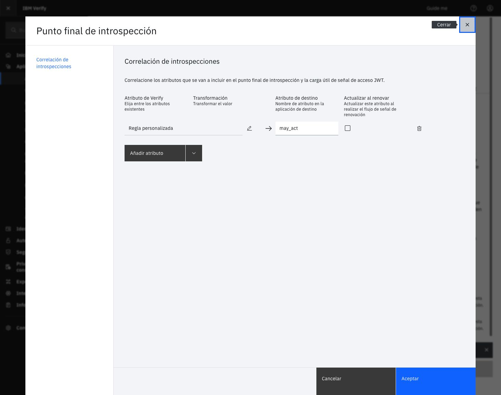

## 8. Guardar la credencial en el namespace verify

El namespace `verify` y su motor KV v2 `secrets/` están creados. En la UI de Vault:

1. Seleccionar **verify** en el selector de namespaces.
2. Abrir **Secrets → secrets/ → Create secret**.
3. Introducir `verify` como ruta y activar **JSON**.
4. Guardar `client_id`, `client_secret` y los metadatos OIDC: `tenant`, `issuer`, `authorization_endpoint`, `token_endpoint`, `jwks_uri`, `redirect_uri`, `auth_method` y `scopes`.
5. Comprobar la vista **Overview**, versión 1, sin mostrar valores sensibles.

| Elemento | Valor |
|---|---|
| Namespace | `verify` |
| Motor KV v2 | `secrets/` |
| Ruta relativa | `verify` |
| API con cabecera `X-Vault-Namespace: verify` | `/v1/secrets/data/verify` |
| API con namespace incorporado en la URL | `/v1/verify/secrets/data/verify` |

Para comprobar únicamente los metadatos desde el Mac, con la CLI de Vault instalada:

```sh
source /tmp/vault/config.env
vault kv metadata get -namespace=verify -mount=secrets verify
```

Para scripts posteriores, usar `VAULT_NAMESPACE=verify` o `-namespace=verify`. El bootstrap se hizo mediante UI y la configuración posterior se automatizó con Bash/API, como se describe a continuación. No hay recursos Terraform de IBM Verify gestionándola.

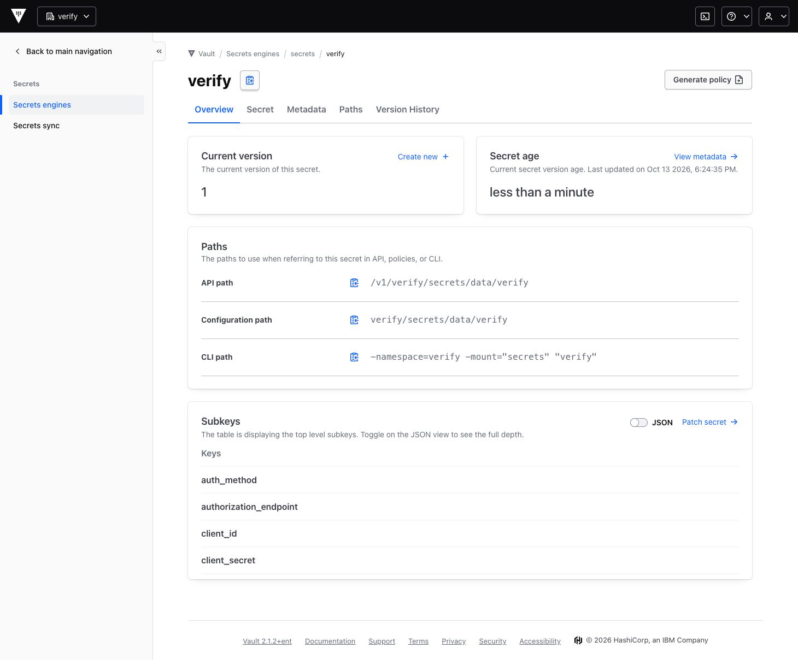

## 9. Automatización Bash/API

Abrir el [notebook](5_IBM_Verify_Vault_Agentic_IAM_Bash.ipynb) desde la raíz del proyecto o desde `verify/`, con el kernel Python 3/IPython disponible. Ejecutar sus celdas en orden. Requiere Bash, `curl`, `jq`, `vault`, `openssl` y `nc` de macOS, además de Vault accesible y `/tmp/vault/config.env` con la dirección, token y CA.

El cliente administrativo **vault-verify-automation** tiene cuatro permisos: `manageAppAccessAdmin`, `manageSTSClients`, `manageAuthDetailTypes` y `readUsers`. Sus credenciales se recuperan desde Vault. El cliente STS **vault-obo-sts** exige sujeto y actor, admite `vault:path_access`, rechaza tipos desconocidos y emite JWT RS256 de 600 segundos. No tiene permisos administrativos de Verify.

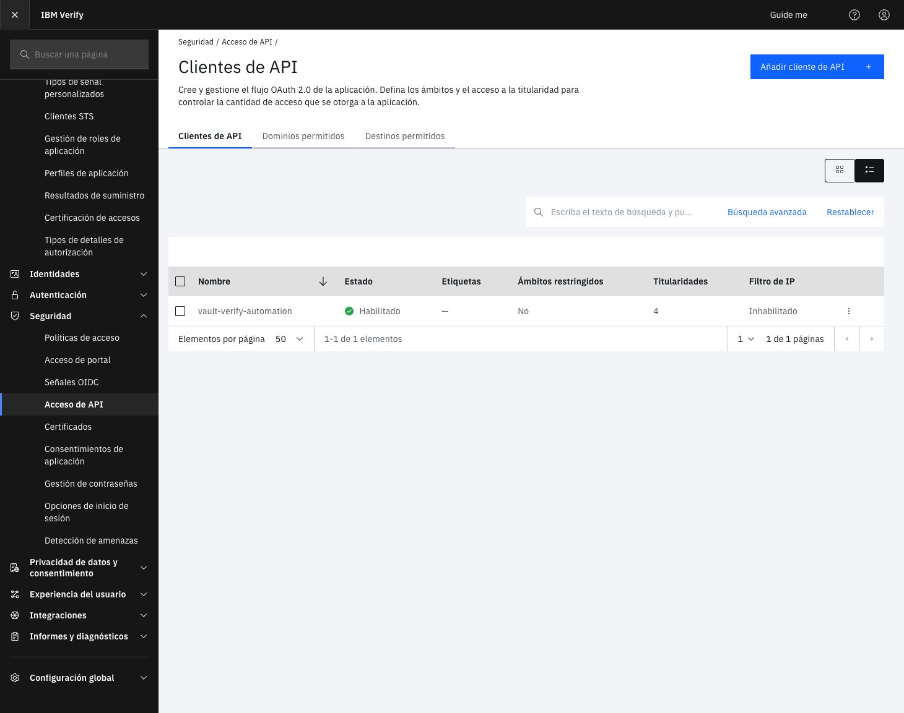

| Script | Acción |
|---|---|
| `scripts/00-preflight.sh` | Comprueba conectividad, namespace, KV y bootstrap |
| `scripts/01-inventory.sh` | Consulta el inventario sin mostrar credenciales |
| `scripts/02-configure-verify.sh` | Actualiza la aplicación, crea o reutiliza RAR y STS |
| `scripts/03-human-login.sh` | Login humano con navegador, Authorization Code y PKCE |
| `scripts/04-configure-vault.sh` | Comprueba el humano en el directorio y configura perfil, entidades, aliases, políticas y agente |
| `scripts/05-test-access.sh` | Intercambia tokens y ejecuta ocho pruebas de acceso |

El login humano muestra una URL que se abre en Chrome y espera el callback en `http://localhost:9876/callback`. El usuario completa IBMid y el consentimiento. Para repetir la demostración tras caducar el token humano, ejecutar las etapas 5 y 7 del notebook. La configuración se ha reaplicado sin duplicar los recursos gestionados.

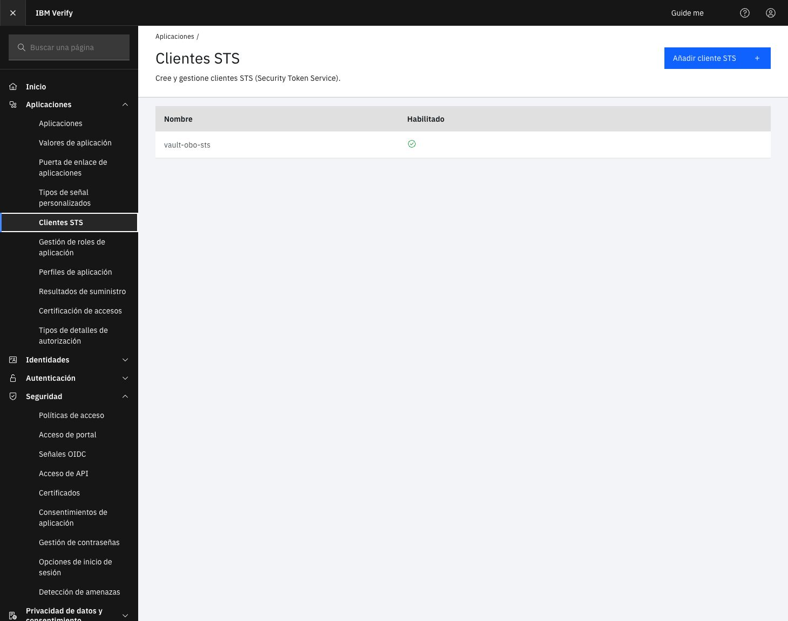

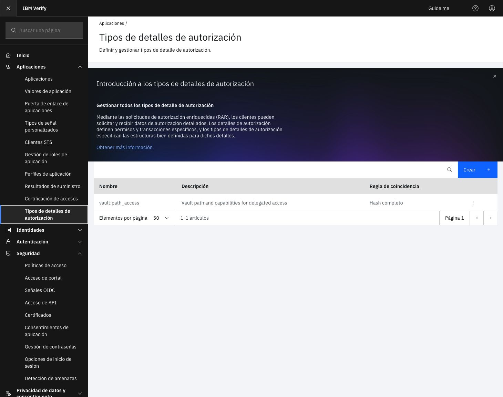

Todas estas rutas KV están dentro del namespace `verify`, motor `secrets/`:

| Ruta | Contenido |
|---|---|
| `verify` | Credencial OAuth de la aplicación |
| `verify-admin` | Credencial administrativa del bootstrap |
| `verify-sts` | Credencial del cliente Token Exchange |
| `verify-config` | Identificadores de aplicación, STS y tipo RAR |
| `verify-human-session` | Sesión OAuth del humano |
| `verify-delegated-session` | Token delegado OBO |
| `verify-identities` | Identificadores de humano, agente y entidades |

Los scripts usan temporales privados fuera de Google Drive y los eliminan al terminar. Las salidas del notebook están limpias; el informe conserva resultados sin JWT ni secretos.

## 10. Perfil y límites de acceso en Vault

El perfil OAuth `verify` valida issuer, JWKS, firma RS256 e identidades registradas. Se configura **`actor_claim="actor-token.sub"`**, que corresponde al mapeo personalizado del STS. El valor predeterminado `act.sub` no identifica al actor en los JWT emitidos por este laboratorio. Las rutas RAR son relativas al namespace: `secrets/data/agentic-demo/shared`, sin prefijo `verify/`.

El perfil no configura `audiences`, siguiendo la limitación del STS descrita en la [guía de HashiCorp para Verify](https://developer.hashicorp.com/vault/ai/iam/providers/verify). Por tanto, estas pruebas no acreditan una restricción por audiencia. El perfil exige RAR; únicamente el registro de `verify-agent` tiene `optional_authorization_details=true` para su acceso autónomo. Si el token contiene RAR, sus restricciones siguen aplicándose.

La política del humano permite leer `shared` y `human-only`; el límite del agente permite solo leer `shared`. OBO respeta la intersección de la política humana, el límite del agente y RAR.

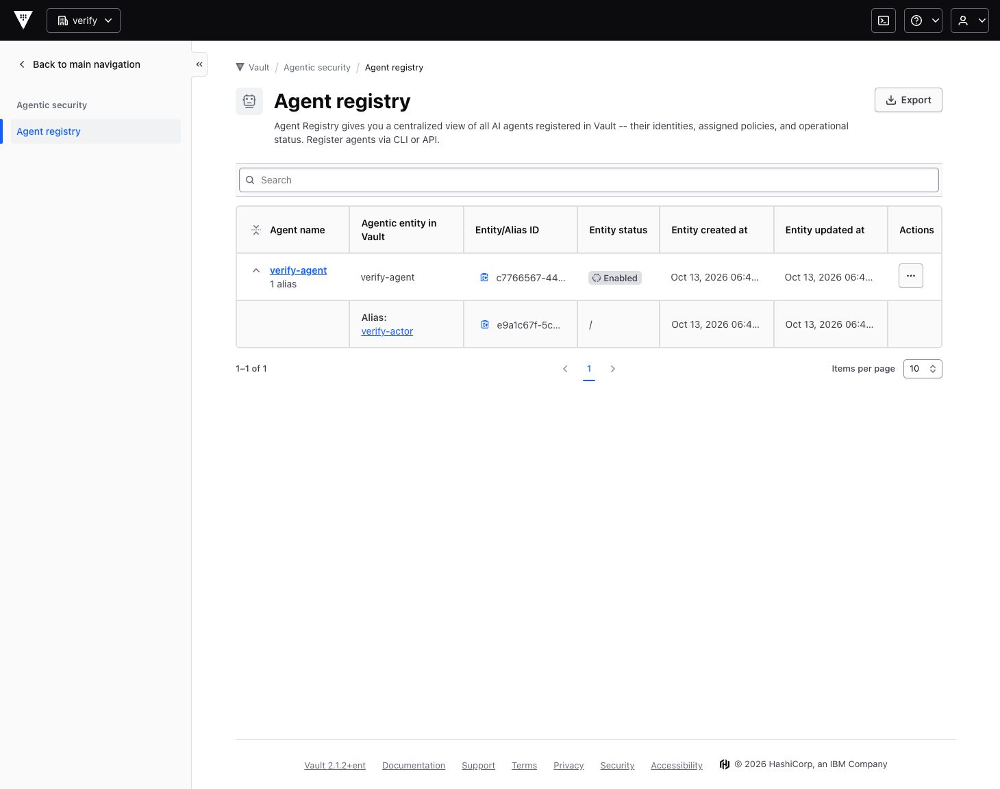

## 11. Verificación realizada

El [informe de pruebas](docs/api-verification.json) registra ocho resultados correctos. Las lecturas positivas confirman que Vault acepta la firma del token y las identidades. Se incluyen pruebas separadas para aislar el límite del agente y la restricción RAR.

| Prueba | HTTP esperado y obtenido |
|---|---|
| Lectura autónoma de `shared` | 200 |
| Escritura autónoma | 403 |
| Lectura OBO de `shared` | 200 |
| Escritura OBO | 403 |
| Lectura OBO de `human-only` | 403 |
| Lectura OBO del secreto administrativo | 403 |
| Lectura permitida por humano y RAR, denegada por el límite del agente | 403 |
| Lectura permitida por las políticas, denegada por RAR | 403 |

El [informe inicial de Client Credentials](docs/client-credentials-check.json) se conserva como evidencia de la primera comprobación. El informe de ocho pruebas es la evidencia posterior de acceso efectivo a Vault. Los scripts se ejecutaron directamente; los contadores de las celdas del notebook se entregan sin ejecución ni salidas guardadas.

Discovery consultado el 13 de octubre de 2026: `https://merchan.verify.ibm.com/oauth2/.well-known/openid-configuration`. [Metadatos públicos observados](docs/discovery.json):

| Parámetro | Valor |
|---|---|
| Issuer | `https://merchan.verify.ibm.com/oauth2` |
| Autorización | `https://merchan.verify.ibm.com/oauth2/authorize` |
| Token | `https://merchan.verify.ibm.com/oauth2/token` |
| JWKS del servidor | `https://merchan.verify.ibm.com/oauth2/jwks` |

Client Credentials y Token Exchange se han probado contra este tenant, incluido el acceso OBO a Vault y sus límites de autorización.

## Chatbot Lumen

La integración base se amplía con [Lumen](../chatbot/README.md): usuarios Cloud Directory, grupos, OIDC, OBO a MySQL y un agente autónomo para Tavily. Los pasos y capturas están en el [notebook 6](../6_Lumen_Chatbot_Vault_IAM.ipynb). El cliente de automatización dispone además de `manageUserStandardGroups` y `manageUsersPwdReset`, aprobados para crear y activar los usuarios de prueba.
